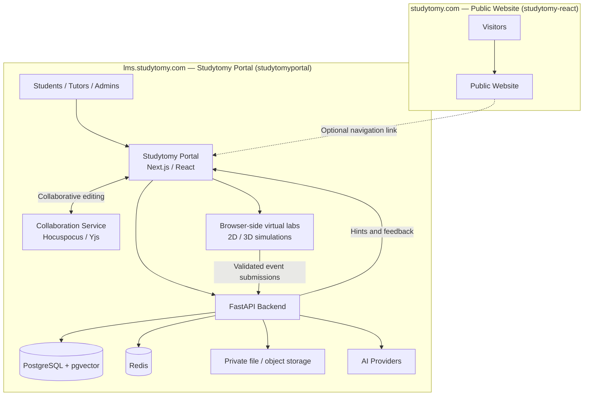

# Studytomy

**AI-assisted learning, trusted tutoring, and measurable progress.**

Studytomy is a proposed Australian curriculum-focused learning platform combining structured courses, educator-led tutoring, context-aware AI assistance, assessments, interactive learning, and evidence-based progress tracking. The initial target market is Australia (a Victorian pilot, subject to client approval), with engineering delivery supported from Sri Lanka.

> [!IMPORTANT]
> **Project status — modernization and migration planned.** This README is the target product and engineering charter, not a statement that the new Studytomy platform is already implemented or deployed. The current [Studytomy website](https://www.studytomy.com/) and its [legacy repository](https://github.com/nirzaf/studytomy-react) are separate from the proposed modernized platform. The upstream open-source LMS provides a starting point; all Studytomy-specific integrations require implementation and verification.

## Contents

- [Product vision](#product-vision)
- [Scope and delivery status](#scope-and-delivery-status)
- [Target architecture](#target-architecture)
- [Technology choices](#technology-choices)
- [User journeys](#user-journeys)
- [AI and virtual laboratory principles](#ai-and-virtual-laboratory-principles)
- [Repository organization](#repository-organization)
- [Getting started](#getting-started)
- [Migration strategy](#migration-strategy)
- [Security, privacy, and governance](#security-privacy-and-governance)
- [Engineering standards](#engineering-standards)
- [Roadmap and acceptance gates](#roadmap-and-acceptance-gates)
- [Decisions still required](#decisions-still-required)
- [Licensing and acknowledgments](#licensing-and-acknowledgments)

## Product vision

Studytomy is intended to help students learn, practise, receive feedback, and improve while giving tutors a controlled way to author educational material, guide students, and review learning evidence. AI assists teachers and learners; it is not the authority for curriculum accuracy, final academic decisions, or scientifically valid experiments.

### Target audiences

| Audience | Intended value |
|---|---|
| **Students** | Curriculum-linked lessons, guided explanations, practice, and understandable feedback. |
| **Tutors and educators** | Course authoring, assessment generation, submissions, marking, and intervention insights. |
| **Parents / guardians** | Authorized visibility into a child's progress and next steps (planned, not standard LMS functionality). |
| **Administrators** | User/content access, tutoring operations, course publication, and platform oversight. |
| **Studytomy operations** | Lead handling, scheduling, reporting, and eventually reviewed marketing intelligence. |

### Product principles

- **Education first**: Explain concepts, support genuine practice, and validate assessed outcomes.
- **Human oversight**: Educators approve reference content and review subjective or uncertain marks.
- **Reuse before rebuilding**: Preserve upstream LMS functionality and implement only demonstrable gaps.
- **One authoritative backend**: Native FastAPI services and PostgreSQL; no Supabase in the target runtime.
- **Small, verifiable releases**: Prove a complete learner workflow before expanding subjects, markets, or AI modalities.
- **Privacy by design**: Explicit permissions for minors, guardians, staff, and AI service providers.

## Scope and delivery status

Use these terms consistently:

- **Upstream OSS capability**: Available in the selected open-source LMS codebase; not evidence that Studytomy has configured or deployed it.
- **Legacy capability**: Present in the previous Studytomy application; must be retained, replaced, or migrated deliberately.
- **Planned**: Studytomy-specific development that requires approval, implementation, and tests.
- **Conditional**: Enabled only if the client chooses it or the required third-party service is configured.

### Foundation capabilities to reuse

| Capability | Source / status | Delivery note |
|---|---|---|
| Course catalogue, chapters, learning activities | Upstream OSS | Configure Studytomy subjects, visibility, and approved content. |
| Rich editor, video/PDF lessons, interactive blocks | Upstream OSS | Editor authoring is documented as desktop-focused. |
| Quizzes, assignments, submissions | Upstream OSS | Includes multiple choice, fill-in-the-blanks, short/numeric answers, code, and file submissions. |
| Supported automatic grading and tutor feedback | Upstream OSS | Code grading needs a configured execution service; file submissions require teacher review. |
| Learning paths, progression, completion records, certificates | Upstream OSS | Completion is not an estimate of concept mastery. |
| Lesson-level contextual AI, AI-assisted course/question drafting | Upstream OSS + configuration | Requires an approved AI provider and validated learning content. |
| Collaborative boards, communities, resource library, playgrounds | Upstream OSS | Interactive playgrounds are not scientifically validated labs. |
| Roles, groups, invitations, authentication, MFA | Upstream OSS | Extend for parental/guardian relationships when approved. |
| Branding, public landing pages, SEO, search | Upstream OSS | Compare against existing website URLs and conversion journeys. |
| Headless APIs, webhooks, scoped integrations, MCP | Upstream OSS + configuration | Enable only the endpoints and permissions needed. |

### Studytomy modernization requirements

| Feature | Proposed scope | Status |
|---|---|---|
| AI diagnostic assessments | Curriculum-objective mapping, evidence-backed gaps, optional adaptive questions. | Planned |
| Personalized study plans | Tutor-editable learning plans informed by assessment and available study time. | Planned |
| Australian senior-secondary / ATAR preparation | Approved state-specific content, mock assessments, marking schemes, practice workflows. | Planned |
| AI-generated examination papers | Syllabus-aligned blueprints, controlled question variation, validated answers, tutor approval, export. | Planned |
| Advanced marking | Structured solution steps, rubric-based feedback, uncertainty escalation; handwriting/essays by explicit scope. | Planned |
| Student, guardian and tutor progress views | Authorized progress, results, review tasks, and evidence-backed summaries. | Planned |
| Virtual science laboratories | Validated 2D/3D experiments, measurements, mistakes, experiment records, and scoring. | Planned |
| AI marketing assistant | Draft creatives/copy, campaign recommendations, reviewed publishing workflow. | Planned / optional |
| NSW and Victoria market intelligence | Evidence-labelled research into subject/year demand using approved public data and Studytomy enquiry trends. | Planned / optional |

### Public website and legacy workflow separation

The public website (`studytomy.com` / `www.studytomy.com`, [`nirzaf/studytomy-react`](https://github.com/nirzaf/studytomy-react)) is an independent application outside the LMS development and deployment scope, with its own deployment, authentication sessions, and data storage. There is no requirement to migrate the public website's Supabase database or connect its existing business workflows/APIs (lead intake, trial booking, recurring classes, attendance, payments, notifications, scheduling) to the LMS unless separately authorized.

### Out of scope unless separately approved

- A proprietary AI foundation model; Studytomy will integrate approved AI providers.
- Automatic publication or spending on advertising without a designated human approver.
- Claims of guaranteed exam results, accurate AI essay marking, or universal offline functionality.
- Fully autonomous scientific experiments without validated mathematical/scientific models.
- Multi-school tenancy, SSO, SCORM, LTI, integrated live classrooms, private messaging, built-in payments, and advanced LMS analytics unless specifically selected and implemented/licensed.

## Target architecture

**Decision**: Deploy Studytomy Portal (`lms.studytomy.com`, [`nirzaf/studytomyportal`](https://github.com/nirzaf/studytomyportal)) as a standalone application built on the open-source [LearnHouse](https://github.com/learnhouse/learnhouse) Community Edition runtime and database, while the existing public website (`studytomy.com` / `www.studytomy.com`, [`nirzaf/studytomy-react`](https://github.com/nirzaf/studytomy-react)) remains unchanged and independent.



**Deployment approach**: Deploy the Studytomy LMS at `lms.studytomy.com` while the existing public website (`studytomy.com` / `www.studytomy.com`) remains completely separate with independent deployment, authentication sessions, and data storage. The public website can link to `https://lms.studytomy.com` via a navigation item when ready (a separately approved website change).

### Architecture boundaries

- **Web**: Displays learning flows and gathers actions; never holds AI keys or privileged database credentials.
- **API**: Enforces authentication, learner/tutor/guardian access, data validation, policy and idempotency.
- **Domain services**: Reuse existing course/assignment services; add focused Studytomy modules for real gaps.
- **PostgreSQL**: Source of truth for identities, assignments, learner records, scheduling, evidence and results.
- **Redis**: Supporting cache/background infrastructure; do not treat it as durable grade storage.
- **Labs**: Deterministic calculations and rendering in the browser; report bounded, validated experiment events.
- **AI**: Explains, drafts and proposes; deterministic graders and approved rubrics remain authoritative.

## Technology choices

| Layer | Selected / proposed technology |
|---|---|
| **Web** | Next.js, React, TypeScript, Tailwind CSS (upstream LMS stack) |
| **API** | Python, FastAPI, SQLModel, Alembic (upstream LMS stack) |
| **Primary data** | PostgreSQL; pgvector for curriculum retrieval when needed |
| **Cache / supporting jobs** | Redis |
| **Collaborative content** | Yjs and Hocuspocus |
| **Media** | Local or supported private S3-compatible storage, configured for production |
| **AI** | Existing provider-agnostic upstream integration and approved models |
| **Coding tasks** | Judge0 only when code execution is enabled |
| **Virtual labs** *(evaluations, not dependencies)* | Agentuto, myPhysicsLab, ScienceLab 3D, Cambridge Chemistry Lab Simulator |
| **Hosting** | Container-based self-hosting; production region to be approved |

No Supabase SDK, authentication service, database, storage bucket, functions, or scheduler is permitted in the target Studytomy runtime. The legacy system may remain available temporarily for controlled read-only export and reconciliation.

## User journeys

### Learner

1. Sign in and access only authorized courses.
2. Complete a published lesson and request contextual AI help.
3. Attempt an approved question or assignment.
4. Receive supported automatic grading or tutor-reviewed feedback.
5. View completion records and next activities.

**Enhanced journey (planned)**: Complete a baseline diagnostic → receive an approved learning plan → practise targeted objectives → repeat comparable assessments → review verified progress.

### Tutor

- Author or import lessons and reference content.
- Draft quizzes/activities using AI, then verify and publish them.
- Review submissions, especially files or uncertain answers.
- Use permitted student evidence to plan follow-up teaching.

### Guardian (planned)

View only explicitly linked children's approved progress information and communications. Guardians do not inherit access to full student records or other children's data.

### Science laboratory (planned)

Select experiment → predict result → manipulate variables → record measurements → explain observation → validated assessment → tutor/AI feedback → save evidence.

## AI and virtual laboratory principles

### AI tutor and assessment

- Ground explanations and generated questions in versioned, educator-approved material.
- Treat prompts, uploaded documents, model responses, and retrieved web data as untrusted.
- Never write final grades directly from unchecked model output.
- Record the question version, rubric version, answer evidence, evaluator result, and tutor override where applicable.
- Define low-confidence or unsupported answers as *needs review*, not silently correct/incorrect.
- Apply per-user usage limits, retries, timeouts, and model-provider privacy controls.

### Simulation contract (proposed)

Every adopted lab should expose a consistent conceptual boundary:

| Operation | Responsibility |
|---|---|
| **Initialize** | Load a versioned experiment, starting state, and allowed variables. |
| **Apply action** | Validate and apply a student action to the scientific model. |
| **Measure** | Return units, measured values, assumptions, and tolerances. |
| **Record event** | Produce a stable, unique, bounded event for submission/retry safety. |
| **Evaluate** | Score only against approved experimental criteria and reference cases. |
| **Explain** | Pass validated outcomes to the AI tutor for contextual guidance. |
| **Resume** | Reconstruct state from an authorized snapshot or accepted event sequence. |

For initial labs, prefer a scientifically validated 2D Ohm's Law or motion experiment. Expand into 3D only where it improves learning. Chemistry models require domain-specific validation; a 3D physics engine alone does not simulate chemical reactions correctly.

### Content quality and intellectual property

- Identify curriculum owners, reviewers, and the approved source of truth for Victoria and NSW.
- Do not presume redistribution rights for past examination papers, marking schemes, lab assets, or images.
- Check licenses and asset provenance before integrating third-party simulation code.
- Do not state or imply that generated mock exams are official VCE/HSC examinations.

## Repository organization

The underlying source has these existing upstream application roots:

```text
apps/
  web/       # Next.js portal and authoring interfaces
  api/       # FastAPI, database models, API routers, services, migrations
  collab/    # Collaborative editing server
  cli/       # Setup, diagnostics and deployment tools
```

Proposed Studytomy-specific additions should follow upstream conventions, without reorganizing existing code:

```text
apps/api/src/routers/studytomy/     # Proposed: scoped HTTP endpoints
apps/api/src/services/studytomy/    # Proposed: use cases and domain rules
apps/api/src/db/studytomy/          # Proposed: additive SQLModel entities
apps/api/migrations/versions/       # Existing Alembic location for additive migrations
apps/web/app/                       # Existing routes; new Studytomy pages where appropriate
apps/web/components/                # Reusable Studytomy UI components
```

These proposed paths are not statements about currently existing folders. Keep extensions small, isolated, and compatible with upstream changes. Follow the repository's applicable `AGENTS.md` and local conventions.

## Getting started

### 1. Evaluate the unmodified Community Edition

This is the verified upstream baseline workflow, not an instruction that a Studytomy fork is ready for production:

```bash
git clone https://github.com/learnhouse/learnhouse.git
cd learnhouse
npx learnhouse dev
```

This runs the upstream development environment and its required services. See the [official self-hosting guide](https://docs.learnhouse.app/self-hosting) and [CLI documentation](https://github.com/learnhouse/learnhouse/tree/dev/apps/cli).

### 2. Establish the Studytomy fork

- Select a tagged, reviewed upstream revision, then fork it to the approved organization/repository.
- Record the upstream commit SHA and licensing requirements in the project release record.
- Run the unmodified baseline and execute the existing relevant tests.
- Configure the organization's branding, email, storage, and optional AI using the upstream-supported settings.
- Add custom Studytomy modules incrementally, with focused migrations/tests; avoid copying legacy Supabase architecture.

Do not claim a `dev`-branch checkout or a freshly configured Community Edition is production-ready without verifying its security configuration, service dependencies, and complete workflows.

### 3. Configuration

Use upstream configuration guidance as the authoritative reference for supported variable names and service setup:

- [Installation](https://docs.learnhouse.app/self-hosting)
- [AI provider configuration](https://docs.learnhouse.app/self-hosting/configuration/ai-setup)
- [Email configuration](https://docs.learnhouse.app/self-hosting/configuration/email)
- [Storage configuration](https://docs.learnhouse.app/self-hosting/configuration/storage)

Never commit `.env`, provider keys, private certificates, database passwords, or student records. Optional services (such as AI, email, S3-compatible storage, and code execution) require separate configuration and verification.

### 4. Verification commands

From an appropriately configured upstream checkout or self-hosted installation, use its documented lifecycle commands:

```bash
npx learnhouse doctor
npx learnhouse logs
```

For application unit, integration, and end-to-end tests, use the scripts actually present in the pinned fork. Do not invent a single top-level test command. A passing upstream build alone does not validate Studytomy's integrations.

## Migration strategy

**Status**: **Not included by default.** The public website (`studytomy.com`, [`nirzaf/studytomy-react`](https://github.com/nirzaf/studytomy-react)) and Studytomy Portal (`lms.studytomy.com`, [`nirzaf/studytomyportal`](https://github.com/nirzaf/studytomyportal)) operate as independent applications with separate deployments, authentication sessions, and databases. Migrating the public website's Supabase database or connecting its business APIs to the LMS is out of scope unless separately authorized.

If a data migration is explicitly authorized in the future, follow a mapped migration process rather than a direct Supabase-to-PostgreSQL schema copy:

1. **Inventory**: Identify explicitly authorized records to migrate.
2. **Map**: Connect legacy identities and entities to verified LMS models without duplicate or orphaned records.
3. **Extract**: Export legacy data in a controlled, audited, read-only process.
4. **Transform and validate**: Normalize dates/time zones, statuses, record ownership, and cross-record references.
5. **Dry run**: Import into isolated staging and reconcile counts and representative workflows.
6. **Cut over**: Freeze required writes, perform final reconciliation, and retain rollback capability.

Do not assume Supabase password hashes or sessions are compatible with the LMS authentication system.

## Security, privacy, and governance

The platform involves minors and potentially sensitive educational information. Security requirements are release gates, not optional polish.

- **Access boundaries**: Students see their records only; tutors see only assigned students; guardians see only linked children; admins follow least-privilege roles.
- **Authorization**: Backend-enforced permissions for every read, write, document, session, and AI tool action. Never trust browser-supplied student or organization IDs alone.
- **Data protection**: Encrypt transport and storage where supported; protect backups; minimize retained uploads, audio, and prompts; define deletion and retention processes.
- **AI governance**: Approved providers, human oversight, versioned prompts/rubrics, safe errors, transparent limitations, and no secret exposure.
- **Children's safeguards**: Obtain legal/privacy review for Australian operations, guardian consent rules, cross-border data access, and applicable retention requirements.
- **Operations**: Centralized error logs without leaking learner content; rate limiting; restore drills; dependency updates; alert ownership.
- **Irreversible changes**: Require the project's designated authorization codeword before merges, destructive production operations, critical deletions, or history rewrites.

## Engineering standards

- Preserve upstream architecture and use the smallest change that satisfies an approved requirement.
- Keep domain validation, permission checks, transaction boundaries, and concurrency enforcement on the server.
- Use Alembic for PostgreSQL schema changes. No unreviewed destructive production migrations.
- Make imports, submissions, scheduled tasks, grade updates, and integration callbacks idempotent.
- Add targeted tests for changed behavior; do not replace existing tests with speculative test harnesses.
- Keep AI generation separate from final approved educational results.
- Measure user journeys and service behavior; do not infer scalability from framework choice.
- Maintain an upstream-change log and a focused fork-diff review before upgrades.

### Minimum quality gates

- A student cannot read or modify another student's protected data.
- An educator cannot access students outside their permitted relationships.
- A failed/retried submission does not award duplicate marks or progress.
- Known-answer assessments return the expected results; unsupported work reaches human review.
- Educational material and lab calculations pass approved reference-case checks.
- Migration record counts and critical links reconcile against signed-off baselines.
- Backup restore and rollback have been exercised in a non-production environment.
- AI/provider keys are absent from frontend bundles, logs, and exported assets.

## Roadmap and acceptance gates

| Phase | Deliverable | Exit criterion |
|---|---|---|
| **0 — Foundation** | Pinned upstream fork, development/staging environments, PostgreSQL, roles, storage, AI configuration. | One authenticated course, lesson, assignment and feedback workflow is demonstrated. |
| **1 — Branding and migration** | Studytomy design, public website integration, approved operational record mapping. | Public journeys work and staged data reconciliation passes. |
| **2 — Learning pilot** | One approved Australian curriculum cohort/unit, lesson-level AI, quizzes, supported grading and progress. | Educators sign off correctness, permissions, and representative learner workflows. |
| **3 — Learning intelligence** | Diagnostics, versioned skill evidence, learning plans, guardian visibility and exam preparation. | Evaluators pass reference cases; educators can inspect evidence and override outcomes. |
| **4 — Interactive science** | First validated lab experiment, measurements, saved evidence and scoring. | Subject-matter expert signs off scientific tests and student interaction acceptance. |
| **5 — Business enhancement** | Approved marketing agent, regional demand research and selected operational integrations. | Research cites sources; campaign actions require documented human approval. |

Phases are proposed, not committed dates or completed implementation milestones. Define the pilot scope and measurable targets in the approved requirements specification.

## Decisions still required

- Which launch model: human-tutor-supported, self-service AI, or both?
- First target region, curriculum, year levels, subjects and cohort size (Victoria is the current recommendation, not a confirmed customer commitment).
- Which legacy tutoring workflows must migrate before launch?
- Public site: separate static frontend initially or consolidated Next.js routes?
- Exact AI provider, allowed student data, age safeguards, cost controls, and permitted AI autonomy?
- Which learning outputs need tutor approval, and who owns approved reference content?
- What does the initial parent/guardian experience need to show?
- Which first laboratory experiment, device targets, scoring rubric, and scientific reviewer?
- Which externally hosted services and separately licensed features are actually required?
- Hosting region, identity/permissions model, operational owner, and go-live acceptance criteria?

## Licensing and acknowledgments

This project proposes using [LearnHouse](https://github.com/learnhouse/learnhouse) Community Edition as its open-source foundation. The upstream core is AGPL-3.0 licensed, with separate commercial licensing for Enterprise components. Comply with all applicable notices and corresponding-source/network-use obligations. Independent Studytomy modules may have obligations depending on how they combine with AGPL-covered code; obtain a legal review before promising a closed-source deliverable.

Third-party experiments, curriculum resources, media assets, and examination materials have independent license and distribution terms. Review each before inclusion. Do not incorporate private Enterprise code or bypass its license restrictions.

Studytomy branding, content, and development responsibilities are subject to the client agreement. This README does not convey third-party trademark, educational content, or exclusive intellectual-property rights.

## References

- [LearnHouse upstream source](https://github.com/learnhouse/learnhouse)
- [LearnHouse Community/Enterprise boundaries](https://docs.learnhouse.app/enterprise)
- [LearnHouse self-hosting documentation](https://docs.learnhouse.app/self-hosting)
- [LearnHouse AI configuration](https://docs.learnhouse.app/self-hosting/configuration/ai-setup)
- [Previous Studytomy website repository](https://github.com/nirzaf/studytomy-react) (access controlled)

**Current delivery state**: This README documents the intended modernization. Establish an approved fork, baseline deployment, migration plan, and signed-off pilot scope before marking any custom feature as delivered.
