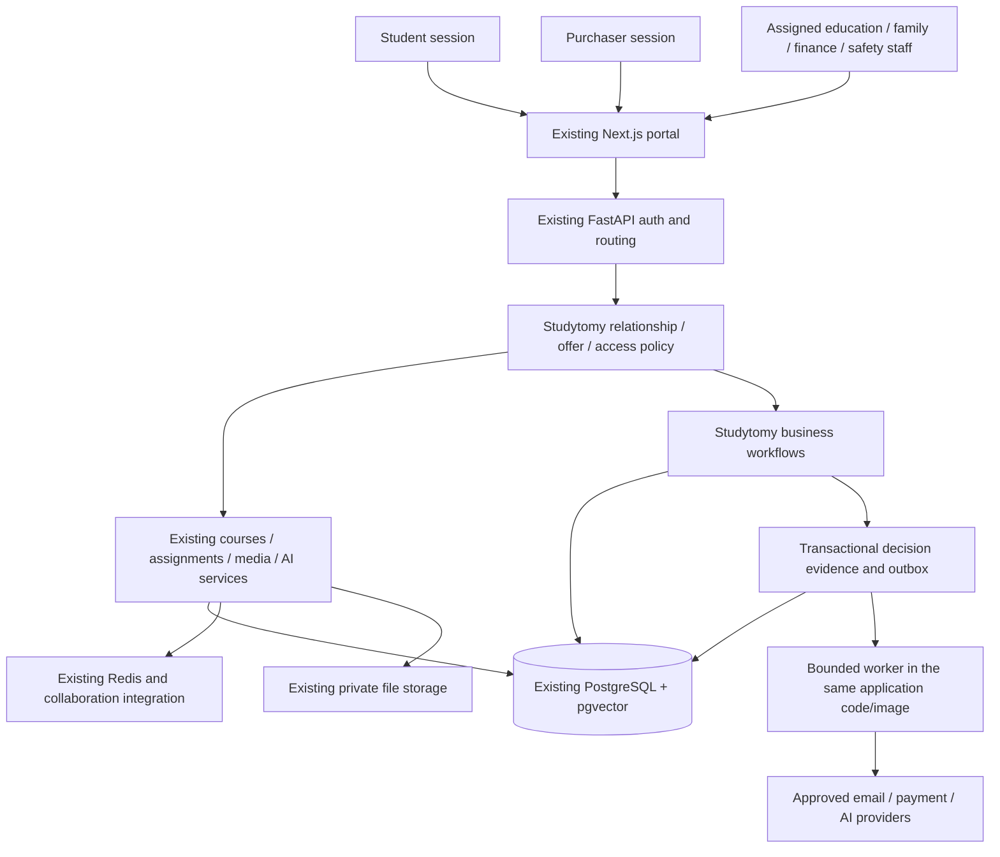
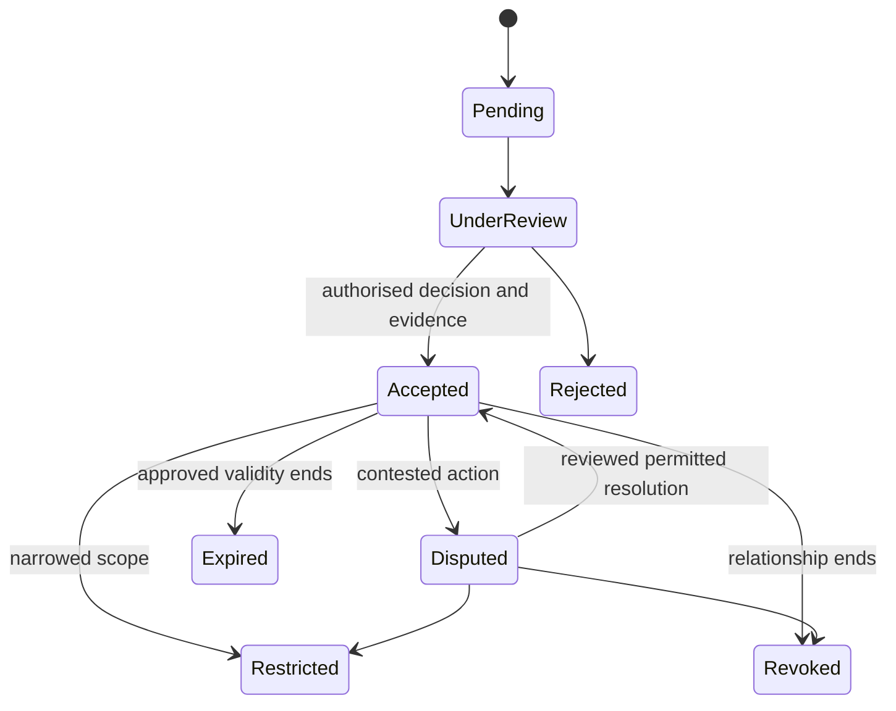
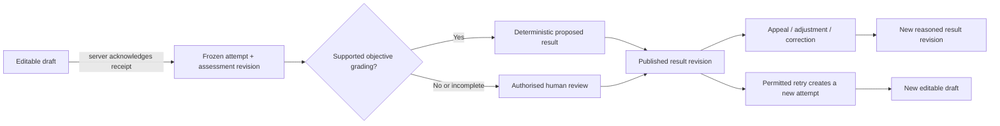

# Studytomy Portal — Family Learning Service
## Evidence-backed atomic implementation specification

**Status: implementation proposal; business decisions and implementation approval pending.**

| Review metadata | Value |
|---|---|
| Authoritative repository | `nirzaf/studytomyportal` |
| Inspected branch | `main` |
| Inspected commit | `0d3b439436c69553bf32b69067b06dad13011df5` |
| Review/snapshot date | 15 November 2026 |
| Target application | `lms.studytomy.com` — production LMS, not the no-auth prototype |
| Supplied source | [D1 — Students and parents summary](https://docs.google.com/document/d/1ICH0jgg57TvirvMPAYgNcu51gdZOzKpF1gOp4HRGzZs) |
| Linked detailed source | [D2 — Detailed business requirements, version 1.0](https://docs.google.com/document/d/1yNq10yXgs0AO_Da4126RB_pE0ZFRbh99zS4ZkfMOxcE), dated 14 November 2026, draft for business approval |
| Detailed-source fingerprint | SHA-256 `54897e309257cab24bf8b09bc2ba7f4a3182898720ee4802554ddf8567545d71` of the exported UTF-8 text |
| Summary-source fingerprint | SHA-256 `3fb9a1497bd85d807952d25b93b65d3fabfbef03aa5ffe51a7ed94f30cf1b78f` of the exported UTF-8 text |
| Source coverage | 128 numbered business rules; 34 acceptance scenarios; 20 open decisions |
| Implementation backlog | 73 dependency-ordered tasks, including 3 explicitly Later work packages |
| Changes made during this review | None to either repository, Google Doc, deployment, database or DNS |
| Verification performed | Read-only source/doc inspection and specification consistency validation; no application build, tests, migration or runtime verification |

> **Read this distinction first:** the source defines a student-and-parent service with staff-operated education, support and commerce. It does not authorise a second LMS, a tutoring marketplace, a new framework, an AI-only learning system or a Cloudflare/D1 rewrite. “Launch” means before offering the relevant service. It does not mean every optional service must be launched simultaneously.

The existing public website and `nirzaf/studytomy-react` remain untouched. Use the current Next.js/React and FastAPI/PostgreSQL architecture. Keep existing authentication, course authoring, supported grading and collaboration foundations. Add only the controls and workflows needed for the approved offer.

### Navigation

1. [Source authority and scope](#scope)
2. [Executive findings and implementation priority](#executive)
3. [Verified capability audit](#audit)
4. [Architecture and code boundaries](#architecture)
5. [Identity, authority and access invariants](#authority)
6. [Proposed data contracts](#data)
7. [Transaction and workflow specifications](#workflows)
8. [API contract inventory](#api)
9. [Frontend and staff-workflow inventory](#ui)
10. [Security, privacy, AI and operational controls](#controls)
11. [Migration and rollout](#migration)
12. [Atomic implementation backlog](#tasks)
13. [Complete source-rule traceability](#rules)
14. [Acceptance scenarios and executable checks](#acceptance)
15. [Open business decisions](#decisions)
16. [Verification commands and evidence](#verification)
17. [Metrics and pilot gates](#metrics)
18. [Source evidence and limitations](#evidence)

<a id="scope"></a>
## 1. Source authority and scope

### 1.1 What was read

D1 is the exact document supplied in the request. It explicitly says it is a summary, not evidence of implemented functionality, and links to D2 for full rules, exceptions and acceptance. Both were opened. This specification preserves D2’s `BR-*`, `AC-*`, `D-*` identifiers and Launch/Later labels. The rule appendix contains the source wording, not rewritten substitutes. Source-line references refer to the captured text export, **not** visual Google Docs line numbering.

Use the following evidence classes throughout:

| Label | Meaning |
|---|---|
| **Source requirement** | A rule, acceptance scenario or decision in D1/D2. It is still a draft business requirement unless approved. |
| **Verified code** | A behavior visible in an inspected source range at the pinned SHA; not proof of the live configuration or successful execution. |
| **Engineering proposal** | The schema, API, state machine, module layout, task or test designed here to satisfy the source. It is not implemented merely by appearing here. |
| **Open decision** | A policy or irreversible technical choice that must be approved before the affected service is offered. |
| **Unverified** | Runtime behavior, externally configured services, inaccessible code or a path not inspected deeply enough to draw a conclusion. |

### 1.2 Conflict resolutions

- **Current stack wins:** no TanStack Start, Workers/D1 migration, new backend framework, replacement ORM, new identity provider or Supabase dependency.
- **Production service wins over prototype shortcuts:** authentication, real server-side authorisation, persistence and accurate receipts are mandatory. Earlier no-auth perspective switchers and scripted AI are demonstration-only artifacts.
- **Source scope wins over earlier marketing ideas:** adaptive diagnostics, full NAPLAN/ATAR catalogues, automatic essay/handwriting marking, Agentuto integration, voice tutoring and AI advertising are not automatically included by this source. Reuse existing capabilities where appropriate; separately specify any later approved addition.
- **Audience remains unresolved:** earlier NAPLAN-only demo content is not approval of D-01/D-02. The data model may support a later NAPLAN offer, but no real age/subject/market or official alignment is inferred.
- **Admin retains Teacher tools:** the prior requirement for Admin teaching capabilities is compatible with this design. It does not override D2’s restricted financial, guardian, privacy or safeguarding decisions.
- **Website separation is permanent for this scope:** no rewrite, API coupling, shared database, credential migration or automatic navigation change in `studytomy-react`.
- **No automatic Enterprise enablement:** use independently implemented Studytomy business workflows, or an expressly licensed implementation selected in a separate decision. Do not alter license detection, ship private code or treat public stubs as working features.

### 1.3 Launch applicability

**Course-only staffed pilot:** eligible families; reviewed course content; required guardian/consent processes; actual paid or approved-free allocations; supported assessments; recoverable work; support/safeguarding/privacy; and any reporting explicitly sold. This can be delivered with approved staff-led payment confirmation, reporting and case review. Staff-led does not mean unrecorded or uncontrolled.

**Conditional Launch:** membership renewal rules apply before selling memberships; promotion rules before using discounts/trials; AI rules before providing AI; community/board rules before opening those spaces; pass-prerequisite tests before promising pass-before-progress. A missing optional capability is excluded from the offer, not silently advertised as forthcoming.

**Later only:** `BR-AI-07` course-wide tutoring; `BR-PAR-06` dedicated parent experience/automatic reports; `BR-CAL-05` personalised reminders. Do not pull these into launch without explicit approval.

### 1.4 Non-goals

No wholesale reimplementation of the LMS, generic workflow/rules engine, separate CRM, school tenancy marketplace, commercial-price estimate, new native mobile app, new scientific model, unlimited AI claim or automatic production migration. Do not rebuild existing editor, media, grading, role or storage functionality that can be safely extended. No guarantee of grades, accredited qualification, legal compliance, measured learning improvement or fixed delivery date is made by this document.

<a id="executive"></a>
## 2. Executive findings and implementation priority

**Recommended approach:** a native-stack modular extension of the existing portal, with a tightly bounded first offer. The main missing layer is not content delivery; it is the service contract between **learner, guardian, purchaser and accountable staff**.

The current code provides useful course/activity, grading, access-check, AI-session and audit primitives. It does not by itself establish that family authority, independent purchase rights, contractual access, confidential casework or all source business policies are fulfilled. Preserve those primitives; add explicit domain records and guards.

### 2.1 Confirmed consequential gaps

| Finding | Current behavior and evidence | Required outcome | Impact / priority |
|---|---|---|---|
| F-01 Family relationship authority is not part of the inspected User/role models | User identity and resource roles exist; `guardian` search returned only planning documents, not implementation. [E05], [E06] | Verify scoped relationships; payer rights are separate; independent students control sharing. | **High** — blocks affected family disclosure. |
| F-02 Community paid-access fallback is not commerce entitlement control | Without Enterprise, paid-access hooks return free access/no-op. [E07], [E08], [E16] | A separately authorised managed-offer gate must validate allocation/collection/eligibility. | **High** — blocks custom paid sale. This is expected OSS behavior, not an allegation of an upstream licensing defect. |
| F-03 Live assessment retry is destructive | Current retry resets/deletes current answer rows; a counter remains. Learner audit records submission/grade metadata, so history is **partial**, not wholly absent. [E10], [E12], [E13], [E15] | Preserve submitted answer, rubric/policy and result revisions for every managed attempt. | **High** — required for fair retries, appeals and evidence. |
| F-04 Mandatory business audit cannot depend on the current learner writer | Current writer is learner-only, commits separately after the action and swallows write failure after logging. [E14] | Authority/refund/publication decisions and evidence must commit atomically. | **High** — required financial and privacy traceability. |
| F-05 Award history and privileged bypass need managed-course policy | Revoke deletes live award; headless admin award deliberately bypasses completion. Own award reads already can survive course visibility changes. [E18], [E24] | Preserve award status history; enforce approved conditions and reviewer decisions across all paths. | **High** — academic evidence and child-safe verification. |
| F-06 Editor history is not immutable evidence retention | Activity snapshots retain only 20 versions. [E19] | Retain the exact versions referenced by accepted offers and submitted attempts under D-13. | **High** — avoid later changes rewriting evidence. |
| F-07 Delivery intent is not delivery success | Webhooks run in process; drip notices claim before send and log failures. [E20], [E21] | Durable business outbox, status/retry/reconciliation and recipient re-checks. | **High** for required receipts/reports; ordinary optional notifications remain a scoped migration. |
| F-08 Child privacy needs separate projections | Existing public/author profile shapes expose selected names/profile fields by design. [E05] | No default public discovery of children or private work; specific publicity permission. | **High** for child participation. |
| F-09 Release prerequisites currently focus on completion/date | The inspected calculator uses completed activities and timing; malformed saved rules can fall back. [E17] | Validate managed configuration and add assessed-pass conditions only where approved and tested. | **High** when that benefit is promised; not a universal replacement of drip. |
| F-10 Alternate privileged paths need coverage | Token submission paths may intentionally skip ordinary learner enrollment/deadline gates; manual certificate operations differ from student routes. [E11], [E24] | Apply managed business invariants to normal/API-token/embed/MCP/storage/AI consumers, not just UI. | **High** — prevents a second path bypassing the new rules. |
| F-11 QA configuration must not imply proof it does not provide | `lint` masks errors; strict lint exists; backend coverage excludes important AI paths; test-mode database is SQLite. [E02], [E04], [E29] | Strict command evidence, explicit AI tests and real PostgreSQL race checks. | **Medium** — validation reliability. |
| F-12 CI policy changed in the inspected head | Head commit is `ci: remove GitHub Actions workflow files`. | Do not silently restore removed workflows. Agree the release-check execution mechanism. | **Medium**, operating decision; no live CI result was inspected. |

### 2.2 Delivery order

| Wave | Deliverable | Gate before exposure |
|---|---|---|
| A — foundations | Baseline, approved policies/owners, permission extensions, evidence, transaction/replay and delivery infrastructure | Design and implementation scope approved; synthetic regression tests available. |
| B — bounded family course service | Individual learners, reviewed relationships, offers, orders/collection evidence, independent grants, support and safe records | Applicable eligibility, privacy, customer terms, payment and staffing decisions approved. |
| C — trustworthy learning evidence | Reviewed releases, reliable drafts/attempts/results, adjustments, awards, lesson AI only where approved | Learning and safety acceptance evidence; no unsupported automation advertised. |
| D — controlled pilot operation | Staff-led reports, purpose-specific messages, incidents/retention/metrics, restore and cross-path tests | All applicable AC scenarios pass or have a formally approved non-applicability reason. |
| E — conditional/later expansion | Membership, promotions and the three Later capabilities | Separate offer readiness, policies, capacity and acceptance. |

These are dependency gates, not a calendar or effort estimate. The source’s 90-day outline is a proposed business observation window, not a development deadline.

<a id="audit"></a>
## 3. Feature audit matrix

Statuses below apply to the **source requirements**, not to whether a source file exists. “Implemented primitive” means the inspected code performs the stated narrow behavior. “Missing (scoped)” means no implementation was established in the inspected call paths/search; reconfirm before adding new code. Live environment, data, contractual policies and test results are unverified.

| Pillar | Existing primitive | Required atomic service control | Status | Evidence / next action |
|---|---|---|---|---|
| Family | User identity, sessions, org roles | Separate learners, verified guardian/supporter scopes, independence/revocation | Missing (scoped) | [E05], [E06], [E28]; [TASK-009](#task-009), [TASK-011](#task-011), [TASK-013](#task-013). |
| Account recovery | Session, MFA and magic-link contracts | Authority-safe child recovery; no payer takeover; shared-device cleanup | Partial | [E28]; inspect complete auth call graph in [TASK-010](#task-010). |
| Offers | Course descriptions, SEO, publication | Accepted offer version, readiness, accessible suitability and truthful benefits | Partial | [E09]; [TASK-017](#task-017), [TASK-008](#task-008). |
| Payments | Provider library, Enterprise hook boundary | Confirmed collection, duplicate/late reconciliation, receipts | Missing in OSS service scope | [E03], [E07], [E08]; [TASK-021](#task-021), [TASK-022](#task-022). |
| Access | Activity/course/lock/drip gate | Eligibility + permissions + independent grant + release and scoped restrictions | Partial | [E16], [E17]; [TASK-025](#task-025), [TASK-026](#task-026). |
| Membership | Enterprise payment boundary | Renewal consent/periods/cancellation/grace/reconciliation | Unverified as usable OSS feature | [E07]; conditional [TASK-031](#task-031)–[TASK-033](#task-033). |
| Refunds | No family refund lifecycle established | Authority, cumulative return limits, pending settlement, unrelated-access preservation | Missing (scoped) | [E07], [E08]; [TASK-029](#task-029), [TASK-030](#task-030). |
| Learning | Courses, activities, completion, drip | First-step clarity, approved accessible alternatives, pass gates, evidence not mastery | Partial | [E09], [E16], [E17], [E18]; [TASK-038](#task-038), [TASK-039](#task-039). |
| AI | Activity ownership/access checks; credits; SSE | Per-learner eligibility/help policy, limits, no high-impact automated decisions, error review | Partial | [E22], [E23]; [TASK-047](#task-047)–[TASK-050](#task-050). |
| Practice | Existing platform practice/board concepts | Rehearsal isolation, assistance attribution, controlled participation | Unverified end-to-end for B2C | [E10], [E16]; [TASK-046](#task-046), [TASK-055](#task-055). |
| Assessment | Objective/manual grading, frozen live answers, row uniqueness, retry locks | Immutable attempt/rubric/result history and fair review | Partial | [E10]–[E15]; [TASK-041](#task-041), [TASK-042](#task-042), [TASK-043](#task-043). |
| Awards | Completion/pass helpers; own award read | Snapshot/evidence, correction history, financial independence, minimal public verification | Partial | [E18], [E24]; [TASK-045](#task-045). |
| Parent reports | Learner result/evidence sources | Authorised staff-led period reports, recipient recheck/correction | Missing (scoped) | [E05], [E15]; [TASK-051](#task-051), [TASK-052](#task-052). |
| Calendar/notices | Drip times, chapter notification implementation | Distinct date semantics, purpose/preferences, delivery truth and stale suppression | Partial | [E17], [E21]; [TASK-053](#task-053), [TASK-054](#task-054). |
| Communities/safeguarding | Course content and membership primitives | Scoped spaces, moderation readiness, private reports, independent investigations | Partial / confidential casework not established | [E06], [E16]; [TASK-056](#task-056)–[TASK-058](#task-058). |
| Teaching quality | Publish boolean and version snapshots | Named review, rights/claims/accessibility approval bound to a revision | Partial | [E09], [E19]; [TASK-036](#task-036), [TASK-037](#task-037). |
| Support | Existing user administration | Accessible cases, owners, next steps, complaint independence, honest targets | Missing (scoped) | [E25]; [TASK-059](#task-059), [TASK-060](#task-060). |
| Privacy | Existing safe projections and auth checks | Family consent, private child data, authority-checked requests, purpose retention/holds | Partial | [E05], [E15], [E25], [E28]; [TASK-061](#task-061)–[TASK-063](#task-063). |
| Governance | Learner audit and feature gates | Transactional decisions, owners, applicable launch gates, honest pilot measures | Partial | [E07], [E14], [E26]; [TASK-004](#task-004), [TASK-065](#task-065), [TASK-070](#task-070). |

Do not remove existing protections because a new service is added. Existing assignment-file ownership, session checks, resource locks, grade-write restrictions and token organisation boundaries are regression requirements.

<a id="architecture"></a>
## 4. Architecture and code boundaries

### 4.1 Preserve the runtime

The inspected manifests declare Bun, Next.js, React, TypeScript, Tailwind, Radix and Tiptap on the frontend; FastAPI, Pydantic, SQLModel, Alembic, async PostgreSQL, pgvector and Redis on the backend. The exact lockfiles and supported runtime must be rechecked at implementation. No dependency upgrade is implied by this specification. [E02], [E03]



The worker may be an explicitly configured process from the **same repository/runtime**, or a verified existing lifecycle task. PostgreSQL owns durable jobs and decisions. Redis is an optimisation, not the sole source of financial truth. Do not add Celery, Kafka, another SQL database or another application backend to implement these rules.

### 4.2 Additive code map

All below are **proposed additions**, unless explicitly identified as existing. Choose a more appropriate existing equivalent discovered during recon rather than duplicate it.

```text
apps/api/src/
  db/studytomy/             # NEW SQLModel records, grouped by family/domain
  services/studytomy/       # NEW focused use cases, pure policy checks, transaction owners
  routers/studytomy/        # NEW thin FastAPI endpoints under /api/v1/studytomy
  security/studytomy_access.py # NEW scope checks composed with existing RBAC
  tests/studytomy/          # NEW targeted service/API/security/Postgres tests
  router.py                # EXISTING router registry: minimal registration change after recon
apps/api/migrations/versions/ # EXISTING Alembic revision history; additive revisions only
apps/web/
  app/orgs/[orgslug]/...    # EXISTING App Router layout families; add scoped pages
  components/Studytomy/    # NEW family/commerce/assessment-review UI, reuse UI primitives
  services/studytomy/      # NEW typed client adapters using existing auth-aware request helper
  types/studytomy.ts       # NEW versioned API DTOs; no duplicate domain rules in the browser
  tests/studytomy/         # NEW frontend tests in existing runner
apps/e2e/features/studytomy/ # NEW scenarios in the current browser-test harness
```

**Dependency direction:** router → authorised use-case service → existing narrow/pure functions + SQLModel. The use-case service owns the transaction. Policy functions take explicit typed inputs and return decisions; no dynamic expression evaluator is required. UI consumes server decisions rather than granting itself access.

**Existing seam modifications:** `courses/activities/access.py`, `assignments.py`, `courses/certifications.py`, `courses/drip.py`, activity versioning, AI authorisation, selected administration/export/deletion paths, dashboard navigation and session-cache lifecycle. Every modified seam needs a preserved baseline test and a managed-offer test. [E10]–[E29]

### 4.3 Managed-service boundary

Create an explicit managed-service marker/release relationship for courses sold under these rules. A managed course cannot rely on the free OSS payment fallback. Before enabling sale, map all resources it exposes and enforce the new gate.

For staged adoption, unmanaged existing content retains upstream behavior until deliberately reviewed and migrated. Do not silently change global course semantics. A new course sold as managed must never be temporarily public while its entitlement configuration is missing.

Existing APIs used by the frontend must either delegate managed-resource mutations into the new transaction-owning service, or return a documented `MANAGED_WORKFLOW_REQUIRED` conflict and direct the updated client to the supported endpoint. There must be **no second successful write path** that bypasses frozen attempts, approvals or financial authority. Ordinary unmanaged workflows remain compatible.

### 4.4 Keep upstream upgrades feasible

Retain upstream modules and notices. Keep an explicit list of small patched seams, tests and why each patch is needed. Do not move source files wholesale, fork entire UI providers, change edition detection or rewrite Hocuspocus. Review upstream changes against these contracts before adoption; a future upstream merge is not approval to relax family controls.

<a id="authority"></a>
## 5. Identity, authority and access invariants

### 5.1 Distinct capacities

| Capacity | Allowed by default in this service design | Explicitly not inferred |
|---|---|---|
| Student | Their own eligible learning, submissions, feedback, permitted retained history and support | Purchase authority, sibling records, guardian rights or unrestricted community contact |
| Purchaser | Their accepted order, receipts, cancellation/refund requests and allocation review | Marks, AI conversations, safety reports, another adult’s personal information |
| Accepted guardian | Only current approved learner/action scopes under D-03/D-12 | Unlimited control, automatic billing ownership, another guardian’s private data |
| Independent student’s supporter | Explicit current voluntary sharing scope | Guardianship or a permanent right because they pay |
| Educator/assessor | Assigned course/learner teaching and marking functions | General family identity evidence, payment disputes, confidential safeguarding investigations |
| Family/support staff | Assigned case/function and permitted data needed to act | Right to decide every financial/safety case or access all children by default |
| Safeguarding lead/reviewer | Assigned confidential matters and approved restrictions | Automatic disclosure to a named adult or unbounded marketing/report access |
| Commerce delegate | Approved financial actions within D-19 limits | Academic visibility or sanction authority |
| Admin | All applicable Teacher tools plus explicitly assigned service administration | Exemption from complaint conflicts, confidential-case scope or financial approvals |

These are business capacities layered onto existing identities/roles, not seven new authentication systems. Current API-token organisation boundaries remain mandatory. A machine acting for a learner must carry an explicit server-authorised subject and permitted operation, not inherit a blanket bypass.

### 5.2 Access equation

For a managed learner resource:

```text
allow = authenticated intended principal
    AND appropriate organisation/resource relationship
    AND approved learner eligibility
    AND required current participation permissions
    AND at least one valid applicable grant
    AND no applicable blocking restriction
    AND resource publication/release/prerequisite conditions
```

Family-report access uses a **different** predicate: current approved sharing/authority scope + permitted report fields + retained-record rules. Receipt access uses purchaser ownership. Safeguarding case access uses explicit case assignment/exclusion. Do not route them all through “has course access”.

**Authorisation result contract (proposed):** `{allowed, code, scope, policy_version_ids, access_version, next_action, public_message}`. Public messages never expose case narratives or other adults. Server logs use a correlation ID, not a full private payload.

### 5.3 Non-negotiable invariants

1. Payment does not create guardianship; guardianship does not create ownership of a place.
2. Each child has their own current User-backed learning identity. A staff profile draft is not an active learning account.
3. Eligibility for learning, independent participation and purchasing are separate policy decisions.
4. Ended/restricted authority stops **future** protected access and sends. Already downloaded material cannot be remotely recalled; handle prior disclosure as an incident where appropriate.
5. Two guardians never gain each other’s private contact/billing data through a learner response.
6. A reported adult, including an admin or guardian, is excluded from their complaint/safeguarding case’s sensitive evidence and notifications.
7. Revoking one entitlement or relationship never automatically revokes unrelated grants or siblings.
8. Expiry/refund/financial dispute does not delete learning evidence or invalidate an academically valid award.
9. New optional charges require a capable authorised purchaser and fresh informed agreement.
10. Completion, assessed result and demonstrated understanding are separate fields and UI concepts.
11. Submitted work and the applicable question/rubric/assistance policy survive later edits and retries.
12. A request, attempted payment, local draft or approved refund is not proof of collection, receipt of a submission or returned money.
13. Critical mutations and their required business evidence are atomic; notifications are independently recoverable.
14. Staff preview never creates learner evidence or paid access.
15. No client boolean, route choice, role-switch control or AI output may set authority, settled money, final sanction or approved publication.

### 5.4 Child credentials — explicit design gate

The existing User model and sign-in contract assume email-based credentials. [E05], [E28] The source has not approved how a young child without an individual usable email authenticates. Do not work around this with fabricated addresses or shared parent sessions.

Approve a credential ADR in [TASK-010](#task-010): either the initial permitted cohort legitimately uses the current per-user login model, or a carefully scoped **managed-learner login extension of the same User/auth system** is approved with verification, recovery and account-control rules. Core nullable-email/schema/identifier changes, if selected, need their own migration and contract tests. Until resolved, affected learners remain unactivated; do not falsely claim all ages are supported.

<a id="data"></a>
## 6. Proposed data contracts

**All `st_*` names are engineering proposals, not existing tables.** First inspect for an equivalent implementation. Add only the schemas for the approved capability; for example a course-only pilot does not need membership tables. The names below specify responsibilities and constraints, not a request for a generic data abstraction layer.

### 6.1 Shared conventions

- Retain existing `user.id`, `organization.id`, `course.id`, `activity.id` and `assignment.id` as foreign keys with their actual types. No new global user database.
- New business rows: `id BIGINT` primary key, stable prefixed UUID string (`*_uuid`, unique), `org_id`, `created_at TIMESTAMPTZ`, and where mutable `updated_at`, `version INTEGER >= 1`.
- Store UTC instants plus the **approved IANA zone and start-basis snapshot** where a family commitment depends on local dates. Date-only work uses an explicit date type, not a fabricated midnight.
- Monetary fields use integer minor units (`BIGINT`), ISO currency and validated currency exponent; no floating-point money and no universal “multiply by 100” assumption.
- Use typed Pydantic schemas for JSON snapshots, fixed enums/check constraints for states, bounded field lengths and payload limits. Do not store an executable rule language or unvalidated arbitrary policy JSON.
- Scope every query by organisation and the actual permitted subject. Index foreign keys and operational queue predicates; prove performance with representative data before adding speculative indexes/partitions.
- Historical evidence is immutable after its defined freeze point. Corrections append a new version/event with `supersedes_id`; normal services do not overwrite originals.
- Do not cascade-delete financial, submitted-work, authority-decision or award evidence from existing User/Course deletions. Use reviewed archive/pseudonymisation/retention behavior and return an actionable conflict where old destructive routes would violate it.
- Each migration must enforce both ownership integrity and lifecycle constraints. Cross-org relationships need a composite constraint or verified in-transaction parent check, not just a UI filter.

### 6.2 Governance, operations and family records

| Schema ID / proposed entity | Essential columns beyond shared convention | Constraints and lifecycle |
|---|---|---|
| S-01 `st_policy_version` | `key` D-01…D-20/domain, typed `body`, `scope_kind/scope_id`, `status`, `effective_from/to`, `approver_user_id`, `approved_at`, evidence reference/hash | Draft → approved → superseded/withdrawn. Approved body immutable; no overlapping active version for the same scope. Unknown values never replaced by sample defaults. |
| S-02 `st_owner_assignment`, `st_staff_scope` | function/capability, user ID, course/case/org scope, effective period, delegation evidence, financial limits where relevant | Default deny. Verify user membership/current role and assignment. Sensitive conflict exclusions take precedence over broad scope. |
| S-03 `st_business_event` | actor user/machine, actor capacity, subject/resource UUIDs, action, before/after **safe** state, reason, policy refs, correlation/operation ID | Written in the same transaction as required mutation. Unique operation/action where replay could duplicate. No whole chat/safety body. Purpose-specific retention; not a claim of tamper-proofness against database administrators. |
| S-04 `st_idempotency_record` | actor+org+operation+key, request hash, resource UUID, processing/completed status, replay-safe response/ref, expiry policy | Unique actor/org/operation/key. Different payload → 409. Resource-level uniqueness remains after key retention expires. |
| S-05 `st_outbox` | event type, safe resource ref, recipient/purpose, semantic dedupe key, state, available_at, lease_owner/until, attempts, provider message ref, last safe error | Unique semantic recipient/event/version key. Pending → processing → accepted/delivered/failed/suppressed/reconciliation_required. Provider acceptance is not proof a person read a message. |
| S-06 `st_evidence_file` | existing storage object/ref, content hash, media type/size, owning learner/case/report, purpose, retention category, upload/verified state | Private only; authorise every retrieval. No live public URL in logs. Large file bytes stay in existing object storage, not JSON columns. |
| S-07 `st_learner_profile` | `user_id`, control mode, approved eligibility decision/ref, minimal justified age/level attributes, preferred zone, review/transition dates, access_version | Unique(org,user). A learner cannot share a User with a sibling. Activation requires an approved credential model; eligibility evidence is not a public profile field. |
| S-08 `st_relationship` | learner ID, adult/supporter user ID, type, allowed action scopes, status, valid_from/to, review case/evidence ref, decision-maker, authority_version | Pending/review/accepted/restricted/disputed/revoked/expired distinct. Accepted effective scope only grants access. Prevent self-grant and duplicate overlapping active equivalent relationship. |
| S-09 `st_consent_event` | subject learner/user, authorised actor, purpose, decision accept/decline/withdraw, policy/notice version, effective time, scope and provenance | Append-only choices; latest applicable permitted event determines status. Learning terms, AI, sharing, marketing and publicity are distinct purposes. |
| S-10 `st_restriction` | subject and resource/contact scope, originating case, reason code, effective/review dates, approved_by, status | No household-wide default. Sensitive narrative belongs in restricted case evidence, not this queryable guard. A replacement purchase does not bypass applicable restrictions. |

### 6.3 Offers, money and access

| Schema ID / proposed entity | Essential columns | Constraints and lifecycle |
|---|---|---|
| S-11 `st_offer`, `st_offer_version` | offer type, exact course/programme coverage, audience/market/format/objectives, access clock/period, assessment/support/award terms, price breakdown, policy refs, service-readiness refs, publish/sale state | Immutable accepted version. Separate catalogue visibility, sale readiness and service availability. Programme resource list is versioned; no silent substitution. |
| S-12 `st_capacity_hold` | offer/cohort version, intended order/learner, quantity, expires_at, held/consumed/released state | Consume under row lock; finite limit cannot be exceeded. Holds are not purchases or entitlements. Optional if no finite approved capacity. |
| S-13 `st_order`, `st_order_line` | purchaser, unique customer ref, accepted offer/terms snapshot, named learner allocation, currency/amounts, requested/accepted timestamps, lifecycle, covered resource snapshot | Stable references; each line has one named learner unless an approved household definition is explicit. Financial outcomes are derived from movements, not a client-editable paid flag. |
| S-14 `st_payment_attempt` | order, provider/manual mode, merchant account/ref, expected amount/currency, outcome, attempted/verified times, verification actor/evidence | Many attempts may exist. Provider reference uniqueness includes merchant/environment scope. An attempt is not collection. No stored card secrets. |
| S-15 `st_money_movement` | collection/refund/chargeback/reversal kind, original payment/source movement, amount/currency, provider transaction ref, confirmed_at, reconciliation reference | Immutable confirmed money ledger. Unique external transaction identity. Opposite movements, not overwritten amounts, correct the ledger. Financial reporting does not label this revenue recognition. |
| S-16 `st_provider_inbox` | provider/merchant/event ID, verified raw-body digest, safe payload/ref, status, received_at, attempts, resolution | Unique event identity; authenticate before processing. Payload retention/minimisation approved. Required only for a configured provider integration. |
| S-17 `st_refund_request` | collection/order scope, amount/currency, reason, policy ref, approval/limit evidence, pending reservation, settlement ref, destination token/ref | Request → review → approved/reserved → executing → settled/failed/reconciliation. Amount cannot exceed returnable balance under lock; compensation is a separate approved transaction. |
| S-18 `st_entitlement` | learner, resource coverage snapshot, source order-line/membership-cycle/free decision, start basis, starts_at/ends_at, state, predecessor/correction ref | Unique grant source + learner + coverage; union of valid grants. Revocation affects only the appropriate source. Snapshot unresolved-start treatment; first-use start claimed once. |
| S-19 `st_membership`, `st_membership_cycle` **conditional** | purchaser/beneficiaries, accepted recurring terms, consent ref, period start/end, next renewal, cancel_requested/effective, cycle status, unique renewal key | No creation from a sample. Every renewal is a distinct period/collection/grant lineage. Cancellation/failure/expiry/refund remain distinct. |

**Money invariant:** for each captured payment and currency, authorised new return ≤ confirmed capture − confirmed prior refunds − live refund reservations − confirmed chargeback debits + approved confirmed reversals. Compute from the ledger under a common lock. Negative/ambiguous balance enters reconciliation; do not silently clamp and declare success. Provider terminology must be mapped after selecting and validating that provider; this is not an invented Stripe API contract.

### 6.4 Education, casework, reporting and retention

| Schema ID / proposed entity | Essential columns | Constraints and lifecycle |
|---|---|---|
| S-20 `st_content_release`, `st_content_review` | course/activity/version hashes, protected snapshot references, owner/reviewer, review criteria, rights evidence, approved claims, state and effective date | Approval binds exact revision. The editor’s rolling history is not the evidence store. Existing source content remains reusable; retain only committed snapshots required by records. |
| S-21 `st_assessment_revision` | assignment/resource IDs, task/answer-key/rubric versions, pass scale, attempts/selection rule, help policy, timing/reveal/adjustment rules, release ref | Immutable when used by an attempt. Correct answers never appear in pre-release student DTOs. |
| S-22 `st_attempt_evidence` | learner, assignment, ordinal, assessment revision, received_at, frozen answers/media refs, assistance declaration, canonical payload hash, receipt ref | Unique(learner,assignment,ordinal). Freeze at authoritative receipt; no patching after submit. Historical unknown answers are explicitly unknown. Existing mutable rows remain a current-view projection. |
| S-23 `st_result_revision` | attempt, deterministic evaluator/rubric version, marks/feedback, marker/reviewer, status, reason, supersedes, published_at | Append corrections. Validate bounds and completeness; unknown/unreviewed ≠ fail. Selected-result rule comes from the assessment version, not whichever row was last updated. |
| S-24 `st_prerequisite_rule` | course/chapter/activity, required resource, type date/completion/assessed-pass, expected policy/result basis, status | Approved simple predicates only; reject cycles/invalid cross-org targets. Completion does not imply pass. Optional if the offer does not promise new assessed gating. |
| S-25 `st_award_record`, `st_award_event` | existing certificate linkage, learner, condition/template snapshot, evidence refs, issued/corrected/withdrawn status, verification code and approved public projection | Never delete to represent expiry/refund. Record academic correction/withdrawal events and reviewed reason. Minimal public verification; protect recipient identity according to D-16. |
| S-26 `st_case`, `st_case_action`, `st_case_participant` | category, requester/subject, owner, stage/next action, policy deadlines, restricted evidence refs, permitted/excluded staff or participants, related business refs | Excluded reported person cannot read or review. Public intake reveals no confidential follow-up. Case closure requires the documented outcome, not just acknowledgement. |
| S-27 `st_adjustment` | learner, affected offer/assessment/resource, approved alternative or deadline, valid period, reviewer, restricted case ref | Show operational accommodation without unnecessary sensitive reasons. Core result criteria remain traceable. |
| S-28 `st_progress_report`, `st_report_recipient` | learner, period, committed evidence versions, safe academic summary, reviewer, report version/status, superseded report, delivery-purpose scope | One learner per report. Recipient access re-evaluated at dispatch/download; no payer inference. Delivery is via S-05, not a second message engine. |
| S-29 `st_notification_preference` | recipient/subject context, purpose, channel, enabled, contact ref, zone/quiet rule ref | Distinguish necessary service messages, optional nudges, marketing. Invalid recipient/contact choice cannot disclose data. |
| S-30 `st_retention_hold`, `st_retention_run` | record-purpose/scope, reason, approver, review/expiry, dry-run candidate digest, execution cursor and outcome | Separate holds from paid access. Recheck before destructive execution. File deletion/reindex/cache work is resumable and evidenced. |
| S-31 `st_ai_allowance_period`, `st_ai_usage` **conditional** | learner/offer/policy period, allowed usage, request ID, reserved/partial/delivered/released state, provider-safe correlation | Unique request lineage; atomically reserve per approved rule. Upstream org credits remain separate; no second automatic user billing system. |

### 6.5 Index and integrity minimums

Use unique keys for external events, intended grants, renewal cycles, idempotency requests and attempt ordinals. Add operational indexes for current relationship `(org,learner,adult,status,valid_to)`, grants `(org,learner,resource,state,ends_at)`, outbox `(state,available_at,lease_until)`, cases `(org,owner,state,next_action_at)`, reports `(org,learner,period_end)`, and evidence history `(org,subject,created_at,id)`. Use actual query plans to finalise shape; polymorphic resource scopes must validate target ownership in services.

The existing model importer recursively walks `src/db`, so new nested models should be discoverable, but the migration environment still needs a metadata test. [E29] Add tests proving every new table is present in Alembic metadata. Do not silently add an independent `create_all()` production startup path.

<a id="workflows"></a>
## 7. Transaction and workflow specifications

### 7.1 Transaction ownership and failure behavior

Existing services frequently commit internally. A new outer `session.begin()` does **not** make those existing commits atomic with new evidence. Refactor only the touched seam into persist-only helpers plus one authoritative transaction owner, or delegate managed-resource requests to the new use case while preserving compatible read projections. Prove rollback behavior with fault injection. Do not remove commits across the entire application.

**Local command transaction:** validate principal and input → lock authoritative rows in a documented stable order → revalidate policy/versions → apply state and evidence snapshots → append mandatory business event → enqueue safe delivery → commit → respond. No external provider request inside a long-running database transaction.

**External effect:** commit a durable intended operation → send with stable provider idempotency/reference → store verified outcome in a new transaction → reconcile unknown outcomes. At-least-once jobs do not imply exactly-once money/email; domain uniqueness and provider outcome verification supply safety.

**Proposed canonical lock order:** offer/cohort capacity → order/line → membership cycle (when present) → collection → refund reservation → entitlement; lock same-kind rows in ascending stable ID order. Every affected use case acquires only its required subset, in that order. A capacity transaction must not acquire an order lock and then return for capacity; split/retry the use case if needed. Validate actual existing call graphs against this order before enabling the service. Treat deadlock/serialization failure as a bounded, idempotent retry, never a duplicate external effect.

### 7.2 Family authority



A relationship only grants its currently effective accepted scopes. Restricted/disputed cases can retain explicitly reviewed safe scopes; never infer all-or-nothing household control. A restriction/revocation increments the relevant authority/access version, invalidates cached grants and suppresses pending report deliveries. It does not refund purchases, transfer learning ownership or erase retained work.

Independent control is an approved learner transition with its own communication/sharing decisions. A voluntary supporter grant is not a former guardian relationship kept alive by a billing contract.

### 7.3 Order → collection → allocation

```mermaid
sequenceDiagram
  participant Buyer as Authorised purchaser
  participant API as Studytomy use case
  participant DB as PostgreSQL
  participant Pay as Approved provider or finance reviewer
  participant Worker as Durable worker
  Buyer->>API: Accept versioned offer and named learner allocation
  API->>DB: Validate readiness, authority, amount and capacity; save order
  API-->>Buyer: Order reference, pending status, safe next step
  Pay->>API: Verified collection evidence
  API->>DB: Lock and deduplicate; classify on-time, duplicate or late
  alt Eligible committed purchase
    API->>DB: Record money + grant + business event + receipt outbox
  else Cancelled, expired, duplicate or ambiguous
    API->>DB: Record actual money + exception; no silent reactivation
  end
  Worker->>DB: Claim delivery; re-check safe recipient and current state
  Worker-->>Buyer: Accurate receipt/status or review notice
```

**States stay orthogonal:** order acceptance/cancellation; payment attempt; confirmed money; refund; grant; learner eligibility; guardian authority; content release; learning evidence. A parent may see “collection confirmed, learner allocation awaiting authority” where the approved offer permits that order. Do not collapse these into a fake paid/active status. If authority must precede payment for the selected offer, checkout blocks until it is established.

Allocation correction checks the approved substantive-use definition under lock. End/replace the mistaken grant lineage; never change `user_id` on an answer, report or award. If the place has been used, create the review required by D-05 rather than transfer history.

### 7.4 Refunds and disputes

Refund request and membership cancellation are separate commands. A refund approval reserves the allowed amount under a collection lock; a pending external return keeps the reservation. On confirmed settlement, append the refund movement, update the request and apply the exact source-grant remedy approved in the customer agreement. On uncertain response, reconcile before sending again. If an approved return fails, release/retry reservations according to the actual provider outcome, not a timeout assumption.

A chargeback/dispute may change payment state and prompt a scoped access review. It never deletes an academically valid award or a sibling’s evidence. Retain the original order/terms/evidence and authorised staff decision. Alternate refund destinations and discretionary compensation have separately approved authority.

### 7.5 Membership cycles — conditional

Membership agreement, cycle collection, cycle entitlement and cancellation-effective time are separate records. A cycle’s stable key is `(membership_id, agreed_period_start, agreed_period_end, terms_version)`; a retry does not create a new period by accident. The charge decision rechecks current cancellation/consent under lock immediately before authorising an external operation. If cancellation and collection cross in flight, preserve facts and apply D-06/D-07’s approved treatment; never invent “cancel always refunds” or “late payment automatically renews”.

Failed renewal uses approved retry/grace/recovery dates and current notices. Recovery states exactly which period was funded and the next charge date. Membership expiry ends only its own grants; independently purchased courses remain valid.

### 7.6 Learning, attempts and results



- The last server acknowledgement determines received/saved truth. A browser spinner or local draft is not a receipt.
- At submission, capture the effective reviewed questions, answer references, grading/help/retry/deadline/award rules and declared assistance. Validate file ownership and complete required tasks before the transition promised by the policy.
- Objective grading can reuse current validators. Human review is required for unsupported/subjective work. Missing evidence is not automatically scored as a failure.
- A retry uses a new ordinal and frozen prior evidence, even if current upstream rows are reused as a projection. Existing audit summaries are useful historical facts but cannot reconstruct deleted answers.
- Result selection (`latest`, `best`, or another explicitly approved rule) is bound to the published assessment policy. Do not select a convenient default without D-08.
- Practice state never mutates a graded attempt. Assistance is recorded as assistance; group output is not proof every participant understands.
- A genuine correction appends a result version, recomputes any approved downstream prerequisite/report/award effects, and notifies only permitted parties. Automatic suspicion is never final misconduct adjudication.

### 7.7 Content releases and awards

Approval applies to an exact version. A published course uses reviewed material and preserves the release references applicable to accepted commitments/attempts. A material error creates a review of affected learning, results and purchased benefits, not just an invisible edit. Harmful content can be urgently withdrawn by the permitted lead while preserving evidence and triggering approved remedies.

Award issuance requires all published conditions against the selected evidence. A manual API-token shortcut must not bypass those conditions in managed courses. Valid awards are not withdrawn solely for membership end, refund or payment dispute. When academic evidence changes, an authorised reviewer records the approved correction/withdrawal and preserves status history; public verification reveals only the approved minimal information.

### 7.8 Reports, notifications and sensitive cases

A staff-led report is a frozen academic projection for one student and period. Review its evidence and intended recipients; recheck recipient authority at send **and download**. A stale report link is not a lasting capability to the underlying data. Safe notices should link to an authenticated retrieval route rather than carry a full confidential attachment.

For a report sent to the wrong person: stop future sends, restrict retrieval, preserve delivery evidence, review actual disclosure, correct the report/recipient list and follow approved incident policy. No claim that changing an address recalls earlier data.

A safety complaint uses a confidential case and excluded-subject ACL, not a public discussion post or routine parent notification. The subject adult is never automatically made a recipient. Staff must review proportionate restrictions and safe re-entry; a fresh purchase is not a bypass.

### 7.9 Failure/compensation matrix

| Failure point | Required stored truth | Recovery / user message |
|---|---|---|
| DB commit fails before order confirmation | No accepted order/grant | Safe retry with same key; do not say paid. |
| Provider accepts payment but app times out | Outcome unknown until verified | Keep order reference; reconcile before retrying charge; do not grant from browser redirect. |
| Payment arrives after cancelled order | Confirmed money, closed commitment, exception | Approved remedy review; no substitute/restarted membership. |
| Refund request repeats while pending | Existing request/reservation | Replay current status; no second return. |
| Draft save response lost after commit | Stored version and request receipt | Replay/read status; recover without creating another attempt. |
| Authoritative grade saved but required audit fails | Entire new managed mutation rolls back | Report failure honestly; retry same operation. |
| Required email fails after job claim | Pending/failed delivery with lease and attempt history | Retry or reconcile according to provider certainty; do not retain a false sent status. |
| Guardian revoked while report queued | Revised authority and suppressed recipient job | No new sensitive delivery; already disclosed data reviewed separately. |
| Redis/cache unavailable | Postgres authority/evidence remains authoritative | Fail safely or use checked DB paths; never grant from stale cache. |
| Private object write/delete fails | Pending evidence/retention operation | Resume or review; do not claim upload/removal complete. |

<a id="api"></a>
## 8. API contract inventory

**Every path below is proposed.** Reuse the current `/api/v1` router/auth/DTO conventions; add a cohesive `/api/v1/studytomy/orgs/{org_uuid}` namespace. Existing course/assignment/media endpoints remain, with the managed-resource delegation/guards described above. Do not claim these routes exist today.

### 8.1 Common contract

- Resolve organisation from the authorised context and verify the URL matches it. For self actions, derive actor/learner from the session. A client-supplied `learner_uuid` is a requested target, never proof of authority.
- All writes validate current policy, scope and `expected_version` where a record is mutable. Return `409 STALE_VERSION` on conflict with a safe refresh instruction.
- Require `Idempotency-Key` for acceptance, collection/refund transitions, allocation changes, final submissions, report dispatch and case transitions susceptible to replay. The operation-specific uniqueness still applies independently.
- Use `422` for invalid fields; `401` for missing authentication; `403` for a legitimate known denial; `404` where revealing a resource would itself disclose private information; `409` for state/version/policy conflicts; `429` for approved service limits. Do not globally change existing API error shapes.
- Proposed new error detail: `{code, message, correlation_id, field_errors?, next_action?}` inside FastAPI’s `detail`. Do not include secrets, hidden answer keys, private case causes or other learners’ identities.
- List endpoints use bounded pagination, stable ordering with unique tie-breaker and server-side scope/filtering. Default size 25/max 100 is a **proposed technical bound**, not a source business rule; confirm suitability in D-15 tests.
- Return an `operation_uuid`/resource UUID and server UTC timestamp after successful authoritative mutation. Async operations return current status, not “done”. Use proper CSRF/session protections from the existing runtime.

### 8.2 Family, offers and commerce

| Method / relative path | Request essentials | Response / scope / invariant |
|---|---|---|
| `POST /learners` | approved identity binding, eligibility scope, minimal fields | Assigned family staff/approved onboarding; unique learner User; no invented email. |
| `GET /learners/{learner}/service-status` | current session | Minimal eligibility/access status for permitted actor; purchaser gets purchase-specific projection only. |
| `POST /relationships` | learner, relationship kind, requested scopes, evidence refs | Pending request, no permissions yet. |
| `POST /relationships/{id}/decisions` | decision/scopes/period, policy ref, reason, expected_version | Assigned reviewer; atomic evidence + version increment. |
| `POST /relationships/{id}/end` | reason, effective time, expected_version | Ended/restricted scope; queued disclosure invalidated. |
| `POST /learners/{learner}/independence` | approved policy/evidence, expected_version | Authorised control transition; billing unchanged. |
| `PUT /me/sharing/{recipient}` | granted scopes/period or withdraw, notice version | Independent subject controls voluntary academic sharing. |
| `GET /offers` / `GET /offers/{id}` | filters/page | Public approved offer projection, sample vs paid, availability and clear terms. |
| `POST /offers/{id}/versions` | complete typed offer | Assigned commercial/education author; draft, not sale-ready. |
| `POST /offers/{id}/publish` | version/readiness approvals | Only approved version; bind readiness and policy references. |
| `POST /orders` | offer versions, named allocations, approved promotions | Draft/customer ref and authoritative quote; no collection yet. |
| `POST /orders/{id}/accept` | final snapshot digest, explicit agreement, idempotency key | Approved purchaser; mismatch requires reconfirmation. |
| `GET /orders/{id}` | purchaser session | Actual order/money/refund/access statuses; no academic fields. |
| `POST /orders/{id}/payment-attempts` | approved collection mode | Pending attempt/provider initiation; no client-confirmed paid state. |
| `POST /collections/manual-confirmations` | authorised evidence, collection ref, amount/currency | Finance scope/D-19; confirmed money only after verification. |
| `POST /provider-events/{provider}` | raw signed provider payload | Provider-specific auth; dedup inbox; adapter defined after provider approval. |
| `POST /allocations/{id}/correct` | replacement learner, reason, expected_version | Assigned staff, eligible unused/reviewed place; no evidence transfer. |
| `POST /refunds` | original collection/order, reason, requested amount | Request only; purchaser or assigned staff under policy. |
| `POST /refunds/{id}/approve` | approved amount/destination reference, reason/version | Financial delegation and available balance under lock. |
| `POST /refunds/{id}/execute` | operation ref | Asynchronous authorised operation; no false settlement. |
| `GET /receipts/{id}` | purchaser/permitted finance | Privacy-safe immutable receipt/adjustment facts. |
| `POST /memberships` / `POST /memberships/{id}/cancel` | approved recurring consent or cancel version | Conditional capability; period/access/charge dates explicit. |
| `POST /service-changes/{id}/decisions` | reviewed affected commitments and remedies | Assigned owner; no automatic replacement/refund assumption. |

### 8.3 Learning, evidence and operations

| Method / relative path | Request essentials | Response / invariant |
|---|---|---|
| `GET /me/access/{course}` | authenticated learner | Composed decision and safe reason; does not expose hidden lesson bodies. |
| `POST /content-reviews` / `POST /content-reviews/{id}/approve` | exact revision/hash, criteria, rights evidence | Assigned reviewer; approval tied to revision. |
| `POST /courses/{course}/releases` | approved release references | Immutable managed release; existing content stays the editor source. |
| `POST /assessments/{assignment}/start` | current learner + disclosed assessment version | A permitted draft/attempt context, current policy and deadline. |
| `PUT /attempts/{id}/draft` | typed answers/file refs, expected_version | Server acknowledgement version; not submission or grade. |
| `POST /attempts/{id}/submit` | expected draft version, assistance, idempotency key | Frozen received attempt, receipt/time and awaiting-review/result state. |
| `POST /attempts/{id}/results` | supported grade/feedback/evidence revision, expected_version | Assigned assessor; immutable result revision and compatible projection. |
| `POST /attempts/{id}/appeals` | reason and permitted evidence refs | Owned case; original attempt unchanged. |
| `POST /attempts/{id}/retry` | approved policy version, idempotency key | New ordinal/draft; earlier evidence retained. |
| `POST /awards/{id}/corrections` | authorised reason/evidence, expected_version | New award event/status; no financial revocation shortcut. |
| `GET /award-verification/{code}` | opaque verification code | Minimal approved public fields; no extra learner discovery. |
| `POST /reports` / `POST /reports/{id}/approve` | learner, period, source result refs, reviewed projection | Staff-led draft/approved version; payer not auto-recipient. |
| `POST /reports/{id}/deliveries` | requested current recipients, idempotency key | Recipient-checked outbox, not a claim of receipt. |
| `GET /reports/{id}` | current relationship/record-access authority | Re-evaluate now; old link alone grants nothing. |
| `POST /help/intake` | minimal contact/category; private narrative through safe flow | Public/authenticated appropriate intake; acknowledgement discloses no existing case details. |
| `POST /cases/{id}/actions` | action, reason, expected_version | Assigned permitted reviewer; excluded subjects denied. |
| `POST /cases/{id}/restrictions` | scoped measure and review date | Safeguarding authority, proportional effects and event evidence. |
| `POST /adjustments` | requested operational alternative, affected offer/task | Review required; not a sale promise. |
| `POST /consent-events` | purpose, notice version, decision and subject scope | Authorised actor; append-only; required vs optional distinct. |
| `PUT /me/communication-preferences` | purpose/channel/quiet choices, expected_version | Scope checked; necessary messages separated. |
| `POST /record-requests` | purpose/scope of request | Authority-reviewed access/correction/removal case. |
| `POST /retention/dry-runs` / `POST /retention/runs/{id}/approve` | approved policy version/candidate digest | Privacy owner; destructive execution requires separately authorised operation. |
| `GET /operations/readiness` / `GET /operations/metrics` | permitted scope and reporting period | Safe source-backed blockers/metrics, not Enterprise enablement. |

### 8.4 Example response projections (proposed)

```json
{
  "order_reference": "ST-DEMO-0001",
  "order_status": "accepted",
  "payment_status": "confirmed",
  "allocation_status": "awaiting_authority_review",
  "learner_label": "Child A",
  "next_action": "Contact family services using the order reference",
  "academic_records": null
}
```

`academic_records` is illustrative here: the production purchaser DTO should normally **omit** academic fields entirely rather than return an expandable object. Demo IDs and state examples are not real customer records or approved commercial policy.

```json
{
  "attempt_uuid": "stattempt_example",
  "receipt_reference": "SUBMISSION-EXAMPLE",
  "received_at": "2026-11-15T10:00:00Z",
  "assessment_revision": "stassessmentrevision_example",
  "status": "awaiting_review",
  "result": null,
  "message": "Your submitted work was received. A final result is not yet available."
}
```

This receipt is returned only after both frozen evidence and required event/operation records commit. If no commit acknowledgement can be established, the UI shows checking/pending and uses the stable request key to reconcile; it never invents a receipt.

<a id="ui"></a>
## 9. Frontend and staff-workflow inventory

Use the current organisation top navigation for learner/purchaser pages and current dashboard shell for staff. Keep Studytomy’s existing branding, spacing, components, i18n and typed request/query patterns. The listed routes are proposed; verify actual layout files during [TASK-001](#task-001). Do not transplant the no-auth prototype, create a new app or import its mock fixtures as production data.

| Proposed screen / route family | Audience and actions | Mandatory visible states |
|---|---|---|
| Organisation `/offers` and offer detail | Families find/compare topic, level, goal, commitment, approved support and representative sample | Free vs paid, ready vs unavailable, exact total/period, adjustment needed, material limitations; no invented curriculum badge |
| `/checkout` / `/purchases` / purchase detail | Capable purchaser confirms learner and terms, checks actual payment, requests refund/cancellation | Awaiting verification, paid but activation pending where permitted, failed, duplicate under review, partial return, disputed, cancelled; academic data absent |
| `/me/access` and course/player status | Student sees their current learner identity, goals, next work, date/pass/completion blocker and help | Effective grant periods, reason-specific lock, reviewed alternative, retained history vs paid lesson access |
| Existing assignment player + attempt receipt/history | Student saves, submits, declares assistance, understands retry/help/pass rules, appeals | Unsaved/saving/saved, checking receipt, received/awaiting review/assessed, correction supersedes; unavailable evidence is not zero |
| Existing teaching studio + review drawer | Assigned teacher/Admin authors, imports or drafts with AI, submits exact revision for review | Draft, review required, approved version, edited-after-approval, withdrawn, rights/accessibility action |
| `/dash/studytomy/families` | Assigned family staff review learners, guardian/supporter scopes, disputes and transitions | Purchaser vs guardian distinction, pending/rejected/expired scopes, no other-adult billing/contact disclosure |
| `/dash/studytomy/commerce` | Finance reviewer reconciles orders, collections, refunds, capacity and scoped exceptions | Actual financial states, unknown outcome, authority limits, source-reference mismatch, no optimistic settlement |
| Existing grading screen + attempt/review tabs | Assigned assessor/Admin reviews frozen work, permitted adjustments and appeal decisions | Selected result rule, prior result/attempt evidence, assistance, confidential reason redaction, conflicting edit |
| `/dash/studytomy/reports` | Approved staff prepare/review/send report for one child and period | Correct recipient scope, incomplete evidence, ready/suppressed/failed delivery, corrected version and incident |
| `/help` / `/help/report` / owned case | Students and adults obtain support regardless of paid content; child reports harmful contact | Safe acknowledgement, monitored hours, owner/next step, no reported-adult disclosure, protected follow-up |
| `/dash/studytomy/cases` | Assigned support/education/safety/privacy staff work permitted cases | Category/sensitivity, conflict exclusion, review deadline, awaiting information vs resolved; no all-admin dossier shortcut |
| `/me/privacy` / `/me/communication` | Authorised subject manages optional purposes and permitted sharing | Required vs optional, current notice, withdrawn choice, quiet periods, effect explained |
| `/dash/studytomy/governance` | Approved owners set policies, review readiness, retention dry-runs and pilot evidence | Open decisions, exact approval/release, blocking gates, missing evidence, guarded destructive actions |
| `/family` **Later only** | Dedicated parent self-service | Not part of launch unless separately approved; reuse the same scoped report/access APIs |

**Reusable UI rules:** server-side filtering/pagination; useful empty/error/loading states; disable only impossible actions with reasons; focus stays visible; validation tied to fields; destructive/reassignment/finance actions show target and effect before confirmation. Buttons must reflect actual completed state, not a toast after a fire-and-forget call. Do not render sensitive values and merely hide them with CSS.

**Not a new RBAC frontend:** navigation can indicate roles, but backend scopes decide. A guardian may choose a child for purchase/report administration; that does not switch the browser’s authenticated student identity or allow impersonated assessed submissions.

**Accessibility:** test representative tasks on approved devices, keyboard-only flow, zoom/reflow, screen-reader labels, captions/transcripts, non-colour status cues and an equivalent route for essential interactive tasks. Use 1440px and 390px as proposed engineering regression viewports; the supported device/accessibility commitment remains D-15’s decision.

<a id="controls"></a>
## 10. Security, privacy, AI and operational controls

### 10.1 Boundary checklist

| Boundary | Required control | Evidence to capture |
|---|---|---|
| Family authority | Current relationship/voluntary share + allowed action, not payer role | Same-org non-guardian denial; revoked-link and independent-control tests |
| Organisation isolation | Scoped lookups and validated parent relationships on every new entity | Cross-org IDs on create/read/update/export/background task |
| Staff assignment | Capability AND course/case/function scope AND conflict exclusion | Admin/guardian named in case cannot view/review it |
| Legacy alternate APIs | Managed-service checks on old write/read paths, API tokens, media and AI | Endpoint-consumer inventory with positive and denial tests |
| Shared devices | Own-principal saves, purge private state on session change, scoped recovery | Two learners, two tabs, back navigation and offline reconnection |
| Object storage | Approved private adapter, content validation, current authorised retrieval | Storage URL/file ID alone insufficient; no public case/report bytes |
| External effects | Verified incoming events, unique business operation, durable intent, reconciliation | Unknown payment/refund/email outcomes never displayed as success |
| Background work | Postgres durable state, bounded leases/retries, re-evaluate recipients and stale jobs | Kill/restart tests and duplicate-worker evidence |
| Imported/AI content | Treat as untrusted data, review factual/curriculum/rights claims, safe rendering | Script/URL/prompt-injection examples, no auto-publication |
| Telemetry | Confirm configured behavior; exclude private input, reports and safety fields | Event allowlist and payload assertions, not assumption that provider presence means active collection |
| Retention | Approved categories, reviewed holds, guarded batches and restore reconciliation | Dry-run manifest, actual removed/retained records and reason |

### 10.2 AI service contract

The existing lesson AI authorises organisation/activity access and ownership before quota spend. Reuse it. [E22] Add required learner/service policy before all equivalent entrypoints. Restrict context to approved visible material and permitted answer-reveal state. If a source is missing, return a qualified answer or supported next step; do not fabricate a citation. Prompt instructions are one layer, not a guarantee of safe output.

AI may draft or suggest; it may not approve guardianship, final misconduct, refund decisions, serious restrictions, safeguarding outcomes or publication. Do not include full AI conversations in ordinary parent reports. Any permitted reviewer access must be purpose-limited and documented. Provider ages, data-use terms, residency/transfer rules and supervisory requirements are **approval inputs under D-10/D-12/D-18**, not facts inferred here.

Evaluation should include real representative approved lessons, malformed/out-of-scope questions, adversarial instructions in uploaded content, unavailable provider/allowance, restricted assessments, false sources, sensitive disclosures and escalation. Use deterministic provider stubs for regression; separately record human-reviewed model/provider evaluations. No claim of “100% safe” or “always Socratic” is an acceptance criterion.

### 10.3 Safeguarding and case confidentiality

The source’s supervised-space/no-unrestricted-private-adult-child-contact recommendation needs D-11 approval before affected spaces open. Use existing communities/boards only with verified membership and moderator coverage. Do not implement private messaging merely because a public route/model exists.

Safety and authority-dispute cases have an excluded-party list and designated reviewers. Confidential evidence is not indexed in course search/RAG, not included in routine webhooks/analytics, and not automatically shared with guardians. A generic account administrator has teaching/operating tools but is not thereby an independent safeguarding reviewer. If the assigned reviewer is the complained-about person, escalate to an approved alternative; do not fall back to them.

### 10.4 Session and website separation

Current auth contains domain-cookie logic and a short role cache. [E28] Inspect actual configured cookie domain, refresh behavior and revocation path. `lms.studytomy.com` must remain independent of the marketing site’s sessions. Do not assert this is already correct or change `studytomy-react` to achieve it. Test host-scoped configuration, CSRF, logout, safe redirects and permission/cache invalidation using synthetic sessions.

### 10.5 Service targets and monitoring

D-15 and D-04 must provide approved thresholds for availability, representative request latency, save/submit reliability, file limits, supported concurrent workload, support acknowledgement/resolution, restore point and restore time. Design/configure measurement now, but do not insert arbitrary SLA numbers into sales copy. Monitor worker backlog/age, incomplete collection/refund outcomes, failed sends, revoked-recipient suppression, orphan evidence, stuck cases and denied-access anomalies without leaking private content.

Ordinary support is not an emergency service. Configure locally appropriate escalation information only after the actual market and responsible owner approve it.

<a id="migration"></a>
## 11. Migration, rollout and rollback

### 11.1 Additive migration sequence

| Batch | Schema / change | Backfill policy | Proof before enablement |
|---|---|---|---|
| M1 | Governance, capability assignments, business evidence, idempotency, outbox, private-file sidecars | No automatic approvals or sensitive role grants | Existing application boots; old schemas/response contracts unchanged |
| M2 | Learner profiles, authority relationships, purpose permissions, scoped restrictions | Map verified existing users only; no guardian inference from payer/name/email | Separate siblings, denied pending grants, controlled credential activation |
| M3 | Offer versions, orders/attempts/money/refunds/entitlements, finite capacity holds | Import approved opening balances/allocations only with reconciliation evidence; no fabricated collection | Zero duplicate intended grants, money totals match approved source inventory |
| M4 | Content/assessment release snapshots, immutable attempts/results/awards, adjustments | Preserve only evidence actually available; old audit summaries labelled incomplete | Retrying/editing cannot erase new snapshots; old live views remain compatible |
| M5 | Casework, reports/delivery, preferences and retention records | Existing contacts not auto-consented; old sensitive content not auto-exported | Case ACLs, recipient rechecks, retention dry-runs and protected files |
| M6 | Membership/promotion/other optional schemas | Only if that offer is approved | Applicable renewal/cancellation/overlap tests and policy records |

Use ordinary Alembic revisions generated for the chosen model changes, not fabricated hard-coded migration IDs. Inspect current heads/branches before generating. Rehearse both fresh installation and upgrade against a disposable copy of the pinned schema. Test uniqueness, FK behavior, transactional evidence and existing API compatibility.

### 11.2 Safe backfill rules

- Do not infer an adult is a guardian because they paid, share a surname or use the same device.
- Do not infer consent from account existence, an invite, historic purchase or an old checkbox without its accepted notice.
- Do not invent missing answers, timestamps, rubrics, grade history or identity verification evidence from audit summaries.
- Do not make existing draft/free courses paid by default. Deliberately map reviewed managed resources before sale.
- Do not reset progress, recalculate historic grades under a new rubric or revoke valid awards just to simplify migration.
- Record `legacy_evidence_incomplete` with a scope/reason where data cannot support a historical claim; owner review decides customer treatment.
- No data is exported from `studytomy-react` or its Supabase services in this scope.

### 11.3 Rollout sequence

1. Freeze the baseline and applicable policy choices. Approve each work package before implementation.
2. Expand schema and deploy compatible readers with new selling/AI/reporting capabilities disabled. Preserve existing workflows.
3. Rehearse mapping and guard coverage using synthetic/approved staging data. Validate all old paths touching managed entities.
4. Configure the initial approved offer and staff ownership; verify required source scenarios, provider configuration and backup restore.
5. Enable only the pilot cohort/offer. Watch queue/financial/privacy/learning metrics and promptly pause **new affected sales** if capacity or quality fails.
6. Roll out additional offers/services only through the source launch gates and updated acceptance evidence.

Do not describe root feature switches as authorisation. Managed resources remain fail-closed when their required service policy is absent, even if a UI button is enabled.

### 11.4 Rollback constraints

Application rollback is preferred while additive schema and committed evidence stay intact. Disabling sale/AI/message automation is different from deleting records. Stop workers safely and retain pending operation references. A previous binary may not understand new policy records; never roll back to a version that ignores grants or confidential-case restrictions for already managed content.

Database restore is an explicitly authorised last-resort recovery, not an ordinary release rollback. It must reconcile provider events, external refunds/emails already executed, retained audit/attempt records and deletion/hold manifests. A rollback cannot unsend a report or uncharge a card. Destructive operations require an explicit user instruction; no codeword is required.

<a id="tasks"></a>
## 12. Atomic implementation backlog

### 12.1 Execution contract for every task

**Default priority: Essential for the affected Launch service.** Conditional Launch tasks are essential only if that service is sold or enabled. The three Later tasks are Optional until explicitly approved. None authorises implementation merely because this document exists.

Each task below is a bounded use case with explicit predecessors, source IDs, existing evidence, target paths, implementation steps and observable acceptance. New paths are **proposed**. If recon finds an equivalent existing module, extend it and update the path mapping instead of duplicating it. Shared technical contracts in §§5–11 apply to every task.

For every `[DB]` task: include the minimal additive Alembic revision, model-metadata test, realistic constraint test and backfill/rollback note. For every `[API]` task: validate inputs, actor/subject/organisation scope, concurrency, idempotency where relevant and error contracts. For every `[UI]` task: use real API data with complete loading/error/empty/denied states and approved accessibility. For every `[AUTH]` task: exercise normal sessions, wrong subjects and alternate privileged call paths.

Use small reviewable branches/diffs; do not make unrelated formatting/dependency changes. Keep family, finance and safeguarding changes serial where they touch shared primitives. Stop at an unresolved policy or credential-design gate for that capability; continue independent work rather than inventing the policy. Commit/push/merge/deploy only when separately authorised under AGENTS.md.

**Task evidence packet:** source/target SHA, changed paths, schema/API/UI behavior, policy approval references, executed command + exit status + test IDs, observed failures/unverified areas, rollout impact and safe rollback point. “Tests exist” is not “tests passed”.

| Task | Scope | Source stage | Dependencies |
|---|---|---|---|
| [TASK-001](#task-001) | Freeze the implementation baseline and regression contracts | Launch | None |
| [TASK-002](#task-002) | Persist approved decisions and accountable service owners | Launch | TASK-001 |
| [TASK-003](#task-003) | Extend staff capabilities without changing learner authority | Launch | TASK-001 |
| [TASK-004](#task-004) | Record mandatory business decisions in the same transaction | Launch | TASK-003 |
| [TASK-005](#task-005) | Implement request replay and stale-write protection | Launch | TASK-004 |
| [TASK-006](#task-006) | Build durable delivery with recipient revalidation | Launch | TASK-004, TASK-005 |
| [TASK-007](#task-007) | Extend private-file handling for evidence and reports | Launch | TASK-003, TASK-004 |
| [TASK-008](#task-008) | Make each commercial offer pass explicit launch gates | Launch | TASK-002, TASK-003, TASK-004 |
| [TASK-009](#task-009) | Add individual learner profiles and eligibility decisions | Launch | TASK-002, TASK-003, TASK-004 |
| [TASK-010](#task-010) | Resolve child credentials and harden recovery | Launch | TASK-009, TASK-003, TASK-004 |
| [TASK-011](#task-011) | Implement verified guardian authority with scoped permissions | Launch | TASK-009, TASK-007, TASK-004, TASK-005 |
| [TASK-012](#task-012) | Handle disputed, restricted and ended relationships | Launch | TASK-011, TASK-006 |
| [TASK-013](#task-013) | Separate independent-student sharing from guardianship | Launch | TASK-012, TASK-002 |
| [TASK-014](#task-014) | Provide the launch family-service staff workspace | Launch | TASK-012, TASK-013, TASK-010 |
| [TASK-015](#task-015) | Prevent learner confusion and stale-session disclosure | Launch | TASK-010, TASK-009 |
| [TASK-016](#task-016) | Add child-safe public and community projections | Launch | TASK-009, TASK-002 |
| [TASK-017](#task-017) | Create immutable offer versions and customer-term snapshots | Launch | TASK-002, TASK-004 |
| [TASK-018](#task-018) | Expose comparable offers and truly free samples | Launch | TASK-017, TASK-008 |
| [TASK-019](#task-019) | Enforce available places and deliverable human support | Launch | TASK-017, TASK-008, TASK-005 |
| [TASK-020](#task-020) | Record purchaser approval and named learner allocations | Launch | TASK-017, TASK-019, TASK-009, TASK-011, TASK-005 |
| [TASK-021](#task-021) | Normalise confirmed collections without unlocking Enterprise | Launch | TASK-020, TASK-004, TASK-005 |
| [TASK-022](#task-022) | Reconcile duplicate, late and uncertain payments | Launch | TASK-021, TASK-006 |
| [TASK-023](#task-023) | Issue privacy-safe receipts and purchase-management views | Launch | TASK-022, TASK-006 |
| [TASK-024](#task-024) | Persist independent course-access grants | Launch | TASK-021, TASK-009, TASK-004 |
| [TASK-025](#task-025) | Compose family-service access with the existing reader gate | Launch | TASK-024, TASK-012, TASK-008 |
| [TASK-026](#task-026) | Close alternate content and submission access paths | Launch | TASK-025 |
| [TASK-027](#task-027) | Correct allocation without moving learning evidence | Launch | TASK-024, TASK-025, TASK-005 |
| [TASK-028](#task-028) | Preserve re-entry and retained-history rights | Launch | TASK-025, TASK-027 |
| [TASK-029](#task-029) | Approve and reserve refunds against actual money | Launch | TASK-021, TASK-023, TASK-004, TASK-005 |
| [TASK-030](#task-030) | Settle returns and apply scoped access effects | Launch | TASK-029, TASK-022, TASK-024, TASK-006 |
| [TASK-031](#task-031) | Create explicit recurring contracts only when offered | Launch—conditional membership | TASK-020, TASK-002, TASK-024 |
| [TASK-032](#task-032) | Serialise membership renewal and cancellation | Launch—conditional membership | TASK-031, TASK-021, TASK-006, TASK-005 |
| [TASK-033](#task-033) | Handle failed collection and grace without harming other grants | Launch—conditional membership | TASK-032, TASK-030 |
| [TASK-034](#task-034) | Manage offer withdrawal, interruption and material change | Launch | TASK-017, TASK-028, TASK-030, TASK-006 |
| [TASK-035](#task-035) | Validate discounts, bundles and optional additions | Launch—conditional promotion | TASK-020, TASK-017 |
| [TASK-036](#task-036) | Add owner/reviewer approval and distribution-rights evidence | Launch | TASK-002, TASK-003, TASK-004, TASK-007 |
| [TASK-037](#task-037) | Preserve committed content and assessment-policy revisions | Launch | TASK-036, TASK-017 |
| [TASK-038](#task-038) | Show goals, accessible formats and the first learning step | Launch | TASK-018, TASK-025, TASK-037 |
| [TASK-039](#task-039) | Add explicit assessed-pass prerequisites and reliable dates | Launch—conditional gated offer | TASK-037, TASK-025 |
| [TASK-040](#task-040) | Make draft saving and submission acknowledgments truthful | Launch | TASK-037, TASK-005, TASK-015 |
| [TASK-041](#task-041) | Keep immutable submitted attempts while retaining current API projections | Launch | TASK-040, TASK-037, TASK-004 |
| [TASK-042](#task-042) | Version grading outcomes and preserve educator judgement | Launch | TASK-041, TASK-003 |
| [TASK-043](#task-043) | Implement fair adjustments, misconduct review and appeals | Launch | TASK-042, TASK-007, TASK-006 |
| [TASK-044](#task-044) | Record assistance and individual evidence explicitly | Launch | TASK-041 |
| [TASK-045](#task-045) | Preserve award evidence and private verification | Launch | TASK-042, TASK-043, TASK-037 |
| [TASK-046](#task-046) | Keep practice, scenarios and boards separate from grading | Launch—conditional interactive offer | TASK-025, TASK-044 |
| [TASK-047](#task-047) | Apply per-learner AI eligibility and assistance policy | Launch—conditional AI offer | TASK-002, TASK-009, TASK-026 |
| [TASK-048](#task-048) | Deliver bounded lesson guidance and an error-review route | Launch—conditional AI offer | TASK-047, TASK-043 |
| [TASK-049](#task-049) | Make AI allowance and outage handling explicit | Launch—conditional AI offer | TASK-047, TASK-005, TASK-006 |
| [TASK-050](#task-050) | Keep AI-generated teaching content in reviewed drafts | Launch—conditional AI authoring | TASK-036, TASK-048 |
| [TASK-051](#task-051) | Produce reviewed staff-led parent progress reports | Launch—conditional included report | TASK-042, TASK-044, TASK-011, TASK-007 |
| [TASK-052](#task-052) | Revalidate recipients and correct wrong disclosures | Launch—conditional included report | TASK-051, TASK-012, TASK-006 |
| [TASK-053](#task-053) | Show reliable deadlines and material date changes | Launch | TASK-037, TASK-040, TASK-006 |
| [TASK-054](#task-054) | Separate service messages, optional reminders and marketing | Launch | TASK-006, TASK-012, TASK-002 |
| [TASK-055](#task-055) | Constrain course spaces, membership and adult contact | Launch—conditional community | TASK-025, TASK-016, TASK-002 |
| [TASK-056](#task-056) | Create purpose-scoped service cases and confidential ACLs | Launch | TASK-003, TASK-007, TASK-004, TASK-005 |
| [TASK-057](#task-057) | Provide a safe reporting route even when learning is restricted | Launch—conditional child participation | TASK-056, TASK-012, TASK-006 |
| [TASK-058](#task-058) | Review restrictions, appeals and safe re-entry | Launch—conditional community/child participation | TASK-057, TASK-025 |
| [TASK-059](#task-059) | Offer support independently of learning access | Launch | TASK-056, TASK-006 |
| [TASK-060](#task-060) | Review essential access and assessment adjustments before sale | Launch | TASK-056, TASK-017, TASK-043 |
| [TASK-061](#task-061) | Separate necessary terms and optional purposes | Launch | TASK-002, TASK-009, TASK-011, TASK-004 |
| [TASK-062](#task-062) | Implement authority-checked record access and correction | Launch | TASK-056, TASK-061, TASK-028, TASK-007 |
| [TASK-063](#task-063) | Apply purpose-specific retention and reviewed holds | Launch | TASK-062, TASK-002, TASK-007, TASK-004 |
| [TASK-064](#task-064) | Link quality, privacy and outage incidents to remediation | Launch | TASK-056, TASK-034, TASK-052, TASK-048 |
| [TASK-065](#task-065) | Define source-faithful pilot and operating measures | Launch | TASK-042, TASK-044, TASK-023, TASK-059, TASK-064 |
| [TASK-066](#task-066) | Verify real PostgreSQL constraints and transaction races | Launch | TASK-041, TASK-030, TASK-027, TASK-052, TASK-063 |
| [TASK-067](#task-067) | Exercise family, educator and commerce journeys end to end | Launch | TASK-059, TASK-058, TASK-045, TASK-051, TASK-054, TASK-016 |
| [TASK-068](#task-068) | Rehearse additive migration and non-destructive backfill | Launch | TASK-066, TASK-002 |
| [TASK-069](#task-069) | Demonstrate delivery recovery and service operating targets | Launch | TASK-006, TASK-064, TASK-068 |
| [TASK-070](#task-070) | Approve a bounded pilot with reconciled evidence | Launch | TASK-067, TASK-069, TASK-065, TASK-008 |
| [TASK-071](#task-071) | Expand lesson help to approved course-wide tutoring | Later | TASK-048, TASK-049, TASK-026 |
| [TASK-072](#task-072) | Add dedicated parent self-service and automatic updates | Later | TASK-052, TASK-013, TASK-061 |
| [TASK-073](#task-073) | Offer evidence-based personalised reminders | Later | TASK-054, TASK-065 |

<a id="task-001"></a>
### TASK-001 — Freeze the implementation baseline and regression contracts

**Priority:** Essential for the applicable offered service · **Stage:** Launch · **Layers:** [TEST] [OPS]

**Dependencies:** None.

**Source rules:** BR-GOV-01, BR-GOV-06. **Decision gates:** D-17.

**Existing evidence:** [E01] [E02] [E03] [E04] [E29]. These references establish reuse seams/limitations, not completed implementation of this task.

**Target files / modules:**

- `docs/studytomy/BASELINE.md`

- `apps/api/src/tests/studytomy/test_existing_contracts.py`

**Implementation steps:**

1. Confirm the checked-out branch/SHA, dirty tree and scoped AGENTS instructions; re-read changed source before coding.

2. Capture the current learner, instructor and admin flows, JSON response shapes and migration heads using synthetic data.

3. Record strict lint/build/test failures before modifications; do not hide them or restore intentionally removed GitHub Actions without approval.

**Acceptance:** A signed baseline identifies actual commands, environment, known failures, immutable source references and the explicit pilot boundary. No marketing-site or framework changes are included.

**Focused verification:** Contract fixtures cover existing login, course read, assignment save/submit/grade and own certificate read; no assertion uses production data.

**Completion evidence:** reviewable diff and applicable migration/API/UI/test results; no production activation while any listed decision or dependency remains unresolved.

<a id="task-002"></a>
### TASK-002 — Persist approved decisions and accountable service owners

**Priority:** Essential for the applicable offered service · **Stage:** Launch · **Layers:** [DB] [API] [AUTH] [TEST]

**Dependencies:** [TASK-001](#task-001).

**Source rules:** BR-GOV-01, BR-GOV-03, BR-GOV-06, BR-PRI-09. **Decision gates:** D-01, D-02, D-03, D-04, D-05, D-06, D-07, D-08, D-09, D-10, D-11, D-12, D-13, D-14, D-15, D-16, D-17, D-18, D-19, D-20.

**Existing evidence:** [E06] [E09]. These references establish reuse seams/limitations, not completed implementation of this task.

**Target files / modules:**

- `apps/api/src/db/studytomy/governance.py`

- `apps/api/src/services/studytomy/policies.py`

- `apps/api/src/routers/studytomy/governance.py`

**Implementation steps:**

1. Add typed policy-version and service-owner records with scope, effective dates, named approver and evidence reference; draft is the initial state.

2. Implement propose/approve/supersede operations; approval cannot be inferred from a file, sample value, role name or model output.

3. Reject overlapping active versions in the same policy scope; reference immutable approved versions from commercial and learning records.

**Acceptance:** An unresolved decision blocks only the affected capability. No default legal age, price, pass mark, retention duration or support SLA is silently activated.

**Focused verification:** Approve missing-owner/version mismatch/overlapping period cases; verify course-only readiness does not require membership terms.

**Completion evidence:** reviewable diff and applicable migration/API/UI/test results; no production activation while any listed decision or dependency remains unresolved.

<a id="task-003"></a>
### TASK-003 — Extend staff capabilities without changing learner authority

**Priority:** Essential for the applicable offered service · **Stage:** Launch · **Layers:** [DB] [API] [UI] [AUTH] [TEST]

**Dependencies:** [TASK-001](#task-001).

**Source rules:** BR-PRI-05, BR-PAY-08, BR-GOV-01, BR-GOV-02. **Decision gates:** D-03, D-19.

**Existing evidence:** [E05] [E06] [E25]. These references establish reuse seams/limitations, not completed implementation of this task.

**Target files / modules:**

- `apps/api/src/db/roles.py`

- `apps/api/src/security/studytomy_access.py`

- `apps/api/src/db/studytomy/governance.py`

- `apps/web/types/studytomy.ts`

**Implementation steps:**

1. Add explicit default-deny Studytomy action capabilities and staff assignment scopes; retain all existing role fields and current auth principals.

2. Check capability AND organisation AND assigned resource/case AND conflict-of-interest exclusion at the service boundary.

3. Keep Admin teaching capabilities available, but do not infer unrestricted safeguarding, guardian or financial authority from Admin alone. Persist reasoned financial delegation limits.

**Acceptance:** An unassigned educator cannot read a learner dossier; a payer cannot read marks; the subject of a complaint cannot review it, including an otherwise privileged administrator.

**Focused verification:** Role serialisation compatibility, denied API token, cross-org identifier substitution and self-approval tests; no client-provided role decides access.

**Completion evidence:** reviewable diff and applicable migration/API/UI/test results; no production activation while any listed decision or dependency remains unresolved.

<a id="task-004"></a>
### TASK-004 — Record mandatory business decisions in the same transaction

**Priority:** Essential for the applicable offered service · **Stage:** Launch · **Layers:** [DB] [API] [TEST]

**Dependencies:** [TASK-003](#task-003).

**Source rules:** BR-GOV-02, BR-PAY-08, BR-ASM-08, BR-FAM-05. **Decision gates:** D-13, D-19.

**Existing evidence:** [E14] [E15]. These references establish reuse seams/limitations, not completed implementation of this task.

**Target files / modules:**

- `apps/api/src/db/studytomy/governance.py`

- `apps/api/src/services/studytomy/audit.py`

**Implementation steps:**

1. Create the purpose-scoped business-event ledger defined in schema S-03; preserve existing learner audit rather than relabelling it as complete.

2. Expose append_business_event(session, actor, action, subject, outcome, reason, policy_refs) that flushes but never commits independently.

3. Call it inside each new authoritative mutation transaction; fail that mutation if mandatory evidence cannot be recorded. Separate confidential evidence from searchable event metadata.

**Acceptance:** Injected audit-write failure rolls back a refund approval or guardian grant. Event metadata contains no full chat, card data or safeguarding narrative.

**Focused verification:** Rollback injection; immutable event update/delete denial; actor and delegated principal attribution; category-specific retention/hold behaviour.

**Completion evidence:** reviewable diff and applicable migration/API/UI/test results; no production activation while any listed decision or dependency remains unresolved.

<a id="task-005"></a>
### TASK-005 — Implement request replay and stale-write protection

**Priority:** Essential for the applicable offered service · **Stage:** Launch · **Layers:** [DB] [API] [TEST]

**Dependencies:** [TASK-004](#task-004).

**Source rules:** BR-PAY-04, BR-PAY-05, BR-SUB-07, BR-ASM-02, BR-SVC-07. **Decision gates:** No additional business policy beyond the approved linked workflows.

**Existing evidence:** [E11] [E12] [E13]. These references establish reuse seams/limitations, not completed implementation of this task.

**Target files / modules:**

- `apps/api/src/db/studytomy/operations.py`

- `apps/api/src/services/studytomy/idempotency.py`

- `apps/api/src/services/studytomy/concurrency.py`

**Implementation steps:**

1. Persist actor/org/operation/key and canonical request hash, status, resource reference and replay-safe response projection.

2. Replayed identical requests return the original committed resource; a reused key with a different payload returns conflict.

3. Use row-version comparison for mutable drafts and FOR UPDATE for financial and seat-allocation decisions; never use a Redis-only lock as the financial invariant.

**Acceptance:** Two concurrent requests cannot create two grants, double-consume a place or refund above the remaining collection. A stale editor cannot overwrite a newer draft.

**Focused verification:** Real PostgreSQL concurrent connections, lost-response replay, key reuse conflict and rollback-before-commit recovery.

**Completion evidence:** reviewable diff and applicable migration/API/UI/test results; no production activation while any listed decision or dependency remains unresolved.

<a id="task-006"></a>
### TASK-006 — Build durable delivery with recipient revalidation

**Priority:** Essential for the applicable offered service · **Stage:** Launch · **Layers:** [DB] [API] [OPS] [TEST]

**Dependencies:** [TASK-004](#task-004), [TASK-005](#task-005).

**Source rules:** BR-CAL-04, BR-PAR-02, BR-PAY-06, BR-SVC-07. **Decision gates:** D-04, D-12, D-14.

**Existing evidence:** [E20] [E21] [E29]. These references establish reuse seams/limitations, not completed implementation of this task.

**Target files / modules:**

- `apps/api/src/db/studytomy/operations.py`

- `apps/api/src/services/studytomy/outbox.py`

- `apps/api/src/services/studytomy/worker.py`

**Implementation steps:**

1. Insert an outbox record in the originating transaction; claim bounded batches with leases, attempts, next-attempt and terminal failure states.

2. Re-check purpose, consent, relationship, completion and resource version immediately before dispatch.

3. Store only a safe template and resource reference, not sensitive report/chat bodies. Use provider idempotency where supported; uncertain remote acceptance becomes reconciliation_required rather than a claim of exactly-once delivery.

**Acceptance:** A process restart does not silently lose a receipt or required notice. Revoked recipients never receive newly generated sensitive content; stale nudges are suppressed.

**Focused verification:** Crash after commit/before send; crash after provider acceptance; revoked guardian mid-queue; repeated worker claim; dead-letter recovery with explicit owner.

**Completion evidence:** reviewable diff and applicable migration/API/UI/test results; no production activation while any listed decision or dependency remains unresolved.

<a id="task-007"></a>
### TASK-007 — Extend private-file handling for evidence and reports

**Priority:** Essential for the applicable offered service · **Stage:** Launch · **Layers:** [DB] [API] [AUTH] [TEST]

**Dependencies:** [TASK-003](#task-003), [TASK-004](#task-004).

**Source rules:** BR-PRI-01, BR-PRI-05, BR-PAR-04, BR-SVC-05. **Decision gates:** D-12, D-13, D-15.

**Existing evidence:** [E16] [E11]. These references establish reuse seams/limitations, not completed implementation of this task.

**Target files / modules:**

- `apps/api/src/db/studytomy/operations.py`

- `apps/api/src/services/studytomy/evidence_files.py`

- `apps/api/src/routers/studytomy/files.py`

**Implementation steps:**

1. Reuse the configured private storage adapter; add only the purpose/owner/retention/checksum sidecar required for family evidence, reports and cases.

2. Validate allowed format, size and supplied file references; authorised upload does not make content publicly readable.

3. Deliver sensitive reports and case evidence through an authenticated permission-checking endpoint; do not use permanent public links or log signed URLs. Exclude new evidence from course RAG and generic media search.

**Acceptance:** Changing an object UUID, possessing a storage key, or belonging to the same organisation does not allow retrieval of another family or safety attachment.

**Focused verification:** Cross-family and reported-party downloads; expired access links; oversized/unsupported file; object-storage failure leaves no false successful receipt.

**Completion evidence:** reviewable diff and applicable migration/API/UI/test results; no production activation while any listed decision or dependency remains unresolved.

<a id="task-008"></a>
### TASK-008 — Make each commercial offer pass explicit launch gates

**Priority:** Essential for the applicable offered service · **Stage:** Launch · **Layers:** [DB] [API] [UI] [TEST]

**Dependencies:** [TASK-002](#task-002), [TASK-003](#task-003), [TASK-004](#task-004).

**Source rules:** BR-OFR-03, BR-OFR-06, BR-GOV-01, BR-GOV-03, BR-GOV-06. **Decision gates:** D-02, D-04, D-15, D-17, D-18.

**Existing evidence:** [E09] [E07]. These references establish reuse seams/limitations, not completed implementation of this task.

**Target files / modules:**

- `apps/api/src/services/studytomy/readiness.py`

- `apps/api/src/routers/studytomy/governance.py`

- `apps/web/components/Studytomy/ReadinessPanel.tsx`

**Implementation steps:**

1. Evaluate applicable source launch gates from approved policy versions, course review, support capacity, named owners and acceptance evidence.

2. Return machine-readable blockers and plain-language next steps; do not implement an arbitrary rules-expression engine.

3. A capability switch alone never proves readiness. Pausing new sales must not silently delete existing commitments.

**Acceptance:** An unreviewed subject or unsupported age expansion remains unavailable for sale; a configured course-only pilot is not blocked by an unoffered membership service.

**Focused verification:** All source AC-32 conditions, stale approval invalidation and draft-price/unsupported-market checkout denial.

**Completion evidence:** reviewable diff and applicable migration/API/UI/test results; no production activation while any listed decision or dependency remains unresolved.

<a id="task-009"></a>
### TASK-009 — Add individual learner profiles and eligibility decisions

**Priority:** Essential for the applicable offered service · **Stage:** Launch · **Layers:** [DB] [API] [AUTH] [TEST]

**Dependencies:** [TASK-002](#task-002), [TASK-003](#task-003), [TASK-004](#task-004).

**Source rules:** BR-FAM-01, BR-FAM-02, BR-FAM-07. **Decision gates:** D-01, D-02, D-03.

**Existing evidence:** [E05]. These references establish reuse seams/limitations, not completed implementation of this task.

**Target files / modules:**

- `apps/api/src/db/studytomy/family.py`

- `apps/api/src/services/studytomy/learners.py`

- `apps/api/src/routers/studytomy/family.py`

**Implementation steps:**

1. Link each active learner profile to an existing User and organisation; never share a progress identity between children.

2. Store the minimal approved eligibility evidence, dependent/independent control status, time zone and policy decision reference.

3. Evaluate learning eligibility, independent participation and purchase eligibility separately, with review/expiry dates. Do not infer guardian authority from a household label or email.

**Acceptance:** Two siblings resolve to different existing user IDs; an out-of-scope learner cannot obtain a managed enrolment; no universal age threshold is hard-coded.

**Focused verification:** Boundary dates using approved fixture policy, independent payer/learner combinations, cross-org links and duplicate profile creation.

**Completion evidence:** reviewable diff and applicable migration/API/UI/test results; no production activation while any listed decision or dependency remains unresolved.

<a id="task-010"></a>
### TASK-010 — Resolve child credentials and harden recovery

**Priority:** Essential for the applicable offered service · **Stage:** Launch · **Layers:** [API] [UI] [AUTH] [TEST]

**Dependencies:** [TASK-009](#task-009), [TASK-003](#task-003), [TASK-004](#task-004).

**Source rules:** BR-FAM-09, BR-FAM-10. **Decision gates:** D-01, D-03, D-12.

**Existing evidence:** [E05] [E28]. These references establish reuse seams/limitations, not completed implementation of this task.

**Target files / modules:**

- `docs/studytomy/ADR-LEARNER-CREDENTIALS.md`

- `apps/api/src/services/studytomy/recovery.py`

- `apps/web/components/Studytomy/AccountRecovery.tsx`

**Implementation steps:**

1. Approve credential design before enrolling children who cannot provide a legitimate unique contact/login address; the current User model requires email.

2. Reuse the existing User principal and existing authentication service. Do not invent child email addresses, shared passwords, synthetic paid logins or a second identity database.

3. Provide authority-reviewed recovery that revokes relevant sessions, preserves purchases and evidence, and does not create guardian rights. Any core auth/schema change requires its own reviewed ADR and contract tests.

**Acceptance:** Unsupported managed-login cases remain clearly blocked, not provisioned through an undocumented workaround. Knowledge of receipt details alone cannot take over the learner account.

**Focused verification:** Recovery with non-guardian payer, contested guardian, independent learner, invalidated sessions and unchanged order/award records.

**Completion evidence:** reviewable diff and applicable migration/API/UI/test results; no production activation while any listed decision or dependency remains unresolved.

<a id="task-011"></a>
### TASK-011 — Implement verified guardian authority with scoped permissions

**Priority:** Essential for the applicable offered service · **Stage:** Launch · **Layers:** [DB] [API] [AUTH] [TEST]

**Dependencies:** [TASK-009](#task-009), [TASK-007](#task-007), [TASK-004](#task-004), [TASK-005](#task-005).

**Source rules:** BR-FAM-03, BR-FAM-04, BR-FAM-05, BR-PRI-05. **Decision gates:** D-03, D-12.

**Existing evidence:** [E05] [E06]. These references establish reuse seams/limitations, not completed implementation of this task.

**Target files / modules:**

- `apps/api/src/db/studytomy/family.py`

- `apps/api/src/services/studytomy/authority.py`

- `apps/api/src/routers/studytomy/family.py`

**Implementation steps:**

1. Create pending relationship requests, evidence references, permitted actions, validity dates and a staff-reviewed decision.

2. Resolve grants only from accepted active relationships; role labels, payer linkage, known contact details and pending requests provide no academic disclosure.

3. Multiple guardians are separate records; each response projects only fields the requesting person may see, excluding other guardians’ billing/contact details.

**Acceptance:** Only an approved current scope authorises a guardian action. Denied, pending and expired relationships are indistinguishable from no grant for sensitive reads.

**Focused verification:** AC-02/03/04; guessing child IDs; attempted self-approval; scope reduction and concurrent approval/revocation.

**Completion evidence:** reviewable diff and applicable migration/API/UI/test results; no production activation while any listed decision or dependency remains unresolved.

<a id="task-012"></a>
### TASK-012 — Handle disputed, restricted and ended relationships

**Priority:** Essential for the applicable offered service · **Stage:** Launch · **Layers:** [API] [AUTH] [TEST]

**Dependencies:** [TASK-011](#task-011), [TASK-006](#task-006).

**Source rules:** BR-FAM-05, BR-FAM-06, BR-ACC-07. **Decision gates:** D-03, D-11.

**Existing evidence:** [E05] [E16]. These references establish reuse seams/limitations, not completed implementation of this task.

**Target files / modules:**

- `apps/api/src/services/studytomy/authority.py`

- `apps/api/src/services/studytomy/restrictions.py`

**Implementation steps:**

1. Restrict disputed disclosures through a case-reviewed transition without awarding authority to the first caller or purchaser.

2. Increment the relationship/access version on any narrowing action; invalidate derived permissions and queued reports, and recheck protected downloads.

3. Leave payer transaction rights and unrelated siblings/grants untouched. Record whether safe undisputed learning can continue, and expose only the non-confidential explanation.

**Acceptance:** Revocation takes effect for subsequent protected reads and deliveries; active sessions or old report links cannot use stale authority.

**Focused verification:** Queued-send race, cached browser request, second guardian, sibling unaffected, billing access retained, confidentiality of dispute reasons.

**Completion evidence:** reviewable diff and applicable migration/API/UI/test results; no production activation while any listed decision or dependency remains unresolved.

<a id="task-013"></a>
### TASK-013 — Separate independent-student sharing from guardianship

**Priority:** Essential for the applicable offered service · **Stage:** Launch · **Layers:** [DB] [API] [UI] [AUTH] [TEST]

**Dependencies:** [TASK-012](#task-012), [TASK-002](#task-002).

**Source rules:** BR-FAM-03, BR-FAM-07, BR-PAR-02. **Decision gates:** D-01, D-03, D-12.

**Existing evidence:** [E05] [E06]. These references establish reuse seams/limitations, not completed implementation of this task.

**Target files / modules:**

- `apps/api/src/services/studytomy/sharing.py`

- `apps/web/components/Studytomy/SharingSettings.tsx`

**Implementation steps:**

1. Implement an explicit independent-control transition and voluntary sharing grants with recipient, scope, period and withdrawal.

2. Establish the student’s own communication choices; continuing payment cannot prolong former guardian academic rights.

3. Use a due-review worker only to raise/execute the approved transition policy, not to guess legal ages or silently broaden permissions.

**Acceptance:** Independent learners can withhold or withdraw sharing while another adult continues to pay; notices use the approved recipient and purpose.

**Focused verification:** Transition boundary, delayed worker, manually approved exception, future report suppression and payer-only projection.

**Completion evidence:** reviewable diff and applicable migration/API/UI/test results; no production activation while any listed decision or dependency remains unresolved.

<a id="task-014"></a>
### TASK-014 — Provide the launch family-service staff workspace

**Priority:** Essential for the applicable offered service · **Stage:** Launch · **Layers:** [UI] [API] [AUTH] [TEST]

**Dependencies:** [TASK-012](#task-012), [TASK-013](#task-013), [TASK-010](#task-010).

**Source rules:** BR-FAM-02, BR-FAM-04, BR-FAM-05, BR-FAM-06, BR-FAM-09. **Decision gates:** D-03, D-04.

**Existing evidence:** [E26] [E27]. These references establish reuse seams/limitations, not completed implementation of this task.

**Target files / modules:**

- `apps/web/app/orgs/[orgslug]/dash/studytomy/families/page.tsx`

- `apps/web/components/Studytomy/FamilyWorkspace.tsx`

- `apps/web/services/studytomy/family.ts`

**Implementation steps:**

1. Use the existing dashboard shell for learner records, authority-review queue and current permitted relationships.

2. Display current learner and action subject persistently; keep purchaser, guardian and supporter labels separate.

3. Show evidence only to assigned reviewers and communicate pending/declined/restricted status with next steps; this is not the Later self-service parent dashboard.

**Acceptance:** Staff can complete a documented authority review without direct database edits. Every consequential action has actor, subject, reason and visible outcome.

**Focused verification:** UI permission denial, sibling selection, stale review dialog, empty/loading/error states and keyboard navigation.

**Completion evidence:** reviewable diff and applicable migration/API/UI/test results; no production activation while any listed decision or dependency remains unresolved.

<a id="task-015"></a>
### TASK-015 — Prevent learner confusion and stale-session disclosure

**Priority:** Essential for the applicable offered service · **Stage:** Launch · **Layers:** [UI] [API] [AUTH] [TEST]

**Dependencies:** [TASK-010](#task-010), [TASK-009](#task-009).

**Source rules:** BR-FAM-10, BR-PRI-05, BR-SVC-07. **Decision gates:** D-12, D-15.

**Existing evidence:** [E27] [E28]. These references establish reuse seams/limitations, not completed implementation of this task.

**Target files / modules:**

- `apps/web/components/Contexts/AuthContext.tsx`

- `apps/web/components/Providers.tsx`

- `apps/web/components/Studytomy/LearnerContextBanner.tsx`

**Implementation steps:**

1. Audit the existing sign-out and refresh lifecycle; extend only missing cleanup for private query caches, draft buffers, AI panes and open collaborative sessions.

2. Bind saves and submits to the authenticated learner, not a client-switchable student_id.

3. Distinguish a guardian selecting a child for administration from authenticating as that child. Confirm actor and intended learner before submitting work or accepting a purchase.

**Acceptance:** After logout or account change, back navigation and another tab cannot display the previous learner’s private work; offline draft recovery never assigns it to the next user.

**Focused verification:** Two users in one browser, multi-tab sign-out, back/forward cache, offline save recovery, expired session without losing acknowledged work.

**Completion evidence:** reviewable diff and applicable migration/API/UI/test results; no production activation while any listed decision or dependency remains unresolved.

<a id="task-016"></a>
### TASK-016 — Add child-safe public and community projections

**Priority:** Essential for the applicable offered service · **Stage:** Launch · **Layers:** [API] [UI] [AUTH] [TEST]

**Dependencies:** [TASK-009](#task-009), [TASK-002](#task-002).

**Source rules:** BR-PRI-01, BR-PRI-04, BR-COM-02. **Decision gates:** D-01, D-11, D-12.

**Existing evidence:** [E05] [E25]. These references establish reuse seams/limitations, not completed implementation of this task.

**Target files / modules:**

- `apps/api/src/db/users.py`

- `apps/api/src/services/studytomy/privacy.py`

- `apps/web/components/Studytomy/PrivacySettings.tsx`

**Implementation steps:**

1. Preserve existing User schemas for compatible callers but add policy-aware projections for minors on profile lookup, search, authorship chips and sharing.

2. Default protected learner identities/work to non-public; require purpose-specific permission before publicity.

3. Do not put eligibility evidence, support needs or relationships into public details/profile/extra_metadata. Inventory all profile and export consumers before narrowing outputs.

**Acceptance:** An unrelated signed-in user cannot enumerate child contact/support/authority details; declining publicity does not remove learning access.

**Focused verification:** Anonymous and same-org stranger reads, public community author projection, search/autocomplete, revoked publicity and baseline adult profile compatibility.

**Completion evidence:** reviewable diff and applicable migration/API/UI/test results; no production activation while any listed decision or dependency remains unresolved.

<a id="task-017"></a>
### TASK-017 — Create immutable offer versions and customer-term snapshots

**Priority:** Essential for the applicable offered service · **Stage:** Launch · **Layers:** [DB] [API] [TEST]

**Dependencies:** [TASK-002](#task-002), [TASK-004](#task-004).

**Source rules:** BR-OFR-01, BR-OFR-03, BR-OFR-04, BR-OFR-05, BR-ACC-03, BR-PAY-01. **Decision gates:** D-02, D-04, D-05, D-08, D-09, D-15, D-16, D-18.

**Existing evidence:** [E09] [E07]. These references establish reuse seams/limitations, not completed implementation of this task.

**Target files / modules:**

- `apps/api/src/db/studytomy/commerce.py`

- `apps/api/src/services/studytomy/offers.py`

- `apps/api/src/routers/studytomy/offers.py`

**Implementation steps:**

1. Add offer and immutable offer-version records referencing existing course IDs or programme contents.

2. Validate goals, audience, formats, prerequisites, accessibility, effort, included service, capacity basis, access clock, assessment/award terms, currency and complete monetary breakdown.

3. Draft changes create a new version; confirmed orders keep their accepted version and wording. Every proposed benefit is excluded unless its delivery method is ready and explicitly included.

**Acceptance:** An accepted price/access/assessment snapshot cannot be overwritten by later catalogue edits. Undefined lifetime access or unsupported accreditation claims fail review.

**Focused verification:** Incomplete offer validation; currency/minor-unit arithmetic; retired version read for an old receipt; changed course title does not rewrite purchase terms.

**Completion evidence:** reviewable diff and applicable migration/API/UI/test results; no production activation while any listed decision or dependency remains unresolved.

<a id="task-018"></a>
### TASK-018 — Expose comparable offers and truly free samples

**Priority:** Essential for the applicable offered service · **Stage:** Launch · **Layers:** [API] [UI] [TEST]

**Dependencies:** [TASK-017](#task-017), [TASK-008](#task-008).

**Source rules:** BR-OFR-02, BR-OFR-05, BR-OFR-08, BR-LRN-09. **Decision gates:** D-02, D-05, D-18, D-20.

**Existing evidence:** [E09] [E26]. These references establish reuse seams/limitations, not completed implementation of this task.

**Target files / modules:**

- `apps/web/app/orgs/[orgslug]/(withmenu)/offers/page.tsx`

- `apps/web/app/orgs/[orgslug]/(withmenu)/offers/[offerUuid]/page.tsx`

- `apps/web/services/studytomy/offers.ts`

**Implementation steps:**

1. Add topic/level/goal search using approved offer metadata; distinguish course/programme/membership and free/sample/paid states.

2. Show total commitment, access clock, support limits, prerequisites and readiness blockers before any checkout action.

3. A sample uses an explicit public/sample resource allowlist and creates no order, recurring consent or paid entitlement. Provide an accurate first-activity and help explanation.

**Acceptance:** Unavailable or unsuitable offers are understandable but not immediately purchasable. Every sample action is free of payment/renewal side effects.

**Focused verification:** AC-07/34; search empty results; expired catalogue response rejected at checkout; inaccessible prerequisites; sample cannot enumerate paid materials.

**Completion evidence:** reviewable diff and applicable migration/API/UI/test results; no production activation while any listed decision or dependency remains unresolved.

<a id="task-019"></a>
### TASK-019 — Enforce available places and deliverable human support

**Priority:** Essential for the applicable offered service · **Stage:** Launch · **Layers:** [DB] [API] [TEST]

**Dependencies:** [TASK-017](#task-017), [TASK-008](#task-008), [TASK-005](#task-005).

**Source rules:** BR-OFR-06, BR-ACC-02, BR-GOV-06. **Decision gates:** D-04, D-05, D-17.

**Existing evidence:** [E09] [E12]. These references establish reuse seams/limitations, not completed implementation of this task.

**Target files / modules:**

- `apps/api/src/db/studytomy/commerce.py`

- `apps/api/src/services/studytomy/capacity.py`

**Implementation steps:**

1. Add capacity holds only for offers with a finite approved place/support limit; define hold expiry explicitly in the approved commercial configuration.

2. Reserve and consume under an offer/cohort row lock; expired abandoned holds release capacity without creating learner work.

3. Pause new sales independently of current commitments; do not oversell during concurrent confirmed collections.

**Acceptance:** The final place can be consumed once. A late successful collection after its hold or offer closes enters remedy review instead of silently adding capacity or substituting another course.

**Focused verification:** Parallel last-place checkout, abandoned hold sweep, collection-after-expiry and pause-sale with unaffected existing grants.

**Completion evidence:** reviewable diff and applicable migration/API/UI/test results; no production activation while any listed decision or dependency remains unresolved.

<a id="task-020"></a>
### TASK-020 — Record purchaser approval and named learner allocations

**Priority:** Essential for the applicable offered service · **Stage:** Launch · **Layers:** [DB] [API] [UI] [AUTH] [TEST]

**Dependencies:** [TASK-017](#task-017), [TASK-019](#task-019), [TASK-009](#task-009), [TASK-011](#task-011), [TASK-005](#task-005).

**Source rules:** BR-OFR-07, BR-ACC-02, BR-PAY-01, BR-PAY-02, BR-FAM-10. **Decision gates:** D-01, D-03, D-05, D-18, D-20.

**Existing evidence:** [E05] [E06] [E09]. These references establish reuse seams/limitations, not completed implementation of this task.

**Target files / modules:**

- `apps/api/src/services/studytomy/orders.py`

- `apps/api/src/routers/studytomy/commerce.py`

- `apps/web/components/Studytomy/Checkout.tsx`

**Implementation steps:**

1. Create referenced draft orders and lines with purchaser, intended learner, approved offer version and access terms.

2. Calculate money exclusively on the server; persist the accepted breakdown and agreement evidence on confirmation.

3. Require independent purchasing authority or an authorised adult, no preselected additions, and an overlap notice before consent. Do not disclose academic results to a purchaser in the checkout response.

**Acceptance:** Editing learner/currency/price/offer-version after acceptance requires a fresh confirmation; a child cannot initiate a new charge.

**Focused verification:** AC-01/03; tampered price; repeated confirmation; two-child allocation; stale terms; existing valid purchase remains visible only as an overlap summary.

**Completion evidence:** reviewable diff and applicable migration/API/UI/test results; no production activation while any listed decision or dependency remains unresolved.

<a id="task-021"></a>
### TASK-021 — Normalise confirmed collections without unlocking Enterprise

**Priority:** Essential for the applicable offered service · **Stage:** Launch · **Layers:** [DB] [API] [AUTH] [TEST]

**Dependencies:** [TASK-020](#task-020), [TASK-004](#task-004), [TASK-005](#task-005).

**Source rules:** BR-PAY-02, BR-PAY-03, BR-PAY-04, BR-PAY-08. **Decision gates:** D-05, D-18, D-19.

**Existing evidence:** [E03] [E07] [E08]. These references establish reuse seams/limitations, not completed implementation of this task.

**Target files / modules:**

- `apps/api/src/db/studytomy/commerce.py`

- `apps/api/src/services/studytomy/collections.py`

- `apps/api/src/routers/studytomy/commerce.py`

**Implementation steps:**

1. Implement payment attempts and immutable confirmed money movements, separate from orders and access.

2. For an approved manual pilot, require assigned finance staff, collection evidence, unique external reference and permitted amount/currency; pending bank verification is not paid.

3. For an approved gateway, verify a signed/provider-confirmed result server-side through one small adapter; client redirects never confirm collection. Preserve Enterprise guards and private ee directories.

**Acceptance:** Only verified collection or a separately approved free/sponsored/provisional grant can fund access. An attempted checkout screen cannot do so.

**Focused verification:** Forged callback/manual unauthorised confirmation, duplicate external reference, mismatched currency/amount, interrupted checkout and ambiguous payment outcome.

**Completion evidence:** reviewable diff and applicable migration/API/UI/test results; no production activation while any listed decision or dependency remains unresolved.

<a id="task-022"></a>
### TASK-022 — Reconcile duplicate, late and uncertain payments

**Priority:** Essential for the applicable offered service · **Stage:** Launch · **Layers:** [DB] [API] [OPS] [TEST]

**Dependencies:** [TASK-021](#task-021), [TASK-006](#task-006).

**Source rules:** BR-PAY-04, BR-PAY-05, BR-PAY-08, BR-SUB-08. **Decision gates:** D-07, D-19.

**Existing evidence:** [E20] [E12]. These references establish reuse seams/limitations, not completed implementation of this task.

**Target files / modules:**

- `apps/api/src/services/studytomy/reconciliation.py`

- `apps/api/src/routers/studytomy/payment_events.py`

- `apps/web/components/Studytomy/CommerceReviewQueue.tsx`

**Implementation steps:**

1. Persist an authenticated provider inbox keyed by provider/event ID when gateway processing is used; preserve duplicate/out-of-order evidence.

2. Match every collection to its intended order/version and lifecycle before granting anything. Record duplicate money as an exception, not a second place.

3. Resolve payment-outcome-unknown using provider lookup or authorised evidence; staff may not automatically reopen cancelled/expired commitments. Provide daily/approved-frequency reconciliation exceptions with owners.

**Acceptance:** Duplicate capture, late settlement and charge dispute produce reviewable states and notices without damaging unrelated purchases.

**Focused verification:** AC-08/09; callbacks before/after cancellation; process crash; duplicate worker; manual and automated evidence reconciliation; no provider network call inside a long DB lock.

**Completion evidence:** reviewable diff and applicable migration/API/UI/test results; no production activation while any listed decision or dependency remains unresolved.

<a id="task-023"></a>
### TASK-023 — Issue privacy-safe receipts and purchase-management views

**Priority:** Essential for the applicable offered service · **Stage:** Launch · **Layers:** [API] [UI] [AUTH] [TEST]

**Dependencies:** [TASK-022](#task-022), [TASK-006](#task-006).

**Source rules:** BR-PAY-02, BR-PAY-06, BR-FAM-03. **Decision gates:** D-05, D-12.

**Existing evidence:** [E05] [E06]. These references establish reuse seams/limitations, not completed implementation of this task.

**Target files / modules:**

- `apps/api/src/services/studytomy/receipts.py`

- `apps/web/app/orgs/[orgslug]/(withmenu)/purchases/page.tsx`

- `apps/web/components/Studytomy/PurchaseDetail.tsx`

**Implementation steps:**

1. Project a purchaser’s own accepted order terms, confirmed money, receipt reference and current operational status.

2. Generate versioned receipts/credit confirmations from committed events; label pending collection and pending refund accurately.

3. Include only the learner identification necessary to distinguish allocations; exclude marks, chat, support needs and another guardian’s contact data.

**Acceptance:** A non-guardian purchaser can manage their purchase and obtain receipts but cannot traverse a receipt into private student records.

**Focused verification:** AC-02; wrong purchaser/order ID; partial refund display; duplicate delivery; legal/business receipt fields blocked until D-18 approved.

**Completion evidence:** reviewable diff and applicable migration/API/UI/test results; no production activation while any listed decision or dependency remains unresolved.

<a id="task-024"></a>
### TASK-024 — Persist independent course-access grants

**Priority:** Essential for the applicable offered service · **Stage:** Launch · **Layers:** [DB] [API] [TEST]

**Dependencies:** [TASK-021](#task-021), [TASK-009](#task-009), [TASK-004](#task-004).

**Source rules:** BR-ACC-01, BR-ACC-02, BR-ACC-03, BR-ACC-05, BR-ACC-08, BR-PAY-03. **Decision gates:** D-01, D-03, D-05, D-07.

**Existing evidence:** [E08] [E16]. These references establish reuse seams/limitations, not completed implementation of this task.

**Target files / modules:**

- `apps/api/src/db/studytomy/access.py`

- `apps/api/src/services/studytomy/entitlements.py`

**Implementation steps:**

1. Create a named learner grant sourced by one confirmed order line, membership cycle or explicit free/sponsor/provisional decision.

2. Use a unique source/learner/resource constraint, immutable start-basis snapshot and explicit validity; first-use start is claimed atomically.

3. Evaluate the union of independent active grants, not a single paid boolean on User/Course. Retain ended grants as history rather than cascading deletion.

**Acceptance:** One invalid grant cannot revoke another valid grant. Access expiry never deletes an attempt, financial record or valid award.

**Focused verification:** AC-05/11/12; duplicate confirmation; mixed free/paid sources; first-use concurrent starts; boundary times and expired provisional allocation.

**Completion evidence:** reviewable diff and applicable migration/API/UI/test results; no production activation while any listed decision or dependency remains unresolved.

<a id="task-025"></a>
### TASK-025 — Compose family-service access with the existing reader gate

**Priority:** Essential for the applicable offered service · **Stage:** Launch · **Layers:** [API] [AUTH] [TEST]

**Dependencies:** [TASK-024](#task-024), [TASK-012](#task-012), [TASK-008](#task-008).

**Source rules:** BR-ACC-01, BR-ACC-07, BR-LRN-05, BR-PRI-05. **Decision gates:** D-03, D-05, D-09, D-11.

**Existing evidence:** [E16] [E17] [E08]. These references establish reuse seams/limitations, not completed implementation of this task.

**Target files / modules:**

- `apps/api/src/services/studytomy/access_policy.py`

- `apps/api/src/services/courses/activities/access.py`

**Implementation steps:**

1. For explicitly managed offers, require identity, learner eligibility, required permissions, current independent grant, scoped restrictions and release conditions.

2. Preserve upstream content/draft/resource checks and return distinct deny reasons with safe next steps.

3. Make staff preview an explicit authorised action; it is not a learner purchase, assessment attempt or completion. Mark a managed course before it is advertised so missing policy cannot fall through to free access.

**Acceptance:** Missing family/commerce configuration is fail-closed for managed content. Ordinary existing unmanaged Community courses keep their documented behavior until deliberately migrated.

**Focused verification:** Course owner preview vs real learner attempt, incomplete consent, payment pending, disputed guardian but safe student learning, sibling unaffected and policy-cache invalidation.

**Completion evidence:** reviewable diff and applicable migration/API/UI/test results; no production activation while any listed decision or dependency remains unresolved.

<a id="task-026"></a>
### TASK-026 — Close alternate content and submission access paths

**Priority:** Essential for the applicable offered service · **Stage:** Launch · **Layers:** [API] [AUTH] [TEST]

**Dependencies:** [TASK-025](#task-025).

**Source rules:** BR-ACC-01, BR-ACC-07, BR-PRI-05, BR-AI-01. **Decision gates:** D-03, D-10, D-12.

**Existing evidence:** [E11] [E16] [E22] [E24]. These references establish reuse seams/limitations, not completed implementation of this task.

**Target files / modules:**

- `apps/api/src/services/courses/activities/access.py`

- `apps/api/src/services/courses/activities/assignments.py`

- `apps/api/src/services/ai/ai.py`

- `apps/api/src/services/admin/admin.py`

**Implementation steps:**

1. Trace and guard course trees, direct activities, media, exports, RAG candidates, AI turns, headless/MCP submission, embedding and collaboration grants for managed resources.

2. Preserve actor and actual learner IDs; do not silently reinterpret an API-token creator as the entitled student.

3. Privileged integrations need explicit assignment-scoped authority and the same business invariants; no automatic enrollment/deadline bypass for managed assessments. Add route-by-route coverage inventory, including any paths that require a later code read.

**Acceptance:** A blocked learner cannot obtain the same protected content or record a grade through a file URL, chat, API token or alternate endpoint.

**Focused verification:** Tampered parent/course/resource combinations; cached access after revocation; API token submit-on-behalf; streaming request started before expiry; no sample-to-paid escalation.

**Completion evidence:** reviewable diff and applicable migration/API/UI/test results; no production activation while any listed decision or dependency remains unresolved.

<a id="task-027"></a>
### TASK-027 — Correct allocation without moving learning evidence

**Priority:** Essential for the applicable offered service · **Stage:** Launch · **Layers:** [API] [UI] [AUTH] [TEST]

**Dependencies:** [TASK-024](#task-024), [TASK-025](#task-025), [TASK-005](#task-005).

**Source rules:** BR-ACC-04, BR-FAM-02, BR-ACC-05. **Decision gates:** D-03, D-05.

**Existing evidence:** [E11] [E24]. These references establish reuse seams/limitations, not completed implementation of this task.

**Target files / modules:**

- `apps/api/src/services/studytomy/allocations.py`

- `apps/web/components/Studytomy/AllocationReview.tsx`

**Implementation steps:**

1. Lock the existing order line and allocation; check the approved definition of substantive use against retained evidence.

2. Record the reason, reviewer and replacement eligible learner; end only the incorrect grant and create a replacement lineage.

3. Do not rewrite User IDs on attempts, copy achievements or transfer private work. Used-place requests go to approved exception review.

**Acceptance:** An unused-place correction changes future access only, while the previous learner’s evidence remains theirs and the purchaser sees a clear corrected allocation.

**Focused verification:** AC-06; race between first activity and reassignment; wrong sibling; already-refunded place; repeated correction idempotency.

**Completion evidence:** reviewable diff and applicable migration/API/UI/test results; no production activation while any listed decision or dependency remains unresolved.

<a id="task-028"></a>
### TASK-028 — Preserve re-entry and retained-history rights

**Priority:** Essential for the applicable offered service · **Stage:** Launch · **Layers:** [API] [UI] [TEST]

**Dependencies:** [TASK-025](#task-025), [TASK-027](#task-027).

**Source rules:** BR-ACC-03, BR-ACC-06, BR-ACC-08, BR-LRN-09. **Decision gates:** D-05, D-13.

**Existing evidence:** [E18] [E24]. These references establish reuse seams/limitations, not completed implementation of this task.

**Target files / modules:**

- `apps/api/src/services/studytomy/learning_history.py`

- `apps/web/components/Studytomy/AccessStatusPanel.tsx`

**Implementation steps:**

1. Show purchased start/end basis, current blockers and separate retained-history rights.

2. Rejoining creates a new access agreement, not new historical work or a reset of original completion dates.

3. Guard generic reset/delete/unenrol operations for managed learners so an expiry cannot be implemented as progress deletion; keep a separately approved correction process.

**Acceptance:** An expired learner can request eligible retained records and view permitted awards without retrieving paid lesson bodies. New-period metrics exclude historical work.

**Focused verification:** AC-11/31; no-valid-grant vs retained-record route; re-enrol duplicate events; policy explanation for unused access during pending authority.

**Completion evidence:** reviewable diff and applicable migration/API/UI/test results; no production activation while any listed decision or dependency remains unresolved.

<a id="task-029"></a>
### TASK-029 — Approve and reserve refunds against actual money

**Priority:** Essential for the applicable offered service · **Stage:** Launch · **Layers:** [DB] [API] [UI] [AUTH] [TEST]

**Dependencies:** [TASK-021](#task-021), [TASK-023](#task-023), [TASK-004](#task-004), [TASK-005](#task-005).

**Source rules:** BR-SUB-05, BR-SUB-06, BR-SUB-07, BR-PAY-08. **Decision gates:** D-07, D-19.

**Existing evidence:** [E07] [E08]. These references establish reuse seams/limitations, not completed implementation of this task.

**Target files / modules:**

- `apps/api/src/db/studytomy/commerce.py`

- `apps/api/src/services/studytomy/refunds.py`

- `apps/web/components/Studytomy/RefundReview.tsx`

**Implementation steps:**

1. Create a referenced refund request with collection linkage, amount/currency, published-policy version, reason and authorised decision.

2. Under a collection row lock, reserve no more than confirmed collected funds less prior returns, active reservations and chargeback adjustments.

3. Separate cancellation, refund approval, provider settlement and any discretionary compensation; review alternate destinations explicitly.

**Acceptance:** Repeated or concurrent requests cannot authorise an over-refund. Approval is displayed as pending money return, never as completed refund.

**Focused verification:** AC-12; partial refunds, pending provider response, dual finance approvers, self-approval rules from D-19 and alternative destination rejection.

**Completion evidence:** reviewable diff and applicable migration/API/UI/test results; no production activation while any listed decision or dependency remains unresolved.

<a id="task-030"></a>
### TASK-030 — Settle returns and apply scoped access effects

**Priority:** Essential for the applicable offered service · **Stage:** Launch · **Layers:** [API] [OPS] [AUTH] [TEST]

**Dependencies:** [TASK-029](#task-029), [TASK-022](#task-022), [TASK-024](#task-024), [TASK-006](#task-006).

**Source rules:** BR-SUB-07, BR-SUB-08, BR-SUB-09, BR-PAY-05. **Decision gates:** D-07, D-19.

**Existing evidence:** [E18] [E20]. These references establish reuse seams/limitations, not completed implementation of this task.

**Target files / modules:**

- `apps/api/src/services/studytomy/refunds.py`

- `apps/api/src/services/studytomy/reconciliation.py`

**Implementation steps:**

1. Use a durable idempotent operation for the selected provider or verified manual refund; uncertain acceptance is reconciled before retry.

2. On confirmed return, add immutable money movement and apply only the approved source-grant access effect.

3. Preserve other purchases, attempts and academically valid awards. A dispute is its own state with case/owner and evidence, not a delete-user operation.

**Acceptance:** Money, refund, entitlement and award states remain independent. Duplicate provider events do not repeat the return or revoke unrelated access.

**Focused verification:** Crash before/after provider acceptance; refund plus chargeback; refund one of overlapping grants; settled amount mismatch; no automatic certificate revocation.

**Completion evidence:** reviewable diff and applicable migration/API/UI/test results; no production activation while any listed decision or dependency remains unresolved.

<a id="task-031"></a>
### TASK-031 — Create explicit recurring contracts only when offered

**Priority:** Essential for the applicable offered service · **Stage:** Launch—conditional membership · **Layers:** [DB] [API] [UI] [AUTH] [TEST]

**Dependencies:** [TASK-020](#task-020), [TASK-002](#task-002), [TASK-024](#task-024).

**Source rules:** BR-SUB-01, BR-SUB-04, BR-OFR-07. **Decision gates:** D-05, D-06, D-07, D-18.

**Existing evidence:** [E07] [E08]. These references establish reuse seams/limitations, not completed implementation of this task.

**Target files / modules:**

- `apps/api/src/db/studytomy/memberships.py`

- `apps/api/src/services/studytomy/memberships.py`

- `apps/web/components/Studytomy/MembershipTerms.tsx`

**Implementation steps:**

1. Keep this capability off for a course-only pilot. Before sale, bind accepted recurring terms, charge periods, beneficiary allocations, renewal consent and cancellation rules.

2. Store future-term proposals separately; obtain required notice/consent without changing a current agreed period.

3. Do not reuse generic organisation Cloud plan quotas as family membership entitlements.

**Acceptance:** No recurring charge can be scheduled from a free sample, child request or unapproved policy version; every billable period has a customer-visible reference.

**Focused verification:** AC-07/13; missing consent, expired terms, next-cycle price changes and multi-child membership allocation rules.

**Completion evidence:** reviewable diff and applicable migration/API/UI/test results; no production activation while any listed decision or dependency remains unresolved.

<a id="task-032"></a>
### TASK-032 — Serialise membership renewal and cancellation

**Priority:** Essential for the applicable offered service · **Stage:** Launch—conditional membership · **Layers:** [API] [OPS] [TEST]

**Dependencies:** [TASK-031](#task-031), [TASK-021](#task-021), [TASK-006](#task-006), [TASK-005](#task-005).

**Source rules:** BR-SUB-02, BR-SUB-03, BR-SUB-05. **Decision gates:** D-06, D-07.

**Existing evidence:** [E20]. These references establish reuse seams/limitations, not completed implementation of this task.

**Target files / modules:**

- `apps/api/src/services/studytomy/renewals.py`

- `apps/api/src/services/studytomy/worker.py`

- `apps/web/components/Studytomy/CancelMembership.tsx`

**Implementation steps:**

1. Use a unique membership/period renewal key and row lock to choose a cycle once.

2. Cancel records request/effective/access-end/future-charge dates and disables future eligible cycles under the accepted policy.

3. Provider calls occur outside DB locks with a durable operation record. Reconcile a concurrently captured charge according to D-06/D-07; never claim cancellation means automatic refund.

**Acceptance:** A cancellation effective before a cycle’s charge decision prevents that cycle; queued/stale workers cannot restart it.

**Focused verification:** AC-10; simultaneous cancel/renew; repeated click; timezone boundary; worker crash and recovered callback after cancellation.

**Completion evidence:** reviewable diff and applicable migration/API/UI/test results; no production activation while any listed decision or dependency remains unresolved.

<a id="task-033"></a>
### TASK-033 — Handle failed collection and grace without harming other grants

**Priority:** Essential for the applicable offered service · **Stage:** Launch—conditional membership · **Layers:** [API] [UI] [OPS] [TEST]

**Dependencies:** [TASK-032](#task-032), [TASK-030](#task-030).

**Source rules:** BR-SUB-03, BR-ACC-05, BR-SUB-08. **Decision gates:** D-06, D-07.

**Existing evidence:** [E16]. These references establish reuse seams/limitations, not completed implementation of this task.

**Target files / modules:**

- `apps/api/src/services/studytomy/renewals.py`

- `apps/web/components/Studytomy/MembershipStatus.tsx`

**Implementation steps:**

1. Implement only approved bounded retry/grace and recovery-period rules, persisted per cycle.

2. Display actual pending/failed/grace/ended/recovered states and which period a late collection covers.

3. End only membership-sourced grants; a separate course stays available. Stopped or cancelled membership needs fresh allowed consent before future renewal.

**Acceptance:** Failed renewal does not close another course or confuse two charged periods; notices stop once the outcome is resolved.

**Focused verification:** AC-11; retry cap, grace boundary, recovered payment after membership end and conflicting out-of-order provider events.

**Completion evidence:** reviewable diff and applicable migration/API/UI/test results; no production activation while any listed decision or dependency remains unresolved.

<a id="task-034"></a>
### TASK-034 — Manage offer withdrawal, interruption and material change

**Priority:** Essential for the applicable offered service · **Stage:** Launch · **Layers:** [API] [UI] [OPS] [TEST]

**Dependencies:** [TASK-017](#task-017), [TASK-028](#task-028), [TASK-030](#task-030), [TASK-006](#task-006).

**Source rules:** BR-SUB-04, BR-SUB-09, BR-SUB-10, BR-EDU-07, BR-GOV-03. **Decision gates:** D-07, D-18.

**Existing evidence:** [E09] [E18]. These references establish reuse seams/limitations, not completed implementation of this task.

**Target files / modules:**

- `apps/api/src/services/studytomy/service_changes.py`

- `apps/web/components/Studytomy/ServiceChangeReview.tsx`

**Implementation steps:**

1. Create a proposed change with affected accepted offer versions/orders, impact, reviewer and approved remedies.

2. Pause new sale if required; preserve current commitments until the approved transition/remedy.

3. Notify only relevant recipients, record choices and apply authorised deadline/refund/alternative-access actions without silent substitution.

**Acceptance:** A course retirement cannot simply unpublish away paid obligations or erase award evidence; affected learners have a recorded continuation or remedy decision.

**Focused verification:** AC-13/20; change during assessment; failed notice retry; late purchaser; unaffected offerings and price-only update.

**Completion evidence:** reviewable diff and applicable migration/API/UI/test results; no production activation while any listed decision or dependency remains unresolved.

<a id="task-035"></a>
### TASK-035 — Validate discounts, bundles and optional additions

**Priority:** Essential for the applicable offered service · **Stage:** Launch—conditional promotion · **Layers:** [API] [UI] [TEST]

**Dependencies:** [TASK-020](#task-020), [TASK-017](#task-017).

**Source rules:** BR-PAY-07, BR-OFR-02, BR-OFR-07. **Decision gates:** D-05, D-20.

**Existing evidence:** [E09]. These references establish reuse seams/limitations, not completed implementation of this task.

**Target files / modules:**

- `apps/api/src/services/studytomy/promotions.py`

- `apps/web/components/Studytomy/Checkout.tsx`

**Implementation steps:**

1. Implement only approved promotion combinations, validity periods and eligibility; lock any finite usage limit at acceptance.

2. Snapshot calculations and disclose already-owned access before a duplicate or bundle purchase.

3. Optional additions start unselected; a new amount or learner allocation always requires informed purchaser reconfirmation.

**Acceptance:** A promotion cannot retroactively change a confirmed total, create a renewal mandate, or bypass eligibility/readiness.

**Focused verification:** Expired/stacked code, concurrent last-use code, changed basket, duplicate course in bundle and malicious client discount amount.

**Completion evidence:** reviewable diff and applicable migration/API/UI/test results; no production activation while any listed decision or dependency remains unresolved.

<a id="task-036"></a>
### TASK-036 — Add owner/reviewer approval and distribution-rights evidence

**Priority:** Essential for the applicable offered service · **Stage:** Launch · **Layers:** [DB] [API] [UI] [AUTH] [TEST]

**Dependencies:** [TASK-002](#task-002), [TASK-003](#task-003), [TASK-004](#task-004), [TASK-007](#task-007).

**Source rules:** BR-EDU-01, BR-EDU-02, BR-EDU-03, BR-EDU-04, BR-EDU-05, BR-OFR-05, BR-AI-08. **Decision gates:** D-02, D-10, D-15, D-16.

**Existing evidence:** [E09] [E19]. These references establish reuse seams/limitations, not completed implementation of this task.

**Target files / modules:**

- `apps/api/src/db/studytomy/education.py`

- `apps/api/src/services/studytomy/publication.py`

- `apps/web/components/Studytomy/ContentReviewPanel.tsx`

**Implementation steps:**

1. Add review records bound to an exact content revision/hash, owner, reviewer, rights evidence and accessibility/assessment findings.

2. Original, imported and AI-generated content follow the same approval gate. A material edit invalidates only the affected approval; no blanket approval of future versions.

3. Guard publication through normal editor, bulk/API/import and integration write paths for managed courses, with a documented exceptional withdrawal path.

**Acceptance:** A draft or changed question cannot become student-visible from an old review. Marketing curriculum/accreditation claims need their own approved evidence.

**Focused verification:** AC-27; publish via direct API; reviewer edits after approval; imported copyrighted material; missing accessible alternative; material change while learners hold an older release.

**Completion evidence:** reviewable diff and applicable migration/API/UI/test results; no production activation while any listed decision or dependency remains unresolved.

<a id="task-037"></a>
### TASK-037 — Preserve committed content and assessment-policy revisions

**Priority:** Essential for the applicable offered service · **Stage:** Launch · **Layers:** [DB] [API] [TEST]

**Dependencies:** [TASK-036](#task-036), [TASK-017](#task-017).

**Source rules:** BR-LRN-08, BR-ASM-01, BR-ASM-05, BR-EDU-05, BR-EDU-07. **Decision gates:** D-08, D-09, D-13, D-16.

**Existing evidence:** [E10] [E19]. These references establish reuse seams/limitations, not completed implementation of this task.

**Target files / modules:**

- `apps/api/src/db/studytomy/education.py`

- `apps/api/src/services/studytomy/releases.py`

- `apps/api/src/services/courses/activities/versioning.py`

**Implementation steps:**

1. Create approved course-release and assessment-revision snapshots with stable resource versions, grading policy, assistance/retry rules, media hashes and retention references.

2. Keep editable Tiptap version history as authoring convenience; do not use its 20-entry retention as assessment or purchase evidence.

3. Retain only the snapshots needed for accepted commitments and attempts, using existing private storage for sizeable immutable content; no second content-authoring engine.

**Acceptance:** A later edit/pruned authoring version cannot change the question, pass policy or reference material associated with an already submitted attempt.

**Focused verification:** Create >20 editor revisions; reopen an older assessed attempt; preserve owned media; reject mutation to released policy snapshot.

**Completion evidence:** reviewable diff and applicable migration/API/UI/test results; no production activation while any listed decision or dependency remains unresolved.

<a id="task-038"></a>
### TASK-038 — Show goals, accessible formats and the first learning step

**Priority:** Essential for the applicable offered service · **Stage:** Launch · **Layers:** [UI] [API] [TEST]

**Dependencies:** [TASK-018](#task-018), [TASK-025](#task-025), [TASK-037](#task-037).

**Source rules:** BR-LRN-01, BR-LRN-02, BR-LRN-03, BR-LRN-04, BR-LRN-07, BR-LRN-09, BR-OFR-04. **Decision gates:** D-02, D-04, D-09, D-15.

**Existing evidence:** [E09] [E16] [E18]. These references establish reuse seams/limitations, not completed implementation of this task.

**Target files / modules:**

- `apps/web/components/Studytomy/CourseOrientation.tsx`

- `apps/web/components/Studytomy/LearningStatus.tsx`

- `apps/api/src/services/studytomy/learning_history.py`

**Implementation steps:**

1. Extend the existing course/player views with reviewed objectives, required/optional work, format alternatives, estimated effort, current access and help routes.

2. Display completion, assessment status and evidence of understanding separately; missing evidence is unknown, never a fail or a mastery estimate.

3. Recommendations must state their rule/evidence and be revisable by educators; no inferred cognitive labels or new BKT/diagnostic model is required.

**Acceptance:** An eligible enrollee can identify their first task and support route; completing a lesson does not claim mastery or issue an award contrary to assessment conditions.

**Focused verification:** AC-14/15/29/34; keyboard/screen-reader flow; video transcript fallback; unavailable format message; empty progress history.

**Completion evidence:** reviewable diff and applicable migration/API/UI/test results; no production activation while any listed decision or dependency remains unresolved.

<a id="task-039"></a>
### TASK-039 — Add explicit assessed-pass prerequisites and reliable dates

**Priority:** Essential for the applicable offered service · **Stage:** Launch—conditional gated offer · **Layers:** [DB] [API] [UI] [TEST]

**Dependencies:** [TASK-037](#task-037), [TASK-025](#task-025).

**Source rules:** BR-LRN-05, BR-LRN-06, BR-CAL-01, BR-CAL-02. **Decision gates:** D-08, D-09, D-15.

**Existing evidence:** [E17] [E10]. These references establish reuse seams/limitations, not completed implementation of this task.

**Target files / modules:**

- `apps/api/src/services/courses/drip.py`

- `apps/api/src/db/studytomy/education.py`

- `apps/api/src/services/studytomy/prerequisites.py`

- `apps/web/components/Studytomy/AccessStatusPanel.tsx`

**Implementation steps:**

1. Add a small explicit prerequisite type for approved assessment pass using the selected retained result, separate from completion and dates.

2. Validate prerequisite ordering/cycles and strict time-zone-aware write contracts; identify old invalid stored values rather than treating a promised gate as open.

3. Preserve existing ordinary drip behavior; managed offers that promise pass-before-progress must be disabled until cross-path tests pass. Explain date/completion/pass/expiry causes independently.

**Acceptance:** A learner who completed all activities but failed the required assessment cannot unlock a pass-gated step. Staff preview does not count as satisfying a learner gate.

**Focused verification:** AC-14/15; equal-time boundary/DST; invalid legacy config; missing/appealed/corrected mark; cycle and cross-course prerequisite scope.

**Completion evidence:** reviewable diff and applicable migration/API/UI/test results; no production activation while any listed decision or dependency remains unresolved.

<a id="task-040"></a>
### TASK-040 — Make draft saving and submission acknowledgments truthful

**Priority:** Essential for the applicable offered service · **Stage:** Launch · **Layers:** [API] [UI] [TEST]

**Dependencies:** [TASK-037](#task-037), [TASK-005](#task-005), [TASK-015](#task-015).

**Source rules:** BR-ASM-02, BR-SVC-07, BR-SUB-10. **Decision gates:** D-08, D-15.

**Existing evidence:** [E11] [E12] [E28]. These references establish reuse seams/limitations, not completed implementation of this task.

**Target files / modules:**

- `apps/api/src/services/courses/activities/assignments.py`

- `apps/web/components/Objects/Activities/Assignment/useAutoSave.ts`

- `apps/web/services/studytomy/assessments.ts`

**Implementation steps:**

1. Add versioned acknowledgement for learner draft saves and persist only against the correct user/assignment/attempt.

2. UI must distinguish local pending edits, server-saved draft and server-received final submission; use idempotent retries after lost responses.

3. Scope any local recovery buffer to the authenticated learner and expiry policy, and purge safely on logout/account change. Missing acknowledgement cannot display Submitted.

**Acceptance:** Interrupted upload/save is not falsely presented as received; later retries do not create another attempt or overwrite a newer acknowledged draft.

**Focused verification:** AC-20/33; offline browser, stale tab, lost successful response, unauthorised file reference, disconnect during final submit and recovery as different learner.

**Completion evidence:** reviewable diff and applicable migration/API/UI/test results; no production activation while any listed decision or dependency remains unresolved.

<a id="task-041"></a>
### TASK-041 — Keep immutable submitted attempts while retaining current API projections

**Priority:** Essential for the applicable offered service · **Stage:** Launch · **Layers:** [DB] [API] [TEST]

**Dependencies:** [TASK-040](#task-040), [TASK-037](#task-037), [TASK-004](#task-004).

**Source rules:** BR-ASM-02, BR-ASM-05, BR-PRC-03. **Decision gates:** D-08, D-13.

**Existing evidence:** [E10] [E11] [E12] [E13] [E14] [E15]. These references establish reuse seams/limitations, not completed implementation of this task.

**Target files / modules:**

- `apps/api/src/db/studytomy/assessment.py`

- `apps/api/src/services/studytomy/attempts.py`

- `apps/api/src/services/courses/activities/assignments.py`

**Implementation steps:**

1. Snapshot the submitted answers, reviewed assessment revision, assistance declaration, attachment references and received timestamp atomically before a retry or destructive live reset can occur.

2. Preserve the current one-live-submission API as a projection where required; submitted attempts and later result revisions are authoritative for managed-course history.

3. Do not fabricate earlier answers from audit summaries. Label imported pre-feature attempt evidence as incomplete. Capture all normal/headless submit and reject/retry paths.

**Acceptance:** Two legitimate retries have separate immutable evidence and the approved selected-result rule. Practice never changes a submitted attempt.

**Focused verification:** AC-19/21; concurrent retry cap; failed snapshot insert rolls back reset; legacy grade-only audit backfill; direct delete/reject keeps retained evidence.

**Completion evidence:** reviewable diff and applicable migration/API/UI/test results; no production activation while any listed decision or dependency remains unresolved.

<a id="task-042"></a>
### TASK-042 — Version grading outcomes and preserve educator judgement

**Priority:** Essential for the applicable offered service · **Stage:** Launch · **Layers:** [DB] [API] [UI] [AUTH] [TEST]

**Dependencies:** [TASK-041](#task-041), [TASK-003](#task-003).

**Source rules:** BR-ASM-01, BR-ASM-03, BR-ASM-04, BR-ASM-09. **Decision gates:** D-08, D-16.

**Existing evidence:** [E10] [E11] [E18]. These references establish reuse seams/limitations, not completed implementation of this task.

**Target files / modules:**

- `apps/api/src/services/studytomy/grading.py`

- `apps/api/src/services/courses/activities/assignments.py`

- `apps/web/components/Studytomy/AssessmentReview.tsx`

**Implementation steps:**

1. Reuse supported deterministic grading and existing teacher review; bind each result to the frozen attempt, evaluator/rubric revision and authorised marker.

2. Incomplete/unsupported subjective work remains awaiting review, not zero-as-final, passed or AI-finalised.

3. Save feedback and score changes as immutable result revisions with reason; update compatibility grade projection in the same controlled transition. Publish required help, retry, passing and feedback rules before attempt start.

**Acceptance:** Numerical/choice fixtures score reproducibly; open-ended work cannot silently pass from a model-generated mark; a correction preserves the previous result.

**Focused verification:** AC-15/21; score bounds, missing task, changed answer key, incorrect unit policy, two simultaneous markers and student-provided grade rejection.

**Completion evidence:** reviewable diff and applicable migration/API/UI/test results; no production activation while any listed decision or dependency remains unresolved.

<a id="task-043"></a>
### TASK-043 — Implement fair adjustments, misconduct review and appeals

**Priority:** Essential for the applicable offered service · **Stage:** Launch · **Layers:** [DB] [API] [UI] [AUTH] [TEST]

**Dependencies:** [TASK-042](#task-042), [TASK-007](#task-007), [TASK-006](#task-006).

**Source rules:** BR-ASM-06, BR-ASM-07, BR-ASM-08, BR-SVC-04. **Decision gates:** D-04, D-08, D-15.

**Existing evidence:** [E11] [E13]. These references establish reuse seams/limitations, not completed implementation of this task.

**Target files / modules:**

- `apps/api/src/services/studytomy/assessment_reviews.py`

- `apps/web/components/Studytomy/AssessmentAppeal.tsx`

**Implementation steps:**

1. Record scoped deadline/format/attempt adjustments with authority, reason and effective period; hide medical/sensitive reasons from general educators and reports.

2. Create a human-reviewed integrity/appeal case; automated signals are evidence prompts, never a final misconduct decision.

3. Exclude the complained-about employee from case review; adjudication creates a new result revision and safe communications, not altered original work.

**Acceptance:** A justified interruption can be reviewed without changing everyone’s deadline; a student can appeal through an accessible route and see the permitted outcome.

**Focused verification:** AC-20/21/28/29; reviewer conflict, reopened appeal, invalid retry grant, confidential adjustment fields, false automated misconduct flag.

**Completion evidence:** reviewable diff and applicable migration/API/UI/test results; no production activation while any listed decision or dependency remains unresolved.

<a id="task-044"></a>
### TASK-044 — Record assistance and individual evidence explicitly

**Priority:** Essential for the applicable offered service · **Stage:** Launch · **Layers:** [DB] [API] [UI] [TEST]

**Dependencies:** [TASK-041](#task-041).

**Source rules:** BR-FAM-08, BR-PRC-05, BR-ASM-04, BR-PAR-03, BR-GOV-05. **Decision gates:** D-08, D-12, D-17.

**Existing evidence:** [E10] [E11]. These references establish reuse seams/limitations, not completed implementation of this task.

**Target files / modules:**

- `apps/api/src/services/studytomy/assistance.py`

- `apps/web/components/Studytomy/AssistanceDeclaration.tsx`

**Implementation steps:**

1. Provide typed declarations for idea/vocabulary/explanation/answer/AI/peer assistance plus independent work, with a limited explanation where necessary.

2. Link group contributions to individuals without using a shared response as individual proof of understanding.

3. Preserve the declaration at submission and in authorised report summaries; do not label assisted work independent or infer misconduct solely from seeking help.

**Acceptance:** Scaffolded and group work can receive feedback but reports/metrics identify its evidence basis rather than inflate independent learning claims.

**Focused verification:** AC-16; changed declaration after submission needs auditable correction; parent tries to submit as learner; no full assistant transcript in reports.

**Completion evidence:** reviewable diff and applicable migration/API/UI/test results; no production activation while any listed decision or dependency remains unresolved.

<a id="task-045"></a>
### TASK-045 — Preserve award evidence and private verification

**Priority:** Essential for the applicable offered service · **Stage:** Launch · **Layers:** [DB] [API] [UI] [AUTH] [TEST]

**Dependencies:** [TASK-042](#task-042), [TASK-043](#task-043), [TASK-037](#task-037).

**Source rules:** BR-ASM-09, BR-ASM-10, BR-ASM-11, BR-ACC-08, BR-OFR-05. **Decision gates:** D-08, D-13, D-16.

**Existing evidence:** [E18] [E24]. These references establish reuse seams/limitations, not completed implementation of this task.

**Target files / modules:**

- `apps/api/src/db/studytomy/assessment.py`

- `apps/api/src/services/studytomy/awards.py`

- `apps/api/src/services/courses/certifications.py`

- `apps/api/src/services/admin/admin.py`

**Implementation steps:**

1. Bind each issued award to a reviewed award-condition snapshot and selected assessment evidence.

2. Preserve existing certificate UI/projection, but record correction/withdrawal history and prevent unreviewed manual-token award bypass for managed courses.

3. Keep expiry/payment/refund actions independent of academically valid awards; public verification returns only the approved minimal fields, not child profile or marks. Define reviewed impact when retries or appeal decisions change eligibility.

**Acceptance:** An expired subscription leaves a valid award intact; an academic correction records a reason and version without erasing original evidence or silently breaking every verification link.

**Focused verification:** AC-15/21/31; direct headless award call; template edits/deletion; child-name exposure; incorrect certificate correction; replayed issuance idempotency.

**Completion evidence:** reviewable diff and applicable migration/API/UI/test results; no production activation while any listed decision or dependency remains unresolved.

<a id="task-046"></a>
### TASK-046 — Keep practice, scenarios and boards separate from grading

**Priority:** Essential for the applicable offered service · **Stage:** Launch—conditional interactive offer · **Layers:** [UI] [API] [AUTH] [TEST]

**Dependencies:** [TASK-025](#task-025), [TASK-044](#task-044).

**Source rules:** BR-PRC-01, BR-PRC-02, BR-PRC-03, BR-PRC-04, BR-PRC-05, BR-PRC-06. **Decision gates:** D-08, D-11, D-15.

**Existing evidence:** [E16] [E10]. These references establish reuse seams/limitations, not completed implementation of this task.

**Target files / modules:**

- `apps/web/components/Studytomy/PracticeBoundary.tsx`

- `apps/api/src/services/studytomy/practice_policy.py`

**Implementation steps:**

1. Reuse existing reviewed interactive blocks, scenarios and boards; clearly identify rehearsal, purpose, feedback and reset behavior.

2. No automatic practice event may mutate a frozen graded attempt or award.

3. Apply approved group membership and safety limits to shared boards; stop access on revocation and provide accessible equivalents and unsaved-work warning. Do not add Agentuto/science-lab integration to this source scope.

**Acceptance:** A practice retry after grading leaves the grade unchanged, and a shared board provides no automatic individual mastery credit.

**Focused verification:** AC-16/19/26/29; reset warning, group removal during open collaboration, structured scenario boundaries and keyboard alternatives.

**Completion evidence:** reviewable diff and applicable migration/API/UI/test results; no production activation while any listed decision or dependency remains unresolved.

<a id="task-047"></a>
### TASK-047 — Apply per-learner AI eligibility and assistance policy

**Priority:** Essential for the applicable offered service · **Stage:** Launch—conditional AI offer · **Layers:** [DB] [API] [AUTH] [TEST]

**Dependencies:** [TASK-002](#task-002), [TASK-009](#task-009), [TASK-026](#task-026).

**Source rules:** BR-AI-01, BR-AI-02, BR-AI-04, BR-AI-05. **Decision gates:** D-01, D-08, D-10, D-12.

**Existing evidence:** [E22] [E23]. These references establish reuse seams/limitations, not completed implementation of this task.

**Target files / modules:**

- `apps/api/src/services/studytomy/ai_policy.py`

- `apps/api/src/services/ai/ai.py`

- `apps/api/src/routers/ai/ai.py`

**Implementation steps:**

1. Evaluate approved age/consent/supervision/provider/scope policy before every start, send, stream, retry and privileged equivalent.

2. Reuse existing organisation/activity/session ownership checks; scope supplied material to what the learner is currently entitled to read.

3. Separate lesson help from restricted assessment assistance and teacher authoring capabilities. Never let AI make authority, refund, sanction or safeguarding decisions.

**Acceptance:** An existing chat cannot continue using revoked lesson/AI authority; disabling assessment help cannot be bypassed by a new session or copied assignment context.

**Focused verification:** AC-17/18; revoked relationship/consent during chat; cross-learner chat ID; inaccessible source citation; restricted assessment prompt and server token paths.

**Completion evidence:** reviewable diff and applicable migration/API/UI/test results; no production activation while any listed decision or dependency remains unresolved.

<a id="task-048"></a>
### TASK-048 — Deliver bounded lesson guidance and an error-review route

**Priority:** Essential for the applicable offered service · **Stage:** Launch—conditional AI offer · **Layers:** [API] [UI] [TEST]

**Dependencies:** [TASK-047](#task-047), [TASK-043](#task-043).

**Source rules:** BR-AI-01, BR-AI-02, BR-AI-03, BR-AI-09. **Decision gates:** D-04, D-08, D-10, D-12.

**Existing evidence:** [E22] [E23]. These references establish reuse seams/limitations, not completed implementation of this task.

**Target files / modules:**

- `apps/api/src/services/studytomy/ai_guidance.py`

- `apps/web/components/Studytomy/AIHelpNotice.tsx`

- `apps/web/components/Studytomy/AIErrorReport.tsx`

**Implementation steps:**

1. Add reviewed guidance instructions for hints/explanations/examples, disclosed source scope, uncertainty and permitted fallback.

2. Validate cited resource references and do not invent authoritative grades, rules or retrieved sources. Record provider/model/policy version and safe correlation metadata.

3. Reported material errors become an assigned review with affected content/attempt impact; private conversations are not automatically included in parent reports.

**Acceptance:** Insufficient lesson evidence produces a qualified explanation and permitted next step; AI failures never imply instant human tutoring or approved professional advice.

**Focused verification:** AC-17/18/23; controlled provider-stub evaluations, false citation, harmful answer escalation, prompt injection from course content and confidential report projection.

**Completion evidence:** reviewable diff and applicable migration/API/UI/test results; no production activation while any listed decision or dependency remains unresolved.

<a id="task-049"></a>
### TASK-049 — Make AI allowance and outage handling explicit

**Priority:** Essential for the applicable offered service · **Stage:** Launch—conditional AI offer · **Layers:** [DB] [API] [UI] [OPS] [TEST]

**Dependencies:** [TASK-047](#task-047), [TASK-005](#task-005), [TASK-006](#task-006).

**Source rules:** BR-AI-06, BR-SVC-03, BR-SVC-07. **Decision gates:** D-04, D-05, D-10.

**Existing evidence:** [E22] [E23] [E07]. These references establish reuse seams/limitations, not completed implementation of this task.

**Target files / modules:**

- `apps/api/src/services/studytomy/ai_usage.py`

- `apps/web/components/Studytomy/AIAllowance.tsx`

**Implementation steps:**

1. Distinguish upstream organisation credits from a disclosed family/learner service allowance; do not silently charge a learner or start an upgrade.

2. Reserve/release allowance with a request ID and approved treatment of empty/partial responses; retain current provider error normalization.

3. Provide a bounded retry and clear alternative-help route when unavailable; disclose that provider requests may be billed internally even if the app response fails.

**Acceptance:** Concurrent requests cannot overspend the approved allowance; failure/partial-stream state never becomes an unexplained charge or an academic result.

**Focused verification:** Quota boundary, disconnect with no/partial/full output, provider timeout after processing, repeated idempotency key and denied extra-support purchase by child.

**Completion evidence:** reviewable diff and applicable migration/API/UI/test results; no production activation while any listed decision or dependency remains unresolved.

<a id="task-050"></a>
### TASK-050 — Keep AI-generated teaching content in reviewed drafts

**Priority:** Essential for the applicable offered service · **Stage:** Launch—conditional AI authoring · **Layers:** [API] [UI] [TEST]

**Dependencies:** [TASK-036](#task-036), [TASK-048](#task-048).

**Source rules:** BR-AI-08, BR-EDU-02, BR-EDU-06. **Decision gates:** D-02, D-10, D-16.

**Existing evidence:** [E09] [E19] [E22]. These references establish reuse seams/limitations, not completed implementation of this task.

**Target files / modules:**

- `apps/api/src/services/studytomy/publication.py`

- `apps/web/components/Studytomy/ContentReviewPanel.tsx`

**Implementation steps:**

1. Integrate generated lessons, quiz tasks, images and interactive material with the same content-review state and provenance as manual/imported work.

2. Do not auto-publish generated content or mutate a released assessment rubric.

3. On reported factual error, connect withdrawal/replacement to affected attempts, reports and commercial commitments for human impact decisions.

**Acceptance:** AI generation success means draft created, not approved learning material. A replacement question cannot rewrite an existing received attempt.

**Focused verification:** AC-27; generated content through API/import; provider failure mid-draft; missing rights/accessibility metadata; downstream affected-result review.

**Completion evidence:** reviewable diff and applicable migration/API/UI/test results; no production activation while any listed decision or dependency remains unresolved.

<a id="task-051"></a>
### TASK-051 — Produce reviewed staff-led parent progress reports

**Priority:** Essential for the applicable offered service · **Stage:** Launch—conditional included report · **Layers:** [DB] [API] [UI] [AUTH] [TEST]

**Dependencies:** [TASK-042](#task-042), [TASK-044](#task-044), [TASK-011](#task-011), [TASK-007](#task-007).

**Source rules:** BR-PAR-01, BR-PAR-02, BR-PAR-03, BR-PAR-04. **Decision gates:** D-04, D-12, D-13.

**Existing evidence:** [E05] [E18] [E15]. These references establish reuse seams/limitations, not completed implementation of this task.

**Target files / modules:**

- `apps/api/src/db/studytomy/reporting.py`

- `apps/api/src/services/studytomy/reports.py`

- `apps/web/components/Studytomy/ProgressReportEditor.tsx`

**Implementation steps:**

1. Create a staff-led report for one learner, period and explicit reporting commitment; identify owner, intended recipients and source result/evidence versions.

2. Structure goals/completion/results/assistance/strengths/next steps; represent missing evidence as unavailable.

3. Whitelist permitted academic fields. Exclude private AI chats, identity evidence, financial disagreements and safeguarding content from routine reports. Approval binds a frozen report version.

**Acceptance:** A promised report has a real owner and delivery record without requiring a new parent dashboard. Two siblings cannot be merged into one accidental dossier.

**Focused verification:** AC-22; period filter, corrected grade, missing evidence, non-guardian payer, multi-guardian differing scope and no raw chat in output.

**Completion evidence:** reviewable diff and applicable migration/API/UI/test results; no production activation while any listed decision or dependency remains unresolved.

<a id="task-052"></a>
### TASK-052 — Revalidate recipients and correct wrong disclosures

**Priority:** Essential for the applicable offered service · **Stage:** Launch—conditional included report · **Layers:** [API] [UI] [AUTH] [OPS] [TEST]

**Dependencies:** [TASK-051](#task-051), [TASK-012](#task-012), [TASK-006](#task-006).

**Source rules:** BR-PAR-02, BR-PAR-05, BR-PRI-08. **Decision gates:** D-03, D-12, D-13.

**Existing evidence:** [E20] [E21]. These references establish reuse seams/limitations, not completed implementation of this task.

**Target files / modules:**

- `apps/api/src/services/studytomy/report_delivery.py`

- `apps/web/components/Studytomy/ReportDeliveryReview.tsx`

**Implementation steps:**

1. Use recipient-specific delivery records; verify current authority at approval, send and protected retrieval.

2. Send minimal notifications containing a protected report link, not a permanent public file/full sensitive email attachment.

3. Wrong recipients or inaccurate marks trigger suppression/incident review and a superseding report; already disclosed data cannot be recalled by changing an email address. Preserve prior delivery evidence with restricted access.

**Acceptance:** No queued report is delivered under expired authority. A corrected report links to its superseded version and records who legitimately received each version.

**Focused verification:** AC-23; revocation after draft/before send/after link creation, duplicate task, incorrect address discovery and later independent-student transition.

**Completion evidence:** reviewable diff and applicable migration/API/UI/test results; no production activation while any listed decision or dependency remains unresolved.

<a id="task-053"></a>
### TASK-053 — Show reliable deadlines and material date changes

**Priority:** Essential for the applicable offered service · **Stage:** Launch · **Layers:** [API] [UI] [TEST]

**Dependencies:** [TASK-037](#task-037), [TASK-040](#task-040), [TASK-006](#task-006).

**Source rules:** BR-CAL-01, BR-CAL-02, BR-LRN-05. **Decision gates:** D-08, D-09, D-14.

**Existing evidence:** [E17] [E10]. These references establish reuse seams/limitations, not completed implementation of this task.

**Target files / modules:**

- `apps/api/src/services/studytomy/calendar_policy.py`

- `apps/web/components/Studytomy/DeadlineNotice.tsx`

**Implementation steps:**

1. Integrate current calendar source mechanisms after confirming the current source path in baseline; reuse existing calendar UI rather than a second scheduler.

2. Distinguish all-day dates, exact deadlines, opening dates and optional recommendations, using the learner’s saved IANA time zone.

3. A material deadline change is versioned and communicated to affected learners; preserve exceptions and do not silently shorten accepted access or adjustment periods.

**Acceptance:** A learner sees the correct local time and whether a date is mandatory; a changed deadline has notice evidence and a review route.

**Focused verification:** AC-14/20/24; DST transitions, changed learner zone, all-day dates, completed task, revoked access and later assessment appeal.

**Completion evidence:** reviewable diff and applicable migration/API/UI/test results; no production activation while any listed decision or dependency remains unresolved.

<a id="task-054"></a>
### TASK-054 — Separate service messages, optional reminders and marketing

**Priority:** Essential for the applicable offered service · **Stage:** Launch · **Layers:** [DB] [API] [UI] [AUTH] [TEST]

**Dependencies:** [TASK-006](#task-006), [TASK-012](#task-012), [TASK-002](#task-002).

**Source rules:** BR-CAL-03, BR-CAL-04, BR-PRI-02, BR-PRI-03. **Decision gates:** D-12, D-14.

**Existing evidence:** [E21] [E20]. These references establish reuse seams/limitations, not completed implementation of this task.

**Target files / modules:**

- `apps/api/src/db/studytomy/communications.py`

- `apps/api/src/services/studytomy/communications.py`

- `apps/web/components/Studytomy/CommunicationPreferences.tsx`

**Implementation steps:**

1. Persist recipient/purpose/channel preferences and approved quiet-time rules; required operational notices remain explicitly separate from optional nudges and marketing.

2. Resolve current intended learner/recipient at dispatch; deduplicate and suppress reminders for completed, superseded or no-longer-authorised tasks.

3. Do not treat the old drip_notification sent_at claim as proof of successful delivery. Adapt only included important notices to the durable outbox, avoiding duplicate sends during cutover.

**Acceptance:** Disabling optional reminders or marketing has no effect on purchased learning or required transaction/safety communications.

**Focused verification:** AC-24/30; failed email after claim, changed contact, quiet-hour DST, completed task between queue/send and policy-version change.

**Completion evidence:** reviewable diff and applicable migration/API/UI/test results; no production activation while any listed decision or dependency remains unresolved.

<a id="task-055"></a>
### TASK-055 — Constrain course spaces, membership and adult contact

**Priority:** Essential for the applicable offered service · **Stage:** Launch—conditional community · **Layers:** [API] [UI] [AUTH] [TEST]

**Dependencies:** [TASK-025](#task-025), [TASK-016](#task-016), [TASK-002](#task-002).

**Source rules:** BR-COM-01, BR-COM-02, BR-COM-03, BR-PRC-04. **Decision gates:** D-04, D-11, D-12.

**Existing evidence:** [E06] [E16]. These references establish reuse seams/limitations, not completed implementation of this task.

**Target files / modules:**

- `apps/api/src/services/studytomy/community_policy.py`

- `apps/web/components/Studytomy/CommunityNotice.tsx`

**Implementation steps:**

1. Confirm current community/board access service call sites in baseline, then layer managed-course membership, conduct agreement and moderation readiness checks onto them.

2. Publish only approved audiences with accountable available moderators; disable unstaffed spaces without implying around-the-clock monitoring.

3. No unrestricted adult–child private messaging is introduced. Existing public community options cannot bypass child privacy or planned launch boundaries.

**Acceptance:** A learner cannot enter an unrelated managed group; removal applies to new reads/posts and active board write authority without ending unrelated course study.

**Focused verification:** AC-26; direct thread URL, removed member socket, unreviewed public setting, rate-limit abuse and teacher visibility limited to assigned course.

**Completion evidence:** reviewable diff and applicable migration/API/UI/test results; no production activation while any listed decision or dependency remains unresolved.

<a id="task-056"></a>
### TASK-056 — Create purpose-scoped service cases and confidential ACLs

**Priority:** Essential for the applicable offered service · **Stage:** Launch · **Layers:** [DB] [API] [AUTH] [TEST]

**Dependencies:** [TASK-003](#task-003), [TASK-007](#task-007), [TASK-004](#task-004), [TASK-005](#task-005).

**Source rules:** BR-SVC-02, BR-SVC-04, BR-COM-05, BR-PRI-05. **Decision gates:** D-04, D-11, D-12, D-13.

**Existing evidence:** [E06] [E14]. These references establish reuse seams/limitations, not completed implementation of this task.

**Target files / modules:**

- `apps/api/src/db/studytomy/cases.py`

- `apps/api/src/services/studytomy/cases.py`

- `apps/api/src/routers/studytomy/cases.py`

**Implementation steps:**

1. Add referenced cases, append-only case actions, assignment/owner, next step, classification, linked resources and explicitly excluded participants.

2. Use simple source-aligned states and category-specific transitions, not a general workflow engine.

3. Safeguarding/authority-dispute narratives are restricted evidence; ordinary staff searches and dashboards return only permitted summaries. Conflict-of-interest exclusion wins over general staff role.

**Acceptance:** Every open case has an accountable owner or visible unassigned escalation; a person complained about cannot assign themselves as reviewer or view the narrative.

**Focused verification:** AC-25/28; direct case ID, parent subject, admin subject, cross-family attachment, reassignment audit and safe unassigned-queue summary.

**Completion evidence:** reviewable diff and applicable migration/API/UI/test results; no production activation while any listed decision or dependency remains unresolved.

<a id="task-057"></a>
### TASK-057 — Provide a safe reporting route even when learning is restricted

**Priority:** Essential for the applicable offered service · **Stage:** Launch—conditional child participation · **Layers:** [API] [UI] [AUTH] [TEST]

**Dependencies:** [TASK-056](#task-056), [TASK-012](#task-012), [TASK-006](#task-006).

**Source rules:** BR-COM-04, BR-COM-05, BR-SVC-01. **Decision gates:** D-04, D-11, D-12.

**Existing evidence:** [E16] [E05]. These references establish reuse seams/limitations, not completed implementation of this task.

**Target files / modules:**

- `apps/api/src/services/studytomy/safeguarding.py`

- `apps/web/app/orgs/[orgslug]/(withmenu)/help/report/page.tsx`

**Implementation steps:**

1. Allow learners to reach the report route without paid lesson entitlement; authenticate private follow-up while allowing a minimal public contact route that reveals no case details.

2. Route serious concerns to the designated safeguarding lead and approved backup, excluding named adults from notifications, case content and recipient expansion.

3. Show monitored hours and appropriate emergency-service guidance from approved policy, never an invented jurisdiction-specific phone number or promise of instant help.

**Acceptance:** A report about a guardian or staff member reaches an independent permitted reviewer without automatically emailing that adult.

**Focused verification:** AC-25; child with expired access, subject is payer/guardian/admin, no lead configured blocks child service readiness, public case-number guessing.

**Completion evidence:** reviewable diff and applicable migration/API/UI/test results; no production activation while any listed decision or dependency remains unresolved.

<a id="task-058"></a>
### TASK-058 — Review restrictions, appeals and safe re-entry

**Priority:** Essential for the applicable offered service · **Stage:** Launch—conditional community/child participation · **Layers:** [API] [UI] [AUTH] [TEST]

**Dependencies:** [TASK-057](#task-057), [TASK-025](#task-025).

**Source rules:** BR-COM-06, BR-COM-07, BR-ACC-07, BR-ASM-07. **Decision gates:** D-11, D-12.

**Existing evidence:** [E06] [E16]. These references establish reuse seams/limitations, not completed implementation of this task.

**Target files / modules:**

- `apps/api/src/services/studytomy/restrictions.py`

- `apps/web/components/Studytomy/SafetyCaseWorkspace.tsx`

**Implementation steps:**

1. Record scoped person/course/activity/contact restrictions, reviewer, non-sensitive reason, review date and permitted appeal/re-entry route.

2. Keep private evidence outside routine parent reports and general audit metadata.

3. Re-entry is a reviewed decision, not a new purchase; adjust only affected grants/contacts and preserve learning evidence and unrelated siblings.

**Acceptance:** Buying a new place cannot bypass an active reviewed safety restriction; a course-only restriction does not suspend the household.

**Focused verification:** AC-25/26; conflicting guardian demands, appeal reviewer exclusion, expired restriction needing review, board disconnect and quiet notification handling.

**Completion evidence:** reviewable diff and applicable migration/API/UI/test results; no production activation while any listed decision or dependency remains unresolved.

<a id="task-059"></a>
### TASK-059 — Offer support independently of learning access

**Priority:** Essential for the applicable offered service · **Stage:** Launch · **Layers:** [API] [UI] [AUTH] [TEST]

**Dependencies:** [TASK-056](#task-056), [TASK-006](#task-006).

**Source rules:** BR-SVC-01, BR-SVC-02, BR-SVC-03, BR-SVC-04. **Decision gates:** D-04, D-15.

**Existing evidence:** [E16] [E25]. These references establish reuse seams/limitations, not completed implementation of this task.

**Target files / modules:**

- `apps/web/app/orgs/[orgslug]/(withmenu)/help/page.tsx`

- `apps/web/components/Studytomy/SupportCase.tsx`

- `apps/api/src/services/studytomy/support.py`

**Implementation steps:**

1. Expose support categories, actual hours/limits and a minimal public intake with privacy-safe acknowledgement.

2. Authenticated families see only their cases and permitted updates; a purchaser may discuss their order but not obtain the child’s academic evidence from support.

3. Distinguish acknowledged, assigned, awaiting information, under review, resolved and closed; complaint about an employee goes to another reviewer.

**Acceptance:** A parent blocked from a paid lesson can still contact support and receive an owner/next step; a receipt does not become proof of guardian authority.

**Focused verification:** AC-28/33; expired entitlement, non-account contact verification, employee conflict, reassignment, reopened complaint and delayed acknowledgement.

**Completion evidence:** reviewable diff and applicable migration/API/UI/test results; no production activation while any listed decision or dependency remains unresolved.

<a id="task-060"></a>
### TASK-060 — Review essential access and assessment adjustments before sale

**Priority:** Essential for the applicable offered service · **Stage:** Launch · **Layers:** [DB] [API] [UI] [AUTH] [TEST]

**Dependencies:** [TASK-056](#task-056), [TASK-017](#task-017), [TASK-043](#task-043).

**Source rules:** BR-OFR-04, BR-LRN-03, BR-ASM-06, BR-SVC-05, BR-SVC-06, BR-PRC-06. **Decision gates:** D-04, D-08, D-15.

**Existing evidence:** [E09] [E10]. These references establish reuse seams/limitations, not completed implementation of this task.

**Target files / modules:**

- `apps/api/src/services/studytomy/adjustments.py`

- `apps/web/components/Studytomy/AdjustmentRequest.tsx`

**Implementation steps:**

1. Record the required alternative, affected offer/task, responsible reviewer, decision and verified availability; collect only justified support information.

2. A purchase depending on an unapproved essential adjustment stays pending rather than promising unavailable specialist support.

3. Share only the operational accommodation with educators, not unnecessary sensitive evidence. Preserve the original assessment criteria and any approved equivalent.

**Acceptance:** Essential formats and recovery alternatives work on approved devices before selling the dependent offer; exception handling is reviewable and consistent.

**Focused verification:** AC-29/20; transcript/keyboard equivalent, unsupported device, denied adjustment explanation, wrong course deadline extension and restricted evidence visibility.

**Completion evidence:** reviewable diff and applicable migration/API/UI/test results; no production activation while any listed decision or dependency remains unresolved.

<a id="task-061"></a>
### TASK-061 — Separate necessary terms and optional purposes

**Priority:** Essential for the applicable offered service · **Stage:** Launch · **Layers:** [DB] [API] [UI] [AUTH] [TEST]

**Dependencies:** [TASK-002](#task-002), [TASK-009](#task-009), [TASK-011](#task-011), [TASK-004](#task-004).

**Source rules:** BR-PRI-01, BR-PRI-02, BR-PRI-03, BR-PRI-04, BR-PRI-09. **Decision gates:** D-01, D-03, D-10, D-12, D-18.

**Existing evidence:** [E05] [E27]. These references establish reuse seams/limitations, not completed implementation of this task.

**Target files / modules:**

- `apps/api/src/db/studytomy/privacy.py`

- `apps/api/src/services/studytomy/consents.py`

- `apps/web/components/Studytomy/ConsentSettings.tsx`

**Implementation steps:**

1. Append accepted/declined/withdrawn choices per subject, authorised actor, purpose, scope and exact notice version.

2. Required participation/customer terms are distinct from optional marketing, public work, broader sharing and any optional AI.

3. Propagate narrowing changes to public projections, report links, provider use and optional delivery; do not make publicity consent a condition of paid learning. Approve actual market rules, not a generic legal-age assumption.

**Acceptance:** Declining publicity/marketing leaves purchased learning intact; withdrawal stops future optional processing under the applicable policy and records any reviewed retention exception.

**Focused verification:** AC-30; unauthorised guardian consent, independent student, old preselected option, actor/notice tampering and telemetry on sensitive screens.

**Completion evidence:** reviewable diff and applicable migration/API/UI/test results; no production activation while any listed decision or dependency remains unresolved.

<a id="task-062"></a>
### TASK-062 — Implement authority-checked record access and correction

**Priority:** Essential for the applicable offered service · **Stage:** Launch · **Layers:** [API] [UI] [AUTH] [TEST]

**Dependencies:** [TASK-056](#task-056), [TASK-061](#task-061), [TASK-028](#task-028), [TASK-007](#task-007).

**Source rules:** BR-PRI-06, BR-ACC-08, BR-PAR-05. **Decision gates:** D-03, D-12, D-13.

**Existing evidence:** [E05] [E25]. These references establish reuse seams/limitations, not completed implementation of this task.

**Target files / modules:**

- `apps/api/src/services/studytomy/record_requests.py`

- `apps/web/components/Studytomy/RecordRequest.tsx`

**Implementation steps:**

1. Use an owned request case with identity/authority review, record-purpose scope, due policy, permitted decision and delivery evidence.

2. Inspect existing export/anonymisation implementation before reuse; source search located it but full behavior is not certified by this audit.

3. Exclude siblings, other adults and safeguarding material not authorised for the requester; corrections append a reasoned revision rather than rewrite authoritative attempt/financial history.

**Acceptance:** Leaving, expiry or refund does not prevent an eligible record request. A non-guardian payer receives only their commercial records.

**Focused verification:** AC-31/23; redacted multi-party data, revoked authority before export/download, independent learner, confidential case subject and oversized export recovery.

**Completion evidence:** reviewable diff and applicable migration/API/UI/test results; no production activation while any listed decision or dependency remains unresolved.

<a id="task-063"></a>
### TASK-063 — Apply purpose-specific retention and reviewed holds

**Priority:** Essential for the applicable offered service · **Stage:** Launch · **Layers:** [DB] [API] [OPS] [AUTH] [TEST]

**Dependencies:** [TASK-062](#task-062), [TASK-002](#task-002), [TASK-007](#task-007), [TASK-004](#task-004).

**Source rules:** BR-PRI-07, BR-PRI-08, BR-ACC-08. **Decision gates:** D-13, D-18.

**Existing evidence:** [E15] [E18] [E19]. These references establish reuse seams/limitations, not completed implementation of this task.

**Target files / modules:**

- `apps/api/src/db/studytomy/privacy.py`

- `apps/api/src/services/studytomy/retention.py`

- `apps/web/components/Studytomy/RetentionReview.tsx`

**Implementation steps:**

1. Inventory work, award, finance, chat, support, safety, consent, delivery and backup records with approved purposes/periods; no invented durations.

2. Produce a deterministic dry-run candidate manifest, evaluate legal/business holds and request authorised approval before destructive actions.

3. Delete/anonymise in bounded resumable batches and include related private objects, caches/search/vector copies and restore-replay procedures. Audit existing CASCADE FKs before any User/Course deletion.

**Acceptance:** Access expiry/refund is not automatic deletion. Continued retention has a documented reason/review date; removal cannot erase unrelated families or necessary held evidence.

**Focused verification:** AC-31; hold added after dry run, idempotent batch resume, private file deletion failure, restored backup reapplies deletion manifest and transaction/cascade checks.

**Completion evidence:** reviewable diff and applicable migration/API/UI/test results; no production activation while any listed decision or dependency remains unresolved.

<a id="task-064"></a>
### TASK-064 — Link quality, privacy and outage incidents to remediation

**Priority:** Essential for the applicable offered service · **Stage:** Launch · **Layers:** [API] [UI] [OPS] [TEST]

**Dependencies:** [TASK-056](#task-056), [TASK-034](#task-034), [TASK-052](#task-052), [TASK-048](#task-048).

**Source rules:** BR-PRI-08, BR-SVC-08, BR-EDU-06, BR-SUB-10. **Decision gates:** D-04, D-07, D-11, D-13, D-15.

**Existing evidence:** [E20] [E21]. These references establish reuse seams/limitations, not completed implementation of this task.

**Target files / modules:**

- `apps/api/src/services/studytomy/incidents.py`

- `apps/web/components/Studytomy/IncidentWorkspace.tsx`

**Implementation steps:**

1. Record observed problem, affected resources/periods, containment, owner, recovery decision and prevention actions without exposing private evidence in general dashboards.

2. Link bad report, AI/content error, failed payment and outage incidents to affected results/commitments for authorised review.

3. Track customer notices and required escalations under approved market policy, not hard-coded legal deadlines.

**Acceptance:** Changing an email address, retrying a request or editing content alone cannot close a material incident without recorded impact and follow-up.

**Focused verification:** AC-20/23/27; wrong report recipient, prolonged provider outage, course rollback, notification failure and case closure without required actions.

**Completion evidence:** reviewable diff and applicable migration/API/UI/test results; no production activation while any listed decision or dependency remains unresolved.

<a id="task-065"></a>
### TASK-065 — Define source-faithful pilot and operating measures

**Priority:** Essential for the applicable offered service · **Stage:** Launch · **Layers:** [API] [UI] [TEST]

**Dependencies:** [TASK-042](#task-042), [TASK-044](#task-044), [TASK-023](#task-023), [TASK-059](#task-059), [TASK-064](#task-064).

**Source rules:** BR-GOV-04, BR-GOV-05, BR-GOV-06, BR-SVC-09. **Decision gates:** D-15, D-17, D-19.

**Existing evidence:** [E07] [E15] [E26]. These references establish reuse seams/limitations, not completed implementation of this task.

**Target files / modules:**

- `apps/api/src/services/studytomy/metrics.py`

- `apps/web/components/Studytomy/PilotEvidenceDashboard.tsx`

**Implementation steps:**

1. Use the source measurement dictionary in this specification, with period/population/exclusions and explicit denominators.

2. Separate family conversion from student completion, repeat course purchase from membership renewal, independent evidence from assistance, confirmed net cash from revenue and contribution from profit.

3. Build a restricted Studytomy operating report, not an unlocked Enterprise analytics page. Omit metrics with insufficient evidence instead of inventing values.

**Acceptance:** Each displayed figure can be reconciled to authorised source records and a documented query; no expected improvement percentage is presented as a measured outcome.

**Focused verification:** AC-32/34; zero denominator, late refunds, duplicate events, returned learner old completion, response bias labels and restricted incident aggregation.

**Completion evidence:** reviewable diff and applicable migration/API/UI/test results; no production activation while any listed decision or dependency remains unresolved.

<a id="task-066"></a>
### TASK-066 — Verify real PostgreSQL constraints and transaction races

**Priority:** Essential for the applicable offered service · **Stage:** Launch · **Layers:** [DB] [TEST] [OPS]

**Dependencies:** [TASK-041](#task-041), [TASK-030](#task-030), [TASK-027](#task-027), [TASK-052](#task-052), [TASK-063](#task-063).

**Source rules:** BR-PAY-05, BR-SUB-07, BR-ASM-02, BR-PRI-05, BR-GOV-02. **Decision gates:** D-15.

**Existing evidence:** [E04] [E29] [E13]. These references establish reuse seams/limitations, not completed implementation of this task.

**Target files / modules:**

- `apps/api/src/tests/studytomy/conftest.py`

- `apps/api/src/tests/studytomy/test_concurrency_postgres.py`

- `apps/api/pyproject.toml`

**Implementation steps:**

1. Add an opt-in isolated PostgreSQL test harness with the actual migrated schema and multiple independent sessions; reject accidental production endpoints.

2. Test duplicate payment confirmation, refund reservations, seat limits, concurrent submit/retry and access-revocation races with controlled barriers.

3. Demonstrate failure when each essential invariant is intentionally broken in a disposable test mutation; do not claim SQLite proves FOR UPDATE behavior.

**Acceptance:** Reproducible checks prove database constraints, rollback and replay contracts. Evidence includes environment/schema revision, commands and outcomes.

**Focused verification:** Run the concurrency and migration cases listed in verification V-06/V-07; note unexecuted external-provider behavior separately.

**Completion evidence:** reviewable diff and applicable migration/API/UI/test results; no production activation while any listed decision or dependency remains unresolved.

<a id="task-067"></a>
### TASK-067 — Exercise family, educator and commerce journeys end to end

**Priority:** Essential for the applicable offered service · **Stage:** Launch · **Layers:** [UI] [API] [AUTH] [TEST]

**Dependencies:** [TASK-059](#task-059), [TASK-058](#task-058), [TASK-045](#task-045), [TASK-051](#task-051), [TASK-054](#task-054), [TASK-016](#task-016).

**Source rules:** BR-SVC-06, BR-SVC-07, BR-SVC-09, BR-GOV-06. **Decision gates:** D-04, D-15, D-17.

**Existing evidence:** [E02] [E27] [E28]. These references establish reuse seams/limitations, not completed implementation of this task.

**Target files / modules:**

- `apps/e2e/features/studytomy/`

- `apps/web/tests/studytomy/`

- `docs/studytomy/ACCEPTANCE-EVIDENCE.md`

**Implementation steps:**

1. Extend the repository’s current browser test harness after confirming its entrypoints; exercise every applicable AC-01–AC-34 using synthetic multi-party fixtures.

2. Test student, teacher, designated support/finance/safety staff and admin with real session permissions, not the no-auth demonstration.

3. Check desktop/mobile, keyboard/focus/contrast and supported assistive alternatives; capture privacy-safe screenshots and failures.

**Acceptance:** Each applicable scenario has observed evidence or a blocking unverified status; disabled membership/Later scenarios are explicitly not applicable with approved offer reason, never marked passed.

**Focused verification:** Auth/cache separation, API tampering, protected media, notices, assessment history, denied reported-party case access, bad provider states and interrupted draft recovery.

**Completion evidence:** reviewable diff and applicable migration/API/UI/test results; no production activation while any listed decision or dependency remains unresolved.

<a id="task-068"></a>
### TASK-068 — Rehearse additive migration and non-destructive backfill

**Priority:** Essential for the applicable offered service · **Stage:** Launch · **Layers:** [DB] [OPS] [TEST]

**Dependencies:** [TASK-066](#task-066), [TASK-002](#task-002).

**Source rules:** BR-ACC-08, BR-ASM-05, BR-PRI-07, BR-GOV-02. **Decision gates:** D-13, D-15.

**Existing evidence:** [E29] [E15] [E19]. These references establish reuse seams/limitations, not completed implementation of this task.

**Target files / modules:**

- `apps/api/migrations/versions/`

- `apps/api/scripts/studytomy_backfill.py`

- `docs/studytomy/MIGRATION-AND-ROLLBACK.md`

**Implementation steps:**

1. Generate additive Alembic revisions in task-sized schema batches, then rehearse clean install and upgrade from the actual inspected base.

2. Backfill identity/course mappings conservatively; never infer guardian authority, consent, paid ownership or missing historical answers.

3. Mark incomplete historical evidence explicitly; reconcile counts and samples. Expand schema first, enable managed service only after gates, and retain backward-compatible application rollback where feasible.

**Acceptance:** No existing learner/course/assignment is deleted or silently sold by migration. Backup restore and data compatibility are demonstrated before production approval.

**Focused verification:** Constraint checks, retryable backfill cursor, no duplicate mapping, absent evidence labeling, old application rollback with new tables retained and approved destructive recovery rehearsal only in staging.

**Completion evidence:** reviewable diff and applicable migration/API/UI/test results; no production activation while any listed decision or dependency remains unresolved.

<a id="task-069"></a>
### TASK-069 — Demonstrate delivery recovery and service operating targets

**Priority:** Essential for the applicable offered service · **Stage:** Launch · **Layers:** [OPS] [TEST]

**Dependencies:** [TASK-006](#task-006), [TASK-064](#task-064), [TASK-068](#task-068).

**Source rules:** BR-SVC-03, BR-SVC-07, BR-SVC-08, BR-SVC-09, BR-SUB-10. **Decision gates:** D-04, D-13, D-15.

**Existing evidence:** [E20] [E21] [E29]. These references establish reuse seams/limitations, not completed implementation of this task.

**Target files / modules:**

- `docs/studytomy/OPERATIONS.md`

- `docs/studytomy/INCIDENT-RUNBOOK.md`

- `apps/api/src/services/studytomy/worker.py`

**Implementation steps:**

1. Record approved availability, response, acknowledgement/resolution, recovery and capacity targets; measure representative real workflows rather than claiming them from architecture.

2. Test worker restart, failed delivery reconciliation, stale-lease recovery, database/object backup restore and outage remedies.

3. Keep website deployment, database and cookies independent; verify lms.studytomy.com configuration and avoid parent-domain session coupling.

**Acceptance:** Named operators can detect and recover failed business operations and explain honest customer status without manual data corruption.

**Focused verification:** Provider/network/Redis outages, lost file objects, partial restore, lease expiry, no-secret logs, verified restoring of restricted evidence and restoration of deletion/hold decisions.

**Completion evidence:** reviewable diff and applicable migration/API/UI/test results; no production activation while any listed decision or dependency remains unresolved.

<a id="task-070"></a>
### TASK-070 — Approve a bounded pilot with reconciled evidence

**Priority:** Essential for the applicable offered service · **Stage:** Launch · **Layers:** [OPS] [TEST]

**Dependencies:** [TASK-067](#task-067), [TASK-069](#task-069), [TASK-065](#task-065), [TASK-008](#task-008).

**Source rules:** BR-GOV-01, BR-GOV-03, BR-GOV-04, BR-GOV-05, BR-GOV-06. **Decision gates:** D-17, D-18, D-19.

**Existing evidence:** [E01] [E02] [E04]. These references establish reuse seams/limitations, not completed implementation of this task.

**Target files / modules:**

- `docs/studytomy/LAUNCH-APPROVAL.md`

- `docs/studytomy/FEATURE-STATUS.md`

**Implementation steps:**

1. Produce the applicable-source AC matrix, decision approvals, feature/service status, release SHA, restore evidence and remaining blockers.

2. Run strict commands and record actual exit status; the inherited lint command that masks errors is not a release check.

3. Obtain separate implementation/merge/deployment approval ; never revive removed CI without authorization.

4. Enable only approved offers/cohorts, then monitor the agreed pilot measures before expansion.

**Acceptance:** A service with unresolved mandatory policy, unavailable staff, failing isolation or missing transaction evidence is not offered for sale. The pilot does not imply Later features are deployed.

**Focused verification:** Full readiness recomputation against actual release; applicable AC outcomes and capability switches checked by accountable owners; record unexecuted tests as unverified.

**Completion evidence:** reviewable diff and applicable migration/API/UI/test results; no production activation while any listed decision or dependency remains unresolved.

<a id="task-071"></a>
### TASK-071 — Expand lesson help to approved course-wide tutoring

**Priority:** Optional, separately approved expansion · **Stage:** Later · **Layers:** [API] [UI] [AUTH] [TEST]

**Dependencies:** [TASK-048](#task-048), [TASK-049](#task-049), [TASK-026](#task-026).

**Source rules:** BR-AI-07. **Decision gates:** D-10, D-12.

**Existing evidence:** [E22] [E07]. These references establish reuse seams/limitations, not completed implementation of this task.

**Target files / modules:**

- `apps/api/src/services/studytomy/course_tutoring.py`

- `apps/web/components/Studytomy/CourseTutor.tsx`

**Implementation steps:**

1. Begin only after separate expansion approval. Reuse available pgvector retrieval/provider services where source inspection verifies compatibility; do not enable Enterprise agent messaging.

2. Evaluate access on every retrieved chunk and source link, with no leakage from paid, draft, locked or restricted assessments.

3. Disclose broader scope, limitations, retained history and allowed actions; course-wide chat still has no authority over grades, payments or family decisions.

**Acceptance:** Broader assistance remains behind its own readiness/consent approval and does not block the lesson-help pilot.

**Focused verification:** Cross-course retrieval denial, reassigned guardian, stale index, revoked course grant, citations to hidden material and quota/error fallbacks.

**Completion evidence:** reviewable diff and applicable migration/API/UI/test results; no production activation while any listed decision or dependency remains unresolved.

<a id="task-072"></a>
### TASK-072 — Add dedicated parent self-service and automatic updates

**Priority:** Optional, separately approved expansion · **Stage:** Later · **Layers:** [UI] [API] [AUTH] [TEST]

**Dependencies:** [TASK-052](#task-052), [TASK-013](#task-013), [TASK-061](#task-061).

**Source rules:** BR-PAR-06. **Decision gates:** D-03, D-04, D-12, D-13.

**Existing evidence:** [E05] [E06]. These references establish reuse seams/limitations, not completed implementation of this task.

**Target files / modules:**

- `apps/web/app/orgs/[orgslug]/(withmenu)/family/page.tsx`

- `apps/web/components/Studytomy/ParentDashboard.tsx`

- `apps/api/src/routers/studytomy/reports.py`

**Implementation steps:**

1. Expose only the approved current relationship scope using existing user authentication; paying does not unlock academic data.

2. Reuse report snapshots, current-permission checks, corrections and safe notifications rather than adding another report store.

3. Automatic schedules are separately enabled with an owner and declared frequency; do not automatically send entire histories or AI conversations.

**Acceptance:** Parents see only currently authorised children and period-specific evidence; relationship or independence changes take effect without changing unrelated billing rights.

**Focused verification:** All AC-02/03/05/22/23 repeated through the self-service UI, absent permission empty state, safe shared-device behavior and scheduled-report race.

**Completion evidence:** reviewable diff and applicable migration/API/UI/test results; no production activation while any listed decision or dependency remains unresolved.

<a id="task-073"></a>
### TASK-073 — Offer evidence-based personalised reminders

**Priority:** Optional, separately approved expansion · **Stage:** Later · **Layers:** [API] [UI] [OPS] [TEST]

**Dependencies:** [TASK-054](#task-054), [TASK-065](#task-065).

**Source rules:** BR-CAL-05. **Decision gates:** D-10, D-12, D-14.

**Existing evidence:** [E21]. These references establish reuse seams/limitations, not completed implementation of this task.

**Target files / modules:**

- `apps/api/src/services/studytomy/personal_reminders.py`

- `apps/web/components/Studytomy/StudyRoutinePreferences.tsx`

**Implementation steps:**

1. Enable only on explicit expansion approval; explain which schedule/activity evidence drives suggestions.

2. Reuse opt-in purposes, quiet hours, deduplication, stale suppression and recipient checks.

3. Keep recommendations adjustable; do not make undisclosed inferences about mental state or turn a routine into a mandatory deadline.

**Acceptance:** Users can opt out without loss of learning, reports or necessary service messages.

**Focused verification:** Consent withdraw between plan/send, completed work, insufficient evidence, changed zone and transparent recommendation explanation.

**Completion evidence:** reviewable diff and applicable migration/API/UI/test results; no production activation while any listed decision or dependency remains unresolved.

<a id="rules"></a>
## 13. Complete source-rule traceability

This register preserves all **128 business-rule identifiers, titles, exact requirement text and source stages** from D2. Source line ranges refer to the exported text fingerprint in the metadata, not to Google Docs page numbers. Technical designs and task mappings are proposals; the business wording below is source-derived.

**How to execute:** a rule is not accepted merely because a table, screen or test file exists. Follow its linked tasks, apply the cross-cutting contracts, run the mapped scenario where one exists, and record a dedicated rule-level check `VR-<rule ID>`. Rules not explicitly named in the source's 34 scenario coverage lists still require their own evidence. Do not silently extend the source AC coverage list and then describe it as original.

**Current-state terminology:** “Partial” means a related implementation exists but not the full family-service behavior. “Missing in inspected scope” means no supporting implementation was found in the reviewed model/service seams and scoped searches; it is not an assertion that every repository line was executed or reviewed. “Unverified” means a policy, external setting, actual deployment or operational outcome cannot be established from this review. No complete end-to-end business rule is certified as operational by this document.

### 13.1. Eligibility, learner identity and family relationships

<a id="br-fam-01"></a>
#### BR-FAM-01 — Eligible learner and purchaser

**Source stage:** Launch. **Source location:** D2, exported lines 134–135.

> Each offer must identify its permitted learner ages and markets. Learning eligibility, independent participation and independent purchasing are separate decisions. A learner outside the approved scope must not be enrolled into that offer. Resolve D-01 and D-02 before accepting affected families.

**Current-state assessment:** Missing in inspected scope / identity baseline reusable. [E05] [E06] [E28]

**Implementation:** [TASK-009](#task-009) — Add individual learner profiles and eligibility decisions.

**Verification record:** `VR-BR-FAM-01`. **Source AC coverage:** [AC-01](#ac-01).

**Policy dependencies:** D-01, D-02, D-03. This union identifies potentially relevant decisions, not a requirement to resolve every decision for an unoffered service.

<a id="br-fam-02"></a>
#### BR-FAM-02 — Separate learner records

**Source stage:** Launch. **Source location:** D2, exported lines 136–137.

> Every student must have an individual learning identity. A parent may support several children, but answers, progress, assessment, preferences, support needs and awards remain separate. One child’s identity or work must not be reused for a sibling.

**Current-state assessment:** Missing in inspected scope / identity baseline reusable. [E05] [E06] [E28]

**Implementation:** [TASK-009](#task-009) — Add individual learner profiles and eligibility decisions, [TASK-014](#task-014) — Provide the launch family-service staff workspace, [TASK-027](#task-027) — Correct allocation without moving learning evidence.

**Verification record:** `VR-BR-FAM-02`. **Source AC coverage:** [AC-03](#ac-03).

**Policy dependencies:** D-01, D-02, D-03, D-04, D-05. This union identifies potentially relevant decisions, not a requirement to resolve every decision for an unoffered service.

<a id="br-fam-03"></a>
#### BR-FAM-03 — Purchaser is not automatically guardian

**Source stage:** Launch. **Source location:** D2, exported lines 138–139.

> Record who pays and who learns separately. Payment permits purchase management, not automatic access to learning information. Guardian-only actions require an accepted relationship under D-03. Independent students control voluntary sharing with parents or other approved supporters and may change or withdraw it, whether they join independently or become independent later.

**Current-state assessment:** Missing in inspected scope / identity baseline reusable. [E05] [E06] [E28]

**Implementation:** [TASK-011](#task-011) — Implement verified guardian authority with scoped permissions, [TASK-013](#task-013) — Separate independent-student sharing from guardianship, [TASK-023](#task-023) — Issue privacy-safe receipts and purchase-management views.

**Verification record:** `VR-BR-FAM-03`. **Source AC coverage:** [AC-02](#ac-02), [AC-05](#ac-05).

**Policy dependencies:** D-01, D-03, D-05, D-12. This union identifies potentially relevant decisions, not a requirement to resolve every decision for an unoffered service.

<a id="br-fam-04"></a>
#### BR-FAM-04 — Establish authority before disclosure

**Source stage:** Launch. **Source location:** D2, exported lines 140–141.

> A pending, rejected or expired guardian request must not grant guardian permissions. Explain what confirmation is needed and the effect on starting the course. Use only the information justified by the approved authority-checking process; payment details alone are insufficient.

**Current-state assessment:** Missing in inspected scope / identity baseline reusable. [E05] [E06] [E28]

**Implementation:** [TASK-011](#task-011) — Implement verified guardian authority with scoped permissions, [TASK-014](#task-014) — Provide the launch family-service staff workspace.

**Verification record:** `VR-BR-FAM-04`. **Source AC coverage:** [AC-04](#ac-04).

**Policy dependencies:** D-03, D-04, D-12. This union identifies potentially relevant decisions, not a requirement to resolve every decision for an unoffered service.

<a id="br-fam-05"></a>
#### BR-FAM-05 — Multiple guardians and disputed authority

**Source stage:** Launch. **Source location:** D2, exported lines 142–143.

> Where allowed, record each guardian’s permitted actions separately. Do not expose another guardian’s private contact or billing details by default. Disputed changes and sensitive new disclosures require staff review; neither the first caller nor the payer automatically prevails.

**Current-state assessment:** Missing in inspected scope / identity baseline reusable. [E05] [E06] [E28]

**Implementation:** [TASK-004](#task-004) — Record mandatory business decisions in the same transaction, [TASK-011](#task-011) — Implement verified guardian authority with scoped permissions, [TASK-012](#task-012) — Handle disputed, restricted and ended relationships, [TASK-014](#task-014) — Provide the launch family-service staff workspace.

**Verification record:** `VR-BR-FAM-05`. **Source AC coverage:** [AC-04](#ac-04).

**Policy dependencies:** D-03, D-04, D-11, D-12, D-13, D-19. This union identifies potentially relevant decisions, not a requirement to resolve every decision for an unoffered service.

<a id="br-fam-06"></a>
#### BR-FAM-06 — End or restrict a relationship

**Source stage:** Launch. **Source location:** D2, exported lines 144–145.

> When a guardian relationship is ended or restricted, stop the affected future access and reports. Handle purchases and cancellation rights separately. Preserve the learner’s work under the retention policy and consider whether safe, undisputed learning can continue.

**Current-state assessment:** Missing in inspected scope / identity baseline reusable. [E05] [E06] [E28]

**Implementation:** [TASK-012](#task-012) — Handle disputed, restricted and ended relationships, [TASK-014](#task-014) — Provide the launch family-service staff workspace.

**Verification record:** `VR-BR-FAM-06`. **Source AC coverage:** [AC-05](#ac-05).

**Policy dependencies:** D-03, D-04, D-11. This union identifies potentially relevant decisions, not a requirement to resolve every decision for an unoffered service.

<a id="br-fam-07"></a>
#### BR-FAM-07 — Transition to independent control

**Source stage:** Launch. **Source location:** D2, exported lines 146–147.

> At the approved transition point, notify the student and establish their own communication and sharing choices. Former guardian access must not continue solely because the adult still pays. Billing rights and learning visibility remain distinct. Timing and permitted exceptions are set in D-01 and D-03.

**Current-state assessment:** Missing in inspected scope / identity baseline reusable. [E05] [E06] [E28]

**Implementation:** [TASK-009](#task-009) — Add individual learner profiles and eligibility decisions, [TASK-013](#task-013) — Separate independent-student sharing from guardianship.

**Verification record:** `VR-BR-FAM-07`. **Source AC coverage:** [AC-05](#ac-05).

**Policy dependencies:** D-01, D-02, D-03, D-12. This union identifies potentially relevant decisions, not a requirement to resolve every decision for an unoffered service.

<a id="br-fam-08"></a>
#### BR-FAM-08 — Honest participation

**Source stage:** Launch. **Source location:** D2, exported lines 148–149.

> Parents may organise study and provide agreed scaffolding, but must not impersonate a learner or submit assessed answers as the child. Where independence matters, record whether ideas, vocabulary, explanations or answers were assisted. Do not label scaffolded work as fully independent.

**Current-state assessment:** Missing in inspected scope / identity baseline reusable. [E05] [E06] [E28]

**Implementation:** [TASK-044](#task-044) — Record assistance and individual evidence explicitly.

**Verification record:** `VR-BR-FAM-08`. **Source AC coverage:** [AC-16](#ac-16).

**Policy dependencies:** D-08, D-12, D-17. This union identifies potentially relevant decisions, not a requirement to resolve every decision for an unoffered service.

<a id="br-fam-09"></a>
#### BR-FAM-09 — Safe account access and recovery

**Source stage:** Launch. **Source location:** D2, exported lines 150–151.

> Provide an appropriate way for each permitted person to enter and recover access to their own account. Check authority before changing who controls it. Recovery must preserve valid purchases, learner records and current restrictions; it must not create guardian authority merely because the requester knows payment details.

**Current-state assessment:** Missing in inspected scope / identity baseline reusable. [E05] [E06] [E28]

**Implementation:** [TASK-010](#task-010) — Resolve child credentials and harden recovery, [TASK-014](#task-014) — Provide the launch family-service staff workspace.

**Verification record:** `VR-BR-FAM-09`. **Source AC coverage:** [AC-33](#ac-33).

**Policy dependencies:** D-01, D-03, D-04, D-12. This union identifies potentially relevant decisions, not a requirement to resolve every decision for an unoffered service.

<a id="br-fam-10"></a>
#### BR-FAM-10 — Clear learner on shared devices

**Source stage:** Launch. **Source location:** D2, exported lines 152–153.

> Families using a shared device must be able to identify the current learner and change users without confusing children’s work. Before a consequential submission or purchase, the responsible person and intended learner must be clear. Ending a session must prevent the next user from casually viewing the previous learner’s private work.

**Current-state assessment:** Missing in inspected scope / identity baseline reusable. [E05] [E06] [E28]

**Implementation:** [TASK-010](#task-010) — Resolve child credentials and harden recovery, [TASK-015](#task-015) — Prevent learner confusion and stale-session disclosure, [TASK-020](#task-020) — Record purchaser approval and named learner allocations.

**Verification record:** `VR-BR-FAM-10`. **Source AC coverage:** [AC-33](#ac-33).

**Policy dependencies:** D-01, D-03, D-05, D-12, D-15, D-18, D-20. This union identifies potentially relevant decisions, not a requirement to resolve every decision for an unoffered service.

### 13.2. Course catalogue, samples and commercial promises

<a id="br-ofr-01"></a>
#### BR-OFR-01 — Complete offer description

**Source stage:** Launch. **Source location:** D2, exported lines 155–156.

> Before purchase, show the learner group, topic, learning goals, prerequisites, included materials, expected effort, start conditions, access duration, assessment, award conditions, support limits and total price. Clearly distinguish a single course, programme and recurring membership.

**Current-state assessment:** Partial / catalogue and publication baseline, family offer commitments missing. [E09] [E19]

**Implementation:** [TASK-017](#task-017) — Create immutable offer versions and customer-term snapshots.

**Verification record:** `VR-BR-OFR-01`. **Source AC coverage:** [AC-07](#ac-07).

**Policy dependencies:** D-02, D-04, D-05, D-08, D-09, D-15, D-16, D-18. This union identifies potentially relevant decisions, not a requirement to resolve every decision for an unoffered service.

<a id="br-ofr-02"></a>
#### BR-OFR-02 — Representative sample

**Source stage:** Launch. **Source location:** D2, exported lines 157–158.

> A sample must reflect the actual learning experience and explain what the paid offer adds. Accessing a free sample creates no paid commitment. Recommended launch default: no automatic conversion from free access to a paid subscription; any later trial requires separate approved terms.

**Current-state assessment:** Partial / catalogue and publication baseline, family offer commitments missing. [E09] [E19]

**Implementation:** [TASK-018](#task-018) — Expose comparable offers and truly free samples, [TASK-035](#task-035) — Validate discounts, bundles and optional additions.

**Verification record:** `VR-BR-OFR-02`. **Source AC coverage:** [AC-07](#ac-07).

**Policy dependencies:** D-02, D-05, D-18, D-20. This union identifies potentially relevant decisions, not a requirement to resolve every decision for an unoffered service.

<a id="br-ofr-03"></a>
#### BR-OFR-03 — Sell available benefits

**Source stage:** Launch. **Source location:** D2, exported lines 159–160.

> Every included benefit must have an available service behind it. Planned parent accounts, reports, reminders or broader tutoring must be labelled as proposed and excluded from the current purchase unless an agreed deliverable is ready. Staff-led provision must be described accurately.

**Current-state assessment:** Partial / catalogue and publication baseline, family offer commitments missing. [E09] [E19]

**Implementation:** [TASK-008](#task-008) — Make each commercial offer pass explicit launch gates, [TASK-017](#task-017) — Create immutable offer versions and customer-term snapshots.

**Verification record:** `VR-BR-OFR-03`. **Source AC coverage:** [AC-07](#ac-07).

**Policy dependencies:** D-02, D-04, D-05, D-08, D-09, D-15, D-16, D-17, D-18. This union identifies potentially relevant decisions, not a requirement to resolve every decision for an unoffered service.

<a id="br-ofr-04"></a>
#### BR-OFR-04 — Suitability and accessibility before sale

**Source stage:** Launch. **Source location:** D2, exported lines 161–162.

> Explain language, reading level, assumed knowledge, equipment and participation requirements. Review any requested adjustment before accepting a purchase that depends on it. Do not imply specialist learning support, curriculum alignment or examination preparation that has not been reviewed.

**Current-state assessment:** Partial / catalogue and publication baseline, family offer commitments missing. [E09] [E19]

**Implementation:** [TASK-017](#task-017) — Create immutable offer versions and customer-term snapshots, [TASK-038](#task-038) — Show goals, accessible formats and the first learning step, [TASK-060](#task-060) — Review essential access and assessment adjustments before sale.

**Verification record:** `VR-BR-OFR-04`. **Source AC coverage:** [AC-29](#ac-29).

**Policy dependencies:** D-02, D-04, D-05, D-08, D-09, D-15, D-16, D-18. This union identifies potentially relevant decisions, not a requirement to resolve every decision for an unoffered service.

<a id="br-ofr-05"></a>
#### BR-OFR-05 — Truthful outcomes and credentials

**Source stage:** Launch. **Source location:** D2, exported lines 163–164.

> Describe the learning opportunity without guaranteed grades, guaranteed examination success, guaranteed speed or universal accuracy claims. State what a Studytomy certificate confirms. Do not suggest formal accreditation or verified personal identity unless separately established.

**Current-state assessment:** Partial / catalogue and publication baseline, family offer commitments missing. [E09] [E19]

**Implementation:** [TASK-017](#task-017) — Create immutable offer versions and customer-term snapshots, [TASK-018](#task-018) — Expose comparable offers and truly free samples, [TASK-036](#task-036) — Add owner/reviewer approval and distribution-rights evidence, [TASK-045](#task-045) — Preserve award evidence and private verification.

**Verification record:** `VR-BR-OFR-05`. **Source AC coverage:** No explicit AC coverage tag in D2; create a focused rule-level acceptance check using the linked task criteria.

**Policy dependencies:** D-02, D-04, D-05, D-08, D-09, D-10, D-13, D-15, D-16, D-18, D-20. This union identifies potentially relevant decisions, not a requirement to resolve every decision for an unoffered service.

<a id="br-ofr-06"></a>
#### BR-OFR-06 — Capacity and availability

**Source stage:** Launch. **Source location:** D2, exported lines 165–166.

> Sell only the courses, scheduled places and human support that Studytomy can deliver. Show start dates and release arrangements. Pause new enrolments where agreed support cannot be provided, and resolve accepted commitments under the service-change policy.

**Current-state assessment:** Partial / catalogue and publication baseline, family offer commitments missing. [E09] [E19]

**Implementation:** [TASK-008](#task-008) — Make each commercial offer pass explicit launch gates, [TASK-019](#task-019) — Enforce available places and deliverable human support.

**Verification record:** `VR-BR-OFR-06`. **Source AC coverage:** No explicit AC coverage tag in D2; create a focused rule-level acceptance check using the linked task criteria.

**Policy dependencies:** D-02, D-04, D-05, D-15, D-17, D-18. This union identifies potentially relevant decisions, not a requirement to resolve every decision for an unoffered service.

<a id="br-ofr-07"></a>
#### BR-OFR-07 — Optional additions require choice

**Source stage:** Launch. **Source location:** D2, exported lines 167–168.

> Additional courses, extra support and membership upgrades require the authorised purchaser’s informed agreement. Do not preselect paid additions or let a child create new charges. Explain any existing access before selling a duplicate or overlapping offer.

**Current-state assessment:** Partial / catalogue and publication baseline, family offer commitments missing. [E09] [E19]

**Implementation:** [TASK-020](#task-020) — Record purchaser approval and named learner allocations, [TASK-031](#task-031) — Create explicit recurring contracts only when offered, [TASK-035](#task-035) — Validate discounts, bundles and optional additions.

**Verification record:** `VR-BR-OFR-07`. **Source AC coverage:** No explicit AC coverage tag in D2; create a focused rule-level acceptance check using the linked task criteria.

**Policy dependencies:** D-01, D-03, D-05, D-06, D-07, D-18, D-20. This union identifies potentially relevant decisions, not a requirement to resolve every decision for an unoffered service.

<a id="br-ofr-08"></a>
#### BR-OFR-08 — Find and compare suitable support

**Source stage:** Launch. **Source location:** D2, exported lines 169–170.

> Families must be able to find available offers by relevant topic, learner level or learning goal, distinguish free samples from paid offers, and compare the commitment and included support. Unavailable or unsuitable offers must not appear immediately purchasable without a clear explanation.

**Current-state assessment:** Partial / catalogue and publication baseline, family offer commitments missing. [E09] [E19]

**Implementation:** [TASK-018](#task-018) — Expose comparable offers and truly free samples.

**Verification record:** `VR-BR-OFR-08`. **Source AC coverage:** [AC-34](#ac-34).

**Policy dependencies:** D-02, D-05, D-18, D-20. This union identifies potentially relevant decisions, not a requirement to resolve every decision for an unoffered service.

### 13.3. Enrolment, learner allocation and access

<a id="br-acc-01"></a>
#### BR-ACC-01 — Conditions for access

**Source stage:** Launch. **Source location:** D2, exported lines 174–175.

> Paid learning requires an eligible learner, required permissions, a valid paid or explicitly approved free allocation, and any stated release conditions. An unresolved condition must show its own status and next step. Do not confuse a family relationship with ownership of a course place.

**Current-state assessment:** Partial / activity and course guards, purchaser-linked grants missing. [E08] [E16] [E24]

**Implementation:** [TASK-024](#task-024) — Persist independent course-access grants, [TASK-025](#task-025) — Compose family-service access with the existing reader gate, [TASK-026](#task-026) — Close alternate content and submission access paths.

**Verification record:** `VR-BR-ACC-01`. **Source AC coverage:** [AC-01](#ac-01).

**Policy dependencies:** D-01, D-03, D-05, D-07, D-09, D-10, D-11, D-12. This union identifies potentially relevant decisions, not a requirement to resolve every decision for an unoffered service.

<a id="br-acc-02"></a>
#### BR-ACC-02 — One place for one learner

**Source stage:** Launch. **Source location:** D2, exported lines 176–177.

> Unless a household offer explicitly says otherwise, one purchased place covers one named learner. Show the intended learner before payment. Purchases for several children must list each allocation and total cost; a common purchaser does not create shared learning records.

**Current-state assessment:** Partial / activity and course guards, purchaser-linked grants missing. [E08] [E16] [E24]

**Implementation:** [TASK-019](#task-019) — Enforce available places and deliverable human support, [TASK-020](#task-020) — Record purchaser approval and named learner allocations, [TASK-024](#task-024) — Persist independent course-access grants.

**Verification record:** `VR-BR-ACC-02`. **Source AC coverage:** [AC-03](#ac-03).

**Policy dependencies:** D-01, D-03, D-04, D-05, D-07, D-17, D-18, D-20. This union identifies potentially relevant decisions, not a requirement to resolve every decision for an unoffered service.

<a id="br-acc-03"></a>
#### BR-ACC-03 — Start and end dates

**Source stage:** Launch. **Source location:** D2, exported lines 178–179.

> State when access starts and ends, the relevant time zone, and whether a period runs from purchase, first use or a fixed programme date. Do not use undefined lifetime or ongoing-access promises. Delays caused by unresolved enrolment must receive the treatment approved in D-05.

**Current-state assessment:** Partial / activity and course guards, purchaser-linked grants missing. [E08] [E16] [E24]

**Implementation:** [TASK-017](#task-017) — Create immutable offer versions and customer-term snapshots, [TASK-024](#task-024) — Persist independent course-access grants, [TASK-028](#task-028) — Preserve re-entry and retained-history rights.

**Verification record:** `VR-BR-ACC-03`. **Source AC coverage:** No explicit AC coverage tag in D2; create a focused rule-level acceptance check using the linked task criteria.

**Policy dependencies:** D-01, D-02, D-03, D-04, D-05, D-07, D-08, D-09, D-13, D-15, D-16, D-18. This union identifies potentially relevant decisions, not a requirement to resolve every decision for an unoffered service.

<a id="br-acc-04"></a>
#### BR-ACC-04 — Correct a mistaken allocation

**Source stage:** Launch. **Source location:** D2, exported lines 180–181.

> Recommended default: support may correct an unused place assigned to the wrong eligible child. After substantive use, apply the approved review rule. Never copy the first learner’s answers, progress, awards or private information into another learner’s record.

**Current-state assessment:** Partial / activity and course guards, purchaser-linked grants missing. [E08] [E16] [E24]

**Implementation:** [TASK-027](#task-027) — Correct allocation without moving learning evidence.

**Verification record:** `VR-BR-ACC-04`. **Source AC coverage:** [AC-06](#ac-06).

**Policy dependencies:** D-03, D-05. This union identifies potentially relevant decisions, not a requirement to resolve every decision for an unoffered service.

<a id="br-acc-05"></a>
#### BR-ACC-05 — Preserve independent access rights

**Source stage:** Launch. **Source location:** D2, exported lines 182–183.

> Where a student has several valid purchases, expiry or refund of one must not remove access supplied by another. Explain what remains included. A membership cancellation must not revoke a separately purchased course that is still valid.

**Current-state assessment:** Partial / activity and course guards, purchaser-linked grants missing. [E08] [E16] [E24]

**Implementation:** [TASK-024](#task-024) — Persist independent course-access grants, [TASK-027](#task-027) — Correct allocation without moving learning evidence, [TASK-033](#task-033) — Handle failed collection and grace without harming other grants.

**Verification record:** `VR-BR-ACC-05`. **Source AC coverage:** [AC-11](#ac-11).

**Policy dependencies:** D-01, D-03, D-05, D-06, D-07. This union identifies potentially relevant decisions, not a requirement to resolve every decision for an unoffered service.

<a id="br-acc-06"></a>
#### BR-ACC-06 — Restart and return

**Source stage:** Launch. **Source location:** D2, exported lines 184–185.

> Allow the student to understand where they stopped and what remains. Rejoining after expiry follows the new access agreement while preserving retained historical work. Do not silently reset results or portray old completion as work performed during the new purchase.

**Current-state assessment:** Partial / activity and course guards, purchaser-linked grants missing. [E08] [E16] [E24]

**Implementation:** [TASK-028](#task-028) — Preserve re-entry and retained-history rights.

**Verification record:** `VR-BR-ACC-06`. **Source AC coverage:** No explicit AC coverage tag in D2; create a focused rule-level acceptance check using the linked task criteria.

**Policy dependencies:** D-05, D-13. This union identifies potentially relevant decisions, not a requirement to resolve every decision for an unoffered service.

<a id="br-acc-07"></a>
#### BR-ACC-07 — Restrict proportionately

**Source stage:** Launch. **Source location:** D2, exported lines 186–187.

> Restrictions for payment issues, misuse or safety must identify the person, purchase or activity affected. Do not automatically restrict unaffected siblings. Explain the reason and review route when appropriate, while protecting confidential safety information.

**Current-state assessment:** Partial / activity and course guards, purchaser-linked grants missing. [E08] [E16] [E24]

**Implementation:** [TASK-012](#task-012) — Handle disputed, restricted and ended relationships, [TASK-025](#task-025) — Compose family-service access with the existing reader gate, [TASK-026](#task-026) — Close alternate content and submission access paths, [TASK-058](#task-058) — Review restrictions, appeals and safe re-entry.

**Verification record:** `VR-BR-ACC-07`. **Source AC coverage:** [AC-03](#ac-03).

**Policy dependencies:** D-03, D-05, D-09, D-10, D-11, D-12. This union identifies potentially relevant decisions, not a requirement to resolve every decision for an unoffered service.

<a id="br-acc-08"></a>
#### BR-ACC-08 — Retained history is separate from paid materials

**Source stage:** Launch. **Source location:** D2, exported lines 188–189.

> Expiry can end access to paid content while learning records and valid awards follow their own retention rules. Before purchase and at exit, explain which records remain viewable, which can be requested and for how long. Expiry is not a deletion instruction.

**Current-state assessment:** Partial / activity and course guards, purchaser-linked grants missing. [E08] [E16] [E24]

**Implementation:** [TASK-024](#task-024) — Persist independent course-access grants, [TASK-028](#task-028) — Preserve re-entry and retained-history rights, [TASK-045](#task-045) — Preserve award evidence and private verification, [TASK-062](#task-062) — Implement authority-checked record access and correction, [TASK-063](#task-063) — Apply purpose-specific retention and reviewed holds, [TASK-068](#task-068) — Rehearse additive migration and non-destructive backfill.

**Verification record:** `VR-BR-ACC-08`. **Source AC coverage:** [AC-12](#ac-12), [AC-31](#ac-31).

**Policy dependencies:** D-01, D-03, D-05, D-07, D-08, D-12, D-13, D-15, D-16, D-18. This union identifies potentially relevant decisions, not a requirement to resolve every decision for an unoffered service.

### 13.4. Orders, prices and payment outcomes

<a id="br-pay-01"></a>
#### BR-PAY-01 — Final price and accepted terms

**Source stage:** Launch. **Source location:** D2, exported lines 191–192.

> Show the currency, base price, discount, applicable charges and total before confirmation. Record the offer, learner allocation, access terms and customer agreement for that purchase. Honour the accepted price for a confirmed order; later price changes apply only under approved rules.

**Current-state assessment:** Missing in inspected scope / official payment hooks are edition-gated. [E07] [E08] [E20]

**Implementation:** [TASK-017](#task-017) — Create immutable offer versions and customer-term snapshots, [TASK-020](#task-020) — Record purchaser approval and named learner allocations.

**Verification record:** `VR-BR-PAY-01`. **Source AC coverage:** [AC-01](#ac-01), [AC-13](#ac-13).

**Policy dependencies:** D-01, D-02, D-03, D-04, D-05, D-08, D-09, D-15, D-16, D-18, D-20. This union identifies potentially relevant decisions, not a requirement to resolve every decision for an unoffered service.

<a id="br-pay-02"></a>
#### BR-PAY-02 — Clear order reference and status

**Source stage:** Launch. **Source location:** D2, exported lines 193–194.

> Each order must have a unique customer reference and understandable status. Distinguish awaiting payment, paid, failed, cancelled, partially refunded, refunded and disputed. Staff must be able to reconcile the purchase, collection and access granted.

**Current-state assessment:** Missing in inspected scope / official payment hooks are edition-gated. [E07] [E08] [E20]

**Implementation:** [TASK-020](#task-020) — Record purchaser approval and named learner allocations, [TASK-021](#task-021) — Normalise confirmed collections without unlocking Enterprise, [TASK-023](#task-023) — Issue privacy-safe receipts and purchase-management views.

**Verification record:** `VR-BR-PAY-02`. **Source AC coverage:** [AC-08](#ac-08).

**Policy dependencies:** D-01, D-03, D-05, D-12, D-18, D-19, D-20. This union identifies potentially relevant decisions, not a requirement to resolve every decision for an unoffered service.

<a id="br-pay-03"></a>
#### BR-PAY-03 — Confirmed collection before paid access

**Source stage:** Launch. **Source location:** D2, exported lines 195–196.

> Grant paid access only after payment is confirmed, except for an explicitly approved free, sponsored or provisional place. A screen saying payment was attempted is not proof of collection. The customer must not be told that a failed or pending order is paid.

**Current-state assessment:** Missing in inspected scope / official payment hooks are edition-gated. [E07] [E08] [E20]

**Implementation:** [TASK-021](#task-021) — Normalise confirmed collections without unlocking Enterprise, [TASK-024](#task-024) — Persist independent course-access grants.

**Verification record:** `VR-BR-PAY-03`. **Source AC coverage:** [AC-08](#ac-08).

**Policy dependencies:** D-01, D-03, D-05, D-07, D-18, D-19. This union identifies potentially relevant decisions, not a requirement to resolve every decision for an unoffered service.

<a id="br-pay-04"></a>
#### BR-PAY-04 — Interrupted or failed payment

**Source stage:** Launch. **Source location:** D2, exported lines 197–198.

> Explain whether the order remains open and how the purchaser can check its outcome before trying again. A failed attempt must not create a paid commitment or multiple unintended places. Preserve any unrelated access already valid.

**Current-state assessment:** Missing in inspected scope / official payment hooks are edition-gated. [E07] [E08] [E20]

**Implementation:** [TASK-005](#task-005) — Implement request replay and stale-write protection, [TASK-021](#task-021) — Normalise confirmed collections without unlocking Enterprise, [TASK-022](#task-022) — Reconcile duplicate, late and uncertain payments.

**Verification record:** `VR-BR-PAY-04`. **Source AC coverage:** [AC-08](#ac-08).

**Policy dependencies:** D-05, D-07, D-18, D-19. This union identifies potentially relevant decisions, not a requirement to resolve every decision for an unoffered service.

<a id="br-pay-05"></a>
#### BR-PAY-05 — Duplicate or late collections

**Source stage:** Launch. **Source location:** D2, exported lines 199–200.

> Check repeated attempts for duplicate collection; return confirmed excess without removing the valid purchase. If money arrives after an order is cancelled or expires, a course closes or the start becomes unavailable, review current instructions and offer an approved arrangement or refund. Do not silently reopen an order, restart membership or substitute another offer.

**Current-state assessment:** Missing in inspected scope / official payment hooks are edition-gated. [E07] [E08] [E20]

**Implementation:** [TASK-005](#task-005) — Implement request replay and stale-write protection, [TASK-022](#task-022) — Reconcile duplicate, late and uncertain payments, [TASK-030](#task-030) — Settle returns and apply scoped access effects, [TASK-066](#task-066) — Verify real PostgreSQL constraints and transaction races.

**Verification record:** `VR-BR-PAY-05`. **Source AC coverage:** [AC-09](#ac-09).

**Policy dependencies:** D-07, D-15, D-19. This union identifies potentially relevant decisions, not a requirement to resolve every decision for an unoffered service.

<a id="br-pay-06"></a>
#### BR-PAY-06 — Receipt and financial record

**Source stage:** Launch. **Source location:** D2, exported lines 201–202.

> Provide confirmation of the item, learner allocation, amount collected, currency, payment date and access terms. Keep corrections and refunds linked to the original purchase. Receipt information sent to a payer must not disclose unrelated learning or another family member’s payment information.

**Current-state assessment:** Missing in inspected scope / official payment hooks are edition-gated. [E07] [E08] [E20]

**Implementation:** [TASK-006](#task-006) — Build durable delivery with recipient revalidation, [TASK-023](#task-023) — Issue privacy-safe receipts and purchase-management views.

**Verification record:** `VR-BR-PAY-06`. **Source AC coverage:** [AC-01](#ac-01).

**Policy dependencies:** D-04, D-05, D-12, D-14. This union identifies potentially relevant decisions, not a requirement to resolve every decision for an unoffered service.

<a id="br-pay-07"></a>
#### BR-PAY-07 — Discount and promotion rules

**Source stage:** Launch. **Source location:** D2, exported lines 203–204.

> Approve eligibility, expiry, quantity limits, combination rules and any renewal effect before advertising a promotion. Show the accepted discount before purchase. Do not silently remove a discount after the purchaser agrees to the final amount. Referral rewards or household bundles need separate approval under D-20.

**Current-state assessment:** Missing in inspected scope / official payment hooks are edition-gated. [E07] [E08] [E20]

**Implementation:** [TASK-035](#task-035) — Validate discounts, bundles and optional additions.

**Verification record:** `VR-BR-PAY-07`. **Source AC coverage:** No explicit AC coverage tag in D2; create a focused rule-level acceptance check using the linked task criteria.

**Policy dependencies:** D-05, D-20. This union identifies potentially relevant decisions, not a requirement to resolve every decision for an unoffered service.

<a id="br-pay-08"></a>
#### BR-PAY-08 — Financial authority and reconciliation

**Source stage:** Launch. **Source location:** D2, exported lines 205–206.

> Name the staff authorised to grant free places, credits, allocation changes and refunds, including approval limits. Record each exception and reason. Review collections, open payment questions, refunds and access exceptions at the agreed operating frequency; unresolved differences require an owner.

**Current-state assessment:** Missing in inspected scope / official payment hooks are edition-gated. [E07] [E08] [E20]

**Implementation:** [TASK-003](#task-003) — Extend staff capabilities without changing learner authority, [TASK-004](#task-004) — Record mandatory business decisions in the same transaction, [TASK-021](#task-021) — Normalise confirmed collections without unlocking Enterprise, [TASK-022](#task-022) — Reconcile duplicate, late and uncertain payments, [TASK-029](#task-029) — Approve and reserve refunds against actual money.

**Verification record:** `VR-BR-PAY-08`. **Source AC coverage:** [AC-06](#ac-06).

**Policy dependencies:** D-03, D-05, D-07, D-13, D-18, D-19. This union identifies potentially relevant decisions, not a requirement to resolve every decision for an unoffered service.

### 13.5. Membership, cancellation, refunds and service remedies

<a id="br-sub-01"></a>
#### BR-SUB-01 — Explicit recurring commitment

**Source stage:** Launch. **Source location:** D2, exported lines 210–211.

> Membership requires clear agreement to the included service, billing frequency, charge or price basis, first payment, renewal date and cancellation method. A one-off course must never become recurring without a new agreement. Do not offer membership while D-06 remains unresolved.

**Current-state assessment:** Missing in inspected scope / no approved family-commerce lifecycle verified. [E07] [E08]

**Implementation:** [TASK-031](#task-031) — Create explicit recurring contracts only when offered.

**Verification record:** `VR-BR-SUB-01`. **Source AC coverage:** [AC-10](#ac-10).

**Policy dependencies:** D-05, D-06, D-07, D-18. This union identifies potentially relevant decisions, not a requirement to resolve every decision for an unoffered service.

<a id="br-sub-02"></a>
#### BR-SUB-02 — Renewal and cancellation

**Source stage:** Launch. **Source location:** D2, exported lines 212–213.

> A valid cancellation stops future renewal from the confirmed effective date. Recommended policy: access continues through the paid period unless a separate restriction or refund applies. Confirm the final access date and whether any further charge is due; never imply that cancellation automatically refunds past payments.

**Current-state assessment:** Missing in inspected scope / no approved family-commerce lifecycle verified. [E07] [E08]

**Implementation:** [TASK-032](#task-032) — Serialise membership renewal and cancellation.

**Verification record:** `VR-BR-SUB-02`. **Source AC coverage:** [AC-10](#ac-10).

**Policy dependencies:** D-06, D-07. This union identifies potentially relevant decisions, not a requirement to resolve every decision for an unoffered service.

<a id="br-sub-03"></a>
#### BR-SUB-03 — Failed renewal and grace

**Source stage:** Launch. **Source location:** D2, exported lines 214–215.

> Explain failed renewal and apply the approved notices, retries and bounded grace period. On recovery, confirm the access period covered and next renewal date. Do not create a duplicate or overlapping collection, silently restart a cancelled membership or leave paid status indefinitely unclear. Any new commitment requires the purchaser’s agreement.

**Current-state assessment:** Missing in inspected scope / no approved family-commerce lifecycle verified. [E07] [E08]

**Implementation:** [TASK-032](#task-032) — Serialise membership renewal and cancellation, [TASK-033](#task-033) — Handle failed collection and grace without harming other grants.

**Verification record:** `VR-BR-SUB-03`. **Source AC coverage:** [AC-11](#ac-11).

**Policy dependencies:** D-06, D-07. This union identifies potentially relevant decisions, not a requirement to resolve every decision for an unoffered service.

<a id="br-sub-04"></a>
#### BR-SUB-04 — Changes to future prices or benefits

**Source stage:** Launch. **Source location:** D2, exported lines 216–217.

> Before a change affects an upcoming commitment, give the approved notice and choice to continue or leave. Do not reduce a benefit already paid for without the agreed remedy. Keep evidence of the terms that applied to each purchased period.

**Current-state assessment:** Missing in inspected scope / no approved family-commerce lifecycle verified. [E07] [E08]

**Implementation:** [TASK-031](#task-031) — Create explicit recurring contracts only when offered, [TASK-034](#task-034) — Manage offer withdrawal, interruption and material change.

**Verification record:** `VR-BR-SUB-04`. **Source AC coverage:** [AC-13](#ac-13).

**Policy dependencies:** D-05, D-06, D-07, D-18. This union identifies potentially relevant decisions, not a requirement to resolve every decision for an unoffered service.

<a id="br-sub-05"></a>
#### BR-SUB-05 — Cancellation and refund are different

**Source stage:** Launch. **Source location:** D2, exported lines 218–219.

> Record the action requested and explain its consequences for charges, access and records. Cancelling renewal must not falsely confirm a refund. Refunding one purchase must not cancel unrelated purchases or erase a learner’s history.

**Current-state assessment:** Missing in inspected scope / no approved family-commerce lifecycle verified. [E07] [E08]

**Implementation:** [TASK-029](#task-029) — Approve and reserve refunds against actual money, [TASK-032](#task-032) — Serialise membership renewal and cancellation.

**Verification record:** `VR-BR-SUB-05`. **Source AC coverage:** [AC-10](#ac-10), [AC-12](#ac-12).

**Policy dependencies:** D-06, D-07, D-19. This union identifies potentially relevant decisions, not a requirement to resolve every decision for an unoffered service.

<a id="br-sub-06"></a>
#### BR-SUB-06 — Published refund policy

**Source stage:** Launch. **Source location:** D2, exported lines 220–221.

> Before sale, publish eligibility, request route, decision period, processing expectation, destination and access consequences. Apply the terms accepted for the purchase and the approved market requirements. If the policy or market review is incomplete, do not accept the affected paid offer. Resolve D-07.

**Current-state assessment:** Missing in inspected scope / no approved family-commerce lifecycle verified. [E07] [E08]

**Implementation:** [TASK-029](#task-029) — Approve and reserve refunds against actual money.

**Verification record:** `VR-BR-SUB-06`. **Source AC coverage:** [AC-12](#ac-12).

**Policy dependencies:** D-07, D-19. This union identifies potentially relevant decisions, not a requirement to resolve every decision for an unoffered service.

<a id="br-sub-07"></a>
#### BR-SUB-07 — Correct amount and destination

**Source stage:** Launch. **Source location:** D2, exported lines 222–223.

> Consider prior refunds and reversals before returning money. The total returned against a charge must not exceed the amount collected unless separately authorised compensation is recorded. Normally return funds to the original payment source; another destination requires a documented authority review.

**Current-state assessment:** Missing in inspected scope / no approved family-commerce lifecycle verified. [E07] [E08]

**Implementation:** [TASK-005](#task-005) — Implement request replay and stale-write protection, [TASK-029](#task-029) — Approve and reserve refunds against actual money, [TASK-030](#task-030) — Settle returns and apply scoped access effects, [TASK-066](#task-066) — Verify real PostgreSQL constraints and transaction races.

**Verification record:** `VR-BR-SUB-07`. **Source AC coverage:** [AC-09](#ac-09), [AC-12](#ac-12).

**Policy dependencies:** D-07, D-15, D-19. This union identifies potentially relevant decisions, not a requirement to resolve every decision for an unoffered service.

<a id="br-sub-08"></a>
#### BR-SUB-08 — Disputes and fair review

**Source stage:** Launch. **Source location:** D2, exported lines 224–225.

> Assign payment disputes and contested remedies to an authorised owner. Preserve the relevant purchase and service evidence. Explain the outcome and escalation route. Financial disagreement alone must not delete learning history or automatically revoke a legitimately earned award.

**Current-state assessment:** Missing in inspected scope / no approved family-commerce lifecycle verified. [E07] [E08]

**Implementation:** [TASK-022](#task-022) — Reconcile duplicate, late and uncertain payments, [TASK-030](#task-030) — Settle returns and apply scoped access effects, [TASK-033](#task-033) — Handle failed collection and grace without harming other grants.

**Verification record:** `VR-BR-SUB-08`. **Source AC coverage:** No explicit AC coverage tag in D2; create a focused rule-level acceptance check using the linked task criteria.

**Policy dependencies:** D-06, D-07, D-19. This union identifies potentially relevant decisions, not a requirement to resolve every decision for an unoffered service.

<a id="br-sub-09"></a>
#### BR-SUB-09 — Course withdrawal and material change

**Source stage:** Launch. **Source location:** D2, exported lines 226–227.

> If Studytomy cannot deliver a material paid benefit, explain the change and offer the remedy approved in D-07: suitable continuation, alternative, extension, credit or refund as applicable. Do not silently substitute a different course, learning goal, start date or assessment obligation.

**Current-state assessment:** Missing in inspected scope / no approved family-commerce lifecycle verified. [E07] [E08]

**Implementation:** [TASK-030](#task-030) — Settle returns and apply scoped access effects, [TASK-034](#task-034) — Manage offer withdrawal, interruption and material change.

**Verification record:** `VR-BR-SUB-09`. **Source AC coverage:** [AC-13](#ac-13).

**Policy dependencies:** D-07, D-18, D-19. This union identifies potentially relevant decisions, not a requirement to resolve every decision for an unoffered service.

<a id="br-sub-10"></a>
#### BR-SUB-10 — Service interruption

**Source stage:** Launch. **Source location:** D2, exported lines 228–229.

> Provide a route to report unavailable learning and explain how missed access, deadlines and paid support are handled. A significant interruption may require a deadline extension or commercial remedy under the published policy. Keep the original student work and avoid penalising a failed submission caused by the interruption.

**Current-state assessment:** Missing in inspected scope / no approved family-commerce lifecycle verified. [E07] [E08]

**Implementation:** [TASK-034](#task-034) — Manage offer withdrawal, interruption and material change, [TASK-040](#task-040) — Make draft saving and submission acknowledgments truthful, [TASK-064](#task-064) — Link quality, privacy and outage incidents to remediation, [TASK-069](#task-069) — Demonstrate delivery recovery and service operating targets.

**Verification record:** `VR-BR-SUB-10`. **Source AC coverage:** No explicit AC coverage tag in D2; create a focused rule-level acceptance check using the linked task criteria.

**Policy dependencies:** D-04, D-07, D-08, D-11, D-13, D-15, D-18. This union identifies potentially relevant decisions, not a requirement to resolve every decision for an unoffered service.

### 13.6. Learning paths, lessons and pacing

<a id="br-lrn-01"></a>
#### BR-LRN-01 — Visible learning goal and sequence

**Source stage:** Launch. **Source location:** D2, exported lines 231–232.

> Each course and required lesson must have a clear purpose, expected activity and position in the learning path. Explain prerequisites and the next step. Distinguish required work from optional enrichment so families can plan a manageable routine.

**Current-state assessment:** Partial / course, drip and completion baseline. [E09] [E16] [E17] [E18]

**Implementation:** [TASK-038](#task-038) — Show goals, accessible formats and the first learning step.

**Verification record:** `VR-BR-LRN-01`. **Source AC coverage:** No explicit AC coverage tag in D2; create a focused rule-level acceptance check using the linked task criteria.

**Policy dependencies:** D-02, D-04, D-09, D-15. This union identifies potentially relevant decisions, not a requirement to resolve every decision for an unoffered service.

<a id="br-lrn-02"></a>
#### BR-LRN-02 — Purposeful lesson structure

**Source stage:** Launch. **Source location:** D2, exported lines 233–234.

> Use an age-suitable explanation, an example or exploration, a chance to practise, and a way to review understanding where relevant. Do not require every format in every lesson. Choose text, video, audio, visual activity or downloadable material because it supports the objective.

**Current-state assessment:** Partial / course, drip and completion baseline. [E09] [E16] [E17] [E18]

**Implementation:** [TASK-038](#task-038) — Show goals, accessible formats and the first learning step.

**Verification record:** `VR-BR-LRN-02`. **Source AC coverage:** No explicit AC coverage tag in D2; create a focused rule-level acceptance check using the linked task criteria.

**Policy dependencies:** D-02, D-04, D-09, D-15. This union identifies potentially relevant decisions, not a requirement to resolve every decision for an unoffered service.

<a id="br-lrn-03"></a>
#### BR-LRN-03 — Equivalent access to key information

**Source stage:** Launch. **Source location:** D2, exported lines 235–236.

> Provide captions, transcripts, readable instructions or another appropriate alternative for essential learning content according to the approved accessibility standard. An audio recap must not be the sole source of an essential visual assessment instruction. State any necessary exceptions before sale.

**Current-state assessment:** Partial / course, drip and completion baseline. [E09] [E16] [E17] [E18]

**Implementation:** [TASK-038](#task-038) — Show goals, accessible formats and the first learning step, [TASK-060](#task-060) — Review essential access and assessment adjustments before sale.

**Verification record:** `VR-BR-LRN-03`. **Source AC coverage:** [AC-29](#ac-29).

**Policy dependencies:** D-02, D-04, D-08, D-09, D-15. This union identifies potentially relevant decisions, not a requirement to resolve every decision for an unoffered service.

<a id="br-lrn-04"></a>
#### BR-LRN-04 — Reliable return to study

**Source stage:** Launch. **Source location:** D2, exported lines 237–238.

> Students must be able to identify completed, current and remaining required work. Record genuine completion without treating a click, video start or mere presence as understanding. Explain the course’s completion rule and preserve completed work when students return.

**Current-state assessment:** Partial / course, drip and completion baseline. [E09] [E16] [E17] [E18]

**Implementation:** [TASK-038](#task-038) — Show goals, accessible formats and the first learning step.

**Verification record:** `VR-BR-LRN-04`. **Source AC coverage:** No explicit AC coverage tag in D2; create a focused rule-level acceptance check using the linked task criteria.

**Policy dependencies:** D-02, D-04, D-09, D-15. This union identifies potentially relevant decisions, not a requirement to resolve every decision for an unoffered service.

<a id="br-lrn-05"></a>
#### BR-LRN-05 — Scheduled release

**Source stage:** Launch. **Source location:** D2, exported lines 239–240.

> If content is released over time, show the schedule, time zone and what will open next. Release changes require notice where they affect an agreed commitment. Students must be told whether a restriction is due to timing, missing completion, missing assessment or expired access.

**Current-state assessment:** Partial / course, drip and completion baseline. [E09] [E16] [E17] [E18]

**Implementation:** [TASK-025](#task-025) — Compose family-service access with the existing reader gate, [TASK-039](#task-039) — Add explicit assessed-pass prerequisites and reliable dates, [TASK-053](#task-053) — Show reliable deadlines and material date changes.

**Verification record:** `VR-BR-LRN-05`. **Source AC coverage:** [AC-14](#ac-14).

**Policy dependencies:** D-03, D-05, D-08, D-09, D-11, D-14, D-15. This union identifies potentially relevant decisions, not a requirement to resolve every decision for an unoffered service.

<a id="br-lrn-06"></a>
#### BR-LRN-06 — Completion versus mastery controls

**Source stage:** Launch. **Source location:** D2, exported lines 241–242.

> Initial progression may depend on completion where that is the agreed rule. A requirement to pass before the next lesson opens is a separate service condition that must be available and checked before it is promised. Publish the pass, retry, support and exception rules under D-08 and D-09.

**Current-state assessment:** Partial / course, drip and completion baseline. [E09] [E16] [E17] [E18]

**Implementation:** [TASK-039](#task-039) — Add explicit assessed-pass prerequisites and reliable dates.

**Verification record:** `VR-BR-LRN-06`. **Source AC coverage:** [AC-14](#ac-14).

**Policy dependencies:** D-08, D-09, D-15. This union identifies potentially relevant decisions, not a requirement to resolve every decision for an unoffered service.

<a id="br-lrn-07"></a>
#### BR-LRN-07 — Manageable pacing and recommendations

**Source stage:** Launch. **Source location:** D2, exported lines 243–244.

> Allow students and families to plan around the stated workload and deadlines. Suggestions must explain the evidence behind the next step; do not claim an individual diagnosis or fully personalised learning plan without an approved method. Avoid punitive streaks or messages that shame a student for missing a session.

**Current-state assessment:** Partial / course, drip and completion baseline. [E09] [E16] [E17] [E18]

**Implementation:** [TASK-038](#task-038) — Show goals, accessible formats and the first learning step.

**Verification record:** `VR-BR-LRN-07`. **Source AC coverage:** No explicit AC coverage tag in D2; create a focused rule-level acceptance check using the linked task criteria.

**Policy dependencies:** D-02, D-04, D-09, D-15. This union identifies potentially relevant decisions, not a requirement to resolve every decision for an unoffered service.

<a id="br-lrn-08"></a>
#### BR-LRN-08 — Change without losing the learning record

**Source stage:** Launch. **Source location:** D2, exported lines 245–246.

> Correct errors and improve lessons under a review process. When required content or assessment changes, explain the effect on current learners and preserve the evidence supporting previous results. Material changes must follow the service-remedy rules rather than silently increasing a family’s commitment.

**Current-state assessment:** Partial / course, drip and completion baseline. [E09] [E16] [E17] [E18]

**Implementation:** [TASK-037](#task-037) — Preserve committed content and assessment-policy revisions.

**Verification record:** `VR-BR-LRN-08`. **Source AC coverage:** No explicit AC coverage tag in D2; create a focused rule-level acceptance check using the linked task criteria.

**Policy dependencies:** D-08, D-09, D-13, D-16. This union identifies potentially relevant decisions, not a requirement to resolve every decision for an unoffered service.

<a id="br-lrn-09"></a>
#### BR-LRN-09 — A clear first learning session

**Source stage:** Launch. **Source location:** D2, exported lines 247–248.

> On entering a purchased course, show the learning goal, starting activity, schedule, assessment expectations and help route. Explain how any starting exercise is used without claiming an unsupported diagnosis. The student should know what to do next and the parent should understand the agreed level of involvement.

**Current-state assessment:** Partial / course, drip and completion baseline. [E09] [E16] [E17] [E18]

**Implementation:** [TASK-018](#task-018) — Expose comparable offers and truly free samples, [TASK-028](#task-028) — Preserve re-entry and retained-history rights, [TASK-038](#task-038) — Show goals, accessible formats and the first learning step.

**Verification record:** `VR-BR-LRN-09`. **Source AC coverage:** [AC-34](#ac-34).

**Policy dependencies:** D-02, D-04, D-05, D-09, D-13, D-15, D-18, D-20. This union identifies potentially relevant decisions, not a requirement to resolve every decision for an unoffered service.

### 13.7. AI assistance for students and educators

<a id="br-ai-01"></a>
#### BR-AI-01 — Disclosed lesson scope

**Source stage:** Launch. **Source location:** D2, exported lines 252–253.

> Describe the current-lesson assistant as help with the lesson material made available to it. Do not claim that it has checked every video, reading, assignment or personal record. Explain when a response is general guidance rather than an answer supported by the lesson. [S1, p. 7]

**Current-state assessment:** Partial / activity-scoped AI; approved child/offer assistance controls unverified. [E22] [E23]

**Implementation:** [TASK-026](#task-026) — Close alternate content and submission access paths, [TASK-047](#task-047) — Apply per-learner AI eligibility and assistance policy, [TASK-048](#task-048) — Deliver bounded lesson guidance and an error-review route.

**Verification record:** `VR-BR-AI-01`. **Source AC coverage:** [AC-17](#ac-17).

**Policy dependencies:** D-01, D-03, D-04, D-08, D-10, D-12. This union identifies potentially relevant decisions, not a requirement to resolve every decision for an unoffered service.

<a id="br-ai-02"></a>
#### BR-AI-02 — Teach rather than replace the learner

**Source stage:** Launch. **Source location:** D2, exported lines 254–255.

> For ordinary practice, favour hints, explanations, worked examples and follow-up questions that help the student attempt the task. For assessed work, apply the declared assistance policy. AI must not secretly complete a restricted assessment on the learner’s behalf.

**Current-state assessment:** Partial / activity-scoped AI; approved child/offer assistance controls unverified. [E22] [E23]

**Implementation:** [TASK-047](#task-047) — Apply per-learner AI eligibility and assistance policy, [TASK-048](#task-048) — Deliver bounded lesson guidance and an error-review route.

**Verification record:** `VR-BR-AI-02`. **Source AC coverage:** [AC-18](#ac-18).

**Policy dependencies:** D-01, D-04, D-08, D-10, D-12. This union identifies potentially relevant decisions, not a requirement to resolve every decision for an unoffered service.

<a id="br-ai-03"></a>
#### BR-AI-03 — Honesty when uncertain

**Source stage:** Launch. **Source location:** D2, exported lines 256–257.

> The assistant must not invent a course rule, reference, grade or guarantee. Where the material is insufficient or the answer is uncertain, say so and suggest a permitted next step. Students must be able to report a response and request human review through the agreed support route.

**Current-state assessment:** Partial / activity-scoped AI; approved child/offer assistance controls unverified. [E22] [E23]

**Implementation:** [TASK-048](#task-048) — Deliver bounded lesson guidance and an error-review route.

**Verification record:** `VR-BR-AI-03`. **Source AC coverage:** [AC-17](#ac-17).

**Policy dependencies:** D-04, D-08, D-10, D-12. This union identifies potentially relevant decisions, not a requirement to resolve every decision for an unoffered service.

<a id="br-ai-04"></a>
#### BR-AI-04 — Age suitability and permitted use

**Source stage:** Launch. **Source location:** D2, exported lines 258–259.

> Enable AI only for the approved learner group and learning purpose. Apply age-appropriate language and boundaries. Decide whether younger learners require supervised use and what information may be supplied. D-10 must be resolved before the feature is included in the affected offer.

**Current-state assessment:** Partial / activity-scoped AI; approved child/offer assistance controls unverified. [E22] [E23]

**Implementation:** [TASK-047](#task-047) — Apply per-learner AI eligibility and assistance policy.

**Verification record:** `VR-BR-AI-04`. **Source AC coverage:** No explicit AC coverage tag in D2; create a focused rule-level acceptance check using the linked task criteria.

**Policy dependencies:** D-01, D-08, D-10, D-12. This union identifies potentially relevant decisions, not a requirement to resolve every decision for an unoffered service.

<a id="br-ai-05"></a>
#### BR-AI-05 — No independent high-impact decisions

**Source stage:** Launch. **Source location:** D2, exported lines 260–261.

> AI may assist preparation or feedback, but must not independently approve guardian authority, impose serious sanctions, decide a payment dispute or make an official safeguarding decision. Final assessment and award decisions follow the approved assessment process and remain reviewable by an authorised educator.

**Current-state assessment:** Partial / activity-scoped AI; approved child/offer assistance controls unverified. [E22] [E23]

**Implementation:** [TASK-047](#task-047) — Apply per-learner AI eligibility and assistance policy.

**Verification record:** `VR-BR-AI-05`. **Source AC coverage:** [AC-18](#ac-18).

**Policy dependencies:** D-01, D-08, D-10, D-12. This union identifies potentially relevant decisions, not a requirement to resolve every decision for an unoffered service.

<a id="br-ai-06"></a>
#### BR-AI-06 — Availability, limits and alternatives

**Source stage:** Launch. **Source location:** D2, exported lines 262–263.

> State usage limits, included support and any charge before purchase. Explain an exhausted allowance or temporary unavailability without creating a surprise charge. Keep ordinary lessons and another agreed help route available where possible. Immediate AI help does not imply immediate human tutoring.

**Current-state assessment:** Partial / activity-scoped AI; approved child/offer assistance controls unverified. [E22] [E23]

**Implementation:** [TASK-049](#task-049) — Make AI allowance and outage handling explicit.

**Verification record:** `VR-BR-AI-06`. **Source AC coverage:** [AC-18](#ac-18).

**Policy dependencies:** D-04, D-05, D-10. This union identifies potentially relevant decisions, not a requirement to resolve every decision for an unoffered service.

<a id="br-ai-07"></a>
#### BR-AI-07 — Course-wide tutoring

**Source stage:** Later. **Source location:** D2, exported lines 264–265.

> A broader tutor may answer from approved course readings, lecture transcripts and task instructions only after its scope, references and suitability are validated. It must distinguish available material from missing coverage. Do not market this expansion as part of the current lesson-only service.

**Current-state assessment:** Partial / activity-scoped AI; approved child/offer assistance controls unverified. [E22] [E23]

**Implementation:** [TASK-071](#task-071) — Expand lesson help to approved course-wide tutoring.

**Verification record:** `VR-BR-AI-07`. **Source AC coverage:** No explicit AC coverage tag in D2; create a focused rule-level acceptance check using the linked task criteria.

**Policy dependencies:** D-10, D-12. This union identifies potentially relevant decisions, not a requirement to resolve every decision for an unoffered service.

<a id="br-ai-08"></a>
#### BR-AI-08 — Review generated teaching material

**Source stage:** Launch. **Source location:** D2, exported lines 266–267.

> Educators may use AI to propose outlines, explanations, questions, illustrations, narration or captions. An accountable educator must check accuracy, suitability, rights and assessment validity before students receive the material. Publish no unverified claim of a fixed production-speed or cost improvement.

**Current-state assessment:** Partial / activity-scoped AI; approved child/offer assistance controls unverified. [E22] [E23]

**Implementation:** [TASK-036](#task-036) — Add owner/reviewer approval and distribution-rights evidence, [TASK-050](#task-050) — Keep AI-generated teaching content in reviewed drafts.

**Verification record:** `VR-BR-AI-08`. **Source AC coverage:** No explicit AC coverage tag in D2; create a focused rule-level acceptance check using the linked task criteria.

**Policy dependencies:** D-02, D-10, D-15, D-16. This union identifies potentially relevant decisions, not a requirement to resolve every decision for an unoffered service.

<a id="br-ai-09"></a>
#### BR-AI-09 — Conversation privacy and error response

**Source stage:** Launch. **Source location:** D2, exported lines 268–269.

> Explain how learning conversations are used and who may review them. Do not routinely expose full conversations to parents merely because progress reports are permitted. Correct material errors, inform affected learners where necessary and review their effect on assessments or safety.

**Current-state assessment:** Partial / activity-scoped AI; approved child/offer assistance controls unverified. [E22] [E23]

**Implementation:** [TASK-048](#task-048) — Deliver bounded lesson guidance and an error-review route.

**Verification record:** `VR-BR-AI-09`. **Source AC coverage:** [AC-17](#ac-17).

**Policy dependencies:** D-04, D-08, D-10, D-12. This union identifies potentially relevant decisions, not a requirement to resolve every decision for an unoffered service.

### 13.8. Practice, scenarios and collaborative activities

<a id="br-prc-01"></a>
#### BR-PRC-01 — Practice has a learning purpose

**Source stage:** Launch. **Source location:** D2, exported lines 271–272.

> Each exercise must state what the student is trying to understand or do, how to begin and how to review the result. Offer a safe way to retry. Practice feedback must identify a useful next step rather than merely marking an answer wrong.

**Current-state assessment:** Partial / existing content and assignment foundation; individual evidence needs extension. [E09] [E10] [E11]

**Implementation:** [TASK-046](#task-046) — Keep practice, scenarios and boards separate from grading.

**Verification record:** `VR-BR-PRC-01`. **Source AC coverage:** [AC-19](#ac-19).

**Policy dependencies:** D-08, D-11, D-15. This union identifies potentially relevant decisions, not a requirement to resolve every decision for an unoffered service.

<a id="br-prc-02"></a>
#### BR-PRC-02 — Guided decision scenarios

**Source stage:** Launch. **Source location:** D2, exported lines 273–274.

> An authored scenario must make the situation, choices, consequences and learning reflection clear. Do not describe a branching activity as unrestricted conversational roleplay. Any expanded conversational activity requires its own suitable content, support and safety review.

**Current-state assessment:** Partial / existing content and assignment foundation; individual evidence needs extension. [E09] [E10] [E11]

**Implementation:** [TASK-046](#task-046) — Keep practice, scenarios and boards separate from grading.

**Verification record:** `VR-BR-PRC-02`. **Source AC coverage:** No explicit AC coverage tag in D2; create a focused rule-level acceptance check using the linked task criteria.

**Policy dependencies:** D-08, D-11, D-15. This union identifies potentially relevant decisions, not a requirement to resolve every decision for an unoffered service.

<a id="br-prc-03"></a>
#### BR-PRC-03 — Distinguish rehearsal and assessment

**Source stage:** Launch. **Source location:** D2, exported lines 275–276.

> Students must know whether an activity is ungraded practice, formative feedback or a graded assessment. Retrying practice must not alter a previously submitted graded attempt without the approved assessment process. Extra help during rehearsal must not be concealed in a later independence claim.

**Current-state assessment:** Partial / existing content and assignment foundation; individual evidence needs extension. [E09] [E10] [E11]

**Implementation:** [TASK-041](#task-041) — Keep immutable submitted attempts while retaining current API projections, [TASK-046](#task-046) — Keep practice, scenarios and boards separate from grading.

**Verification record:** `VR-BR-PRC-03`. **Source AC coverage:** [AC-19](#ac-19).

**Policy dependencies:** D-08, D-11, D-13, D-15. This union identifies potentially relevant decisions, not a requirement to resolve every decision for an unoffered service.

<a id="br-prc-04"></a>
#### BR-PRC-04 — Controlled collaboration

**Source stage:** Launch. **Source location:** D2, exported lines 277–278.

> Limit shared boards and group exercises to approved participants and the learning purpose. Make viewing and contribution rights understandable. Students must be able to report misuse, and staff must be able to stop harmful participation while preserving appropriate evidence.

**Current-state assessment:** Partial / existing content and assignment foundation; individual evidence needs extension. [E09] [E10] [E11]

**Implementation:** [TASK-046](#task-046) — Keep practice, scenarios and boards separate from grading, [TASK-055](#task-055) — Constrain course spaces, membership and adult contact.

**Verification record:** `VR-BR-PRC-04`. **Source AC coverage:** No explicit AC coverage tag in D2; create a focused rule-level acceptance check using the linked task criteria.

**Policy dependencies:** D-04, D-08, D-11, D-12, D-15. This union identifies potentially relevant decisions, not a requirement to resolve every decision for an unoffered service.

<a id="br-prc-05"></a>
#### BR-PRC-05 — Individual understanding in group work

**Source stage:** Launch. **Source location:** D2, exported lines 279–280.

> Explain whether the outcome assesses a group, an individual or both. A shared answer does not prove each member understands it. For individual mastery claims, require the learner’s own explanation or comparable individual work.

**Current-state assessment:** Partial / existing content and assignment foundation; individual evidence needs extension. [E09] [E10] [E11]

**Implementation:** [TASK-044](#task-044) — Record assistance and individual evidence explicitly, [TASK-046](#task-046) — Keep practice, scenarios and boards separate from grading.

**Verification record:** `VR-BR-PRC-05`. **Source AC coverage:** [AC-16](#ac-16).

**Policy dependencies:** D-08, D-11, D-12, D-15, D-17. This union identifies potentially relevant decisions, not a requirement to resolve every decision for an unoffered service.

<a id="br-prc-06"></a>
#### BR-PRC-06 — Work continuity and accessible alternative

**Source stage:** Launch. **Source location:** D2, exported lines 281–282.

> Explain whether an exercise can be resumed, downloaded or reset. A reset must warn about losing unsaved work. If an essential interactive activity is unsuitable or unavailable for a learner, provide the agreed alternative or resolve the limitation before charging for dependent participation.

**Current-state assessment:** Partial / existing content and assignment foundation; individual evidence needs extension. [E09] [E10] [E11]

**Implementation:** [TASK-046](#task-046) — Keep practice, scenarios and boards separate from grading, [TASK-060](#task-060) — Review essential access and assessment adjustments before sale.

**Verification record:** `VR-BR-PRC-06`. **Source AC coverage:** [AC-29](#ac-29).

**Policy dependencies:** D-04, D-08, D-11, D-15. This union identifies potentially relevant decisions, not a requirement to resolve every decision for an unoffered service.

### 13.9. Assessments, feedback, completion and certificates

<a id="br-asm-01"></a>
#### BR-ASM-01 — Assessment terms before the attempt

**Source stage:** Launch. **Source location:** D2, exported lines 286–287.

> Explain the objective, question or task format, marking criteria, pass threshold, permitted assistance, timing, attempts, feedback timing and late-work rule before the student starts. Decisions in D-08 must be set for each assessment; they are not assumed to be the same for every course.

**Current-state assessment:** Partial / supported grading exists; historical evidence and appeals need extension. [E10] [E11] [E12] [E13] [E18]

**Implementation:** [TASK-037](#task-037) — Preserve committed content and assessment-policy revisions, [TASK-042](#task-042) — Version grading outcomes and preserve educator judgement.

**Verification record:** `VR-BR-ASM-01`. **Source AC coverage:** No explicit AC coverage tag in D2; create a focused rule-level acceptance check using the linked task criteria.

**Policy dependencies:** D-08, D-09, D-13, D-16. This union identifies potentially relevant decisions, not a requirement to resolve every decision for an unoffered service.

<a id="br-asm-02"></a>
#### BR-ASM-02 — Clear submission outcome

**Source stage:** Launch. **Source location:** D2, exported lines 288–289.

> The student must know whether work is a draft, submitted, awaiting review or returned. A failed or interrupted submission must not be presented as received. Give a fair route to resolve the issue without duplicate attempts or loss of the original work.

**Current-state assessment:** Partial / supported grading exists; historical evidence and appeals need extension. [E10] [E11] [E12] [E13] [E18]

**Implementation:** [TASK-005](#task-005) — Implement request replay and stale-write protection, [TASK-040](#task-040) — Make draft saving and submission acknowledgments truthful, [TASK-041](#task-041) — Keep immutable submitted attempts while retaining current API projections, [TASK-066](#task-066) — Verify real PostgreSQL constraints and transaction races.

**Verification record:** `VR-BR-ASM-02`. **Source AC coverage:** [AC-20](#ac-20).

**Policy dependencies:** D-08, D-13, D-15. This union identifies potentially relevant decisions, not a requirement to resolve every decision for an unoffered service.

<a id="br-asm-03"></a>
#### BR-ASM-03 — Appropriate marking method

**Source stage:** Launch. **Source location:** D2, exported lines 290–291.

> Use automatic marking only for the question types and answers that can be judged reliably under the approved criteria. Open-ended work requiring judgement must receive suitable educator review. AI feedback must be identified as assistance and must not masquerade as a confirmed human assessment.

**Current-state assessment:** Partial / supported grading exists; historical evidence and appeals need extension. [E10] [E11] [E12] [E13] [E18]

**Implementation:** [TASK-042](#task-042) — Version grading outcomes and preserve educator judgement.

**Verification record:** `VR-BR-ASM-03`. **Source AC coverage:** No explicit AC coverage tag in D2; create a focused rule-level acceptance check using the linked task criteria.

**Policy dependencies:** D-08, D-16. This union identifies potentially relevant decisions, not a requirement to resolve every decision for an unoffered service.

<a id="br-asm-04"></a>
#### BR-ASM-04 — Results supported by evidence

**Source stage:** Launch. **Source location:** D2, exported lines 292–293.

> Present the result, relevant criteria, useful feedback and next step. Keep the submitted work and marking basis associated with the attempt. Do not convert an incomplete attempt into a pass or treat attendance, clicks and time spent as demonstrated understanding.

**Current-state assessment:** Partial / supported grading exists; historical evidence and appeals need extension. [E10] [E11] [E12] [E13] [E18]

**Implementation:** [TASK-042](#task-042) — Version grading outcomes and preserve educator judgement, [TASK-044](#task-044) — Record assistance and individual evidence explicitly.

**Verification record:** `VR-BR-ASM-04`. **Source AC coverage:** [AC-15](#ac-15).

**Policy dependencies:** D-08, D-12, D-16, D-17. This union identifies potentially relevant decisions, not a requirement to resolve every decision for an unoffered service.

<a id="br-asm-05"></a>
#### BR-ASM-05 — Retries and the retained result

**Source stage:** Launch. **Source location:** D2, exported lines 294–295.

> State whether the latest, best or another approved result determines completion. Preserve earlier attempts where the retention policy requires them. A retry must not silently erase the evidence used for a previous award. Explain any waiting period or support required before another attempt.

**Current-state assessment:** Partial / supported grading exists; historical evidence and appeals need extension. [E10] [E11] [E12] [E13] [E18]

**Implementation:** [TASK-037](#task-037) — Preserve committed content and assessment-policy revisions, [TASK-041](#task-041) — Keep immutable submitted attempts while retaining current API projections, [TASK-068](#task-068) — Rehearse additive migration and non-destructive backfill.

**Verification record:** `VR-BR-ASM-05`. **Source AC coverage:** [AC-19](#ac-19).

**Policy dependencies:** D-08, D-09, D-13, D-15, D-16. This union identifies potentially relevant decisions, not a requirement to resolve every decision for an unoffered service.

<a id="br-asm-06"></a>
#### BR-ASM-06 — Deadline adjustments and fairness

**Source stage:** Launch. **Source location:** D2, exported lines 296–297.

> Use the approved process for illness, accessibility needs, service interruption or exceptional circumstances. Record the permitted adjustment and reason. Treat comparable requests consistently without disclosing another student’s private circumstances.

**Current-state assessment:** Partial / supported grading exists; historical evidence and appeals need extension. [E10] [E11] [E12] [E13] [E18]

**Implementation:** [TASK-043](#task-043) — Implement fair adjustments, misconduct review and appeals, [TASK-060](#task-060) — Review essential access and assessment adjustments before sale.

**Verification record:** `VR-BR-ASM-06`. **Source AC coverage:** [AC-20](#ac-20).

**Policy dependencies:** D-04, D-08, D-15. This union identifies potentially relevant decisions, not a requirement to resolve every decision for an unoffered service.

<a id="br-asm-07"></a>
#### BR-ASM-07 — Academic honesty and assistance

**Source stage:** Launch. **Source location:** D2, exported lines 298–299.

> Describe permitted resources, collaboration, parent scaffolding and AI use. Review suspected misconduct using evidence and a proportionate response. Do not impose a final adverse result solely from an unexplained automated suspicion. Give the student an opportunity to respond.

**Current-state assessment:** Partial / supported grading exists; historical evidence and appeals need extension. [E10] [E11] [E12] [E13] [E18]

**Implementation:** [TASK-043](#task-043) — Implement fair adjustments, misconduct review and appeals, [TASK-058](#task-058) — Review restrictions, appeals and safe re-entry.

**Verification record:** `VR-BR-ASM-07`. **Source AC coverage:** [AC-16](#ac-16).

**Policy dependencies:** D-04, D-08, D-11, D-12, D-15. This union identifies potentially relevant decisions, not a requirement to resolve every decision for an unoffered service.

<a id="br-asm-08"></a>
#### BR-ASM-08 — Review and appeal

**Source stage:** Launch. **Source location:** D2, exported lines 300–301.

> Provide a route to question a mark or completion decision within the published period. An authorised reviewer must examine the work and criteria, explain the outcome and record any correction. The original submission must remain distinguishable from later feedback or amended marks.

**Current-state assessment:** Partial / supported grading exists; historical evidence and appeals need extension. [E10] [E11] [E12] [E13] [E18]

**Implementation:** [TASK-004](#task-004) — Record mandatory business decisions in the same transaction, [TASK-043](#task-043) — Implement fair adjustments, misconduct review and appeals.

**Verification record:** `VR-BR-ASM-08`. **Source AC coverage:** [AC-21](#ac-21).

**Policy dependencies:** D-04, D-08, D-13, D-15, D-19. This union identifies potentially relevant decisions, not a requirement to resolve every decision for an unoffered service.

<a id="br-asm-09"></a>
#### BR-ASM-09 — Three different progress meanings

**Source stage:** Launch. **Source location:** D2, exported lines 302–303.

> Report activity completion, assessment performance and demonstrated understanding separately. A lesson may be completed without proving mastery. A course completion claim must follow its published requirements; an award may additionally require passing specified graded assessments. [S1, p. 9]

**Current-state assessment:** Partial / supported grading exists; historical evidence and appeals need extension. [E10] [E11] [E12] [E13] [E18]

**Implementation:** [TASK-042](#task-042) — Version grading outcomes and preserve educator judgement, [TASK-045](#task-045) — Preserve award evidence and private verification.

**Verification record:** `VR-BR-ASM-09`. **Source AC coverage:** [AC-15](#ac-15).

**Policy dependencies:** D-08, D-13, D-16. This union identifies potentially relevant decisions, not a requirement to resolve every decision for an unoffered service.

<a id="br-asm-10"></a>
#### BR-ASM-10 — Certificate eligibility and verification

**Source stage:** Launch. **Source location:** D2, exported lines 304–305.

> Issue a certificate only when the named learner meets the published completion and assessment requirements. State issuer, learner, course, issue date and an award reference. Verification confirms the recorded award, not accreditation or personal identity beyond what Studytomy has actually established.

**Current-state assessment:** Partial / supported grading exists; historical evidence and appeals need extension. [E10] [E11] [E12] [E13] [E18]

**Implementation:** [TASK-045](#task-045) — Preserve award evidence and private verification.

**Verification record:** `VR-BR-ASM-10`. **Source AC coverage:** [AC-15](#ac-15).

**Policy dependencies:** D-08, D-13, D-16. This union identifies potentially relevant decisions, not a requirement to resolve every decision for an unoffered service.

<a id="br-asm-11"></a>
#### BR-ASM-11 — Correction, withdrawal and privacy of awards

**Source stage:** Launch. **Source location:** D2, exported lines 306–307.

> Correct a mistaken certificate through an authorised process with a reason. Withdraw an award only on a valid reviewed basis, not merely because a membership expires. Public verification must reveal only the approved minimum information; child visibility and name presentation are decided in D-16.

**Current-state assessment:** Partial / supported grading exists; historical evidence and appeals need extension. [E10] [E11] [E12] [E13] [E18]

**Implementation:** [TASK-045](#task-045) — Preserve award evidence and private verification.

**Verification record:** `VR-BR-ASM-11`. **Source AC coverage:** [AC-21](#ac-21).

**Policy dependencies:** D-08, D-13, D-16. This union identifies potentially relevant decisions, not a requirement to resolve every decision for an unoffered service.

### 13.10. Parent confidence and progress communication

<a id="br-par-01"></a>
#### BR-PAR-01 — Defined reporting commitment

**Source stage:** Launch. **Source location:** D2, exported lines 311–312.

> Each offer must state whether parent updates are included, their content, frequency, delivery method and responsible person. An agreed staff-led update is acceptable for a pilot; do not advertise a dedicated parent area or automatic reports until available and checked.

**Current-state assessment:** Missing in inspected scope / scoped guardian reporting not implemented in reviewed identity model. [E05] [E06]

**Implementation:** [TASK-051](#task-051) — Produce reviewed staff-led parent progress reports.

**Verification record:** `VR-BR-PAR-01`. **Source AC coverage:** [AC-22](#ac-22).

**Policy dependencies:** D-04, D-12, D-13. This union identifies potentially relevant decisions, not a requirement to resolve every decision for an unoffered service.

<a id="br-par-02"></a>
#### BR-PAR-02 — Only authorised recipients

**Source stage:** Launch. **Source location:** D2, exported lines 313–314.

> Before sharing progress, confirm the current relationship and permitted scope. Do not send one child’s work to another family or continue reports after authority is withdrawn. A payer without learning visibility receives purchase information only.

**Current-state assessment:** Missing in inspected scope / scoped guardian reporting not implemented in reviewed identity model. [E05] [E06]

**Implementation:** [TASK-006](#task-006) — Build durable delivery with recipient revalidation, [TASK-013](#task-013) — Separate independent-student sharing from guardianship, [TASK-051](#task-051) — Produce reviewed staff-led parent progress reports, [TASK-052](#task-052) — Revalidate recipients and correct wrong disclosures.

**Verification record:** `VR-BR-PAR-02`. **Source AC coverage:** [AC-02](#ac-02).

**Policy dependencies:** D-01, D-03, D-04, D-12, D-13, D-14. This union identifies potentially relevant decisions, not a requirement to resolve every decision for an unoffered service.

<a id="br-par-03"></a>
#### BR-PAR-03 — Evidence and useful next step

**Source stage:** Launch. **Source location:** D2, exported lines 315–316.

> A progress update must identify the learning goal, period covered, completed work, assessment evidence, declared assistance, strengths and a practical next step where relevant. Label missing information as unavailable rather than interpreting it as failure.

**Current-state assessment:** Missing in inspected scope / scoped guardian reporting not implemented in reviewed identity model. [E05] [E06]

**Implementation:** [TASK-044](#task-044) — Record assistance and individual evidence explicitly, [TASK-051](#task-051) — Produce reviewed staff-led parent progress reports.

**Verification record:** `VR-BR-PAR-03`. **Source AC coverage:** [AC-22](#ac-22).

**Policy dependencies:** D-04, D-08, D-12, D-13, D-17. This union identifies potentially relevant decisions, not a requirement to resolve every decision for an unoffered service.

<a id="br-par-04"></a>
#### BR-PAR-04 — Privacy within family reporting

**Source stage:** Launch. **Source location:** D2, exported lines 317–318.

> Routine reports must not automatically include every AI conversation, sensitive disclosure, moderation report or private support discussion. Define the information shared and any separately handled safeguarding exception. Parent visibility must be understandable to the student at an appropriate level.

**Current-state assessment:** Missing in inspected scope / scoped guardian reporting not implemented in reviewed identity model. [E05] [E06]

**Implementation:** [TASK-007](#task-007) — Extend private-file handling for evidence and reports, [TASK-051](#task-051) — Produce reviewed staff-led parent progress reports.

**Verification record:** `VR-BR-PAR-04`. **Source AC coverage:** [AC-22](#ac-22).

**Policy dependencies:** D-04, D-12, D-13, D-15. This union identifies potentially relevant decisions, not a requirement to resolve every decision for an unoffered service.

<a id="br-par-05"></a>
#### BR-PAR-05 — Correction and challenge

**Source stage:** Launch. **Source location:** D2, exported lines 319–320.

> Students and authorised parents must be able to challenge inaccurate progress information. Review the underlying work, explain the outcome and correct the report without rewriting the learner’s original work. A material incorrect report must be withdrawn or replaced for its permitted recipients.

**Current-state assessment:** Missing in inspected scope / scoped guardian reporting not implemented in reviewed identity model. [E05] [E06]

**Implementation:** [TASK-052](#task-052) — Revalidate recipients and correct wrong disclosures, [TASK-062](#task-062) — Implement authority-checked record access and correction.

**Verification record:** `VR-BR-PAR-05`. **Source AC coverage:** [AC-23](#ac-23).

**Policy dependencies:** D-03, D-12, D-13. This union identifies potentially relevant decisions, not a requirement to resolve every decision for an unoffered service.

<a id="br-par-06"></a>
#### BR-PAR-06 — Dedicated parent experience

**Source stage:** Later. **Source location:** D2, exported lines 321–322.

> A later parent area may consolidate linked children, agreed progress and family service actions. It must preserve each child’s privacy and the difference between guardian and payer rights. Automatic reporting must apply the same recipient, scope and correction rules as staff-led reporting.

**Current-state assessment:** Missing in inspected scope / scoped guardian reporting not implemented in reviewed identity model. [E05] [E06]

**Implementation:** [TASK-072](#task-072) — Add dedicated parent self-service and automatic updates.

**Verification record:** `VR-BR-PAR-06`. **Source AC coverage:** No explicit AC coverage tag in D2; create a focused rule-level acceptance check using the linked task criteria.

**Policy dependencies:** D-03, D-04, D-12, D-13. This union identifies potentially relevant decisions, not a requirement to resolve every decision for an unoffered service.

### 13.11. Study calendar, reminders and family routines

<a id="br-cal-01"></a>
#### BR-CAL-01 — One understandable schedule

**Source stage:** Launch. **Source location:** D2, exported lines 324–325.

> Show relevant lesson releases, assessment due dates and agreed study commitments in the student’s schedule. Distinguish a fixed deadline from a suggested study time. Dates must use a stated time zone and remain understandable when a family travels.

**Current-state assessment:** Partial / dates and chapter notices; delivery/purpose policy incomplete. [E17] [E21]

**Implementation:** [TASK-039](#task-039) — Add explicit assessed-pass prerequisites and reliable dates, [TASK-053](#task-053) — Show reliable deadlines and material date changes.

**Verification record:** `VR-BR-CAL-01`. **Source AC coverage:** [AC-24](#ac-24).

**Policy dependencies:** D-08, D-09, D-14, D-15. This union identifies potentially relevant decisions, not a requirement to resolve every decision for an unoffered service.

<a id="br-cal-02"></a>
#### BR-CAL-02 — Explain changes

**Source stage:** Launch. **Source location:** D2, exported lines 326–327.

> When a release or deadline changes, show the revised date and reason where appropriate. Notify affected students and permitted adults under the communication policy. Do not silently shorten an agreed assessment window or turn an optional activity into an overdue requirement.

**Current-state assessment:** Partial / dates and chapter notices; delivery/purpose policy incomplete. [E17] [E21]

**Implementation:** [TASK-039](#task-039) — Add explicit assessed-pass prerequisites and reliable dates, [TASK-053](#task-053) — Show reliable deadlines and material date changes.

**Verification record:** `VR-BR-CAL-02`. **Source AC coverage:** No explicit AC coverage tag in D2; create a focused rule-level acceptance check using the linked task criteria.

**Policy dependencies:** D-08, D-09, D-14, D-15. This union identifies potentially relevant decisions, not a requirement to resolve every decision for an unoffered service.

<a id="br-cal-03"></a>
#### BR-CAL-03 — Necessary notices and optional nudges

**Source stage:** Launch. **Source location:** D2, exported lines 328–329.

> Separate purchase, access, safety and material service notices from optional study reminders and marketing. A family must be able to change optional reminder and marketing choices independently without losing purchased learning.

**Current-state assessment:** Partial / dates and chapter notices; delivery/purpose policy incomplete. [E17] [E21]

**Implementation:** [TASK-054](#task-054) — Separate service messages, optional reminders and marketing.

**Verification record:** `VR-BR-CAL-03`. **Source AC coverage:** [AC-24](#ac-24).

**Policy dependencies:** D-12, D-14. This union identifies potentially relevant decisions, not a requirement to resolve every decision for an unoffered service.

<a id="br-cal-04"></a>
#### BR-CAL-04 — Relevant recipients and frequency

**Source stage:** Launch. **Source location:** D2, exported lines 330–331.

> Send reminders only to permitted recipients for the correct learner and current activity. Do not continue completion reminders after the task is completed or access ends. Approve reasonable frequency, quiet periods and child contact rules under D-14; avoid pressure, shame and unnecessary interruption.

**Current-state assessment:** Partial / dates and chapter notices; delivery/purpose policy incomplete. [E17] [E21]

**Implementation:** [TASK-006](#task-006) — Build durable delivery with recipient revalidation, [TASK-054](#task-054) — Separate service messages, optional reminders and marketing.

**Verification record:** `VR-BR-CAL-04`. **Source AC coverage:** [AC-24](#ac-24).

**Policy dependencies:** D-04, D-12, D-14. This union identifies potentially relevant decisions, not a requirement to resolve every decision for an unoffered service.

<a id="br-cal-05"></a>
#### BR-CAL-05 — Personalised reminders

**Source stage:** Later. **Source location:** D2, exported lines 332–333.

> A later personalised reminder service must explain what prompts a message and let the family adjust the schedule within the offer. Existing calendar and lesson-release alerts must not be presented as proof of all personalised reminder behaviour.

**Current-state assessment:** Partial / dates and chapter notices; delivery/purpose policy incomplete. [E17] [E21]

**Implementation:** [TASK-073](#task-073) — Offer evidence-based personalised reminders.

**Verification record:** `VR-BR-CAL-05`. **Source AC coverage:** No explicit AC coverage tag in D2; create a focused rule-level acceptance check using the linked task criteria.

**Policy dependencies:** D-10, D-12, D-14. This union identifies potentially relevant decisions, not a requirement to resolve every decision for an unoffered service.

### 13.12. Community, conduct and safeguarding

<a id="br-com-01"></a>
#### BR-COM-01 — Approved learning spaces

**Source stage:** Launch. **Source location:** D2, exported lines 337–338.

> Limit discussion groups and collaborative activities to their approved learner audience. Course enrolment must not grant access to every group. Recommended initial policy: course-specific supervised spaces; no unrestricted private contact between unrelated adults and children.

**Current-state assessment:** Partial / existing LMS community rights; confidential safeguarding case controls missing. [E06] [E15]

**Implementation:** [TASK-055](#task-055) — Constrain course spaces, membership and adult contact.

**Verification record:** `VR-BR-COM-01`. **Source AC coverage:** [AC-26](#ac-26).

**Policy dependencies:** D-04, D-11, D-12. This union identifies potentially relevant decisions, not a requirement to resolve every decision for an unoffered service.

<a id="br-com-02"></a>
#### BR-COM-02 — Clear conduct and privacy

**Source stage:** Launch. **Source location:** D2, exported lines 339–340.

> Publish age-appropriate rules covering respectful participation, bullying, harassment, discrimination, impersonation, copying work and sharing personal information. Child profiles and work must not be publicly discoverable by default. Explain who can view each shared activity.

**Current-state assessment:** Partial / existing LMS community rights; confidential safeguarding case controls missing. [E06] [E15]

**Implementation:** [TASK-016](#task-016) — Add child-safe public and community projections, [TASK-055](#task-055) — Constrain course spaces, membership and adult contact.

**Verification record:** `VR-BR-COM-02`. **Source AC coverage:** [AC-26](#ac-26).

**Policy dependencies:** D-01, D-04, D-11, D-12. This union identifies potentially relevant decisions, not a requirement to resolve every decision for an unoffered service.

<a id="br-com-03"></a>
#### BR-COM-03 — Moderation ownership and capacity

**Source stage:** Launch. **Source location:** D2, exported lines 341–342.

> Every enabled community space must have an accountable moderator, stated monitoring arrangements and a report route. Do not promise continuous monitoring unless staffed. If capacity is unavailable, restrict or postpone the affected community feature rather than leave its responsibility unclear.

**Current-state assessment:** Partial / existing LMS community rights; confidential safeguarding case controls missing. [E06] [E15]

**Implementation:** [TASK-055](#task-055) — Constrain course spaces, membership and adult contact.

**Verification record:** `VR-BR-COM-03`. **Source AC coverage:** [AC-26](#ac-26).

**Policy dependencies:** D-04, D-11, D-12. This union identifies potentially relevant decisions, not a requirement to resolve every decision for an unoffered service.

<a id="br-com-04"></a>
#### BR-COM-04 — Safe reporting

**Source stage:** Launch. **Source location:** D2, exported lines 343–344.

> Students must be able to report uncomfortable contact, harmful content or a concern about an adult. The report must not automatically be sent to the person named in it, including a guardian. Provide an understandable route even if the student is restricted from a shared activity.

**Current-state assessment:** Partial / existing LMS community rights; confidential safeguarding case controls missing. [E06] [E15]

**Implementation:** [TASK-057](#task-057) — Provide a safe reporting route even when learning is restricted.

**Verification record:** `VR-BR-COM-04`. **Source AC coverage:** [AC-25](#ac-25).

**Policy dependencies:** D-04, D-11, D-12. This union identifies potentially relevant decisions, not a requirement to resolve every decision for an unoffered service.

<a id="br-com-05"></a>
#### BR-COM-05 — Protect and escalate

**Source stage:** Launch. **Source location:** D2, exported lines 345–346.

> A designated safeguarding lead must assess serious concerns, restrict harmful contact where necessary and follow the approved escalation process. Protect the evidence and limit who can view it. Ordinary support and AI assistance must not be described as emergency response services.

**Current-state assessment:** Partial / existing LMS community rights; confidential safeguarding case controls missing. [E06] [E15]

**Implementation:** [TASK-056](#task-056) — Create purpose-scoped service cases and confidential ACLs, [TASK-057](#task-057) — Provide a safe reporting route even when learning is restricted.

**Verification record:** `VR-BR-COM-05`. **Source AC coverage:** [AC-25](#ac-25).

**Policy dependencies:** D-04, D-11, D-12, D-13. This union identifies potentially relevant decisions, not a requirement to resolve every decision for an unoffered service.

<a id="br-com-06"></a>
#### BR-COM-06 — Proportionate decisions and review

**Source stage:** Launch. **Source location:** D2, exported lines 347–348.

> Record the reason for moderation or participation restrictions. Give the affected person an appropriate explanation and review route unless this would compromise protection. Consider safe alternatives and avoid penalising unrelated learners or every child in a household.

**Current-state assessment:** Partial / existing LMS community rights; confidential safeguarding case controls missing. [E06] [E15]

**Implementation:** [TASK-058](#task-058) — Review restrictions, appeals and safe re-entry.

**Verification record:** `VR-BR-COM-06`. **Source AC coverage:** [AC-25](#ac-25).

**Policy dependencies:** D-11, D-12. This union identifies potentially relevant decisions, not a requirement to resolve every decision for an unoffered service.

<a id="br-com-07"></a>
#### BR-COM-07 — Re-entry and unresolved concerns

**Source stage:** Launch. **Source location:** D2, exported lines 349–350.

> A removed participant may return only under the reviewed conditions, not merely by making another purchase. Follow up unresolved safety concerns and keep their handling separate from ordinary course completion or promotional activity. D-11 must be resolved before child collaboration is enabled.

**Current-state assessment:** Partial / existing LMS community rights; confidential safeguarding case controls missing. [E06] [E15]

**Implementation:** [TASK-058](#task-058) — Review restrictions, appeals and safe re-entry.

**Verification record:** `VR-BR-COM-07`. **Source AC coverage:** No explicit AC coverage tag in D2; create a focused rule-level acceptance check using the linked task criteria.

**Policy dependencies:** D-11, D-12. This union identifies potentially relevant decisions, not a requirement to resolve every decision for an unoffered service.

### 13.13. Teaching quality and content operations

<a id="br-edu-01"></a>
#### BR-EDU-01 — Accountable content owner

**Source stage:** Launch. **Source location:** D2, exported lines 352–353.

> Assign an education owner to every published course. Record the intended learner group, learning goals, content review date and assessment expectations. Content without a responsible owner or suitability review must not be sold.

**Current-state assessment:** Partial / authoring snapshots and publication; approved release controls missing. [E09] [E19]

**Implementation:** [TASK-036](#task-036) — Add owner/reviewer approval and distribution-rights evidence.

**Verification record:** `VR-BR-EDU-01`. **Source AC coverage:** No explicit AC coverage tag in D2; create a focused rule-level acceptance check using the linked task criteria.

**Policy dependencies:** D-02, D-10, D-15, D-16. This union identifies potentially relevant decisions, not a requirement to resolve every decision for an unoffered service.

<a id="br-edu-02"></a>
#### BR-EDU-02 — Preparation and review before release

**Source stage:** Launch. **Source location:** D2, exported lines 354–355.

> Educators may start from original material, templates or permitted existing classes. Review explanations, examples, media, exercises and answer guidance for accuracy and suitability. Imported material must be checked for missing elements and rights before publication; a successful transfer alone is not approval.

**Current-state assessment:** Partial / authoring snapshots and publication; approved release controls missing. [E09] [E19]

**Implementation:** [TASK-036](#task-036) — Add owner/reviewer approval and distribution-rights evidence, [TASK-050](#task-050) — Keep AI-generated teaching content in reviewed drafts.

**Verification record:** `VR-BR-EDU-02`. **Source AC coverage:** [AC-27](#ac-27).

**Policy dependencies:** D-02, D-10, D-15, D-16. This union identifies potentially relevant decisions, not a requirement to resolve every decision for an unoffered service.

<a id="br-edu-03"></a>
#### BR-EDU-03 — Content rights and permissions

**Source stage:** Launch. **Source location:** D2, exported lines 356–357.

> Use only material Studytomy is entitled to distribute for the agreed purpose. Record ownership or permission for teaching resources, illustrations, recordings and external contributions. Student participation or private sharing does not grant permission to use their work or image in advertising.

**Current-state assessment:** Partial / authoring snapshots and publication; approved release controls missing. [E09] [E19]

**Implementation:** [TASK-036](#task-036) — Add owner/reviewer approval and distribution-rights evidence.

**Verification record:** `VR-BR-EDU-03`. **Source AC coverage:** No explicit AC coverage tag in D2; create a focused rule-level acceptance check using the linked task criteria.

**Policy dependencies:** D-02, D-10, D-15, D-16. This union identifies potentially relevant decisions, not a requirement to resolve every decision for an unoffered service.

<a id="br-edu-04"></a>
#### BR-EDU-04 — Assessment validity and fairness

**Source stage:** Launch. **Source location:** D2, exported lines 358–359.

> Check that tasks measure the stated objective and that answer guidance, scoring and feedback are consistent. Review for unnecessary reading demands, ambiguity or inaccessible presentation that would distort the intended result. Confirm any claimed curriculum or examination alignment before advertising it.

**Current-state assessment:** Partial / authoring snapshots and publication; approved release controls missing. [E09] [E19]

**Implementation:** [TASK-036](#task-036) — Add owner/reviewer approval and distribution-rights evidence.

**Verification record:** `VR-BR-EDU-04`. **Source AC coverage:** [AC-27](#ac-27).

**Policy dependencies:** D-02, D-10, D-15, D-16. This union identifies potentially relevant decisions, not a requirement to resolve every decision for an unoffered service.

<a id="br-edu-05"></a>
#### BR-EDU-05 — Publishing approval

**Source stage:** Launch. **Source location:** D2, exported lines 360–361.

> A named reviewer must approve the course’s learning and commercial description before release. AI-generated material remains subject to educator approval. Drafts, unreviewed answer keys and unfinished activities must not be presented as live purchased lessons.

**Current-state assessment:** Partial / authoring snapshots and publication; approved release controls missing. [E09] [E19]

**Implementation:** [TASK-036](#task-036) — Add owner/reviewer approval and distribution-rights evidence, [TASK-037](#task-037) — Preserve committed content and assessment-policy revisions.

**Verification record:** `VR-BR-EDU-05`. **Source AC coverage:** [AC-27](#ac-27).

**Policy dependencies:** D-02, D-08, D-09, D-10, D-13, D-15, D-16. This union identifies potentially relevant decisions, not a requirement to resolve every decision for an unoffered service.

<a id="br-edu-06"></a>
#### BR-EDU-06 — Quality concerns after publication

**Source stage:** Launch. **Source location:** D2, exported lines 362–363.

> Provide a route for learners and staff to report an error. Assess its seriousness, correct the material, and determine whether affected students need a notice, reassessment or remedy. Remove harmful or materially misleading content from use while it is reviewed.

**Current-state assessment:** Partial / authoring snapshots and publication; approved release controls missing. [E09] [E19]

**Implementation:** [TASK-050](#task-050) — Keep AI-generated teaching content in reviewed drafts, [TASK-064](#task-064) — Link quality, privacy and outage incidents to remediation.

**Verification record:** `VR-BR-EDU-06`. **Source AC coverage:** [AC-27](#ac-27).

**Policy dependencies:** D-02, D-04, D-07, D-10, D-11, D-13, D-15, D-16. This union identifies potentially relevant decisions, not a requirement to resolve every decision for an unoffered service.

<a id="br-edu-07"></a>
#### BR-EDU-07 — Retirement and continuity

**Source stage:** Launch. **Source location:** D2, exported lines 364–365.

> Before retiring a course, identify active commitments, valid awards, remaining assessments and family communication needs. Preserve the evidence required for existing results and offer the agreed continuation or remedy. Stop new sales when the future service can no longer be delivered.

**Current-state assessment:** Partial / authoring snapshots and publication; approved release controls missing. [E09] [E19]

**Implementation:** [TASK-034](#task-034) — Manage offer withdrawal, interruption and material change, [TASK-037](#task-037) — Preserve committed content and assessment-policy revisions.

**Verification record:** `VR-BR-EDU-07`. **Source AC coverage:** No explicit AC coverage tag in D2; create a focused rule-level acceptance check using the linked task criteria.

**Policy dependencies:** D-07, D-08, D-09, D-13, D-16, D-18. This union identifies potentially relevant decisions, not a requirement to resolve every decision for an unoffered service.

### 13.14. Support, accessibility and dependable service

<a id="br-svc-01"></a>
#### BR-SVC-01 — Support categories and published hours

**Source stage:** Launch. **Source location:** D2, exported lines 367–368.

> Define learning help, family communication, purchase support and safety reporting separately. State each route, monitored hours, response expectation and included limit before sale. A family must be able to contact support for an existing purchase without buying again or accessing a paid lesson.

**Current-state assessment:** Unverified service operation / custom case, adjustment and recovery controls required. [E20] [E21] [E27]

**Implementation:** [TASK-057](#task-057) — Provide a safe reporting route even when learning is restricted, [TASK-059](#task-059) — Offer support independently of learning access.

**Verification record:** `VR-BR-SVC-01`. **Source AC coverage:** [AC-28](#ac-28).

**Policy dependencies:** D-04, D-11, D-12, D-15. This union identifies potentially relevant decisions, not a requirement to resolve every decision for an unoffered service.

<a id="br-svc-02"></a>
#### BR-SVC-02 — One accountable case owner

**Source stage:** Launch. **Source location:** D2, exported lines 369–370.

> Give each substantive request a reference, category, responsible person and clear status. Record the agreed next action and relevant correspondence. The family must not have to restart its explanation whenever a case is passed to another authorised person.

**Current-state assessment:** Unverified service operation / custom case, adjustment and recovery controls required. [E20] [E21] [E27]

**Implementation:** [TASK-056](#task-056) — Create purpose-scoped service cases and confidential ACLs, [TASK-059](#task-059) — Offer support independently of learning access.

**Verification record:** `VR-BR-SVC-02`. **Source AC coverage:** [AC-28](#ac-28).

**Policy dependencies:** D-04, D-11, D-12, D-13, D-15. This union identifies potentially relevant decisions, not a requirement to resolve every decision for an unoffered service.

<a id="br-svc-03"></a>
#### BR-SVC-03 — Acknowledgement and resolution expectations

**Source stage:** Launch. **Source location:** D2, exported lines 371–372.

> Publish response and review targets that match staffing. Explain when additional information is needed and when the next update is due. An initial acknowledgement is not a completed resolution. D-04 must set measured targets before support is advertised; none are asserted by this draft.

**Current-state assessment:** Unverified service operation / custom case, adjustment and recovery controls required. [E20] [E21] [E27]

**Implementation:** [TASK-049](#task-049) — Make AI allowance and outage handling explicit, [TASK-059](#task-059) — Offer support independently of learning access, [TASK-069](#task-069) — Demonstrate delivery recovery and service operating targets.

**Verification record:** `VR-BR-SVC-03`. **Source AC coverage:** [AC-28](#ac-28).

**Policy dependencies:** D-04, D-05, D-10, D-13, D-15. This union identifies potentially relevant decisions, not a requirement to resolve every decision for an unoffered service.

<a id="br-svc-04"></a>
#### BR-SVC-04 — Complaints and independent review

**Source stage:** Launch. **Source location:** D2, exported lines 373–374.

> Provide acknowledgement, a reasoned outcome and escalation for a complaint. A complaint about a staff member must be reviewed by someone other than that person. Do not condition the complaint route on a positive review, withdrawal of criticism or a further purchase.

**Current-state assessment:** Unverified service operation / custom case, adjustment and recovery controls required. [E20] [E21] [E27]

**Implementation:** [TASK-043](#task-043) — Implement fair adjustments, misconduct review and appeals, [TASK-056](#task-056) — Create purpose-scoped service cases and confidential ACLs, [TASK-059](#task-059) — Offer support independently of learning access.

**Verification record:** `VR-BR-SVC-04`. **Source AC coverage:** [AC-28](#ac-28).

**Policy dependencies:** D-04, D-08, D-11, D-12, D-13, D-15. This union identifies potentially relevant decisions, not a requirement to resolve every decision for an unoffered service.

<a id="br-svc-05"></a>
#### BR-SVC-05 — Learning and accessibility adjustments

**Source stage:** Launch. **Source location:** D2, exported lines 375–376.

> Allow families to explain access or support needs without requiring unnecessary sensitive detail. State available adjustments and limitations. Where a purchased activity cannot be used as agreed, offer a suitable alternative or apply the remedy policy; do not invent a specialist diagnosis.

**Current-state assessment:** Unverified service operation / custom case, adjustment and recovery controls required. [E20] [E21] [E27]

**Implementation:** [TASK-007](#task-007) — Extend private-file handling for evidence and reports, [TASK-060](#task-060) — Review essential access and assessment adjustments before sale.

**Verification record:** `VR-BR-SVC-05`. **Source AC coverage:** [AC-29](#ac-29).

**Policy dependencies:** D-04, D-08, D-12, D-13, D-15. This union identifies potentially relevant decisions, not a requirement to resolve every decision for an unoffered service.

<a id="br-svc-06"></a>
#### BR-SVC-06 — Readability and convenient use

**Source stage:** Launch. **Source location:** D2, exported lines 377–378.

> Essential enrolment, payment, learning, assessment and support tasks must be understandable on the supported devices and formats. Instructions must use clear language. The approved accessibility standard and representative family checks are defined in D-15 before launch.

**Current-state assessment:** Unverified service operation / custom case, adjustment and recovery controls required. [E20] [E21] [E27]

**Implementation:** [TASK-060](#task-060) — Review essential access and assessment adjustments before sale, [TASK-067](#task-067) — Exercise family, educator and commerce journeys end to end.

**Verification record:** `VR-BR-SVC-06`. **Source AC coverage:** [AC-29](#ac-29).

**Policy dependencies:** D-04, D-08, D-15, D-17. This union identifies potentially relevant decisions, not a requirement to resolve every decision for an unoffered service.

<a id="br-svc-07"></a>
#### BR-SVC-07 — Interrupted work and recovery

**Source stage:** Launch. **Source location:** D2, exported lines 379–380.

> Tell students when an action is not completed, preserve available work and explain how to resume. If learning access or submission is interrupted, review affected deadlines and paid commitments. Confirm recovery before telling a family that work or access has been restored.

**Current-state assessment:** Unverified service operation / custom case, adjustment and recovery controls required. [E20] [E21] [E27]

**Implementation:** [TASK-005](#task-005) — Implement request replay and stale-write protection, [TASK-006](#task-006) — Build durable delivery with recipient revalidation, [TASK-015](#task-015) — Prevent learner confusion and stale-session disclosure, [TASK-040](#task-040) — Make draft saving and submission acknowledgments truthful, [TASK-049](#task-049) — Make AI allowance and outage handling explicit, [TASK-067](#task-067) — Exercise family, educator and commerce journeys end to end, [TASK-069](#task-069) — Demonstrate delivery recovery and service operating targets.

**Verification record:** `VR-BR-SVC-07`. **Source AC coverage:** [AC-20](#ac-20).

**Policy dependencies:** D-04, D-05, D-08, D-10, D-12, D-13, D-14, D-15, D-17. This union identifies potentially relevant decisions, not a requirement to resolve every decision for an unoffered service.

<a id="br-svc-08"></a>
#### BR-SVC-08 — Operational incident ownership

**Source stage:** Launch. **Source location:** D2, exported lines 381–382.

> Assign service interruptions, incorrect disclosures, missing work and payment errors to an accountable owner. Stop continuing harm where possible, assess affected families, communicate appropriately, and record the outcome and prevention action. Correcting a visible symptom alone does not close an unresolved incident.

**Current-state assessment:** Unverified service operation / custom case, adjustment and recovery controls required. [E20] [E21] [E27]

**Implementation:** [TASK-064](#task-064) — Link quality, privacy and outage incidents to remediation, [TASK-069](#task-069) — Demonstrate delivery recovery and service operating targets.

**Verification record:** `VR-BR-SVC-08`. **Source AC coverage:** [AC-23](#ac-23).

**Policy dependencies:** D-04, D-07, D-11, D-13, D-15. This union identifies potentially relevant decisions, not a requirement to resolve every decision for an unoffered service.

<a id="br-svc-09"></a>
#### BR-SVC-09 — Availability and task responsiveness

**Source stage:** Launch. **Source location:** D2, exported lines 383–384.

> Before launch, define acceptable availability and completion times for essential family tasks on the supported devices and connections. Check them using representative enrolment, purchase, lesson and submission journeys. Explain planned interruptions and review material failures against D-15; do not advertise unmeasured service guarantees.

**Current-state assessment:** Unverified service operation / custom case, adjustment and recovery controls required. [E20] [E21] [E27]

**Implementation:** [TASK-065](#task-065) — Define source-faithful pilot and operating measures, [TASK-067](#task-067) — Exercise family, educator and commerce journeys end to end, [TASK-069](#task-069) — Demonstrate delivery recovery and service operating targets.

**Verification record:** `VR-BR-SVC-09`. **Source AC coverage:** [AC-34](#ac-34).

**Policy dependencies:** D-04, D-13, D-15, D-17, D-19. This union identifies potentially relevant decisions, not a requirement to resolve every decision for an unoffered service.

### 13.15. Privacy, consent and information handling

<a id="br-pri-01"></a>
#### BR-PRI-01 — Clear purpose and minimum information

**Source stage:** Launch. **Source location:** D2, exported lines 386–387.

> Explain what student, guardian and purchase information is collected, why it is needed and who may use it. Collect only what is justified for the stated learning service and approved obligations. Do not request sensitive personal details merely because they might later be useful.

**Current-state assessment:** Partial / existing auth and projections; purpose/authority/retention policy incomplete. [E05] [E15] [E25] [E27] [E28]

**Implementation:** [TASK-007](#task-007) — Extend private-file handling for evidence and reports, [TASK-016](#task-016) — Add child-safe public and community projections, [TASK-061](#task-061) — Separate necessary terms and optional purposes.

**Verification record:** `VR-BR-PRI-01`. **Source AC coverage:** No explicit AC coverage tag in D2; create a focused rule-level acceptance check using the linked task criteria.

**Policy dependencies:** D-01, D-03, D-10, D-11, D-12, D-13, D-15, D-18. This union identifies potentially relevant decisions, not a requirement to resolve every decision for an unoffered service.

<a id="br-pri-02"></a>
#### BR-PRI-02 — Required permission is explicit

**Source stage:** Launch. **Source location:** D2, exported lines 388–389.

> Before an activity requiring guardian or student permission begins, obtain the applicable informed permission. Missing, rejected or withdrawn permission is not approval. Separate essential participation terms from optional community, marketing, publicity and extra sharing choices.

**Current-state assessment:** Partial / existing auth and projections; purpose/authority/retention policy incomplete. [E05] [E15] [E25] [E27] [E28]

**Implementation:** [TASK-054](#task-054) — Separate service messages, optional reminders and marketing, [TASK-061](#task-061) — Separate necessary terms and optional purposes.

**Verification record:** `VR-BR-PRI-02`. **Source AC coverage:** [AC-30](#ac-30).

**Policy dependencies:** D-01, D-03, D-10, D-12, D-14, D-18. This union identifies potentially relevant decisions, not a requirement to resolve every decision for an unoffered service.

<a id="br-pri-03"></a>
#### BR-PRI-03 — Optional choices do not remove unrelated value

**Source stage:** Launch. **Source location:** D2, exported lines 390–391.

> Declining marketing or publicity must not remove learning already purchased. Where an optional learning activity is declined, explain its effect and any agreed alternative. Changes to choices take effect under a clear process without hiding ongoing necessary notices.

**Current-state assessment:** Partial / existing auth and projections; purpose/authority/retention policy incomplete. [E05] [E15] [E25] [E27] [E28]

**Implementation:** [TASK-054](#task-054) — Separate service messages, optional reminders and marketing, [TASK-061](#task-061) — Separate necessary terms and optional purposes.

**Verification record:** `VR-BR-PRI-03`. **Source AC coverage:** [AC-30](#ac-30).

**Policy dependencies:** D-01, D-03, D-10, D-12, D-14, D-18. This union identifies potentially relevant decisions, not a requirement to resolve every decision for an unoffered service.

<a id="br-pri-04"></a>
#### BR-PRI-04 — Public use of student identity or work

**Source stage:** Launch. **Source location:** D2, exported lines 392–393.

> Obtain the required permission for the specific public use of a name, image, voice, work sample, result or testimonial. Private classroom participation is not advertising permission. Do not display unnecessary personal information or make a child publicly discoverable by default.

**Current-state assessment:** Partial / existing auth and projections; purpose/authority/retention policy incomplete. [E05] [E15] [E25] [E27] [E28]

**Implementation:** [TASK-016](#task-016) — Add child-safe public and community projections, [TASK-061](#task-061) — Separate necessary terms and optional purposes.

**Verification record:** `VR-BR-PRI-04`. **Source AC coverage:** [AC-30](#ac-30).

**Policy dependencies:** D-01, D-03, D-10, D-11, D-12, D-18. This union identifies potentially relevant decisions, not a requirement to resolve every decision for an unoffered service.

<a id="br-pri-05"></a>
#### BR-PRI-05 — Access is limited and reviewable

**Source stage:** Launch. **Source location:** D2, exported lines 394–395.

> Students, families and staff may see only the information justified by their current role, relationship and assigned responsibility. Remove access when that basis ends. Staff reviewing a support matter must not browse unrelated family learning or financial information.

**Current-state assessment:** Partial / existing auth and projections; purpose/authority/retention policy incomplete. [E05] [E15] [E25] [E27] [E28]

**Implementation:** [TASK-003](#task-003) — Extend staff capabilities without changing learner authority, [TASK-007](#task-007) — Extend private-file handling for evidence and reports, [TASK-011](#task-011) — Implement verified guardian authority with scoped permissions, [TASK-015](#task-015) — Prevent learner confusion and stale-session disclosure, [TASK-025](#task-025) — Compose family-service access with the existing reader gate, [TASK-026](#task-026) — Close alternate content and submission access paths, [TASK-056](#task-056) — Create purpose-scoped service cases and confidential ACLs, [TASK-066](#task-066) — Verify real PostgreSQL constraints and transaction races.

**Verification record:** `VR-BR-PRI-05`. **Source AC coverage:** No explicit AC coverage tag in D2; create a focused rule-level acceptance check using the linked task criteria.

**Policy dependencies:** D-03, D-04, D-05, D-09, D-10, D-11, D-12, D-13, D-15, D-19. This union identifies potentially relevant decisions, not a requirement to resolve every decision for an unoffered service.

<a id="br-pri-06"></a>
#### BR-PRI-06 — Correction, access and removal requests

**Source stage:** Launch. **Source location:** D2, exported lines 396–397.

> Provide a clear route to request personal records, corrections or removal. Check the requester’s authority, explain what will happen and give the approved response timeframe. Do not disclose another learner’s or guardian’s information as part of a response.

**Current-state assessment:** Partial / existing auth and projections; purpose/authority/retention policy incomplete. [E05] [E15] [E25] [E27] [E28]

**Implementation:** [TASK-062](#task-062) — Implement authority-checked record access and correction.

**Verification record:** `VR-BR-PRI-06`. **Source AC coverage:** [AC-31](#ac-31).

**Policy dependencies:** D-03, D-12, D-13. This union identifies potentially relevant decisions, not a requirement to resolve every decision for an unoffered service.

<a id="br-pri-07"></a>
#### BR-PRI-07 — Separate retention by record purpose

**Source stage:** Launch. **Source location:** D2, exported lines 398–399.

> Approve separate retention periods for work, assessments, awards, purchases, complaints and safety reports. At expiry, remove or anonymise records unless documented, approved continued retention applies; review the exception and explain it where required. Refunds, cancellations, guardian unlinking and removal requests are separate events.

**Current-state assessment:** Partial / existing auth and projections; purpose/authority/retention policy incomplete. [E05] [E15] [E25] [E27] [E28]

**Implementation:** [TASK-063](#task-063) — Apply purpose-specific retention and reviewed holds, [TASK-068](#task-068) — Rehearse additive migration and non-destructive backfill.

**Verification record:** `VR-BR-PRI-07`. **Source AC coverage:** [AC-31](#ac-31).

**Policy dependencies:** D-13, D-15, D-18. This union identifies potentially relevant decisions, not a requirement to resolve every decision for an unoffered service.

<a id="br-pri-08"></a>
#### BR-PRI-08 — Changed permission and incorrect disclosure

**Source stage:** Launch. **Source location:** D2, exported lines 400–401.

> Stop future disclosures affected by withdrawn authority or a mistaken relationship. Review the information already shared and follow the incident process. Do not assume that changing an address or unlinking a guardian resolves the consequences of an earlier disclosure.

**Current-state assessment:** Partial / existing auth and projections; purpose/authority/retention policy incomplete. [E05] [E15] [E25] [E27] [E28]

**Implementation:** [TASK-052](#task-052) — Revalidate recipients and correct wrong disclosures, [TASK-063](#task-063) — Apply purpose-specific retention and reviewed holds, [TASK-064](#task-064) — Link quality, privacy and outage incidents to remediation.

**Verification record:** `VR-BR-PRI-08`. **Source AC coverage:** [AC-05](#ac-05), [AC-23](#ac-23).

**Policy dependencies:** D-03, D-04, D-07, D-11, D-12, D-13, D-15, D-18. This union identifies potentially relevant decisions, not a requirement to resolve every decision for an unoffered service.

<a id="br-pri-09"></a>
#### BR-PRI-09 — Rules approved for the actual market

**Source stage:** Launch. **Source location:** D2, exported lines 402–403.

> Before accepting the affected families, approve the applicable age, privacy, consumer, safeguarding and record-handling requirements for the chosen market. This draft sets business controls; it does not choose a jurisdiction or assert a universal legal threshold. D-01, D-12 and D-13 are launch decisions.

**Current-state assessment:** Partial / existing auth and projections; purpose/authority/retention policy incomplete. [E05] [E15] [E25] [E27] [E28]

**Implementation:** [TASK-002](#task-002) — Persist approved decisions and accountable service owners, [TASK-061](#task-061) — Separate necessary terms and optional purposes.

**Verification record:** `VR-BR-PRI-09`. **Source AC coverage:** No explicit AC coverage tag in D2; create a focused rule-level acceptance check using the linked task criteria.

**Policy dependencies:** D-01, D-02, D-03, D-04, D-05, D-06, D-07, D-08, D-09, D-10, D-11, D-12, D-13, D-14, D-15, D-16, D-17, D-18, D-19, D-20. This union identifies potentially relevant decisions, not a requirement to resolve every decision for an unoffered service.

### 13.16. Business control, measurement and change

<a id="br-gov-01"></a>
#### BR-GOV-01 — Named owners and approved policies

**Source stage:** Launch. **Source location:** D2, exported lines 405–406.

> Each enabled service must have named business, education, support and financial owners as appropriate. Resolve its blocking decisions, approve customer-facing terms and confirm staff capacity before sale. A pilot designation does not excuse inaccurate promises or unclear responsibility.

**Current-state assessment:** Partial engineering instructions / business-owner approvals and demonstrated outcomes unverified. [E01] [E04] [E14]

**Implementation:** [TASK-001](#task-001) — Freeze the implementation baseline and regression contracts, [TASK-002](#task-002) — Persist approved decisions and accountable service owners, [TASK-003](#task-003) — Extend staff capabilities without changing learner authority, [TASK-008](#task-008) — Make each commercial offer pass explicit launch gates, [TASK-070](#task-070) — Approve a bounded pilot with reconciled evidence.

**Verification record:** `VR-BR-GOV-01`. **Source AC coverage:** [AC-32](#ac-32).

**Policy dependencies:** D-01, D-02, D-03, D-04, D-05, D-06, D-07, D-08, D-09, D-10, D-11, D-12, D-13, D-14, D-15, D-16, D-17, D-18, D-19, D-20. This union identifies potentially relevant decisions, not a requirement to resolve every decision for an unoffered service.

<a id="br-gov-02"></a>
#### BR-GOV-02 — Record significant decisions

**Source stage:** Launch. **Source location:** D2, exported lines 407–408.

> Record who authorised a material purchase change, refund, result correction, award withdrawal, guardian change, safety restriction or service exception, together with the reason and effective date. Only authorised people may review sensitive evidence.

**Current-state assessment:** Partial engineering instructions / business-owner approvals and demonstrated outcomes unverified. [E01] [E04] [E14]

**Implementation:** [TASK-003](#task-003) — Extend staff capabilities without changing learner authority, [TASK-004](#task-004) — Record mandatory business decisions in the same transaction, [TASK-066](#task-066) — Verify real PostgreSQL constraints and transaction races, [TASK-068](#task-068) — Rehearse additive migration and non-destructive backfill.

**Verification record:** `VR-BR-GOV-02`. **Source AC coverage:** No explicit AC coverage tag in D2; create a focused rule-level acceptance check using the linked task criteria.

**Policy dependencies:** D-03, D-13, D-15, D-19. This union identifies potentially relevant decisions, not a requirement to resolve every decision for an unoffered service.

<a id="br-gov-03"></a>
#### BR-GOV-03 — Control service changes

**Source stage:** Launch. **Source location:** D2, exported lines 409–410.

> For a proposed change, assess the effect on current families, price, learning goals, permissions, support and assessment. Approve the change, communicate material consequences and provide any required remedy. Do not treat a newly edited document as evidence that a policy was previously accepted.

**Current-state assessment:** Partial engineering instructions / business-owner approvals and demonstrated outcomes unverified. [E01] [E04] [E14]

**Implementation:** [TASK-002](#task-002) — Persist approved decisions and accountable service owners, [TASK-008](#task-008) — Make each commercial offer pass explicit launch gates, [TASK-034](#task-034) — Manage offer withdrawal, interruption and material change, [TASK-070](#task-070) — Approve a bounded pilot with reconciled evidence.

**Verification record:** `VR-BR-GOV-03`. **Source AC coverage:** [AC-32](#ac-32).

**Policy dependencies:** D-01, D-02, D-03, D-04, D-05, D-06, D-07, D-08, D-09, D-10, D-11, D-12, D-13, D-14, D-15, D-16, D-17, D-18, D-19, D-20. This union identifies potentially relevant decisions, not a requirement to resolve every decision for an unoffered service.

<a id="br-gov-04"></a>
#### BR-GOV-04 — Measure with consistent definitions

**Source stage:** Launch. **Source location:** D2, exported lines 411–412.

> Define the period, population, numerator, denominator and exclusions for each business measure. Keep student counts, family counts, orders and memberships distinct. Separate cancellations, failed renewals, refunds and inactivity rather than combining them into one unexplained loss figure.

**Current-state assessment:** Partial engineering instructions / business-owner approvals and demonstrated outcomes unverified. [E01] [E04] [E14]

**Implementation:** [TASK-065](#task-065) — Define source-faithful pilot and operating measures, [TASK-070](#task-070) — Approve a bounded pilot with reconciled evidence.

**Verification record:** `VR-BR-GOV-04`. **Source AC coverage:** No explicit AC coverage tag in D2; create a focused rule-level acceptance check using the linked task criteria.

**Policy dependencies:** D-15, D-17, D-18, D-19. This union identifies potentially relevant decisions, not a requirement to resolve every decision for an unoffered service.

<a id="br-gov-05"></a>
#### BR-GOV-05 — Validate educational and commercial value

**Source stage:** Launch. **Source location:** D2, exported lines 413–414.

> Compare appropriately matched learning evidence and record assistance; report sample limits and missing information. Evaluate parent confidence, participation, paid continuation and delivery cost together. Do not generalise an observed pilot improvement into a guaranteed outcome for every student.

**Current-state assessment:** Partial engineering instructions / business-owner approvals and demonstrated outcomes unverified. [E01] [E04] [E14]

**Implementation:** [TASK-044](#task-044) — Record assistance and individual evidence explicitly, [TASK-065](#task-065) — Define source-faithful pilot and operating measures, [TASK-070](#task-070) — Approve a bounded pilot with reconciled evidence.

**Verification record:** `VR-BR-GOV-05`. **Source AC coverage:** No explicit AC coverage tag in D2; create a focused rule-level acceptance check using the linked task criteria.

**Policy dependencies:** D-08, D-12, D-15, D-17, D-18, D-19. This union identifies potentially relevant decisions, not a requirement to resolve every decision for an unoffered service.

<a id="br-gov-06"></a>
#### BR-GOV-06 — Grow only within service capacity

**Source stage:** Launch. **Source location:** D2, exported lines 415–416.

> Use the launch gates and agreed success measures before expanding enrolment, age groups or subjects. Pause expansion if teaching quality, family support, safeguarding or financial control cannot sustain the commitments. The next phase requires its own decisions and acceptance evidence.

**Current-state assessment:** Partial engineering instructions / business-owner approvals and demonstrated outcomes unverified. [E01] [E04] [E14]

**Implementation:** [TASK-001](#task-001) — Freeze the implementation baseline and regression contracts, [TASK-002](#task-002) — Persist approved decisions and accountable service owners, [TASK-008](#task-008) — Make each commercial offer pass explicit launch gates, [TASK-019](#task-019) — Enforce available places and deliverable human support, [TASK-065](#task-065) — Define source-faithful pilot and operating measures, [TASK-067](#task-067) — Exercise family, educator and commerce journeys end to end, [TASK-070](#task-070) — Approve a bounded pilot with reconciled evidence.

**Verification record:** `VR-BR-GOV-06`. **Source AC coverage:** [AC-32](#ac-32).

**Policy dependencies:** D-01, D-02, D-03, D-04, D-05, D-06, D-07, D-08, D-09, D-10, D-11, D-12, D-13, D-14, D-15, D-16, D-17, D-18, D-19, D-20. This union identifies potentially relevant decisions, not a requirement to resolve every decision for an unoffered service.

<a id="acceptance"></a>
## 14. Source acceptance scenarios and executable checks

### 14.1 Fixture design

Use synthetic parties only: two distinct dependent learners, a verified guardian, a financial-only purchaser, an independent learner, an assigned teacher, a finance operator, an authorised finance approver, a family-services reviewer, an independent safeguarding reviewer and an administrator who can also be the subject of a complaint. A role name is not a substitute for the explicit assignments/scopes.

Include two independent valid access grants to the same resource, separate sibling allocations, a cancelled order, duplicate and late payment events, partial refunds, disputed authority, a revoked report recipient, a held record, an unreviewed lesson and both assisted and independent work. Prices, ages, timing and retention used in tests are **synthetic approved-policy fixtures**, never proposed real business terms.

Use hand-checked objective answer cases and educator-reviewed subjective rubric samples. Do not use official examination material without verified rights or promise that fixture performance establishes clinical/educational efficacy. Normal happy paths, denial cases and failure/recovery cases must all be represented.

### 14.2 Status and evidence contract

Every source scenario gets one of `NOT_RUN`, `PASS`, `FAIL`, `BLOCKED` or `NOT_APPLICABLE`. `NOT_APPLICABLE` requires an approved reason tied to the actual pilot offer, for example no membership sold. It does not mean the requirement is implemented. Capture release SHA, policy versions, actors/scopes, prerequisites, test command/run ID, observable outcomes, evidence links and reviewer. Never put real child data or secrets in the evidence bundle.

The quoted scenario and source coverage below are unchanged from D2. The test instructions are **proposed engineering elaboration**, not additional source business policy.

<a id="ac-01"></a>
### AC-01 — Parent purchases for a child

**Source scenario** (D2 exported line 502):

> An eligible child is selected; the required relationship and permissions are established; the purchaser accepts the price and terms; payment is confirmed. The correct learner receives the agreed access and the purchaser receives a matching receipt.

**Exact source coverage:** [BR-FAM-01](#br-fam-01), [BR-ACC-01](#br-acc-01), [BR-PAY-01](#br-pay-01), [BR-PAY-06](#br-pay-06).

**Implementation tasks:** [TASK-006](#task-006), [TASK-009](#task-009), [TASK-017](#task-017), [TASK-020](#task-020), [TASK-023](#task-023), [TASK-024](#task-024), [TASK-025](#task-025), [TASK-026](#task-026).

**Test setup / actions:** Seed one eligible dependent learner, verified guardian, independent purchaser identity and approved offer version. Confirm payment through a trusted fixture, then replay the confirmation.

**Required assertions:** Exactly one correct learner grant and receipt exist; receipt currency/total/terms match the accepted snapshot. Guardian permissions match the relationship, not the order. Request replay returns the same business references.

**Evidence to retain:** the relevant API responses/database references, UI states and policy decisions; exclude personal payloads from general logs. Include both success and denial/recovery evidence. **Current execution status: NOT_RUN.**

<a id="ac-02"></a>
### AC-02 — Payer has no guardian authority

**Source scenario** (D2 exported line 505):

> A grandparent or another payer buys support without an approved guardian relationship. Purchase management and billing information are available; the child’s marks, conversations and private learning information are not disclosed merely because payment was made.

**Exact source coverage:** [BR-FAM-03](#br-fam-03), [BR-PAR-02](#br-par-02).

**Implementation tasks:** [TASK-006](#task-006), [TASK-011](#task-011), [TASK-013](#task-013), [TASK-023](#task-023), [TASK-051](#task-051), [TASK-052](#task-052).

**Test setup / actions:** Use a purchaser who is not an approved guardian. Exercise own order and receipt reads, learner report/grade/chat reads, exports and guessed private-file links.

**Required assertions:** Own financial records are readable; all academic/private routes and queued deliveries deny disclosure. Adding the payer to the same organisation or selecting an admin-looking UI does not create family authority.

**Evidence to retain:** the relevant API responses/database references, UI states and policy decisions; exclude personal payloads from general logs. Include both success and denial/recovery evidence. **Current execution status: NOT_RUN.**

<a id="ac-03"></a>
### AC-03 — Two children in one family

**Source scenario** (D2 exported line 508):

> A purchaser buys two places. Each place has a distinct learner allocation. Neither child sees the sibling’s answers or history, and a report or restriction affecting one child does not automatically affect the other.

**Exact source coverage:** [BR-FAM-02](#br-fam-02), [BR-ACC-02](#br-acc-02), [BR-ACC-07](#br-acc-07).

**Implementation tasks:** [TASK-009](#task-009), [TASK-012](#task-012), [TASK-014](#task-014), [TASK-019](#task-019), [TASK-020](#task-020), [TASK-024](#task-024), [TASK-025](#task-025), [TASK-026](#task-026), [TASK-027](#task-027), [TASK-058](#task-058).

**Test setup / actions:** Create two sibling identities, two allocated lines and different assessment answers. Trigger a scoped restriction and report for one learner; use a shared browser in successive sessions.

**Required assertions:** Rows, attachments, caches, receipts and reports use explicit learner keys. The unrelated sibling grant and work remain unchanged. No merged progress or cross-child report is generated.

**Evidence to retain:** the relevant API responses/database references, UI states and policy decisions; exclude personal payloads from general logs. Include both success and denial/recovery evidence. **Current execution status: NOT_RUN.**

<a id="ac-04"></a>
### AC-04 — Unresolved or disputed guardian authority

**Source scenario** (D2 exported line 511):

> The requested relationship is pending or contested. Sensitive disclosures and disputed changes do not proceed; staff follow the review process and explain the next step, while considering safe undisputed learning.

**Exact source coverage:** [BR-FAM-04](#br-fam-04), [BR-FAM-05](#br-fam-05).

**Implementation tasks:** [TASK-004](#task-004), [TASK-011](#task-011), [TASK-012](#task-012), [TASK-014](#task-014).

**Test setup / actions:** Create pending then contested authority with an existing undisputed safe learning grant. Submit report requests, contact changes and a disputed guardian decision while an assigned reviewer works the case.

**Required assertions:** Disputed disclosure/change operations fail closed; safe undisputed learning is separately assessed. A reviewer records reason, evidence and permitted scope; a reported party cannot decide the outcome.

**Evidence to retain:** the relevant API responses/database references, UI states and policy decisions; exclude personal payloads from general logs. Include both success and denial/recovery evidence. **Current execution status: NOT_RUN.**

<a id="ac-05"></a>
### AC-05 — Relationship ends or learner becomes independent

**Source scenario** (D2 exported line 514):

> Ending a guardian relationship stops the relevant future visibility and reports. Students choose voluntary sharing when joining independently or reaching independent control; a continuing payer retains only the appropriate purchase rights. Changes or withdrawal of sharing take effect.

**Exact source coverage:** [BR-FAM-03](#br-fam-03), [BR-FAM-06](#br-fam-06), [BR-FAM-07](#br-fam-07), [BR-PRI-08](#br-pri-08).

**Implementation tasks:** [TASK-009](#task-009), [TASK-011](#task-011), [TASK-012](#task-012), [TASK-013](#task-013), [TASK-014](#task-014), [TASK-023](#task-023), [TASK-052](#task-052), [TASK-063](#task-063), [TASK-064](#task-064).

**Test setup / actions:** Queue a guardian report, revoke authority, then attempt delivery and download. Separately transition a learner to independent control and withdraw voluntary sharing while the same payer continues a valid purchase.

**Required assertions:** Revoked sharing does not reappear through a cache, renewed order or stale token. Billing rights survive only in purchaser scope; report access requires the current permitted relationship.

**Evidence to retain:** the relevant API responses/database references, UI states and policy decisions; exclude personal payloads from general logs. Include both success and denial/recovery evidence. **Current execution status: NOT_RUN.**

<a id="ac-06"></a>
### AC-06 — Wrong child selected

**Source scenario** (D2 exported line 517):

> An unused place was assigned to the wrong eligible child. Support applies the approved correction, records the reason and changes the allocation without transferring the original child’s work or personal information.

**Exact source coverage:** [BR-ACC-04](#br-acc-04), [BR-PAY-08](#br-pay-08).

**Implementation tasks:** [TASK-003](#task-003), [TASK-004](#task-004), [TASK-021](#task-021), [TASK-022](#task-022), [TASK-027](#task-027), [TASK-029](#task-029).

**Test setup / actions:** Reserve an unused place for learner A; request an approved correction to learner B. Repeat concurrently and try a correction after A has submitted work.

**Required assertions:** One correction event preserves old allocation lineage and moves only the eligible unused grant. No answers or sensitive metadata move. Used/ambiguous cases enter the approved review/remedy flow.

**Evidence to retain:** the relevant API responses/database references, UI states and policy decisions; exclude personal payloads from general logs. Include both success and denial/recovery evidence. **Current execution status: NOT_RUN.**

<a id="ac-07"></a>
### AC-07 — Sample and truthful offer

**Source scenario** (D2 exported line 520):

> A family views a sample and an offer with a proposed parent feature. No charge or subscription starts from the sample, and the proposed benefit is not represented as included in the current paid service.

**Exact source coverage:** [BR-OFR-01](#br-ofr-01), [BR-OFR-02](#br-ofr-02), [BR-OFR-03](#br-ofr-03).

**Implementation tasks:** [TASK-008](#task-008), [TASK-017](#task-017), [TASK-018](#task-018), [TASK-035](#task-035).

**Test setup / actions:** Browse a free sample, leave and resume it, then inspect an offer containing a future parent-dashboard proposal.

**Required assertions:** No order, recurring mandate or charge is created by sample use. The later feature is labelled unavailable/not included. Offer preview, accepted terms and receipt have no contradictory promises.

**Evidence to retain:** the relevant API responses/database references, UI states and policy decisions; exclude personal payloads from general logs. Include both success and denial/recovery evidence. **Current execution status: NOT_RUN.**

<a id="ac-08"></a>
### AC-08 — Unconfirmed or failed payment

**Source scenario** (D2 exported line 523):

> Payment is pending or interrupted. The order shows its actual status, paid access is not falsely confirmed, and the purchaser can check the outcome before trying again. Previously valid learning remains available.

**Exact source coverage:** [BR-PAY-02](#br-pay-02), [BR-PAY-03](#br-pay-03), [BR-PAY-04](#br-pay-04).

**Implementation tasks:** [TASK-005](#task-005), [TASK-020](#task-020), [TASK-021](#task-021), [TASK-022](#task-022), [TASK-023](#task-023), [TASK-024](#task-024).

**Test setup / actions:** Lose the response to a payment initiation; inspect status, retry with the same idempotency key and simulate pending/failed outcomes plus an unrelated paid course.

**Required assertions:** The UI never substitutes success for an unknown result. One intended order is preserved, unknown collection reconciles before a new attempt, and previously valid access is not revoked.

**Evidence to retain:** the relevant API responses/database references, UI states and policy decisions; exclude personal payloads from general logs. Include both success and denial/recovery evidence. **Current execution status: NOT_RUN.**

<a id="ac-09"></a>
### AC-09 — Duplicate or late collection

**Source scenario** (D2 exported line 526):

> Two collections are confirmed for one intended order, or money arrives for a closed offer or cancelled or expired order. Staff apply the approved correction or remedy, preserve valid purchases and do not silently substitute a course or restart a cancelled commitment.

**Exact source coverage:** [BR-PAY-05](#br-pay-05), [BR-SUB-07](#br-sub-07).

**Implementation tasks:** [TASK-005](#task-005), [TASK-022](#task-022), [TASK-029](#task-029), [TASK-030](#task-030), [TASK-066](#task-066).

**Test setup / actions:** Send duplicate notifications for one collection, two distinct captured collections for one order, and a late capture after cancellation or offer closure.

**Required assertions:** Duplicate notifications are deduplicated; distinct money is recorded, not discarded. An exception/remedy references the extra or late collection; no automatic substitute course or restarted membership is granted.

**Evidence to retain:** the relevant API responses/database references, UI states and policy decisions; exclude personal payloads from general logs. Include both success and denial/recovery evidence. **Current execution status: NOT_RUN.**

<a id="ac-10"></a>
### AC-10 — Membership cancellation

**Source scenario** (D2 exported line 529):

> The purchaser cancels under the published rule. Confirmation states the effective date, remaining access and future-charge position. Renewal does not continue after cancellation takes effect, and no refund is falsely implied.

**Exact source coverage:** [BR-SUB-01](#br-sub-01), [BR-SUB-02](#br-sub-02), [BR-SUB-05](#br-sub-05).

**Implementation tasks:** [TASK-029](#task-029), [TASK-031](#task-031), [TASK-032](#task-032).

**Test setup / actions:** On an approved membership, request cancellation twice near the renewal boundary and race the scheduled renewal worker.

**Required assertions:** Persist one effective cancellation decision. No new cycle begins after that boundary; an in-flight captured payment enters reconciliation. Confirmation distinguishes cancellation, remaining access and any separately approved refund.

**Evidence to retain:** the relevant API responses/database references, UI states and policy decisions; exclude personal payloads from general logs. Include both success and denial/recovery evidence. **Current execution status: NOT_RUN.**

<a id="ac-11"></a>
### AC-11 — Failed renewal and overlapping access

**Source scenario** (D2 exported line 532):

> A membership renewal fails while a separate course remains valid. Notices and grace follow the approved rule; membership expiry preserves the separate course. On payment recovery, the family is told the period covered and next renewal date, with no duplicate or overlapping collection.

**Exact source coverage:** [BR-SUB-03](#br-sub-03), [BR-ACC-05](#br-acc-05).

**Implementation tasks:** [TASK-024](#task-024), [TASK-027](#task-027), [TASK-032](#task-032), [TASK-033](#task-033).

**Test setup / actions:** Give a learner overlapping membership and standalone course grants. Fail then recover renewal under approved fixture grace rules; replay the late recovery notification.

**Required assertions:** Access is a union of independent valid grants. Membership failure does not revoke the course. Recovered period and next renewal date follow accepted policy without duplicate cycles, charges or silent period overlap.

**Evidence to retain:** the relevant API responses/database references, UI states and policy decisions; exclude personal payloads from general logs. Include both success and denial/recovery evidence. **Current execution status: NOT_RUN.**

<a id="ac-12"></a>
### AC-12 — Refund and repeated request

**Source scenario** (D2 exported line 535):

> An authorised refund is approved and then requested again. Previous returns are considered; the purchaser receives the correct amount and status. Unrelated purchases, retained learning records and valid awards are not silently removed.

**Exact source coverage:** [BR-SUB-05](#br-sub-05), [BR-SUB-06](#br-sub-06), [BR-SUB-07](#br-sub-07), [BR-ACC-08](#br-acc-08).

**Implementation tasks:** [TASK-005](#task-005), [TASK-024](#task-024), [TASK-028](#task-028), [TASK-029](#task-029), [TASK-030](#task-030), [TASK-032](#task-032), [TASK-045](#task-045), [TASK-062](#task-062), [TASK-063](#task-063), [TASK-066](#task-066), [TASK-068](#task-068).

**Test setup / actions:** Reserve one approved refund, concurrently request another, replay a settled request and inject provider timeout after remote acceptance.

**Required assertions:** Returnable balance includes settled returns and live reservations under a shared lock. Unknown settlement is not retried as new money; unrelated grants, historical work and valid awards are retained.

**Evidence to retain:** the relevant API responses/database references, UI states and policy decisions; exclude personal payloads from general logs. Include both success and denial/recovery evidence. **Current execution status: NOT_RUN.**

<a id="ac-13"></a>
### AC-13 — Price or benefit changes

**Source scenario** (D2 exported line 538):

> A future price increases or a promised course is withdrawn. The accepted current commitment is respected, and affected families receive the approved notice, continuation choice or remedy before the changed commitment applies.

**Exact source coverage:** [BR-PAY-01](#br-pay-01), [BR-SUB-04](#br-sub-04), [BR-SUB-09](#br-sub-09).

**Implementation tasks:** [TASK-017](#task-017), [TASK-020](#task-020), [TASK-030](#task-030), [TASK-031](#task-031), [TASK-034](#task-034).

**Test setup / actions:** Accept an offer version, publish a later price/coverage version, then withdraw a promised resource during the accepted period.

**Required assertions:** Current snapshot is not overwritten. Notice/choice/remedy references affected families and decision policy. New price applies only to the approved future commitment, not by editing an existing order.

**Evidence to retain:** the relevant API responses/database references, UI states and policy decisions; exclude personal payloads from general logs. Include both success and denial/recovery evidence. **Current execution status: NOT_RUN.**

<a id="ac-14"></a>
### AC-14 — Scheduled and prerequisite restrictions

**Source scenario** (D2 exported line 541):

> A student cannot open the next lesson. The explanation correctly identifies release timing, completion, an expressly supported assessment requirement or expired access; the learner is given the applicable next step.

**Exact source coverage:** [BR-LRN-05](#br-lrn-05), [BR-LRN-06](#br-lrn-06).

**Implementation tasks:** [TASK-025](#task-025), [TASK-039](#task-039), [TASK-053](#task-053).

**Test setup / actions:** Evaluate opening time, completion prerequisite, approved assessed-pass prerequisite and expiry separately, including combinations and a direct media/API read.

**Required assertions:** Each denied state has a truthful non-leaking reason and next action. All consuming surfaces use the same effective policy. A malformed required rule blocks the managed activity instead of silently unlocking it.

**Evidence to retain:** the relevant API responses/database references, UI states and policy decisions; exclude personal payloads from general logs. Include both success and denial/recovery evidence. **Current execution status: NOT_RUN.**

<a id="ac-15"></a>
### AC-15 — Completion is not mastery

**Source scenario** (D2 exported line 544):

> A learner finishes all activities but fails a required assessment. Progress shows completed activity and the actual assessment result; no mastery claim or certificate is issued until the published award conditions are met.

**Exact source coverage:** [BR-ASM-04](#br-asm-04), [BR-ASM-09](#br-asm-09), [BR-ASM-10](#br-asm-10).

**Implementation tasks:** [TASK-042](#task-042), [TASK-044](#task-044), [TASK-045](#task-045).

**Test setup / actions:** Complete every required activity but fail one required assessment; include another learner with ungraded practice only.

**Required assertions:** Completion percentages remain truthful but are not labelled mastery. Award evaluation uses published conditions and selected-result rule; practice alone cannot substitute for a required graded pass.

**Evidence to retain:** the relevant API responses/database references, UI states and policy decisions; exclude personal payloads from general logs. Include both success and denial/recovery evidence. **Current execution status: NOT_RUN.**

<a id="ac-16"></a>
### AC-16 — Assisted and group work

**Source scenario** (D2 exported line 547):

> A parent supplies ideas or a study group produces a shared answer. The assistance is identified, and an individual mastery claim relies on that student’s own evidence rather than automatically treating the work as independent.

**Exact source coverage:** [BR-FAM-08](#br-fam-08), [BR-PRC-05](#br-prc-05), [BR-ASM-07](#br-asm-07).

**Implementation tasks:** [TASK-043](#task-043), [TASK-044](#task-044), [TASK-046](#task-046), [TASK-058](#task-058).

**Test setup / actions:** Record parent-assisted ideation, teacher hints and a group-produced answer. View result summaries and prepare an individual-understanding report.

**Required assertions:** Assistance type/source stays attached to the evidence. Reports distinguish assisted, independent and missing evidence. No automatic individual mastery attribution occurs from shared work.

**Evidence to retain:** the relevant API responses/database references, UI states and policy decisions; exclude personal payloads from general logs. Include both success and denial/recovery evidence. **Current execution status: NOT_RUN.**

<a id="ac-17"></a>
### AC-17 — AI lacks sufficient course material

**Source scenario** (D2 exported line 550):

> A student asks a question outside the available lesson material. The assistant does not invent course evidence; it explains its limits and gives a permitted next step. A reported incorrect answer reaches the review route.

**Exact source coverage:** [BR-AI-01](#br-ai-01), [BR-AI-03](#br-ai-03), [BR-AI-09](#br-ai-09).

**Implementation tasks:** [TASK-026](#task-026), [TASK-047](#task-047), [TASK-048](#task-048).

**Test setup / actions:** Mock unsupported retrieval context and a plausible but wrong AI response. Submit a quality report and inspect its reviewer ownership.

**Required assertions:** The answer names limitations without fabricated source citations. Report is persisted with authorised context/version and reaches an education owner; review does not expose other learners’ chat history.

**Evidence to retain:** the relevant API responses/database references, UI states and policy decisions; exclude personal payloads from general logs. Include both success and denial/recovery evidence. **Current execution status: NOT_RUN.**

<a id="ac-18"></a>
### AC-18 — AI unavailable or restricted assessment

**Source scenario** (D2 exported line 553):

> An allowance is exhausted, AI is unavailable, or an assessment forbids assistance. The student receives an accurate explanation, no surprise charge and the permitted alternative support; restricted assessed answers are not supplied as the learner’s work.

**Exact source coverage:** [BR-AI-02](#br-ai-02), [BR-AI-05](#br-ai-05), [BR-AI-06](#br-ai-06).

**Implementation tasks:** [TASK-047](#task-047), [TASK-048](#task-048), [TASK-049](#task-049).

**Test setup / actions:** Test no remaining allowance, provider failure, partial stream and a restricted assessment reached through normal, deep-linked and alternate chat routes.

**Required assertions:** Authorisation and assessment policy precede provider spend. Reservations settle under the approved rule; no unexpected learner charge. The approved non-AI help path remains available without leaking restricted answers.

**Evidence to retain:** the relevant API responses/database references, UI states and policy decisions; exclude personal payloads from general logs. Include both success and denial/recovery evidence. **Current execution status: NOT_RUN.**

<a id="ac-19"></a>
### AC-19 — Practice and graded attempts stay distinct

**Source scenario** (D2 exported line 556):

> A learner retries practice after submitting an assessment. The practice supports learning but does not alter the graded submission or awarded result. Any assessed retry follows the published rules.

**Exact source coverage:** [BR-PRC-01](#br-prc-01), [BR-PRC-03](#br-prc-03), [BR-ASM-05](#br-asm-05).

**Implementation tasks:** [TASK-037](#task-037), [TASK-041](#task-041), [TASK-046](#task-046), [TASK-068](#task-068).

**Test setup / actions:** Submit a graded attempt; retry a lesson practice quiz and edit the original task definition; then request an allowed assessed retry.

**Required assertions:** Frozen answers/rubric/result of the first attempt remain unchanged. Practice updates no grade. An assessed retry creates a distinct retained attempt and applies the published attempt cap and result-selection rule.

**Evidence to retain:** the relevant API responses/database references, UI states and policy decisions; exclude personal payloads from general logs. Include both success and denial/recovery evidence. **Current execution status: NOT_RUN.**

<a id="ac-20"></a>
### AC-20 — Interrupted submission and fair adjustment

**Source scenario** (D2 exported line 559):

> A submission fails during a service interruption. It is not described as received. Available work is preserved, the learner is told how to resume, and an authorised deadline or remedy review takes account of the interruption.

**Exact source coverage:** [BR-ASM-02](#br-asm-02), [BR-ASM-06](#br-asm-06), [BR-SVC-07](#br-svc-07).

**Implementation tasks:** [TASK-005](#task-005), [TASK-006](#task-006), [TASK-015](#task-015), [TASK-040](#task-040), [TASK-041](#task-041), [TASK-043](#task-043), [TASK-049](#task-049), [TASK-060](#task-060), [TASK-066](#task-066), [TASK-067](#task-067), [TASK-069](#task-069).

**Test setup / actions:** Interrupt draft save and final submission at pre-commit and post-commit/lost-response points. Request a reviewed deadline adjustment after the outage.

**Required assertions:** A durable receipt is the only basis for “received”. Replay retrieves the original committed receipt; unsaved work is identified honestly. Any approved exception is scoped and evidenced, not a silent edit of the original deadline.

**Evidence to retain:** the relevant API responses/database references, UI states and policy decisions; exclude personal payloads from general logs. Include both success and denial/recovery evidence. **Current execution status: NOT_RUN.**

<a id="ac-21"></a>
### AC-21 — Mark or certificate correction

**Source scenario** (D2 exported line 562):

> A learner challenges a result or an award contains an error. An authorised reviewer checks the evidence, communicates the decision and records any correction without rewriting the original submission or withdrawing an award merely because membership ended.

**Exact source coverage:** [BR-ASM-08](#br-asm-08), [BR-ASM-11](#br-asm-11).

**Implementation tasks:** [TASK-004](#task-004), [TASK-043](#task-043), [TASK-045](#task-045).

**Test setup / actions:** Appeal a graded result, correct a certificate name, expire paid access and request an academic withdrawal as a separate case.

**Required assertions:** The original submission/result remains recoverable with a superseding decision. Award correction/withdrawal is evented and reasoned. Expiry or refund alone does not withdraw an academically valid award.

**Evidence to retain:** the relevant API responses/database references, UI states and policy decisions; exclude personal payloads from general logs. Include both success and denial/recovery evidence. **Current execution status: NOT_RUN.**

<a id="ac-22"></a>
### AC-22 — Useful parent progress report

**Source scenario** (D2 exported line 565):

> An authorised parent receives the agreed update. It separates completion, results and understanding, identifies assistance and missing evidence, gives a useful next step and excludes sensitive conversations outside the reporting scope.

**Exact source coverage:** [BR-PAR-01](#br-par-01), [BR-PAR-03](#br-par-03), [BR-PAR-04](#br-par-04).

**Implementation tasks:** [TASK-007](#task-007), [TASK-044](#task-044), [TASK-051](#task-051).

**Test setup / actions:** Generate a staff-reviewed report using a mix of completed, failed, assisted and missing work. Include a confidential conversation in the source account.

**Required assertions:** Report shows separate completion/result/understanding concepts, assistance and next step. Only authorised academic fields enter it; confidential conversation content is excluded by construction.

**Evidence to retain:** the relevant API responses/database references, UI states and policy decisions; exclude personal payloads from general logs. Include both success and denial/recovery evidence. **Current execution status: NOT_RUN.**

<a id="ac-23"></a>
### AC-23 — Wrong report or inaccurate result

**Source scenario** (D2 exported line 568):

> A report contains an incorrect mark or is sent to the wrong person. Further incorrect disclosure stops, the record is reviewed, the report is corrected for permitted recipients and the incident is handled rather than merely changing an address.

**Exact source coverage:** [BR-PAR-05](#br-par-05), [BR-PRI-08](#br-pri-08), [BR-SVC-08](#br-svc-08).

**Implementation tasks:** [TASK-052](#task-052), [TASK-062](#task-062), [TASK-063](#task-063), [TASK-064](#task-064), [TASK-069](#task-069).

**Test setup / actions:** Create an incorrect report revision and simulate a wrong-recipient delivery incident. Correct the result and attempt all previously issued access links.

**Required assertions:** Future incorrect disclosures stop. Recipient restriction and incident record are retained; corrected version is sent only after current authority checks. A previously delivered copy is not falsely claimed retracted.

**Evidence to retain:** the relevant API responses/database references, UI states and policy decisions; exclude personal payloads from general logs. Include both success and denial/recovery evidence. **Current execution status: NOT_RUN.**

<a id="ac-24"></a>
### AC-24 — Reminder choices and completion

**Source scenario** (D2 exported line 571):

> A student completes a task or a family disables optional nudges. Stale completion reminders stop, choices are respected and necessary purchase or safety messages remain distinguishable. Notices use the correct learner and time zone.

**Exact source coverage:** [BR-CAL-01](#br-cal-01), [BR-CAL-03](#br-cal-03), [BR-CAL-04](#br-cal-04).

**Implementation tasks:** [TASK-006](#task-006), [TASK-039](#task-039), [TASK-053](#task-053), [TASK-054](#task-054).

**Test setup / actions:** Queue nudges then complete the task, disable optional reminders or change recipient time zone/guardian state. Include a necessary service notice in the same period.

**Required assertions:** Dispatch revalidates state and purpose. Stale/disabled nudges are suppressed; necessary notices are distinguished and sent only to the correct authorised contact. Local dates/quiet-time rules follow the approved policy.

**Evidence to retain:** the relevant API responses/database references, UI states and policy decisions; exclude personal payloads from general logs. Include both success and denial/recovery evidence. **Current execution status: NOT_RUN.**

<a id="ac-25"></a>
### AC-25 — Harmful contact involving an adult

**Source scenario** (D2 exported line 574):

> A child reports uncomfortable contact by an adult, including a guardian. The concern reaches the designated safeguarding lead without automatic disclosure to the person named; proportionate restrictions and confidential review follow.

**Exact source coverage:** [BR-COM-04](#br-com-04), [BR-COM-05](#br-com-05), [BR-COM-06](#br-com-06).

**Implementation tasks:** [TASK-056](#task-056), [TASK-057](#task-057), [TASK-058](#task-058).

**Test setup / actions:** Submit a concern identifying a guardian, then an administrator, as the reported adult. Test inbox, email summary, export, search and assignment-to-self paths.

**Required assertions:** The reported adult receives no automatic notice or evidence access. A designated alternate safeguarding lead can review; proportionate restrictions preserve safe unrelated learning. Emergency handling follows approved operating instructions, not an invented legal policy.

**Evidence to retain:** the relevant API responses/database references, UI states and policy decisions; exclude personal payloads from general logs. Include both success and denial/recovery evidence. **Current execution status: NOT_RUN.**

<a id="ac-26"></a>
### AC-26 — Community membership and misconduct

**Source scenario** (D2 exported line 577):

> A student attempts to enter an unrelated group or posts inappropriate material. Unauthorised participation is prevented; moderators can review the report, restrict the affected activity, explain an appropriate outcome and preserve safe learning.

**Exact source coverage:** [BR-COM-01](#br-com-01), [BR-COM-02](#br-com-02), [BR-COM-03](#br-com-03).

**Implementation tasks:** [TASK-016](#task-016), [TASK-055](#task-055).

**Test setup / actions:** Attempt an unrelated group via UI, API and known file/thread IDs. Report inappropriate content and apply a scoped moderation decision.

**Required assertions:** Group participation and content reads enforce membership/scope. Evidence remains available to authorised moderation; restriction does not indiscriminately erase coursework or expose the reporter.

**Evidence to retain:** the relevant API responses/database references, UI states and policy decisions; exclude personal payloads from general logs. Include both success and denial/recovery evidence. **Current execution status: NOT_RUN.**

<a id="ac-27"></a>
### AC-27 — Unreviewed or incorrect lesson

**Source scenario** (D2 exported line 580):

> Draft, imported or AI-assisted content is not released without the required review. A material error reported after publication triggers an education review and consideration of affected assessment results and paid commitments.

**Exact source coverage:** [BR-EDU-02](#br-edu-02), [BR-EDU-04](#br-edu-04), [BR-EDU-05](#br-edu-05), [BR-EDU-06](#br-edu-06).

**Implementation tasks:** [TASK-036](#task-036), [TASK-037](#task-037), [TASK-050](#task-050), [TASK-064](#task-064).

**Test setup / actions:** Draft/import/AI-generate content, then attempt publish without review. Approve a revision, change it and later report a material answer-key defect.

**Required assertions:** Only the approved exact revision is released. New changes invalidate relevant approval. Impact review identifies affected evidence and paid commitments without rewriting original submissions.

**Evidence to retain:** the relevant API responses/database references, UI states and policy decisions; exclude personal payloads from general logs. Include both success and denial/recovery evidence. **Current execution status: NOT_RUN.**

<a id="ac-28"></a>
### AC-28 — Support access and complaint

**Source scenario** (D2 exported line 583):

> A parent cannot enter a paid lesson and wants to complain. A usable support route remains available, the case receives an owner and next step, and a complaint about an employee is reviewed by another person.

**Exact source coverage:** [BR-SVC-01](#br-svc-01), [BR-SVC-02](#br-svc-02), [BR-SVC-03](#br-svc-03), [BR-SVC-04](#br-svc-04).

**Implementation tasks:** [TASK-043](#task-043), [TASK-049](#task-049), [TASK-056](#task-056), [TASK-057](#task-057), [TASK-059](#task-059), [TASK-069](#task-069).

**Test setup / actions:** Remove paid lesson access and open support. Submit a complaint about a staff member who normally manages that queue.

**Required assertions:** Support intake remains reachable and non-enumerating; case has an owner/next step. The named employee cannot decide their complaint, and contact acknowledgement is not misreported as resolution.

**Evidence to retain:** the relevant API responses/database references, UI states and policy decisions; exclude personal payloads from general logs. Include both success and denial/recovery evidence. **Current execution status: NOT_RUN.**

<a id="ac-29"></a>
### AC-29 — Required learning adjustment

**Source scenario** (D2 exported line 586):

> A family needs an adjustment essential to using an offer. Studytomy explains available support and limitations before accepting a dependent purchase; essential learning has the agreed accessible alternative.

**Exact source coverage:** [BR-OFR-04](#br-ofr-04), [BR-LRN-03](#br-lrn-03), [BR-PRC-06](#br-prc-06), [BR-SVC-05](#br-svc-05), [BR-SVC-06](#br-svc-06).

**Implementation tasks:** [TASK-007](#task-007), [TASK-017](#task-017), [TASK-038](#task-038), [TASK-046](#task-046), [TASK-060](#task-060), [TASK-067](#task-067).

**Test setup / actions:** Request an essential format/time adjustment before purchase. Test an unsupported case and an approved scoped alternative through course/practice/assessment.

**Required assertions:** A dependent purchase is not accepted with false assurances. Approved alternatives and deadlines are usable and traceable; sensitive reasons are not unnecessarily displayed to educators or other families.

**Evidence to retain:** the relevant API responses/database references, UI states and policy decisions; exclude personal payloads from general logs. Include both success and denial/recovery evidence. **Current execution status: NOT_RUN.**

<a id="ac-30"></a>
### AC-30 — Optional consent and public work

**Source scenario** (D2 exported line 589):

> A family declines promotion or publicity. Purchased learning continues, the student’s work and identity are not used publicly without the required specific permission, and optional choices remain distinct from essential participation terms.

**Exact source coverage:** [BR-PRI-02](#br-pri-02), [BR-PRI-03](#br-pri-03), [BR-PRI-04](#br-pri-04).

**Implementation tasks:** [TASK-016](#task-016), [TASK-054](#task-054), [TASK-061](#task-061).

**Test setup / actions:** Decline marketing/publicity, keep necessary participation permissions, then attempt a promotional export of work and later withdraw a previously granted optional permission.

**Required assertions:** Purchased learning continues. Purpose-specific permissions govern publication independently of payment and generic terms. Future use stops after withdrawal under approved rules; historical completed use is not silently rewritten.

**Evidence to retain:** the relevant API responses/database references, UI states and policy decisions; exclude personal payloads from general logs. Include both success and denial/recovery evidence. **Current execution status: NOT_RUN.**

<a id="ac-31"></a>
### AC-31 — Record request and leaving

**Source scenario** (D2 exported line 592):

> An authorised student or guardian requests records or closure after expiry or refund. Staff confirm authority and explain what can be provided or removed without disclosing another person’s information. Expired retention is acted upon; any continued retention has an approved, reviewed reason.

**Exact source coverage:** [BR-PRI-06](#br-pri-06), [BR-PRI-07](#br-pri-07), [BR-ACC-08](#br-acc-08).

**Implementation tasks:** [TASK-024](#task-024), [TASK-028](#task-028), [TASK-045](#task-045), [TASK-062](#task-062), [TASK-063](#task-063), [TASK-068](#task-068).

**Test setup / actions:** Expire/refund access, request records and closure, apply a valid reviewed hold, then run retention with overlapping family/case data.

**Required assertions:** Authority is checked and third-party content excluded. No purchase prerequisite blocks the request. Eligible expired data is processed; held records retain a reviewed reason and restoration/deletion manifests prevent accidental resurrection.

**Evidence to retain:** the relevant API responses/database references, UI states and policy decisions; exclude personal payloads from general logs. Include both success and denial/recovery evidence. **Current execution status: NOT_RUN.**

<a id="ac-32"></a>
### AC-32 — Launch and expansion control

**Source scenario** (D2 exported line 595):

> A proposed launch or age-group expansion lacks a decision, qualified owner or support capacity. That affected service remains unavailable for sale until its requirements and acceptance evidence are approved. Marketing does not represent it as already operating.

**Exact source coverage:** [BR-GOV-01](#br-gov-01), [BR-GOV-03](#br-gov-03), [BR-GOV-06](#br-gov-06).

**Implementation tasks:** [TASK-001](#task-001), [TASK-002](#task-002), [TASK-003](#task-003), [TASK-008](#task-008), [TASK-019](#task-019), [TASK-034](#task-034), [TASK-065](#task-065), [TASK-067](#task-067), [TASK-070](#task-070).

**Test setup / actions:** Attempt sale, new age-group activation and marketing publication with one missing owner/decision/capacity/acceptance record each.

**Required assertions:** Readiness returns specific blockers and prevents only the affected launch/expansion. Pilot wording cannot override essential authority, truthfulness or safeguarding gates.

**Evidence to retain:** the relevant API responses/database references, UI states and policy decisions; exclude personal payloads from general logs. Include both success and denial/recovery evidence. **Current execution status: NOT_RUN.**

<a id="ac-33"></a>
### AC-33 — Recover access and change learners

**Source scenario** (D2 exported line 598):

> An authorised person recovers account access without changing guardian rights or losing purchases. Two children subsequently use the same device; the current learner is clear, their work stays separate and ending a session protects the previous learner’s private information.

**Exact source coverage:** [BR-FAM-09](#br-fam-09), [BR-FAM-10](#br-fam-10).

**Implementation tasks:** [TASK-010](#task-010), [TASK-014](#task-014), [TASK-015](#task-015), [TASK-020](#task-020).

**Test setup / actions:** Recover a learner account through the approved flow and revoke old sessions; use the same device successively for two children including back navigation and cached downloads.

**Required assertions:** Recovery preserves learning/purchases without granting authority. The current learner is clear; session cleanup prevents the next child seeing prior private data or restoring saved authenticated responses.

**Evidence to retain:** the relevant API responses/database references, UI states and policy decisions; exclude personal payloads from general logs. Include both success and denial/recovery evidence. **Current execution status: NOT_RUN.**

<a id="ac-34"></a>
### AC-34 — Find suitable support and begin

**Source scenario** (D2 exported line 601):

> A family finds an offer appropriate to the intended topic and learner level, compares its terms, and starts after the required conditions are met. The first activity, schedule and help route are clear; essential tasks meet the approved availability and responsiveness criteria.

**Exact source coverage:** [BR-OFR-08](#br-ofr-08), [BR-LRN-09](#br-lrn-09), [BR-SVC-09](#br-svc-09).

**Implementation tasks:** [TASK-018](#task-018), [TASK-028](#task-028), [TASK-038](#task-038), [TASK-065](#task-065), [TASK-067](#task-067), [TASK-069](#task-069).

**Test setup / actions:** Find an approved offer by topic/level, compare the actual terms, satisfy required conditions, begin the first activity and request help under representative supported device/network load.

**Required assertions:** Offer metadata is truthful and consistent with granted content. Schedule/help are visible; measured availability/responsiveness meets the approved D-15 target, or the case remains blocked/unverified rather than assumed passed.

**Evidence to retain:** the relevant API responses/database references, UI states and policy decisions; exclude personal payloads from general logs. Include both success and denial/recovery evidence. **Current execution status: NOT_RUN.**

<a id="decisions"></a>
## 15. Open business decisions — no silent defaults

All **20 decisions remain open in the source**. The current request approves preparing this specification, not a market/age/price/refund/privacy policy. Owners below are source role assignments; a named accountable person and approval evidence must be added before activation.

The “source pilot boundary” is a condition for an agreed narrower pilot, not an approved workaround or authority to skip required controls. Engineering can implement safe storage, rejection states and tests using fixtures while the policy is unresolved. It cannot select a real age, price, retention period or service promise without the responsible owner's approval.

<a id="d-01"></a>
### D-01

**Decision required — source wording:** Markets; learner ages; independent participation and purchasing.

**Accountable source owner:** Business and safeguarding leads.

**Source pilot boundary:** Approve each threshold and market obligation separately; no universal age is assumed.

**Affected work packages:** [TASK-002](#task-002), [TASK-009](#task-009), [TASK-010](#task-010), [TASK-013](#task-013), [TASK-016](#task-016), [TASK-020](#task-020), [TASK-024](#task-024), [TASK-047](#task-047), [TASK-061](#task-061).

**Approval record required:** scope, selected policy, rationale, effective date, named owner/approver, evidence and next review. **Status: UNAPPROVED.**

<a id="d-02"></a>
### D-02

**Decision required — source wording:** Initial subjects, learner level, language and curriculum claims.

**Accountable source owner:** Education lead.

**Source pilot boundary:** Start with a defined learner group and small reviewed course selection.

**Affected work packages:** [TASK-002](#task-002), [TASK-008](#task-008), [TASK-009](#task-009), [TASK-017](#task-017), [TASK-018](#task-018), [TASK-036](#task-036), [TASK-038](#task-038), [TASK-050](#task-050).

**Approval record required:** scope, selected policy, rationale, effective date, named owner/approver, evidence and next review. **Status: UNAPPROVED.**

<a id="d-03"></a>
### D-03

**Decision required — source wording:** Guardian authority, multiple guardians, disputes and adult transition.

**Accountable source owner:** Family services lead.

**Source pilot boundary:** Payment alone grants no academic visibility; define evidence and permitted actions.

**Affected work packages:** [TASK-002](#task-002), [TASK-003](#task-003), [TASK-009](#task-009), [TASK-010](#task-010), [TASK-011](#task-011), [TASK-012](#task-012), [TASK-013](#task-013), [TASK-014](#task-014), [TASK-020](#task-020), [TASK-024](#task-024), [TASK-025](#task-025), [TASK-026](#task-026), [TASK-027](#task-027), [TASK-052](#task-052), [TASK-061](#task-061), [TASK-062](#task-062), [TASK-072](#task-072).

**Approval record required:** scope, selected policy, rationale, effective date, named owner/approver, evidence and next review. **Status: UNAPPROVED.**

<a id="d-04"></a>
### D-04

**Decision required — source wording:** Support routes, monitored hours, response targets and staffing.

**Accountable source owner:** Support and education leads.

**Source pilot boundary:** Publish only deliverable commitments; distinguish AI from human availability.

**Affected work packages:** [TASK-002](#task-002), [TASK-006](#task-006), [TASK-008](#task-008), [TASK-014](#task-014), [TASK-017](#task-017), [TASK-019](#task-019), [TASK-038](#task-038), [TASK-043](#task-043), [TASK-048](#task-048), [TASK-049](#task-049), [TASK-051](#task-051), [TASK-055](#task-055), [TASK-056](#task-056), [TASK-057](#task-057), [TASK-059](#task-059), [TASK-060](#task-060), [TASK-064](#task-064), [TASK-067](#task-067), [TASK-069](#task-069), [TASK-072](#task-072).

**Approval record required:** scope, selected policy, rationale, effective date, named owner/approver, evidence and next review. **Status: UNAPPROVED.**

<a id="d-05"></a>
### D-05

**Decision required — source wording:** Prices, currencies, charges, access periods and learner allocation.

**Accountable source owner:** Commercial lead.

**Source pilot boundary:** Use explicit terms; one learner per place unless a household offer is separately approved.

**Affected work packages:** [TASK-002](#task-002), [TASK-017](#task-017), [TASK-018](#task-018), [TASK-019](#task-019), [TASK-020](#task-020), [TASK-021](#task-021), [TASK-023](#task-023), [TASK-024](#task-024), [TASK-025](#task-025), [TASK-027](#task-027), [TASK-028](#task-028), [TASK-031](#task-031), [TASK-035](#task-035), [TASK-049](#task-049).

**Approval record required:** scope, selected policy, rationale, effective date, named owner/approver, evidence and next review. **Status: UNAPPROVED.**

<a id="d-06"></a>
### D-06

**Decision required — source wording:** Membership period, renewal, retries, grace and recovered-payment periods.

**Accountable source owner:** Commercial lead.

**Source pilot boundary:** Approve next renewal dates and price notices; no recurring sale until arrangements are ready.

**Affected work packages:** [TASK-002](#task-002), [TASK-031](#task-031), [TASK-032](#task-032), [TASK-033](#task-033).

**Approval record required:** scope, selected policy, rationale, effective date, named owner/approver, evidence and next review. **Status: UNAPPROVED.**

<a id="d-07"></a>
### D-07

**Decision required — source wording:** Refunds, cancellation, disputes, interruption and withdrawal remedies.

**Accountable source owner:** Commercial and support leads.

**Source pilot boundary:** Publish eligibility and timeframes; distinguish money returned from ending future renewal.

**Affected work packages:** [TASK-002](#task-002), [TASK-022](#task-022), [TASK-024](#task-024), [TASK-029](#task-029), [TASK-030](#task-030), [TASK-031](#task-031), [TASK-032](#task-032), [TASK-033](#task-033), [TASK-034](#task-034), [TASK-064](#task-064).

**Approval record required:** scope, selected policy, rationale, effective date, named owner/approver, evidence and next review. **Status: UNAPPROVED.**

<a id="d-08"></a>
### D-08

**Decision required — source wording:** Pass marks, marking method, assistance, attempts, deadlines and appeals.

**Accountable source owner:** Education lead.

**Source pilot boundary:** Set rules per assessment; retain evidence and a fair review route.

**Affected work packages:** [TASK-002](#task-002), [TASK-017](#task-017), [TASK-037](#task-037), [TASK-039](#task-039), [TASK-040](#task-040), [TASK-041](#task-041), [TASK-042](#task-042), [TASK-043](#task-043), [TASK-044](#task-044), [TASK-045](#task-045), [TASK-046](#task-046), [TASK-047](#task-047), [TASK-048](#task-048), [TASK-053](#task-053), [TASK-060](#task-060).

**Approval record required:** scope, selected policy, rationale, effective date, named owner/approver, evidence and next review. **Status: UNAPPROVED.**

<a id="d-09"></a>
### D-09

**Decision required — source wording:** Release schedule, completion prerequisites and any mastery gate.

**Accountable source owner:** Education lead.

**Source pilot boundary:** Do not promise pass-before-progress until that requirement is available and checked.

**Affected work packages:** [TASK-002](#task-002), [TASK-017](#task-017), [TASK-025](#task-025), [TASK-037](#task-037), [TASK-038](#task-038), [TASK-039](#task-039), [TASK-053](#task-053).

**Approval record required:** scope, selected policy, rationale, effective date, named owner/approver, evidence and next review. **Status: UNAPPROVED.**

<a id="d-10"></a>
### D-10

**Decision required — source wording:** AI learner eligibility, supervision, materials, limits and review.

**Accountable source owner:** Education and safeguarding leads.

**Source pilot boundary:** Begin with disclosed lesson scope; approve broader tutoring separately.

**Affected work packages:** [TASK-002](#task-002), [TASK-026](#task-026), [TASK-036](#task-036), [TASK-047](#task-047), [TASK-048](#task-048), [TASK-049](#task-049), [TASK-050](#task-050), [TASK-061](#task-061), [TASK-071](#task-071), [TASK-073](#task-073).

**Approval record required:** scope, selected policy, rationale, effective date, named owner/approver, evidence and next review. **Status: UNAPPROVED.**

<a id="d-11"></a>
### D-11

**Decision required — source wording:** Community audiences, adult contact boundaries and moderation.

**Accountable source owner:** Safeguarding lead.

**Source pilot boundary:** Supervised course spaces; exclude unrestricted adult–child private contact at launch.

**Affected work packages:** [TASK-002](#task-002), [TASK-012](#task-012), [TASK-016](#task-016), [TASK-025](#task-025), [TASK-046](#task-046), [TASK-055](#task-055), [TASK-056](#task-056), [TASK-057](#task-057), [TASK-058](#task-058), [TASK-064](#task-064).

**Approval record required:** scope, selected policy, rationale, effective date, named owner/approver, evidence and next review. **Status: UNAPPROVED.**

<a id="d-12"></a>
### D-12

**Decision required — source wording:** Information use, consent, parent report scope and publicity.

**Accountable source owner:** Business and family services leads.

**Source pilot boundary:** Separate required and optional choices; minimise sensitive disclosures.

**Affected work packages:** [TASK-002](#task-002), [TASK-006](#task-006), [TASK-007](#task-007), [TASK-010](#task-010), [TASK-011](#task-011), [TASK-013](#task-013), [TASK-015](#task-015), [TASK-016](#task-016), [TASK-023](#task-023), [TASK-026](#task-026), [TASK-044](#task-044), [TASK-047](#task-047), [TASK-048](#task-048), [TASK-051](#task-051), [TASK-052](#task-052), [TASK-054](#task-054), [TASK-055](#task-055), [TASK-056](#task-056), [TASK-057](#task-057), [TASK-058](#task-058), [TASK-061](#task-061), [TASK-062](#task-062), [TASK-071](#task-071), [TASK-072](#task-072), [TASK-073](#task-073).

**Approval record required:** scope, selected policy, rationale, effective date, named owner/approver, evidence and next review. **Status: UNAPPROVED.**

<a id="d-13"></a>
### D-13

**Decision required — source wording:** Retention and record access, correction, removal and incident handling.

**Accountable source owner:** Business lead.

**Source pilot boundary:** Set periods and response commitments by record purpose, with appropriate market review.

**Affected work packages:** [TASK-002](#task-002), [TASK-004](#task-004), [TASK-007](#task-007), [TASK-028](#task-028), [TASK-037](#task-037), [TASK-041](#task-041), [TASK-045](#task-045), [TASK-051](#task-051), [TASK-052](#task-052), [TASK-056](#task-056), [TASK-062](#task-062), [TASK-063](#task-063), [TASK-064](#task-064), [TASK-068](#task-068), [TASK-069](#task-069), [TASK-072](#task-072).

**Approval record required:** scope, selected policy, rationale, effective date, named owner/approver, evidence and next review. **Status: UNAPPROVED.**

<a id="d-14"></a>
### D-14

**Decision required — source wording:** Reminder frequency, quiet periods, contacts and marketing choices.

**Accountable source owner:** Family services lead.

**Source pilot boundary:** Optional nudges are adjustable and separate from necessary service messages.

**Affected work packages:** [TASK-002](#task-002), [TASK-006](#task-006), [TASK-053](#task-053), [TASK-054](#task-054), [TASK-073](#task-073).

**Approval record required:** scope, selected policy, rationale, effective date, named owner/approver, evidence and next review. **Status: UNAPPROVED.**

<a id="d-15"></a>
### D-15

**Decision required — source wording:** Accessibility standard, supported formats and service recovery.

**Accountable source owner:** Education and service leads.

**Source pilot boundary:** Check representative family tasks and agree essential alternatives before sale.

**Affected work packages:** [TASK-002](#task-002), [TASK-007](#task-007), [TASK-008](#task-008), [TASK-015](#task-015), [TASK-017](#task-017), [TASK-036](#task-036), [TASK-038](#task-038), [TASK-039](#task-039), [TASK-040](#task-040), [TASK-043](#task-043), [TASK-046](#task-046), [TASK-059](#task-059), [TASK-060](#task-060), [TASK-064](#task-064), [TASK-065](#task-065), [TASK-066](#task-066), [TASK-067](#task-067), [TASK-068](#task-068), [TASK-069](#task-069).

**Approval record required:** scope, selected policy, rationale, effective date, named owner/approver, evidence and next review. **Status: UNAPPROVED.**

<a id="d-16"></a>
### D-16

**Decision required — source wording:** Content rights, review approvals and certificate presentation.

**Accountable source owner:** Education lead.

**Source pilot boundary:** Approve distribution rights, award requirements and minimal public verification details.

**Affected work packages:** [TASK-002](#task-002), [TASK-017](#task-017), [TASK-036](#task-036), [TASK-037](#task-037), [TASK-042](#task-042), [TASK-045](#task-045), [TASK-050](#task-050).

**Approval record required:** scope, selected policy, rationale, effective date, named owner/approver, evidence and next review. **Status: UNAPPROVED.**

<a id="d-17"></a>
### D-17

**Decision required — source wording:** Pilot size, duration, comparison method, measures and success thresholds.

**Accountable source owner:** Business and education leads.

**Source pilot boundary:** Use the 90-day outline as a proposal; set measurable thresholds before enrolment.

**Affected work packages:** [TASK-001](#task-001), [TASK-002](#task-002), [TASK-008](#task-008), [TASK-019](#task-019), [TASK-044](#task-044), [TASK-065](#task-065), [TASK-067](#task-067), [TASK-070](#task-070).

**Approval record required:** scope, selected policy, rationale, effective date, named owner/approver, evidence and next review. **Status: UNAPPROVED.**

<a id="d-18"></a>
### D-18

**Decision required — source wording:** Customer terms and requirements for the selected market.

**Accountable source owner:** Business lead.

**Source pilot boundary:** Obtain appropriate review before accepting affected families; no geography is assumed.

**Affected work packages:** [TASK-002](#task-002), [TASK-008](#task-008), [TASK-017](#task-017), [TASK-018](#task-018), [TASK-020](#task-020), [TASK-021](#task-021), [TASK-031](#task-031), [TASK-034](#task-034), [TASK-061](#task-061), [TASK-063](#task-063), [TASK-070](#task-070).

**Approval record required:** scope, selected policy, rationale, effective date, named owner/approver, evidence and next review. **Status: UNAPPROVED.**

<a id="d-19"></a>
### D-19

**Decision required — source wording:** Staff authority, refund limits, exceptions and financial review frequency.

**Accountable source owner:** Business and commercial leads.

**Source pilot boundary:** Name accountable people and record material decisions and collections.

**Affected work packages:** [TASK-002](#task-002), [TASK-003](#task-003), [TASK-004](#task-004), [TASK-021](#task-021), [TASK-022](#task-022), [TASK-029](#task-029), [TASK-030](#task-030), [TASK-065](#task-065), [TASK-070](#task-070).

**Approval record required:** scope, selected policy, rationale, effective date, named owner/approver, evidence and next review. **Status: UNAPPROVED.**

<a id="d-20"></a>
### D-20

**Decision required — source wording:** Discounts, bundles, referrals, trial rules and optional additions.

**Accountable source owner:** Commercial lead.

**Source pilot boundary:** Start with a free representative sample and no automatic free-to-paid conversion.

**Affected work packages:** [TASK-002](#task-002), [TASK-018](#task-018), [TASK-020](#task-020), [TASK-035](#task-035).

**Approval record required:** scope, selected policy, rationale, effective date, named owner/approver, evidence and next review. **Status: UNAPPROVED.**

### 15.1 Engineering decisions that also require a recorded choice

These are derived implementation decisions, distinct from D-01–D-20:

| Decision | Proposed direction | Gate |
|---|---|---|
| Minor learner credentials | Reuse the existing identity authority; choose a legitimate child-account/contact/recovery design without fabricated emails or shared identities | Before creating affected learner accounts; credential ADR and auth review |
| Commercial implementation | One independently implemented Studytomy workflow or a separately licensed validated implementation; never enable private Enterprise code by removing gates | Before production commerce integration |
| First payment channel | Use the approved staffed confirmed-payment process if suitable; implement a gateway only after provider/account/region/currency/mandate decisions | Before making claims of instant checkout or recurring billing |
| Required background delivery | Same-stack PostgreSQL-backed outbox with bounded worker; Redis may coordinate but is not authoritative financial state | Before reliable receipt/report/notice automation |
| Existing endpoint compatibility | Route managed resources through shared new policy services; keep unrelated existing workflows compatible | Before enabling family-managed offers |
| CI execution mechanism | Use the owner-approved external/local validation mechanism; do not restore removed GitHub Actions as incidental work | Before asserting unattended release protection |
| Hosting/provider region | Configure and verify approved deployment/data-processing locations; the domain name does not establish residency | Before real learner data |
| Merge/deployment confirmation | Explicit user instruction; no codeword required | Before irreversible actions |

<a id="verification"></a>
## 16. Verification strategy, commands and completion evidence

### 16.1 Executed in this specification task

- Opened the exact supplied Google Doc and its expressly linked detailed reference.
- Read the pinned repository metadata, selected source files, model/service contracts, configuration and relevant test locations.
- Preserved source IDs/stages/text and generated task, decision and acceptance mappings.
- Ran **document-only** checks for coverage, references, dependency ordering, Markdown structure and source fidelity.

**Not executed:** dependency installation, application compilation, unit/integration/browser tests, migration rehearsal, deployment, payment-provider calls, AI evaluation, load testing, backup restore, DNS inspection or live permission checks. No production readiness conclusion follows from this review.

### 16.2 Required verification matrix

| ID | Layer / invariant | Required cases | Passing evidence |
|---|---|---|---|
| V-01 | Baseline compatibility | Existing auth, course read, drafts, learner submissions, tutor review and own certificates | Actual baseline and post-change command results; unrelated regressions not hidden |
| V-02 | Authority/ownership | Payer-only, guardian scopes, pending/disputed/revoked relationship, independent sharing, siblings | Denied API/UI/download/export paths, not just hidden navigation |
| V-03 | Staff separation | Wrong org, unassigned tutor, delegation limits, reported staff/admin, token bypass | Capability and subject-scoped service tests; no self-review |
| V-04 | Offers/access | Versioned terms, finite capacity, correct allocation, multiple valid grants, expired one grant | Stable accepted snapshot and correct union-of-grants on every content surface |
| V-05 | Money lifecycle | Pending, failed, duplicate notification, duplicate collection, late capture, unknown refund, chargeback | Balanced confirmed movement references, no duplicate grant, explicit reconciliation |
| V-06 | PostgreSQL concurrency | Simultaneous refund reservation, last seat, payment confirmation, submit/retry and revocation | Independent DB sessions and barriers; uniqueness/lock/rollback demonstrated |
| V-07 | Migrations | Fresh install, upgrade, metadata, backfill resume, old incomplete evidence, FK behavior | Actual schema heads/counts/samples; controlled rollback/restore rehearsal |
| V-08 | Assessment evidence | Draft vs receipt, lost response, edited task/rubric, assisted work, attempts, appeal | Immutable original answer/result snapshots and traceable superseding decisions |
| V-09 | Completion/awards | Finished-but-failed, ungraded practice, manual issue bypass, expired membership, corrected name | Published award rules enforced; no expiry-driven academic withdrawal |
| V-10 | AI controls | Wrong activity, exhausted quota, restricted assessment, weak context, prompt injection, partial/failure | No unauthorised provider spend, no invented evidence, approved fallback and review route |
| V-11 | Reports/privacy | Revoked recipient during delivery/download, wrong report, confidential content, wrong child | Safe projection, current authority checks, incident workflow and versioned correction |
| V-12 | Confidential casework | Concern about guardian or privileged admin, assignment/notification/search/export | No automatic disclosure to reported party; independent owner and proportionate restriction |
| V-13 | Notifications/outbox | Restart, lease expiry, repeated job, provider-accepted timeout, stale completion, opt-out | Honest state, suppression, controlled retry and reconciliation; no exactly-once claim |
| V-14 | Retention/requests | Expired paid access, mixed records, valid hold, hold expiry, partial file deletion, restore | Authority/redaction, reasoned continued retention, resumable processing and no unintended resurrection |
| V-15 | Accessibility/devices | Agreed widths/browsers, keyboard/focus, error messages, accessible alternative, reduced motion | Approved D-15 criteria and manual observations; screenshots alone are not sufficient |
| V-16 | Performance/operations | Representative course/assessment/report queries and worker bursts; provider/Redis outage | D-15 latency/capacity/recovery values measured, not invented |
| V-17 | Website separation | Portal host cookies, asset/API URLs, deployment config, repository diff | No marketing-repository, Supabase, apex-domain or shared-session changes |
| V-18 | Content/release truth | Review exact revision, rights, changed answer key, proposed marketing claims | Safe publication and impact review; no future feature sold as operating |
| V-19 | Metrics | Mature eligible denominator, assistance labels, refunds/reversals, missing outcomes | Reproducible queries/report period, exclusions, source values and no simulated actuals |
| V-20 | Pilot gate | Applicable AC-01–AC-34 plus every rule-level VR ID, approvals, capacity and owner | Named acceptance sign-off; blockers/NA reasons retained, Later features disabled |

### 16.3 Commands — proposed execution, not run here

First verify the approved target SHA and the current package scripts. Use the repository's pinned tool versions; do not introduce global upgrades to make commands pass.

```bash
# Read-only baseline checks, from the portal checkout:
git status --short --branch
git rev-parse HEAD
git diff --stat

# Existing frontend package scripts. The normal `lint` masks failures;
# use the strict script for release evidence.
cd apps/web
bun install --frozen-lockfile
bun run lint:strict . --max-warnings=0
bun ./node_modules/typescript/bin/tsc --noEmit
bun run test
bun run build
```

The exact frontend commands are grounded in the inspected package scripts [E02]. Baseline unrelated lint/build problems must be recorded and scoped, not suppressed, mass-fixed or labelled successful. Inspect the actual locked dependency/runtime environment rather than assuming the container here can execute the specified Bun/Python versions.

```bash
# Backend unit/regression tests, from the portal checkout:
cd apps/api
uv sync --frozen
TESTING=true uv run pytest src/tests/studytomy -m "not studytomy_postgres"
```

The `src/tests/studytomy` suite and `studytomy_postgres` marker above are **proposed additions in this spec**. Register the marker and document the new fixture setup. The existing `TESTING=true` database is in-memory SQLite [E29]; it does not prove Postgres `FOR UPDATE`, JSONB, FK/cascade, partial-index or concurrent-transaction behavior.

For V-06/V-07, implement a dedicated opt-in test fixture using `STUDYTOMY_TEST_DATABASE_URL` pointing to a disposable isolated PostgreSQL database, apply the approved Alembic revisions, and reject production hosts/databases. The fixture creates its own async session factory rather than silently reusing the global SQLite test engine. Never print connection strings. Then use the verified harness command, for example:

```bash
# Only after the dedicated PostgreSQL fixture/marker is implemented:
uv run pytest src/tests/studytomy -m studytomy_postgres
```

Extend the existing `apps/e2e` Playwright harness with `features/studytomy`; confirm actual scripts and service setup in baseline before running. This is an authenticated **production-stack** integration test, not the offline HTML demo. Mock external payment/AI/email providers for deterministic cases and separately record sandbox-provider integration checks. No real charge, child account or production email is permitted for routine tests.

The existing backend coverage configuration excludes some AI/code/stream paths [E04]. Add focused behavioral checks for changed paths; do not report whole-product 100% coverage based on that configuration. Do not lower gates simply to pass, and do not add a broad testing framework unrelated to these changed behaviors.

### 16.4 Required evidence template

```text
Rule / AC / verification ID:
Release SHA + schema revision:
Approved offer/policy version:
Actors, scopes and synthetic fixture IDs:
Preconditions / action:
Expected outcome:
Observed outcome:
Command / run ID / exit status:
Evidence location (redacted):
Result: NOT_RUN | PASS | FAIL | BLOCKED | NOT_APPLICABLE
Failure / NA rationale and accountable owner:
Deployment impact / rollback constraint:
Reviewer / review date:
```

A write-ready implementation report must state changed paths, executed checks, outstanding policy decisions and release impact. No feature is marked complete solely because an agent says it is implemented. Inspect the diff and observed outcomes.

<a id="metrics"></a>
## 17. Pilot gates and measurement definitions

### 17.1 Exact source launch gates

These gate names, required evidence and accountable approvals come from D2 §24.2. Implement their status in the readiness use case; do not create a second free-form workflow engine.

| Gate | Required source evidence | Accountable source approval |
|---|---|---|
| Offer ready | Accurate description, approved learner scope, price, access, assessment, support and terms. | Business and education leads |
| Families ready | Required authority and consent process; separate learner and payer responsibilities; reporting scope. | Family services lead |
| Learning ready | Reviewed materials, suitable practice, reliable assessment rules and accessible alternatives. | Education lead |
| Money and access ready | Demonstrated purchase, failed-payment, duplicate, cancellation, refund and overlap outcomes as applicable. | Commercial lead |
| People and safety ready | Named staff, service capacity, complaint route, moderation and safeguarding response for enabled activities. | Support and safeguarding leads |
| Privacy ready | Approved information use, access, record retention, requests and incident response. | Business lead |
| Evidence ready | Applicable acceptance scenarios passed with recorded outcomes; no unresolved blocking decisions. | Business owner |
| Expansion ready | Pilot measures and service capacity meet approved thresholds; new-scope decisions resolved. | Business and education leads |

A failed gate blocks the affected sale or activity. A proposed exception must identify owner, customer impact and approval; essential family authority, truthful pricing and safety cannot be bypassed by calling the service a pilot.

The source's suggested 90-day outline is **preparation days 1–30, delivery days 31–60, evaluation days 61–90**. It is not a contractual delivery estimate and does not prove that any phase has occurred. Agree pilot size, dates, targets and comparisons under D-17. No financial forecast or commercial price is introduced here.

### 17.2 Source measures translated into implementable reporting

The first two columns preserve the source's measure names and intent. The final column is the proposed engineering contract.

| Source measure | Definition / interpretation | Implementation and data-quality requirements |
|---|---|---|
| Independent understanding | Compare appropriate starting/follow-up work and assistance; score change is not sole-causation proof or guaranteed improvement. | Match comparable task conditions and versions; report assisted/independent/missing categories and excluded cases. No mastery label inferred from completion. |
| Required-work completion | Learners meeting published required-work conditions / eligible enrolled learners. | Snapshot requirement version and denominator dates; state withdrawals and unavailable data. Count unique learners, not activity clicks. |
| Parent confidence | Consistent question about clarity, useful progress and agreed support; report response rate and concerns. | Store authorised response scope; show invitations, responses and non-response without publishing identifiable family comments. |
| Sample-to-purchase conversion | Eligible families making a first paid purchase / eligible families using a sample, within a stated window. | D-17 must define safe consistent family counting. A purchaser account is not automatically one family. Deduplicate accidental purchases; mark unavailable rather than infer families from surname/IP. |
| Paid continuation | Eligible families renewing or buying again within the review period. | Separate membership renewals, additional courses and the eligible/mature cohort. No unsupported lifetime-value assumption. |
| Renewal success | Successful renewals / memberships due for renewal. | Separate voluntary cancellation, grace, payment failure and unknown reconciliation. Count cycles once using the stable cycle key. |
| Refunds and reversals | Count, amount and reason against relevant paid orders/collections. | Distinguish request, approval, settlement, reversal and chargeback. Report gross confirmed collections and returns, not only a net figure. |
| Support performance | Acknowledged/resolved within approved targets, unresolved age and reopened cases. | Use actual timestamps and approved service-hours policy. Acknowledgement is not resolution. Safety details require restricted aggregation. |
| Net collections | Confirmed money collected less refunds/reversals, identifying taxes separately. | Derive from confirmed ledger movements by currency and period. Cash is not earned revenue; do not combine currencies without an approved conversion basis. |
| Operating contribution | Defined net service revenue less attributable content, support, AI, payment and moderation cost. | Use approved revenue/cost allocations; manual reviewed inputs may be used for the pilot. Do not describe it as total profit or implement an accounting system by implication. |
| Cost to gain a paying family | Relevant promotion/sales spend / newly paying families. | Approved attribution window, cost inputs and family denominator; show unavailable data honestly. No invented spend or LTV. |
| Service and learning quality | Material content corrections, missing work, incorrect disclosures and safety cases with resolution status. | Versioned incident classifications and confidentiality-aware aggregation. Suppress identifying detail/small cohorts under approved policy; no public child-level leaderboard. |

Every dashboard/export states period, organisation/offer/cohort scope, eligible population, source freshness, exclusions, missing evidence and query/report version. Preserve enough source references to reproduce a figure within the approved retention policy. Synthetic demo values must never appear in an actual business report.

### 17.3 Management review

D2 recommends operating-frequency review of family/payment/safety matters, a planned weekly course-quality/pilot-measures meeting, and a recorded end-of-pilot expansion decision. Exact staffing, thresholds and cadence remain subject to D-04, D-17 and D-19. This specification does not create a reminder or alter the existing upstream-review automation.

<a id="evidence"></a>
## 18. Evidence register, source integrity and limitations

### 18.1 Requirements snapshots

| Source | Purpose | Status |
|---|---|---|
| [D1 — supplied summary](https://docs.google.com/document/d/1ICH0jgg57TvirvMPAYgNcu51gdZOzKpF1gOp4HRGzZs) | User-selected scope, principles and direction to the detailed reference | Read directly; exported text fingerprint recorded in metadata |
| [D2 — linked detailed reference](https://docs.google.com/document/d/1yNq10yXgs0AO_Da4126RB_pE0ZFRbh99zS4ZkfMOxcE) | Exact BR/AC/D rules, stages, states, gates and measures | Version 1.0, 14 November 2026, Draft for business approval; exact identifiers and wording retained |
| Repository `AGENTS.md` | Engineering constraints and approvals | Read at the pinned current commit; not evidence that planned functionality is implemented |
| Root README / prior demos / proposals | Orientation only | Not substituted for current source or treated as implementation evidence |

Google Docs links remain editable references. Export hashes identify the text used in this review; they are not approval signatures. Re-read and diff changed requirements before execution. Proposed schemas, routes, task names, status enums and test IDs are engineering elaboration, not wording silently attributed to the business source.

### 18.2 Code evidence — immutable revision references

All links below target the inspected portal commit. Ranges establish only the stated local behavior. A file's existence, comment or dependency alone does not establish production behavior, and no runtime capability is marked verified solely by a README.

| Evidence | Inspected source | Observation used in this specification |
|---|---|---|
| [E01] | `AGENTS.md:1–100` | Repository/domain separation, same-stack extension, source verification and approval constraints. |
| [E02] | `apps/web/package.json:1–16` | Bun package manager, Next scripts, non-strict lint masks exit failures; strict lint script and Bun tests exist. |
| [E03] | `apps/api/pyproject.toml:1–55` | Declared Python/FastAPI/SQLModel/Alembic/PostgreSQL/Redis/AI dependencies; provider libraries alone do not prove features. |
| [E04] | `apps/api/pyproject.toml:57–93` | Pytest settings and coverage exclusions for AI/code/stream paths; no whole-product coverage conclusion. |
| [E05] | `apps/api/src/db/users.py:15–125` | Existing User identity requires email; public authenticated profile projection is not a child-specific privacy model. |
| [E06] | `apps/api/src/db/roles.py:35–100` | Typed resource-rights buckets exist; family, safeguarding and financial decision capabilities require extensions. |
| [E07] | `apps/api/src/core/deployment_mode.py:24–68` | Community/Enterprise feature boundary includes payments, advanced analytics, audit logs and messaging. |
| [E08] | `apps/api/src/core/ee_hooks.py:126–177` | Paid activity/resource hooks fall back to free access without Enterprise; not a family-commerce entitlement service. |
| [E09] | `apps/api/src/db/courses/courses.py:54–115` | Course publication, metadata, SEO and drip fields exist; dedicated family offer/terms/review snapshot not in this model. |
| [E10] | `apps/api/src/db/courses/assignments.py:36–103` | Marking/retries/reveal configuration exists; live retry resets answers and grade; policy settings are mutable. |
| [E11] | `apps/api/src/services/courses/activities/assignments.py:2252–2435` | Task saving, ownership, grading and activity checks; headless token submissions deliberately skip some learner gates. |
| [E12] | `apps/api/src/services/courses/activities/assignments.py:2945–3130` | Submission lifecycle, unique-row race recovery, subsequent learner audit and webhook delivery. |
| [E13] | `apps/api/src/services/courses/activities/assignments.py:3510–3745` | Current update/reject/retry behavior, row locks, destructive live attempt reset and certificate reconciliation. |
| [E14] | `apps/api/src/services/audit/audit.py:1–94` | Learner audit uses an isolated transaction after action commit; failure logged rather than propagated; admin actions excluded. |
| [E15] | `apps/api/src/db/user_audit_events.py:24–114` | Existing learner audit metadata/history, timestamps and user/org cascading FKs; not full immutable commercial evidence. |
| [E16] | `apps/api/src/services/courses/activities/access.py:1–217` | Shared course/activity consumer gate, release locks, paid hook, editor bypass and redaction. |
| [E17] | `apps/api/src/services/courses/drip.py:85–218` | Date/enrolment and completion prerequisites; malformed stored config falls back; no assessed-pass condition in this calculator. |
| [E18] | `apps/api/src/services/courses/certifications.py:420–690` | Certificate revoke deletes live award row; own award retrieval can outlive course visibility; completion/pass helpers exist. |
| [E19] | `apps/api/src/services/courses/activities/versioning.py:17–79` | Activity edit snapshots exist but only the latest 20 are retained; insufficient as contractual/assessment evidence retention. |
| [E20] | `apps/api/src/services/webhooks/dispatch.py:1–180` | Outgoing webhooks use in-process tasks with bounded retries; not an atomic durable business outbox. |
| [E21] | `apps/api/src/services/courses/drip_notify.py:57–157` | Chapter notice claim commits before email; failed-send path logs but claim survives; additional delivery states are needed. |
| [E22] | `apps/api/src/services/ai/ai.py:72–221` | Activity chat checks organisation/activity/session access before rate limit and credit reservation; reuse this boundary. |
| [E23] | `apps/api/src/routers/ai/ai.py:104–166` | SSE chat history/refund handling exists; new policy needs coverage of partial responses, retries and fallbacks. |
| [E24] | `apps/api/src/services/admin/admin.py:1840–2060` | Headless enrolment/progress-reset/manual certificate award paths exist; certificate award can bypass completion. |
| [E25] | `apps/api/src/services/admin/admin.py:2250–2490` | Org-scoped member profile/role management, token checks and session-cache invalidation exist. |
| [E26] | `apps/web/lib/dashboard-menu-items.ts:1–151` | Existing dashboard navigation and Enterprise-gated menus; add distinct Studytomy pages without enabling private modules. |
| [E27] | `apps/web/components/Providers.tsx:1–43` | Existing auth/session, React Query, PostHog and background-task providers; reuse auth and review sensitive-data telemetry. |
| [E28] | `apps/web/components/Contexts/AuthContext.tsx:1–170` | Existing auth/session/MFA/magic-link contracts, short session cache and domain-cookie calculation. |
| [E29] | `apps/api/src/core/events/database.py:1–70` | Models are recursively imported; TESTING=true selects in-memory SQLite, not PostgreSQL concurrency semantics. |

### 18.3 Inspection boundary

The branch read resolved `main` to `0d3b439436c69553bf32b69067b06dad13011df5`. Its head commit message is `ci: remove GitHub Actions workflow files`; the inspected tree has no GitHub Actions workflow files. This is not evidence that external CI is absent or that the production branch is unprotected. Restore/add pipeline configuration only under explicit scope approval.

Scoped search for `guardian` returned planning documents rather than an implemented relationship service. Combined with the inspected user/rights model and access seams, that supports the scoped family-domain gap—not an exhaustive statement about every uninspected file. `quiet_hours` had no search result; new notice controls still require inspecting current mail/nudge paths before changing them.

Existing privacy/anonymisation and test helpers were located but not exhaustively reviewed. Before modifying record export/closure, inspect their complete implementation and tests. Do not create a duplicate DSAR subsystem based solely on this report. Current provider settings, private Enterprise code, deployed policies, storage ACLs, email delivery, actual RPO/RTO, database migration state and production user relationships remain **UNVERIFIED**.

The existing user audit is a useful durable foundation but its comments describing legal quality are not a legal certification. Its isolated post-commit write and cascading ownership mean it cannot alone prove the mandatory financial/authority evidence contract. Preserve it while adding only required business evidence.

The source's “Later” items remain exactly BR-AI-07, BR-PAR-06 and BR-CAL-05. All other rules keep their source Launch designation but are applied before the relevant service is offered. A manual/staff-operated control is acceptable only where it satisfies the source, has an owner and produces the specified evidence; it is never a silent substitute for a promised automated feature.

### 18.4 Completion boundary for this deliverable

This Markdown file is the review output. It does not grant implementation, financial, data-access, merge or deployment authority. No repository files, Google Docs, DNS records, cloud resources or production data were modified. No application tests or builds were run. The generated document's structural/source-coverage checks are separate from application verification.

Implement one approved dependency-complete task at a time; keep the smallest sufficient diff, verify observed behavior and update evidence. The stable stack and independent public website boundary remain unchanged.

[E01]: https://github.com/nirzaf/studytomyportal/blob/0d3b439436c69553bf32b69067b06dad13011df5/AGENTS.md#L1-L100

[E02]: https://github.com/nirzaf/studytomyportal/blob/0d3b439436c69553bf32b69067b06dad13011df5/apps/web/package.json#L1-L16

[E03]: https://github.com/nirzaf/studytomyportal/blob/0d3b439436c69553bf32b69067b06dad13011df5/apps/api/pyproject.toml#L1-L55

[E04]: https://github.com/nirzaf/studytomyportal/blob/0d3b439436c69553bf32b69067b06dad13011df5/apps/api/pyproject.toml#L57-L93

[E05]: https://github.com/nirzaf/studytomyportal/blob/0d3b439436c69553bf32b69067b06dad13011df5/apps/api/src/db/users.py#L15-L125

[E06]: https://github.com/nirzaf/studytomyportal/blob/0d3b439436c69553bf32b69067b06dad13011df5/apps/api/src/db/roles.py#L35-L100

[E07]: https://github.com/nirzaf/studytomyportal/blob/0d3b439436c69553bf32b69067b06dad13011df5/apps/api/src/core/deployment_mode.py#L24-L68

[E08]: https://github.com/nirzaf/studytomyportal/blob/0d3b439436c69553bf32b69067b06dad13011df5/apps/api/src/core/ee_hooks.py#L126-L177

[E09]: https://github.com/nirzaf/studytomyportal/blob/0d3b439436c69553bf32b69067b06dad13011df5/apps/api/src/db/courses/courses.py#L54-L115

[E10]: https://github.com/nirzaf/studytomyportal/blob/0d3b439436c69553bf32b69067b06dad13011df5/apps/api/src/db/courses/assignments.py#L36-L103

[E11]: https://github.com/nirzaf/studytomyportal/blob/0d3b439436c69553bf32b69067b06dad13011df5/apps/api/src/services/courses/activities/assignments.py#L2252-L2435

[E12]: https://github.com/nirzaf/studytomyportal/blob/0d3b439436c69553bf32b69067b06dad13011df5/apps/api/src/services/courses/activities/assignments.py#L2945-L3130

[E13]: https://github.com/nirzaf/studytomyportal/blob/0d3b439436c69553bf32b69067b06dad13011df5/apps/api/src/services/courses/activities/assignments.py#L3510-L3745

[E14]: https://github.com/nirzaf/studytomyportal/blob/0d3b439436c69553bf32b69067b06dad13011df5/apps/api/src/services/audit/audit.py#L1-L94

[E15]: https://github.com/nirzaf/studytomyportal/blob/0d3b439436c69553bf32b69067b06dad13011df5/apps/api/src/db/user_audit_events.py#L24-L114

[E16]: https://github.com/nirzaf/studytomyportal/blob/0d3b439436c69553bf32b69067b06dad13011df5/apps/api/src/services/courses/activities/access.py#L1-L217

[E17]: https://github.com/nirzaf/studytomyportal/blob/0d3b439436c69553bf32b69067b06dad13011df5/apps/api/src/services/courses/drip.py#L85-L218

[E18]: https://github.com/nirzaf/studytomyportal/blob/0d3b439436c69553bf32b69067b06dad13011df5/apps/api/src/services/courses/certifications.py#L420-L690

[E19]: https://github.com/nirzaf/studytomyportal/blob/0d3b439436c69553bf32b69067b06dad13011df5/apps/api/src/services/courses/activities/versioning.py#L17-L79

[E20]: https://github.com/nirzaf/studytomyportal/blob/0d3b439436c69553bf32b69067b06dad13011df5/apps/api/src/services/webhooks/dispatch.py#L1-L180

[E21]: https://github.com/nirzaf/studytomyportal/blob/0d3b439436c69553bf32b69067b06dad13011df5/apps/api/src/services/courses/drip_notify.py#L57-L157

[E22]: https://github.com/nirzaf/studytomyportal/blob/0d3b439436c69553bf32b69067b06dad13011df5/apps/api/src/services/ai/ai.py#L72-L221

[E23]: https://github.com/nirzaf/studytomyportal/blob/0d3b439436c69553bf32b69067b06dad13011df5/apps/api/src/routers/ai/ai.py#L104-L166

[E24]: https://github.com/nirzaf/studytomyportal/blob/0d3b439436c69553bf32b69067b06dad13011df5/apps/api/src/services/admin/admin.py#L1840-L2060

[E25]: https://github.com/nirzaf/studytomyportal/blob/0d3b439436c69553bf32b69067b06dad13011df5/apps/api/src/services/admin/admin.py#L2250-L2490

[E26]: https://github.com/nirzaf/studytomyportal/blob/0d3b439436c69553bf32b69067b06dad13011df5/apps/web/lib/dashboard-menu-items.ts#L1-L151

[E27]: https://github.com/nirzaf/studytomyportal/blob/0d3b439436c69553bf32b69067b06dad13011df5/apps/web/components/Providers.tsx#L1-L43

[E28]: https://github.com/nirzaf/studytomyportal/blob/0d3b439436c69553bf32b69067b06dad13011df5/apps/web/components/Contexts/AuthContext.tsx#L1-L170

[E29]: https://github.com/nirzaf/studytomyportal/blob/0d3b439436c69553bf32b69067b06dad13011df5/apps/api/src/core/events/database.py#L1-L70
