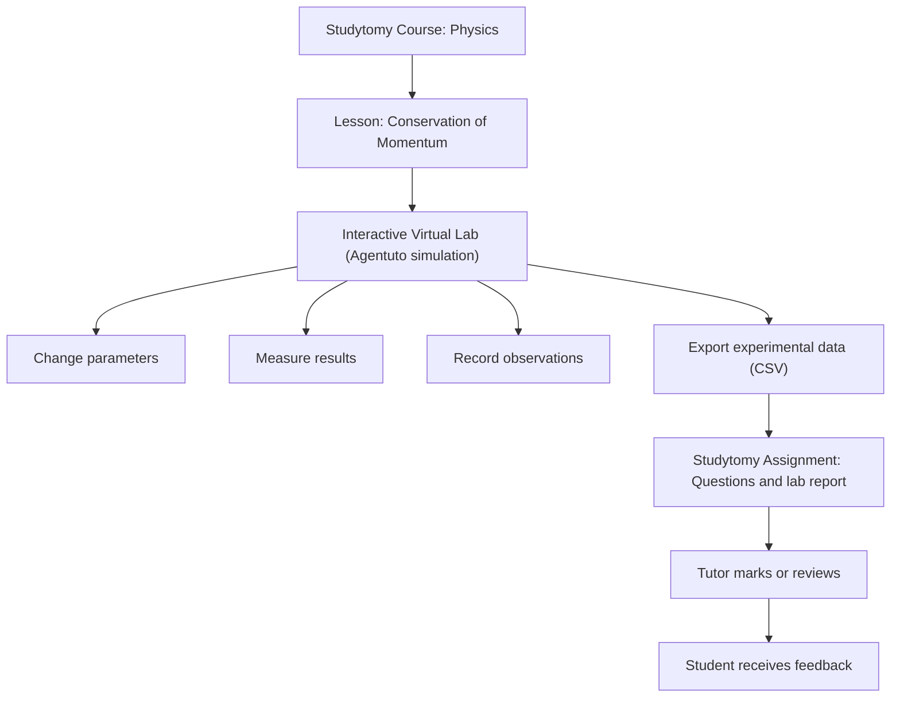
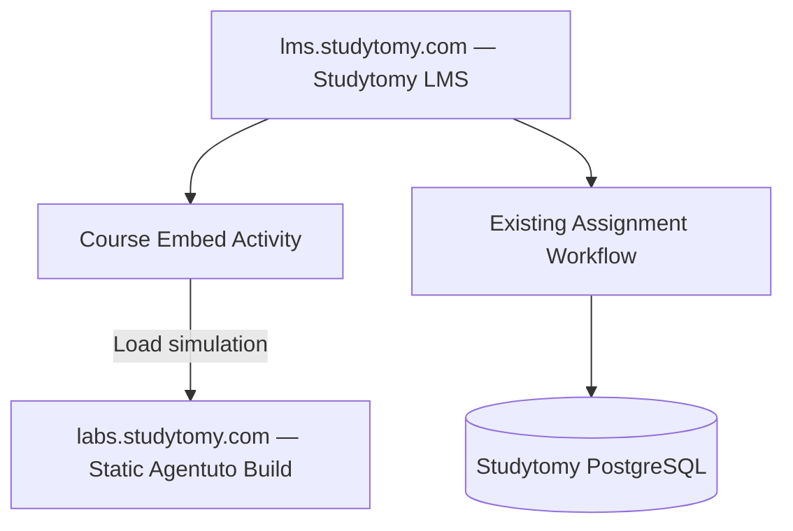
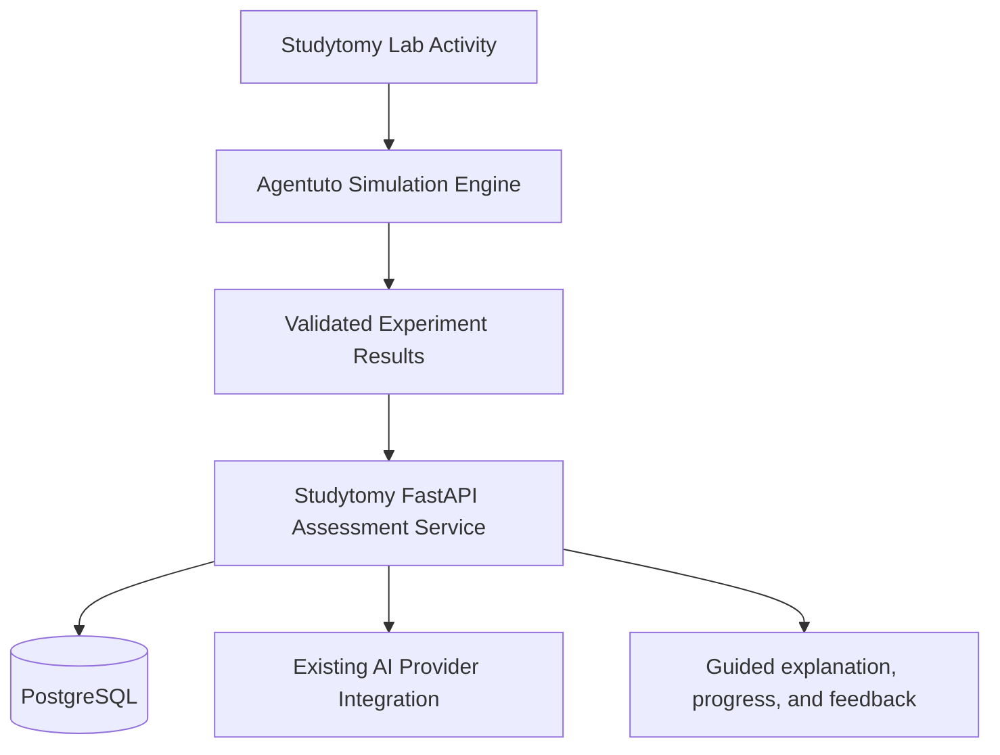

# Studytomy Virtual Science Lab — Agentuto Integration Proposal

**Status**: Proposed (documentation only; not yet implemented or deployed).

## Recommended for integration

Introduce a **Studytomy Virtual Physics Lab** inside the existing LMS (`lms.studytomy.com`), using [Agentuto](https://github.com/danielw-sudo/agentuto) as the simulation foundation.

Rather than installing Agentuto as another LMS or rewriting its simulation engine, Studytomy can reuse its physics simulations inside Studytomy courses, connect experiments to assignments, and later add server-side AI guidance and persistent progress tracking.

### Inspected repository baselines

- **Studytomy Portal**: [`nirzaf/studytomyportal`](https://github.com/nirzaf/studytomyportal/tree/4faea9bafc6190dca7d2daf96a97fbd06a68452d) (`main`, commit `4faea9b`)
- **Agentuto**: [`danielw-sudo/agentuto`](https://github.com/danielw-sudo/agentuto/tree/697025a14aabbd391072fbedc522d1d68bebcbc4) (`main`, commit `697025a`)

---

## 1. Where it fits inside Studytomy

| Studytomy section | Integration idea | Student experience |
|---|---|---|
| **Courses** | Add an interactive laboratory as a learning activity. | Learn a physics concept, then perform the experiment. |
| **Assignments** | Connect the experiment to questions and practical reports. | Record measurements, submit observations, receive a score. |
| **Paths** | Include laboratory-based lessons in structured learning programs. | Complete theory → simulation → assessment. |
| **Library** | Store approved experiment guides, worksheets, and reports. | Access practical instructions and reference materials. |
| **Boards** | Discuss findings with tutors and classmates. | Compare experimental results and explain scientific concepts. |
| **Playgrounds** | Create simpler AI-generated demonstrations to complement labs. | Explore additional interactive concepts. |

Use **Courses** as the primary integration point, rather than moving all of Agentuto into the **Playgrounds** section.

Studytomy already supports external learning content through its [Embed Activity component](apps/web/components/Objects/Activities/Embed/EmbedActivity.tsx), which provides a relatively small initial integration.

---

## 2. What Agentuto already provides

Based on the inspected Agentuto source and documentation:

| Existing capability | Benefit to Studytomy |
|---|---|
| **18 interactive simulation environments** | Reusable practical experiments without writing every engine from scratch |
| **2D Canvas and Three.js 3D simulations** | A mixture of lightweight and visually rich experiments |
| **Adjustable scientific parameters** | Students can change conditions and observe outcomes |
| **Virtual instruments** | Photogate, caliper, oscilloscope, and telemetry readings |
| **Lab notebook and Inquiry Log** | Students record predictions, measurements, and conclusions |
| **CSV data export** | Results can be reviewed or analyzed externally |
| **Optional Socratic AI tutor** | Foundation for contextual questions about experiment readings |
| **Headless TypeScript simulation engines** | Scientific calculations can be tested separately from the UI |
| **MIT license** | Allows modification and commercial reuse, subject to license conditions |

> [!NOTE]
> These capabilities do not mean Agentuto already provides LMS-integrated grading, persistent learner records, guardian dashboards, or curriculum-certified practical assessments.

---

## 3. Example: A Studytomy physics practical

### Proposed learning workflow



### Student journey

1. Learn the theory of momentum and collisions.
2. Open the virtual laboratory from the course.
3. Adjust the objects' masses and starting velocities.
4. Observe elastic and inelastic collision behavior.
5. Record the initial and final momentum values.
6. Submit measurements and explanations through an assignment.
7. Receive teacher feedback or supported objective-question grading.

Agentuto already contains a [conservation-momentum simulation](https://github.com/danielw-sudo/agentuto/tree/697025a14aabbd391072fbedc522d1d68bebcbc4/src/simulations/physics/conservation-momentum). Curriculum mapping and assessment rubrics must still be approved for the selected Australian year level.

---

## 4. The cleanest technical integration

Implement in two stages:

### Stage A — Embed the standalone simulation



Agentuto is a static React/Vite application and does not require its own database.

For the first proof of concept, deploy a pinned, Studytomy-branded Agentuto build to a static host such as `labs.studytomy.com`. In the Studytomy course editor, add an **Embed** activity pointing to a specific simulation, for example:

```text
https://labs.studytomy.com/#/sandbox/conservation-momentum
```

Agentuto's [routing implementation](https://github.com/danielw-sudo/agentuto/blob/697025a14aabbd391072fbedc522d1d68bebcbc4/src/app/routes.ts) already supports these deep links. This approach requires no new backend, database, or Supabase integration.

**Three limitations to test**:
1. The static host must permit iframe embedding from `lms.studytomy.com`.
2. The iframe's sandbox and browser-storage behavior must allow the simulation to function.
3. The existing Embed activity uses a relatively compact frame; a full-screen lab option is preferable for serious experiments.

At this stage, lab data is not automatically saved in Studytomy; students export CSV files and submit them through an existing assignment.

### Stage B — Native Studytomy integration

Once the proof of concept is accepted, extract selected simulation components instead of carrying Agentuto's full application interface. Agentuto separates simulation engines and renderers through its [SimulationEngine and ViewportRenderer interfaces](https://github.com/danielw-sudo/agentuto/blob/697025a14aabbd391072fbedc522d1d68bebcbc4/src/core/types/simulation.ts), providing a practical path to a native Studytomy activity with Studytomy navigation, authentication, and learning records.



Scientific calculations stay in the simulator. The Studytomy FastAPI backend validates submitted evidence, authorizes the student, and controls grading. The AI tutor explains readings and asks follow-up questions; it does not independently determine scientific truth or final marks.

---

## 5. What custom development would be necessary?

| Capability | Current status | Recommended development |
|---|---|---|
| **Physics simulation** | Available in Agentuto | Reuse and validate |
| **Course integration** | Embed capability exists in Studytomy | Configure initially |
| **Measurement export** | Available in Agentuto | Reuse CSV export |
| **Submission workflow** | Available in Studytomy | Use an assignment for the pilot |
| **Automatic completion after experiment** | Not integrated | Add a validated completion workflow later |
| **Persisted experiment history** | Not integrated | Add PostgreSQL records |
| **Experiment-specific automated marking** | Not integrated | Add deterministic scoring rules |
| **Context-aware AI lab assistance** | Agentuto has optional client-side AI | Integrate with Studytomy's protected FastAPI AI services |
| **Tutor experiment review** | Generic assignment review exists | Add experiment-specific review only when needed |
| **Curriculum validation** | Not established for Australian courses | Educator review and reference-case testing |

Studytomy's current [assignment model](apps/api/src/db/courses/assignments.py) supports `CUSTOM` tasks, which store custom JSON submissions without automatically grading them—offering a useful future integration point without creating a separate grading system.

> [!CAUTION]
> **Important security consideration**: Agentuto's optional AI tutor currently stores a user-provided Gemini API key in browser `localStorage` and calls Gemini directly. For Studytomy, disable that standalone key workflow and route AI requests through the authenticated FastAPI backend to avoid distributing institutional AI credentials to students and to enforce usage controls, privacy, and logging. Client-reported scores and measurements must never be accepted as authoritative without server-side validation.

---

## 6. Recommended pilot

### Studytomy Virtual Physics Lab — Pilot 01

| Field | Specification |
|---|---|
| **Subject** | Physics |
| **Topic** | Conservation of Momentum |
| **Simulation** | Agentuto `conservation-momentum` |
| **Integration** | Existing Embed activity |
| **Assessment** | Existing assignment with numerical questions and a lab report |
| **Student output** | Measurements, CSV data, observations, conclusions |
| **Review** | Tutor evaluates submitted work |

**Pilot acceptance criteria**:
- A student can open the laboratory from an authorized course, change parameters, observe scientifically correct outcomes for agreed reference cases, export results, submit an assignment, and receive feedback.
- Test on desktop and mobile, including full-screen use and browsers without WebGL support.
- Verify that external access to the standalone laboratory is acceptable for the pilot (restricting access to a Studytomy lesson does not automatically restrict a publicly hosted static simulation).

---

## 7. Navigation placement & implementation sequence

Do not create another top-level menu immediately. Initially place experiments inside courses:

```text
Courses → Physics → Chapter → Virtual Laboratory
```

Once a validated collection of experiments exists, a dedicated **Virtual Labs** section can be introduced with Physics, Chemistry, and Biology catalogues so experiments can be referenced across multiple courses without duplicating simulation code. *(Note: Agentuto primarily provides physics and mathematics simulations; it does not establish a complete validated chemistry or biology laboratory.)*

### Recommended implementation sequence

| Priority | Deliverable | Complexity |
|---|---|---|
| **P1** | Host a curated Agentuto build and embed one simulation | Low–Medium |
| **P2** | Link the experiment to existing assignments and manual marking | Low |
| **P3** | Introduce authenticated experiment sessions and saved measurements | Medium |
| **P4** | Add validated experiment-specific scoring | Medium–High |
| **P5** | Integrate server-side Socratic AI guidance | Medium |
| **P6** | Expand into a native, searchable Virtual Labs module | Medium–High |

**Recommendation**: Implement **P1** and **P2** as the first proof of concept to deliver a useful student experience while preserving the Studytomy architecture and minimizing changes to the LearnHouse-based codebase.

### Licensing & scope note

Agentuto is MIT-licensed, making commercial integration feasible subject to applicable notices and dependency/asset review. Individual simulations still require scientific and curriculum verification. All proposed changes concern `nirzaf/studytomyportal`; the separate `nirzaf/studytomy-react` public website remains untouched.
