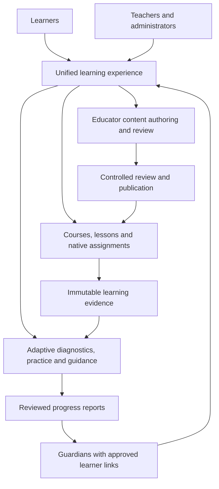
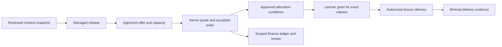

# Studytomy architecture and agent navigation guide

Evidence snapshot: 2026-11-17. Inspected local `main` at `4f3346af99b516bab2d422217905d078096d55ac` and its dirty worktree. Remote `main` was `a11289a01e83c1fcdcbbfc418f7340ffee697e59`; its one additional commit updates only the access inventory. Local adaptive, family and commerce source can differ from published main. Reinspect source and current approvals before relying on this map.

> [!NOTE]
> **Re-verified 2026-11-20 at `ef6b730d`** (dirty worktree: ten in-flight `apps/cli` files plus `POSTGRESQL-19-UPGRADE.md`). The stack map still holds; three things moved. Alembic reports a single head `b7c2e9a4d1f0` (137 revision files). The committed CLI default database image is now `pgvector/pgvector:0.8.7-pg19` (`apps/cli/src/constants.ts:10`), while the local runbook containers still request `pg16`. The web `lint` script no longer masks ESLint's exit code. Line-number links in the tables below remain 2026-11-17 worktree references and have shifted since (for example the Studytomy router mounts begin near `router.py:72`, the native grade finalizer is `assignments.py:4186`, and `search_course_content` is `query_service.py:45`); re-verify before citing one as current. Full sweep numbers: [local verification log](LOCAL-VERIFICATION.md).

## 1. Purpose, provenance and status vocabulary

One educator-led platform connects learner courses, native assignments, adaptive guidance, teacher/admin authoring and authorized guardian reports. It extends LearnHouse Community Edition; the legacy public website is a separate application. This guide expands the three conceptual views in the user-approved **Studytomy-Conceptual-Architecture.pdf** with current technical evidence and explicit implementation boundaries.

- **Implemented (green)**: the named foundation or mechanism exists in inspected source. Some mechanisms are local worktree changes.
- **Partially Implemented (blue)**: core local paths exist, with remaining integration, policy or acceptance work.
- **Planned (purple)**: recommended target behavior without a verified end-to-end implementation.
- **Approval-Gated (amber)**: use or disclosure requires verified decisions and current authority. A gate can have working code.

## 2. Experience and value

Learners explore and practise; educators create, review and manage access; guardians see only purpose-authorized reviewed reports. AI supports educators and never becomes the authority for grades, enrollment, publication or access.

## 3. Verified stack and version sources

Versions below are manifest declarations unless explicitly marked observed runtime. Caret ranges are not assertions of exact installed resolution. Consult `apps/web/bun.lock` and `apps/api/uv.lock` before changing dependencies; manifests contain the complete library inventory.

| Layer | Inspected version/evidence |
|---|---|
| Web | Next.js `^16.4.5`, React/React DOM `19.3.1`, TypeScript `6.0.3`, Tailwind `^4.3.4`; `apps/web/package.json` |
| Web data/editor | TanStack React Query `^5.106.1` (not a replacement framework), Tiptap `3.32.3`, Yjs `^13.6.33`, Hocuspocus provider `^4.8.0`; web manifest |
| Web package manager | `bun@1.4.4` declared by web manifest |
| API | Python `>=3.14.7,<3.14.8`, FastAPI `0.162.0`, Pydantic `2.14.3`, SQLModel `0.0.44`, Uvicorn `0.54.0`; `apps/api/pyproject.toml` |
| Database/migrations | PostgreSQL **16.16 observed locally**; Alembic `1.20.1`, asyncpg `0.32.0`, psycopg2-binary `2.9.13` declared |
| Vector retrieval | PostgreSQL vector extension **0.8.7 observed locally**; Python pgvector `0.5.1`; `Vector(768)` and cosine HNSW |
| AI/source processing | Pydantic AI slim `2.66.0`, google-genai `2.34.0`, pypdf `6.21.4`, tiktoken `0.14.0` |
| MCP | SDK `mcp==2.3.0`; existing native MCP service, not a greenfield server |
| Cache/storage | Redis client `8.1.0`; local dev Redis image `8.6.1-alpine` observed. boto3/botocore `1.43.124`; configured file/object storage. Test Redis versions can differ. |
| Test tooling | pytest `9.2.0`, pytest-asyncio `1.4.1.post1`, pytest-xdist `3.8.0`; Bun tests and Chromium browser tests |

Do not upgrade these versions merely to match this document. Runtime observations describe local containers only, not a production deployment.

## 4. Platform and trust boundaries

[Editable Mermaid](architecture/system.mmd) · [PNG export](architecture/system.png)

The two editable Mermaid files are the diagram sources. Regenerate their SVG and PNG exports with Mermaid CLI 12.2.0 and a local Chromium browser. Use a white background, `--size 1500 --scale 2 --no-font-embed`, and the matching output filename.

Keep one FastAPI business-logic boundary inside LearnHouse. Next.js owns presentation and interactions. MCP and HTTP enter through their existing authentication paths and reuse server services. PostgreSQL owns identities, policies, grants, versioned domain records and immutable events. pgvector supports derived retrieval within PostgreSQL. Protected file storage holds the asset bytes referenced by those records. Redis supports transient coordination and cache state. Existing board collaboration continues through Hocuspocus. Model calls cross a separate trust boundary and require approved context transfer and server validation.

Application services, not browser or MCP arguments, decide authority. The MCP adapter must reuse existing services and native course/assignment contracts. An API token or model response is not permission to publish, change grades or cross organization boundaries. Provider data transfer requires configured authorization and minimization.

### Navigation map

| Concern | Existing repository location |
|---|---|
| Root instructions | `AGENTS.md`; more specific `apps/web/AGENTS.md` applies to web changes |
| UI routes/components | `apps/web/app`, `apps/web/components`, `apps/web/components/Studytomy` |
| API boundary | `apps/api/src/routers`; Studytomy `routers/studytomy` |
| Native learning services | `apps/api/src/services/courses`, native assignment services and their callers |
| Identity and authorization | `apps/api/src/security/auth.py`, `org_auth.py`, `rbac/rbac.py`, `mcp_auth.py` |
| Studytomy domain | `apps/api/src/services/studytomy`, `apps/api/src/db/studytomy` |
| AI planning/assignment drafts | `apps/api/src/services/ai/courseplanning.py`, `assignment_gen.py` |
| RAG | `apps/api/src/services/ai/rag`; `apps/api/src/db/course_embeddings.py` |
| Provider abstraction | `apps/api/src/services/ai/llm`, including `embeddings.py` |
| Existing MCP | `apps/api/src/services/mcp/server.py`, `handlers.py`, `access.py`, `oauth.py`, `approvals.py`, `audit.py` |
| Schema lifecycle | `apps/api/migrations`, `apps/api/src/core/migrations.py` |
| Verification | `apps/api/src/tests/studytomy`, other native/security tests, `apps/web/tests`, `apps/e2e/features/studytomy` |
| Local evidence | `docs/studytomy/ALE-IMPLEMENTATION.md`, `CONTENT-PUBLICATION-PATHS.md`, `IMPLEMENTATION-STATUS.md`, `MIGRATION-AND-ROLLBACK.md` |

Paths establish where to inspect, not completeness. Documents can lag ongoing source edits.

## 5. Existing versus requested grounded authoring

### Existing source evidence

- AI course-planning UI accepts attachments: `apps/web/components/Objects/Modals/Course/Create/AICourse/AICourseCreationModal.tsx`.
- `courseplanning.py` builds attachment context and passes attachments to planning; binary attachment support depends on the model provider.
- PDF document activities extract page-located text through `rag/sources/document.py` and `rag/formats.py`. **pypdf is not OCR**; scanned/unreadable documents must not be reported as successfully grounded.
- `assignment_gen.py` can extract course content for draft tasks but currently can fall back to empty context after extraction errors. Draft output is not automatically saved or reviewed.
- Lesson-body generation in the inspected `courseplanning.py` uses names/descriptions and optional current content. End-to-end original-source retrieval and citations are **not established** by that path.
- `course_embeddings.py` retains organization/course/activity, chunk text/index, source type, locator and content hash. `query_service.py` filters authorized org/course IDs in SQL, uses cosine distance, fetches up to 20 candidates for top five, then applies activity permissions. Fixed overfetch does not guarantee sufficient authorized recall.
- Existing ingestion chunking is 512 tokens with 50 overlap. Embeddings default to 768 dimensions; provider/model configuration can change. Same dimensions alone do not make different embedding spaces compatible.
- Local modifications in RAG access/pipeline exclude managed drafts from legacy AI paths. Preserve this protection; do not remove it merely to make generation work.

### Requested extension: explicitly scoped source-to-draft flow

The following is target behavior queued for implementation; do not treat it as available today.

```mermaid
flowchart LR
  UP[Teacher or admin upload] --> LINK[Explicit org, course and lesson association]
  LINK --> VALID[Validate ownership, file and access]
  VALID --> EX[Extract text or actionable unsupported status]
  EX --> VER[Version source, hash and page locators]
  VER --> IDX[Versioned chunks and embeddings]
  IDX --> RET[Retrieve only authorized linked course and lesson]
  RET --> GEN[Generate editable lesson and quiz drafts]
  GEN --> CITE[Validate exact revision citations and support]
  CITE --> REVIEW[Teacher and required independent review]
  REVIEW --> RELEASE[Controlled publication and learner access]
```

**Scope is strict:** no global source fallback, unrelated course, unrelated lesson or implicit sharing. Recheck current access and revocation before retrieved text reaches a model and before citations are returned. A valid citation identifier is not itself proof that a statement is supported.

Persist immutable source identity/revision/hash, page or time locator, extraction/chunking version and embedding provider/model/dimensions. Use isolated reindex generations and explicit cutover; preserve original evidence. Fail closed for empty extraction, absent authorized retrieval, unsupported input or unavailable required vector capability.

Evaluate exact authorized retrieval as a baseline. Benchmark the existing cosine HNSW against that baseline and consider bounded iterative scanning or PostgreSQL full-text/vector reciprocal-rank fusion only when measured relevance/recall warrants it. Do not add a separate vector database by default. Uploaded text is untrusted data, never system instructions or tool permission.

## 6. MCP reuse and extension boundary

The baseline already has a stateless streamable-HTTP MCP server at `/mcp` in `services/mcp/server.py`, an organization enable/disable control, authentication middleware, resource/prompt support and an approval pipeline. Its own header describes reuse of the same tool registry as the in-app agent. Reinspect actual handlers and role tests before extending it.

The newly requested work is to verify/adapt direct draft course and lesson creation for **authorized teachers as well as administrators**, including source-grounded drafts. This is not evidence that those precise requested flows or role combinations have passed acceptance. Learners must not obtain authoring rights; tenant/course/lesson restrictions and publication controls remain server enforced.

Use audience-bound authentication; never pass arbitrary upstream tokens through. If row-level security is adopted as defense in depth, test with a non-owner/non-BYPASSRLS role. Do not assume owner-role tests demonstrate isolation. Do not expose an unauthenticated server or silently expand persistent credentials.

## 7. Local adaptive learning and reporting design

[Editable Mermaid](architecture/learning-content-lifecycle.mmd) · [PNG export](architecture/learning-content-lifecycle.png)

**Curriculum → Approved Content → Diagnostic → Personalised Teaching → Practice → Assessment → Mastery → Progress Reporting.** Evidence can accumulate during diagnostics, practice and assessment. The server projects mastery from attributable observations, and mastery can inform the next objective or practice selection. Content and evidence retain the version they were issued against. A published report exposes a reviewed projection to a presently authorized recipient.

Existing local `adaptive_*` services cover curriculum/objectives, item sourcing/review, attempts, diagnostics, scoring/mastery, practice/turns, evidence, teaching guidance, reports and retention. `assignment_adapter.py` connects native assignment behavior. These are extensive local changes, not a declaration that every ALE requirement or guardian journey is accepted.

Never let generated output overwrite approved snapshots, final grades or historical evidence. An attempt freezes its issued items and scoring inputs. Server scoring uses those inputs, and incomplete or unsupported managed work requires review before finalization. Native assignment item evidence remains distinct from a reviewed final assessment result. Mastery should consume eligible evidence under the applicable rule version. Reports require current purpose, relationship and exact reviewed version. Withdrawal/revocation and cache clearing must prevent stale disclosure. No real-user activation is implied by synthetic policy records in tests.

### Status and source evidence

Line links refer to the inspected local worktree. References to pending implementation files resolve in that checkout and may be absent from the published branch.

| Capability | Status and code evidence |
|---|---|
| Platform and ingress | **Implemented.** [Mounted Studytomy routers](../../apps/api/src/router.py#L100), [MCP transport](../../apps/api/src/services/mcp/server.py#L191), and [MCP member rights](../../apps/api/src/services/mcp/server.py#L275). Teacher/admin parity for the proposed grounded workflow remains unverified. |
| Curriculum and released content | **Partially Implemented.** Versioned curriculum models (`apps/api/src/db/studytomy/adaptive.py:35`, local worktree), course review (`apps/api/src/services/studytomy/publication.py:275`, local worktree) and release recording (`apps/api/src/services/studytomy/publication.py:191`, local worktree) support local paths. Actual curriculum, rights and publication approvals remain required. |
| Source-grounded authoring | **Planned end-to-end.** [Existing chunk metadata](../../apps/api/src/db/course_embeddings.py#L8) and [course retrieval](../../apps/api/src/services/ai/rag/query_service.py#L42) supply reuse points. Exact lesson-linked retrieval, claim support and frozen citations are target requirements. |
| Diagnostic, tutor and practice | **Partially Implemented.** Diagnostic issuance (`apps/api/src/services/studytomy/adaptive_attempts.py:545`, local worktree), tutor session (`apps/api/src/services/studytomy/adaptive_guidance.py:357`, local worktree) and tutor turns (`apps/api/src/services/studytomy/adaptive_turns.py:234`, local worktree) are local paths. Live-provider quality and full learner journeys remain unverified. |
| Grades, evidence and mastery | **Implemented mechanisms; Partially Implemented lifecycle.** Diagnostic response processing (`apps/api/src/services/studytomy/adaptive_attempts.py:906`, local worktree), native assignment grade journal (`apps/api/src/services/studytomy/assignment_adapter.py:652`, local worktree) and mastery observations (`apps/api/src/services/studytomy/adaptive_mastery.py:74`, local worktree) reflect server ownership. Native grading stays with LearnHouse. |
| Learner and guardian access | **Approval-Gated.** Exact active grants (`apps/api/src/services/studytomy/entitlements.py:88`, local worktree), current guardian scope (`apps/api/src/services/studytomy/authority.py:1113`, local worktree), report publication (`apps/api/src/services/studytomy/adaptive_reports.py:752`, local worktree) and report retrieval (`apps/api/src/services/studytomy/adaptive_reports.py:1047`, local worktree) enforce distinct decisions. Real approvals and dependent guardian acceptance remain unverified. |

### Authoritative records and dependencies

| Boundary | Authority and dependency |
|---|---|
| Content → delivery | A managed release (`apps/api/src/db/studytomy/education.py:78`, local worktree) binds reviewed content. Lesson delivery resolves the learner's current exact release grant before using the snapshot. |
| Assessment → evidence → mastery | Attempt items (`apps/api/src/db/studytomy/adaptive_evidence.py:138`, local worktree) preserve issued context. The [native grade finalizer](../../apps/api/src/services/courses/activities/assignments.py#L3916) and adaptive scorer own grading. Learning evidence (`apps/api/src/db/studytomy/adaptive_evidence.py:238`, local worktree) feeds a separate mastery projection (`apps/api/src/db/studytomy/adaptive_evidence.py:355`, local worktree). |
| Mastery → review → guardian disclosure | The progress report (`apps/api/src/db/studytomy/adaptive_reports.py:19`, local worktree) and recipient record (`apps/api/src/db/studytomy/adaptive_reports.py:92`, local worktree) capture the version and intended disclosure. The read path rechecks current relationship and permitted scope. |

### Architecture decisions

- Retain the modular monolith and native LearnHouse courses, assignments, identity and licensing boundaries. Keep the legacy public website outside the portal.
- Use immutable release, assessment and evidence references for reproducibility. Keep mastery and report drafts as derived, versioned outputs. A tutor suggestion has no write authority over grades or permissions.
- Publish through human review and exact policy scope. Authoring tools may prepare drafts. Guardian report release requires a reviewed version, current relationship and authorized purpose, with withdrawal and access rechecked on reads.
- Reuse PostgreSQL and pgvector for authorized retrieval. Add neither a vector database nor a separate AI backend. Evaluate retrieval quality and missing-source failure without widening access.

## 8. Local content, access and commercial boundaries

Local services include releases, access policy, capacity, collections, receipts and refunds. Managed releases pin reviewed snapshots; grants pin learner/release/access windows. Collection and refund bookkeeping does not itself execute a financial transfer. Named business policies, staff assignment, separation of duties, immutable events, retries and concurrency remain required.

Retained access history may explain dates without exposing expired lesson content. Missing historical delivery events do not prove a grant was unused. Commercial policy decisions must not be invented to unblock implementation.

## 9. Verification and remaining acceptance

Observed Codex checkpoints are bounded reports, not independently rerun certification: 34 PostgreSQL regression cases at fresh schema `425be90c73a1`; separate concurrency checks for allocation and progress retention; mobile browser journeys using real sign-in but intercepted purchase/history/learning responses. Read current evidence files for actual dates, selections, exclusions and subsequent changes. Do not sum overlapping suites into a fictitious overall test count.

- Use disposable loopback PostgreSQL for real locking, constraints, migrations and concurrency. SQLite fast tests cannot prove those properties.
- Preserve the existing development server and other workers. Do not run migrations against the shared database merely because Docker is available.
- Required grounding acceptance: source extraction failure, unsupported scans, exact revision citations, factual support evaluation, cross-course/lesson/tenant denials, revoked links, embedding mismatch and authorized teacher/admin success.
- Required MCP acceptance: authentication/audience handling, least privilege, idempotent retries, ordinary-learner denial, tenant boundaries and preservation of review/publication controls.
- Real-provider quality, scanned-document support, real-endpoint browser journeys and dependent guardian-report acceptance remain unverified unless newer explicit evidence establishes them.

## 10. Rules for the next agent

1. Read root/scoped instructions and current source; record HEAD plus dirty files. Do not reset or restore another worker's changes.
2. Reuse native services and current equivalents; classify work as implemented, partial, missing or unverified.
3. Consult this guide as a dated map, never as permission or proof of completion. Preserve LearnHouse licensing and upstream boundaries.
4. Keep implementation small and dependency-complete; include migration/rollback notes and focused tests. Do not weaken authorization, independent review or immutable evidence to pass tests.
5. Local-only boundaries remain: no CI/CD, push, merge, deployment, production migration or destructive action without separate applicable authorization.

Primary technical references: [pgvector](https://github.com/pgvector/pgvector), [PostgreSQL row security](https://www.postgresql.org/docs/current/ddl-rowsecurity.html), [MCP authorization](https://modelcontextprotocol.io/specification/2025-11-25/basic/authorization). These guide design; repository code and verified results determine actual behavior.
